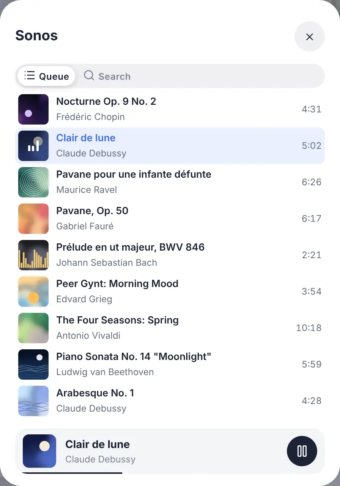
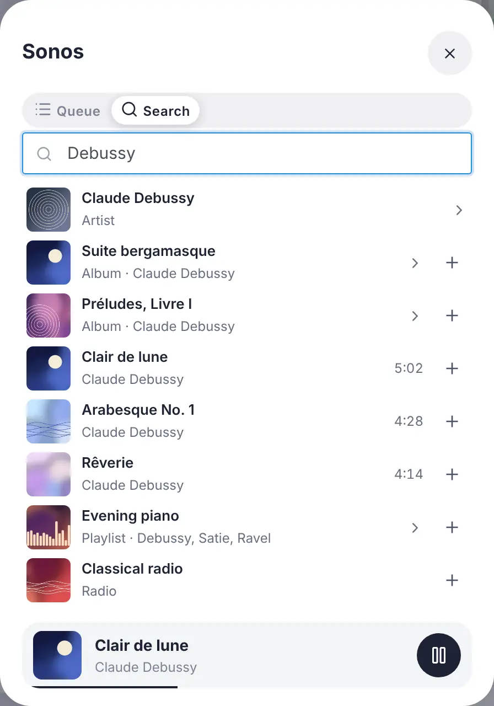
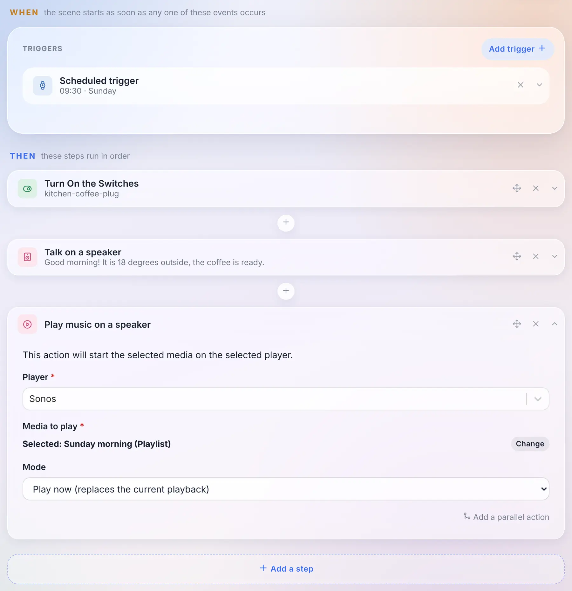
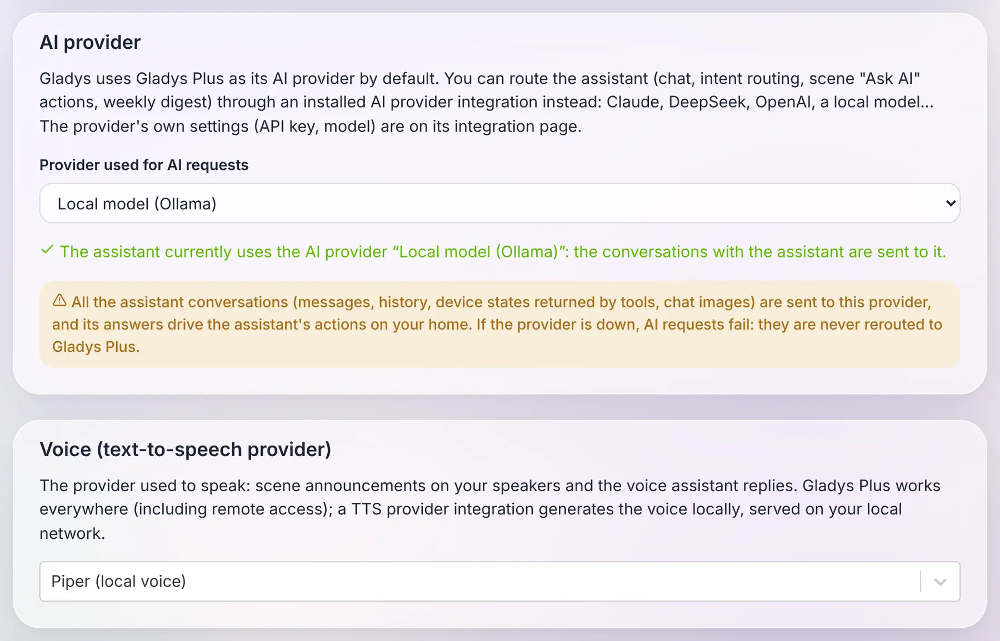
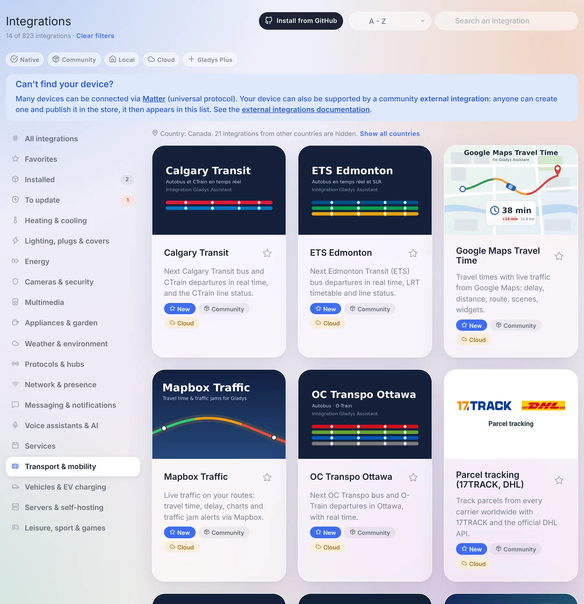
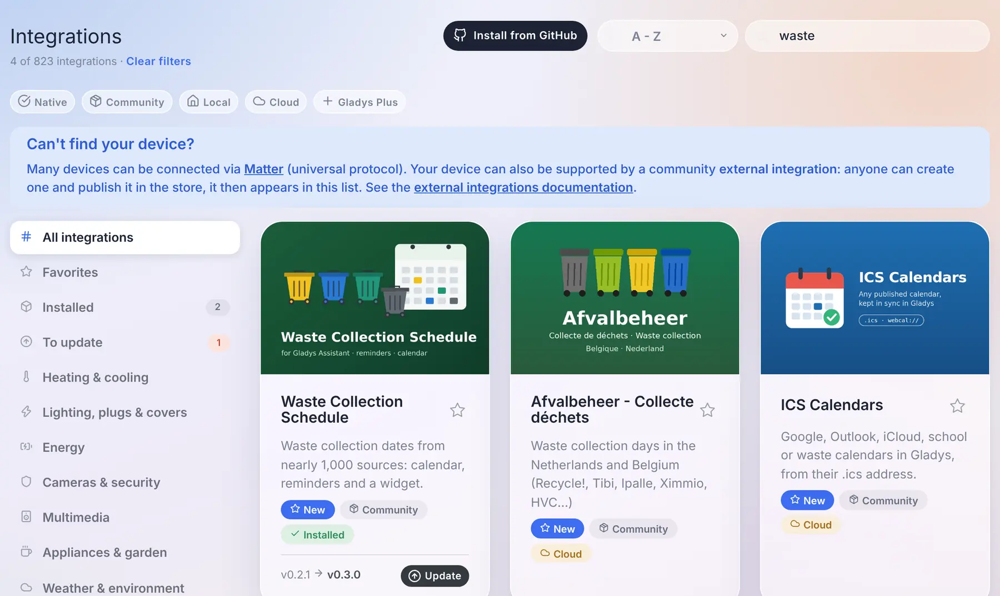

Hey everyone!

New version of Gladys today, 5.3 🎉

Three things in this one. The music widget becomes **a real player**: the artwork, the title, the progress, the queue, and a search to start an album or a playlist. The assistant can now run on **the AI of your choice**, a model running at home included, instead of Gladys Plus. And the **voice** too: scene announcements can be spoken by a local text-to-speech engine.

{/* truncate */}

## A real music player on the dashboard

Until now, the music widget of Gladys was a remote control: the name of the speaker, play, pause, next, and a volume slider. Nothing told you what was playing.

In 5.3, it becomes the player you know from Spotify or Sonos apps: the **artwork** of the album, the **title**, the **artist** and the **album**, a **progress bar** you can drag to seek, shuffle, repeat (all or one), and the volume. A live radio shows a "Live" badge instead of the progress bar.

Two buttons at the end of the volume row open the rest, in a panel that never changes the size of the card:

- **the queue**, with the current track highlighted: a tap jumps to any track;

- **the search and the library**: type an artist, an album, a playlist or a radio, tap to play it, or add it to the queue with the "+" button. An album or a playlist can be opened, or played whole.

A detail that matters: the progress bar is not refreshed every second by the server. The player only reports its position when something happens (a pause, a seek, a new track), and the dashboard computes the rest. A music player costs your database nothing: none of its states is kept in history.

### Start a playlist from a scene

A new **"Play music on a speaker"** action lets a scene start a track, an album, a playlist or a radio. You pick it with the same search as on the dashboard, and choose whether it replaces what is playing or joins the queue (right after the current track, or at the end).

And because the track is now a state of the device like any other, "when the track changes on the kitchen speaker" is just the usual device trigger, on the title.

### Which players?

This new player is fed by **external integrations**: an integration publishes what is playing and serves the artworks, Gladys displays them and never loads an image from the internet in your browser. The store already has integrations for Sonos, Spotify, Jellyfin, Plex, Volumio, MPD, Lyrion or Yamaha MusicCast, which now have everything they need to light up this player: their authors just have to publish the new states.

The built-in Sonos, Google Cast and AirPlay integrations don't change: their widget keeps the same controls, in the new style. And the built-in Sonos integration already has its "Migrate" button towards the community one: your rooms, widgets and scenes follow the device.

## Choose the AI of your assistant

For a few months now, the assistant of Gladys talks with you, controls your home, creates scenes and analyzes your cameras. Behind it, there was always the same AI: the one of Gladys Plus.

In 5.3, it becomes **a choice**. An external integration of the new **"AI provider"** type can answer the assistant in place of Gladys Plus: Claude, Mistral, OpenAI, DeepSeek, or **a model running on your own machine** through Ollama. You choose it on the Artificial Intelligence page of the integrations, and the whole assistant follows: the chat, the "Ask AI" action of scenes, and the weekly home report.

To be clear about what ships today: 5.3 brings the AI and text-to-speech provider types, and the providers themselves will arrive in the catalog as the community publishes them. The screenshot above uses example integrations. And the Ollama integration already in the store is something else: it lets a scene ask a question to a local model, it is not an AI provider for the assistant.

What I find interesting about the way it works: **the whole assistant still runs in your Gladys**. The tools, the context of your home, the conversation history, the actions on your devices: all of this stays local. The only thing that goes to the provider is a standard request, the one every AI on the market understands, and its answer comes back to Gladys, which checks it before acting. An AI integration is therefore a thin adapter, which can plug in any provider.

Three rules I cared about:

- **Gladys Plus stays the default.** Nothing changes for you if you don't touch anything.
- **No silent fallback.** If you chose a local model because you want your conversations to stay at home, and that model is down, Gladys tells you so. It never sends your messages to Gladys Plus behind your back.
- **The assistant without Gladys Plus.** With your own provider, the chat, the scenes and the weekly report work without a Gladys Plus subscription.

One honest warning: an AI provider sees every conversation and its answers drive actions in your home. That's the highest level of trust you can give an integration, and Gladys says so plainly when you select one.

## And the voice too

Same idea for text-to-speech. Until now, when a scene announced "the washing machine is done" on a speaker, the voice came from Gladys Plus.

An integration of the new **"Text-to-speech"** type can now generate that voice, locally with an engine like Piper, or with the cloud service of your choice. You choose it on the same page, and **scene announcements** on your speakers go through it. The audio is generated on your network and stays in memory for a few minutes, the time for the speaker to fetch it.

One limitation, for now: with a local voice, the replies of the voice assistant in the browser are text only. The microphone of a browser requires HTTPS, and a browser refuses to play, inside an HTTPS page, a sound served over HTTP on your local network. Gladys never switches to Gladys Plus behind your back: if you want the assistant to speak in the browser, keep Gladys Plus as the voice.

## A catalog built for a thousand integrations

When version 5 launched at the end of August, the store had about seventy community integrations. Today it has **785**, plus the native ones. The integrations page wasn't designed for that: it downloaded the complete store (22 MB) every 30 minutes, and finding something meant scrolling through everything.

So here is what changes:

- **A catalog that loads fast.** Gladys now downloads a light index of 1.4 MB, and fetches the complete file of an integration, a few kilobytes, only when you open it, install it or update it. While it loads, the page says so, instead of showing the native integrations as if they were the whole catalog. Cards are shown page by page, with a "Show more integrations" button.
- **The search is the first filter.** It reads more than the card: every language of the description, the keywords declared by the author, the author themselves, and the countries. Results are ranked (the names that start with what you typed first), and a search always looks through the whole catalog, whatever the category you are in.
- **The country filter nobody has to set.** Transit networks, electricity suppliers, waste collection, cinemas: a lot of integrations only make sense in one country. Gladys deduces your country from the timezone it is already configured with, and hides the integrations of other countries from the categories. One line says how many are hidden, with a "Show all countries" link, and the search still finds them.
- **Four new categories**: *Transport & mobility*, *Vehicles & EV charging*, *Servers & self-hosting* and *Leisure, sport & games*. "Services" had become a 160-integration catch-all.
- **Small things that count**: an "Installed" badge on the cards, a "Last updated" sort, a count that always compares to the whole catalog ("21 of 823 integrations") with a single "Clear filters" link, and when you come back from an integration page, you're back exactly where you were in the list.

### Update an integration from its card

When a community integration has a new version, its card now shows the installed version, the new one, and an **Update** button. No need to open the integration anymore.

Thanks to [@cicoub13](https://github.com/cicoub13) for this one!

## For integration developers

- **Music players**: a player gains the "now playing" features (`title`, `artist`, `album`, `artwork`, `duration`, `position`, `shuffle`, `repeat`, `mute`, and a writable `playback_state`), and the new `music` manifest field declares what the integration can do on demand: `browse`, `search`, `queue` and `append`. Artworks are served by the integration behind a key, never as a URL. The contract is in [the music spec](https://github.com/GladysAssistant/Gladys/blob/master/docs/specs/external-integrations/capabilities/music.md).
- **AI providers**: the new `ai` type receives OpenAI-compatible chat completion requests and answers with an OpenAI-compatible completion. [The AI provider spec](https://github.com/GladysAssistant/Gladys/blob/master/docs/specs/external-integrations/capabilities/ai-type.md) also explains how to reach a model running on the host, and why its context window must be configured.
- **Text-to-speech providers**: the new `tts` type receives a text and a language, and answers with the audio. [The TTS provider spec](https://github.com/GladysAssistant/Gladys/blob/master/docs/specs/external-integrations/capabilities/tts-type.md).
- **Catalog**: two new optional manifest fields, `keywords` (search-only terms: brands, models, cities served) and `countries` (ISO codes of the countries where the integration is usable, absent means worldwide), and the four new categories `transport`, `vehicles`, `servers` and `leisure`.
- **Polling**: a discovered device that publishes a `poll_frequency` is now polled by Gladys without having to set `should_poll` as well.

The SDK doesn't wrap these new messages yet: until it does, an integration handles them over its WebSocket connection, as described in the specs.

## Fixes

5.2.1 went out the day after 5.2. Here is what it and this release fix:

- **Users**: you can no longer change your own role, and the last administrator of an instance can't lose the role. Until now, an administrator who was the only one could give themselves another role, and nobody could reach the users settings anymore to give it back. An instance already in that situation gets its oldest account back as administrator.
- **Devices**: saving a device no longer rolls back the current value of its features to the one the page had when it was opened. Thanks [@Terdious](https://github.com/Terdious)!
- **Devices**: creating a device while Gladys is writing something else to its database no longer fails with a "database is locked" error.
- **Login**: an email typed with capitals or spaces is accepted, at login and when resetting the password.
- **Batteries**: disabling the low battery warning in the settings really disables it, and the battery and backup failure messages reach every administrator, even when sending to one of them fails. Thanks [@cicoub13](https://github.com/cicoub13)!
- **Energy**: the EDF Tarif Bleu templates, which carry more than ten years of price history, can be selected again: the history outside the validity of your contract is dropped, without changing the costs.
- **Enedis**: meters can be renamed, and a new meter is named after its PDL instead of "Enedis", which tells two meters apart.
- **Zigbee2MQTT**: the serial port of the USB dongle is always the one bound inside the container, whatever its path on the host, which could prevent Zigbee2MQTT from starting.
- **Zigbee2MQTT**: the four buttons of the Philips Hue Tap switch are recognized.
- **Dashboard**: selecting text or dragging a slider in a panel or a modal, then releasing the mouse outside of it, no longer closes it.
- **Devices**: the device lists no longer carry the image of each camera (up to 150 kB each): they load faster, and saving a camera no longer fails because the request is too large.
- **Energy**: a new contract can reuse the name of an existing one, like a renewed Tempo contract. Thanks [@cicoub13](https://github.com/cicoub13)!
- **Settings**: a user who is not an administrator now reaches the settings from the menu, and only sees the tabs they can use. Thanks [@cicoub13](https://github.com/cicoub13)!
- **Scenes**: the summary of a shutter action shows the device and the chosen value, and the editor highlights the selected button. Thanks [@cicoub13](https://github.com/cicoub13)!
- **Widgets**: the buttons of integration widgets keep their icon colors in the Horizon theme. Thanks to Stefan Bauer!
- **HomeKit**: the presets of a radiator stay accurate in the Home app, and a request that fails gets an answer instead of leaving the Home app waiting. Thanks [@Dreamthy](https://github.com/Dreamthy)!
- **Under the hood**: the interface is now built with Vite 8. Thanks [@bertrandda](https://github.com/bertrandda)!

That makes 30 pull requests since version 5.2.

## Thanks to the contributors

Thanks to [@cicoub13](https://github.com/cicoub13) for the update button of the catalog cards, the battery and backup messages, the settings of non-admin users, the shutter actions in scenes and the energy contracts sharing a name, to [@Terdious](https://github.com/Terdious) for the device save fix, to [@Dreamthy](https://github.com/Dreamthy) for the HomeKit radiators, to Stefan Bauer for the widget icons in the Horizon theme, to [@bertrandda](https://github.com/bertrandda) for the upgrade to Vite 8, and to [@William-De71](https://github.com/William-De71) for keeping the tests green when the clocks change. And thanks to everyone who asked for these features and reported bugs on the forum!

See you on [the forum](https://community.gladysassistant.com/) if you want to talk about this release :)

## How to update?

As always, Gladys updates automatically within 24 hours if you use Watchtower, otherwise you can do it in one click from the settings.

The [full CHANGELOG of 5.3.0](https://github.com/GladysAssistant/Gladys/releases/tag/v5.3.0) is on GitHub.
