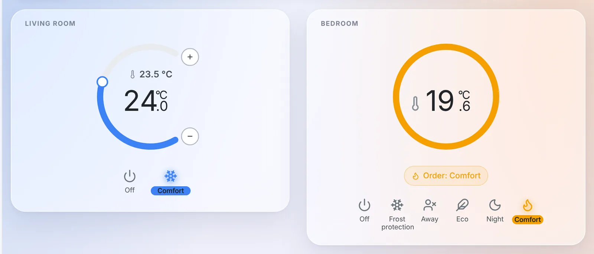
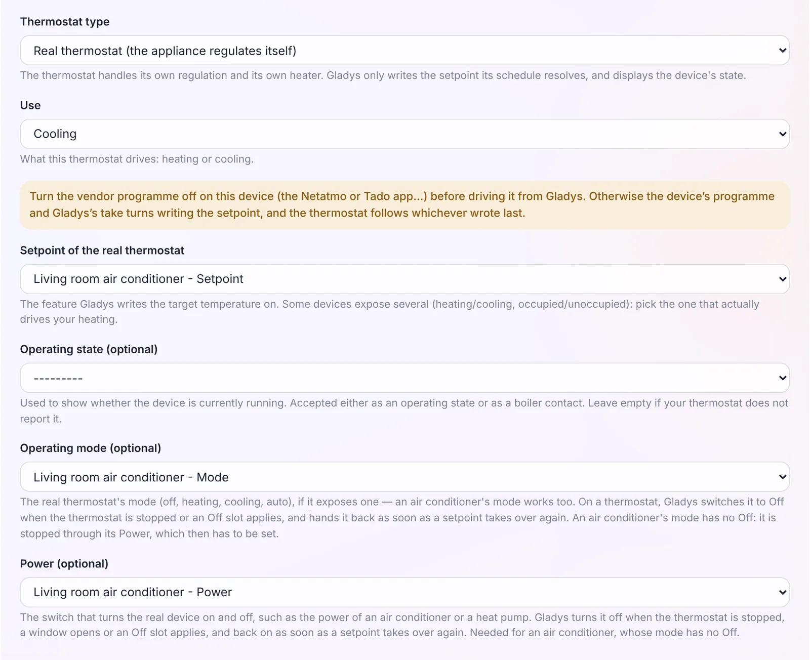
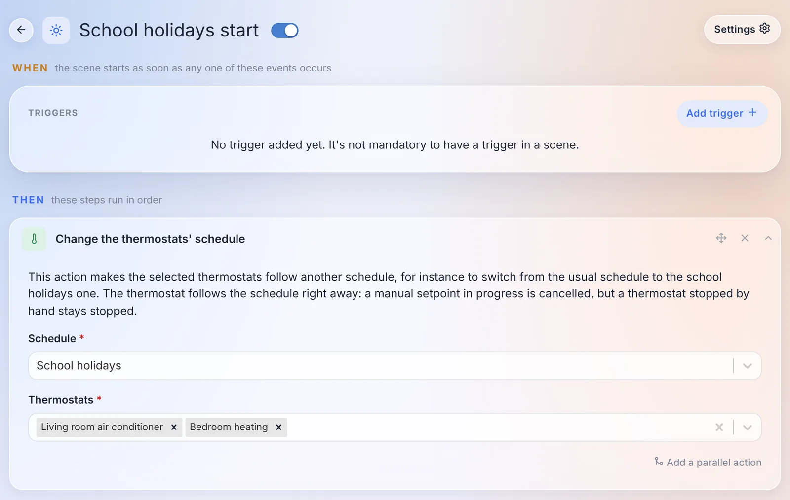
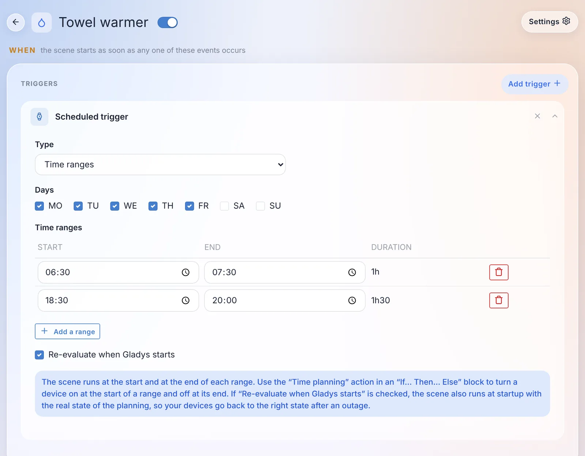

Hey everyone!

New version of Gladys today, 5.3.1 🎉

Don't let the version number fool you: this is not just a bug fix release. The thermostat introduced in 5.2 now drives **air conditioners** and **pilot-wire heaters**, it waits a little before cutting the heating when a window opens, and a scene can switch the whole house to the holiday schedule. Scenes get a **"Time ranges"** trigger. And on the Gladys Plus side, users are managed on a single page, two-factor authentication can be recovered without emailing support, and backups now run every day.

{/* truncate */}

## The thermostat drives air conditioners

In 5.2, Gladys became your thermostat, but for heating only. In 5.3.1, an **air conditioner** or a **heat pump** can be set up as a "Real thermostat (the appliance regulates itself)": Gladys sends it the setpoint and the mode, and the air conditioner does the rest.

An air conditioner has one peculiarity: its mode has no "off" position. So the form has a new **"Power (optional)"** field. Gladys turns this power off when the thermostat is stopped, a window opens or an Off slot applies, and turns it back on when a setpoint takes over again. When you pick the setpoint of an air conditioner, its mode and power are filled in for you, and if the power is missing, the form warns you.

A few details that matter:

- **Presets made for cooling**: Comfort 24 °C, Eco 26 °C, Night 25 °C, Away 28 °C and Frost protection 30 °C, instead of the heating values.
- **The remote control is respected.** If you switch the air conditioner off with its remote, the thermostat stops until the next point of the schedule, instead of turning it back on behind your back.
- **Several temperature sensors**: an "Add a temperature sensor" button lets you pick more than one, and Gladys regulates on their average. A probe that has been silent for more than an hour is left out of the average as long as another one still reports.
- **Several opening sensors**: any open window cuts the heating or the cooling.
- **Lists filtered by room**: in the form, the device lists only offer the devices of the thermostat's room. A "Show the devices of every room" switch widens them, handy for a living room open onto the kitchen.
- **A new "Thermostat Active Preset" state** follows each point of the schedule. A scene can now trigger when the schedule moves, for example, from Comfort to Eco.

## Pilot-wire heaters

If you live in France, there is a good chance your electric heaters have a pilot wire ("fil pilote"). A pilot-wire heater keeps its own thermostat and obeys six orders: off, frost protection, eco, comfort, comfort -1 and comfort -2.

5.3.1 adds a **"Pilot-wire heater (the heater regulates itself)"** thermostat type. You pick the pilot-wire module as the actuator, and the presets table gets an **"Order sent"** column: by default, Frost protection and Away send frost protection, Eco and Night send eco, and Comfort sends comfort. Comfort -1 and comfort -2 are offered too.

The widget of this type (on the right in the screenshot at the top of this article) has no knob: a pilot-wire heater does not take a setpoint in degrees. It shows the room temperature, a ring in the color of the current order, and "Order: Comfort", or "Sending the Comfort order…" until the module has confirmed it.

If you would rather have Gladys regulate from a sensor in the room, that works too: a "Virtual thermostat (Gladys regulates)" now accepts a pilot wire as its actuator. Gladys sends comfort below the setpoint and frost protection above it. In that case, set the heater's own comfort setpoint high enough (24 °C for instance): it obeys Gladys, and that value remains a safety ceiling if Gladys stops.

One piece of advice, which the form reminds you of: turn off the module's own programme first (the Heatzy schedule, the Tuya programme…), otherwise the module and Gladys will take turns overwriting the order. An order changed on the module itself, with its button or the vendor app, is taken as a manual change.

Thanks to [@William-De71](https://github.com/William-De71), who tested all of this on a real Qubino ZMNHJD module!

## An open window no longer cuts off right away

Until now, opening the front door to come in and closing it behind you cut the heating within a second. The thermostat form now has a **"Delay before cutting off"** field under the opening sensor: **60 seconds by default**, up to one hour, and 0 to keep cutting off immediately.

A window closed before the delay runs out cuts nothing, and the "Window open" banner of the widget only shows up once the delay is over.

Heads up, this changes the behavior: thermostats that already have an opening sensor now wait 60 seconds before cutting off. If you want to keep the immediate cut, set the delay to 0.

## The holiday schedule, from a scene

A new scene action, **"Change the thermostats' schedule"**, switches one or more thermostats to another schedule. The typical example: going from the school-term schedule to the school-holidays one, then back.

The thermostat follows the new schedule right away. A manual setpoint in progress is cancelled, but a thermostat stopped by hand stays stopped. The AI assistant also knows this action when it creates a scene for you.

Two small things in the schedule editor and the widget:

- **"All day"**: a box to cover a whole day, instead of typing 00:00 → 23:59 and leaving one minute uncovered. Along the way, several bugs that could make part of a schedule disappear on save were fixed.
- **The gauge animates**: when the setpoint changes, the arc, the knob and the number glide to the new value instead of jumping all at once.

## Time ranges in scenes

Driving a device from a weekly schedule used to take two scenes, one to turn it on and one to turn it off, kept in sync by hand.

The scheduled trigger now has a **"Time ranges"** type: you tick the days, add ranges (a start and an end), and the scene runs at the start and at the end of each range. Ranges that cross midnight are supported (shown as "+1d").

To do everything in a single scene, there is a new **"Time planning"** condition: "We are inside a time range" or "We are outside the time ranges". In an "If… Then… Else" block, "Then" turns the device on at the start of a range, and "Else" turns it off at the end.

And a **"Re-evaluate when Gladys starts"** box runs the scene at start-up with the current state of the planning: after a power cut, your devices go back to the right state.

Thanks [@William-De71](https://github.com/William-De71) for this one too!

## One page for users

If you use Gladys Plus, you managed your users in three places: Settings › Users, the "Plus users" tab, and "Remote users" in the Gladys Plus settings. Everything is now in **Settings › Users**.

Each user has a **"Remote access · Gladys Plus"** section that tells you where they stand: "Invitation sent", "Waiting for your authorization", "Keys changed", "Authorized"… The authorization switch and the key fingerprints to compare are right on their card.

From the Gladys Plus app, an admin can:

- **invite** a user from their card: the account created from the invitation is linked to that user automatically, the invitee has nothing to pick;
- **link** an existing Gladys Plus account to a user, in one click when the email matches;
- **reset a user's two-factor authentication**, confirming with their own code;
- **remove** someone from Gladys Plus, without touching their Gladys user or their data.

And when a user is not accepted by the instance, for example after resetting their Gladys Plus password, they now see a page explaining why and what to do, instead of a one-line error.

## Two-factor authentication, without contacting support

Losing your phone means losing your two-factor app. Until now, you had to email support to get your account reset by hand. There are now several ways out on your own:

- **Change your app**: in Settings › Security, on Gladys Plus, a "Your two-factor app" card lets you move to a new phone. You need the code of the new app and the code of the current one, or a recovery code if you lost it.
- **New recovery codes from your Gladys**: an admin, logged in locally, can generate new codes for a user from Settings › Users by typing their Gladys password again. The old codes stop working.
- **A reset by email** when no Gladys is connected to the account: a link on the login screen sends an email valid for one hour.

The login form also links to [our new two-factor authentication troubleshooting guide](/docs/plus/two-factor-authentication/), which covers the most common causes: a phone clock that is off, an old entry in the app, a new phone.

## Gladys Plus backups every day

Three things were wrong with Gladys Plus backups:

- when a backup failed, every admin got a message on every attempt, so one message per night for as long as the problem lasted;
- on the other hand, some failures were never reported: a Gladys that was off or offline at 2 AM, or restarted during the backup, said nothing;
- and the "more than 24 hours since the last backup" rule, combined with a random start time, meant most instances were in practice backed up every other day.

Now, each instance makes **one backup a day**. A missed night is caught up during the day and when Gladys starts. Admins are warned after **two nights without a successful backup**, then once a week while the problem lasts, and one last time when everything works again. A month of failures means six messages instead of thirty. The backups page also shows a banner when they fail, with the date of the last successful backup and the last error.

## Zigbee2MQTT: renaming a device no longer breaks anything

Renaming a device in the Zigbee2MQTT interface broke its link with Gladys: the device showed up again as new in the discovery page, scenes silently stopped working, and the history was split in two.

Gladys now remembers the IEEE address of each device, its hardware identifier that never changes. When a name no longer matches, the device is found again by its address: scenes, dashboards and history keep working. The name shown in Gladys follows the rename, unless you had customized it. Nothing to do on your side: existing devices get their address at the next start.

Also in Zigbee2MQTT:

- devices whose name contains a "/" (like "living-room/lamp") finally send their states to Gladys;
- the buttons of the Philips Hue Tap Dial switch (RDM002) trigger scenes. Thanks [@cicoub13](https://github.com/cicoub13)!
- devices added before energy monitoring can be updated to get their consumption and cost features. Thanks [@cicoub13](https://github.com/cicoub13)!

## Native integrations replaced by the community

Since version 5, more and more community integrations do better than their native version. These now show a "Soon deprecated" badge in the catalog, and a banner on their page pointing to the replacement:

| Native integration | Replacement                                                                                                                                 | "Migrate" button |
| ------------------ | ------------------------------------------------------------------------------------------------------------------------------------------- | ---------------- |
| Tasmota            | [Gladys-Tasmota](https://github.com/gboulvin/Gladys-Tasmota)                                                                                | yes              |
| Google Cast        | [Gladys-Google-Cast](https://github.com/gboulvin/Gladys-Google-Cast)                                                                        | yes              |
| eWeLink            | [gladys-sonoff-ewelink](https://github.com/William-De71/gladys-sonoff-ewelink)                                                              | yes              |
| Broadlink          | [gladys-broadlink](https://github.com/prohand/gladys-broadlink)                                                                             | yes              |
| Xiaomi             | [gladys-xiaomi-home](https://github.com/callemand/gladys-xiaomi-home) or [gladys-xiaomi-miot](https://github.com/guim31/gladys-xiaomi-miot) | yes              |
| Node-RED           | [Gladys-Node-RED](https://github.com/gboulvin/Gladys-Node-RED)                                                                              | –                |
| CallMeBot          | [gladys-callmebot](https://github.com/GladysAssistant/gladys-callmebot)                                                                     | –                |
| CalDAV             | [gladys-caldav-sync](https://github.com/bertrandda/gladys-caldav-sync)                                                                      | –                |
| Nextcloud Talk     | [gladys-nextcloud-talk](https://github.com/bertrandda/gladys-nextcloud-talk)                                                                | –                |

Nothing breaks today: the native integrations keep working, and both versions live side by side in the catalog during the transition. The "Migrate" button, next to "Delete" on devices already created, moves the history, scenes and dashboards to the device of the new integration. For Tasmota, for example, relays, dimmers, colors, energy readings, temperature and humidity are matched automatically. Thanks [@gboulvin](https://github.com/gboulvin) for the Tasmota migration!

AirPlay stays supported for now: its community counterpart does not cover everything yet.

## And also

- **Voice assistant**: with some noise around you, the end of your sentence was sometimes never detected, and recording went on for 30 seconds. While listening, the button now reads **"Send"**: pressing it sends what you said, instead of throwing it away. Same for dictation in the chat.
- **External integrations**: the devices page shows a battery badge, green, orange or red, for devices that publish their battery level. Thanks [@Terdious](https://github.com/Terdious)!
- **AI assistant**: "what's the humidity in the house?" no longer gets "there is no humidity sensor" because the model only looked at devices without a room.

## Security

- **Changing your password logs out your other sessions.** Until now, a browser logged in with the old password stayed logged in for up to a year. Now, changing your password logs out all your other sessions, and a "forgot password" reset logs them all out. API keys (MCP, webhooks, Open API) are kept, but devices in tablet mode will have to log in again.
- **A revoked session stays revoked after a restart**, and a tablet locked by the alarm no longer gets full access back after an update.
- **The new password is no longer kept in the browser** after changing it from your profile.
- **The MCP server** now creates one server per request: two simultaneous requests can no longer get each other's response.
- And dependencies with known high or critical vulnerabilities were updated.

## Fixes

- **Login**: users whose email was saved before 5.3 with a space or capital letters can log in again. On an instance where this was the only admin, nobody could get in anymore.
- **Forgot password**: the text and the link arrive in a single message. By email, the link alone was often blocked by spam filters.
- **MQTT**: after restoring a backup on a new machine, the embedded MQTT broker is recreated with its credentials, instead of disappearing. And a Mosquitto upgrade no longer empties its list of users.
- **Thermostat**: a hold "until the next point" ends at the right time across a change of the clocks, and moves onto a new point added to the schedule. The banners name the day when it is not today ("until tomorrow 14:00"). On iPad, the flame stays in the middle of the gauge.
- **Matter**: a Matter bulb no longer shows up on two rows (a switch and a brightness) in the devices widget, and light scene actions do turn it on.
- **CalDAV**: recurring events, like a birthday, no longer stop two years after they were imported. Thanks [@bertrandda](https://github.com/bertrandda)!
- **Maps**: the map keeps your zoom and position instead of re-fitting on every location update. Thanks [@cicoub13](https://github.com/cicoub13)!
- **Scenes**: the footer of the editor fits on one line on mobile. Thanks [@cicoub13](https://github.com/cicoub13)!
- **AI quota**: the countdown to the quota reset shows the right number of days (30 days showed "0s"). Thanks [@huangkongsheng](https://github.com/huangkongsheng)!
- **Timezones**: 18 outdated offsets fixed in the timezone list, like Apia (Samoa), now at GMT+13:00 instead of +14:00. Thanks [@yu2971512385-ui](https://github.com/yu2971512385-ui)!
- **Music player**: the volume and progress bars fill up to the end of their track.

That's 45 pull requests since version 5.3.0.

## Thanks to the contributors

A huge thank you to [@William-De71](https://github.com/William-De71), behind most of the thermostat news (air conditioners, pilot wire, opening delay, schedule switching, "All day", gauge animation) and the time ranges in scenes, plus the Matter, iPad and music player fixes. Thanks also to [@cicoub13](https://github.com/cicoub13) for the Hue Tap Dial, the energy of older Zigbee2MQTT devices, the maps and the scene editor on mobile, to [@gboulvin](https://github.com/gboulvin) for the Tasmota migration and the Tasmota, Google Cast and Node-RED community integrations, to [@bertrandda](https://github.com/bertrandda) for CalDAV and Nextcloud Talk, to [@Terdious](https://github.com/Terdious) for the battery badges, to [@huangkongsheng](https://github.com/huangkongsheng) for the AI quota countdown, and to [@yu2971512385-ui](https://github.com/yu2971512385-ui) for the timezones. And thanks to everyone who asked for these features and reported bugs on the forum!

See you on [the forum](https://community.gladysassistant.com/) if you want to talk about this release :)

## How to update?

As always, Gladys updates automatically within 24 hours if you use Watchtower, otherwise you can do it in one click from the settings.

The [full CHANGELOG of 5.3.1](https://github.com/GladysAssistant/Gladys/releases/tag/v5.3.1) is on GitHub.
