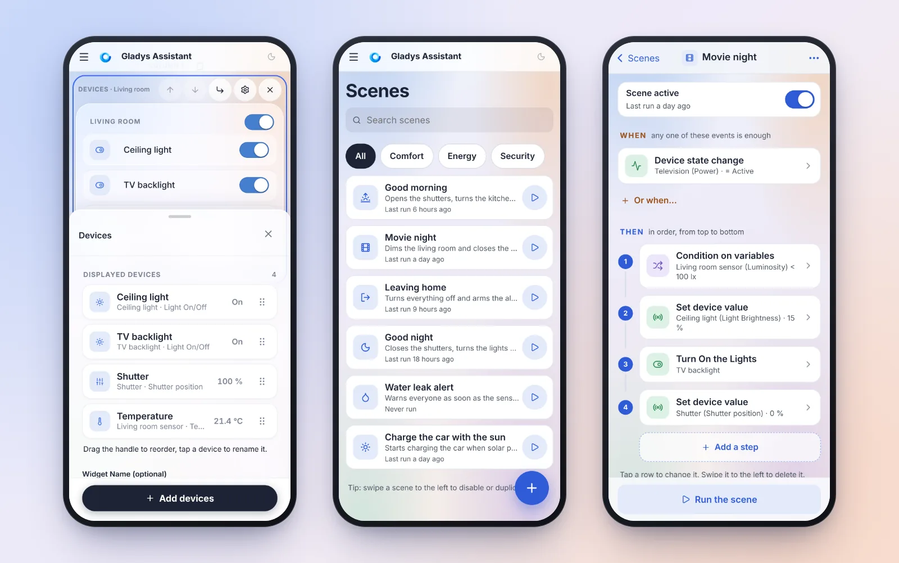
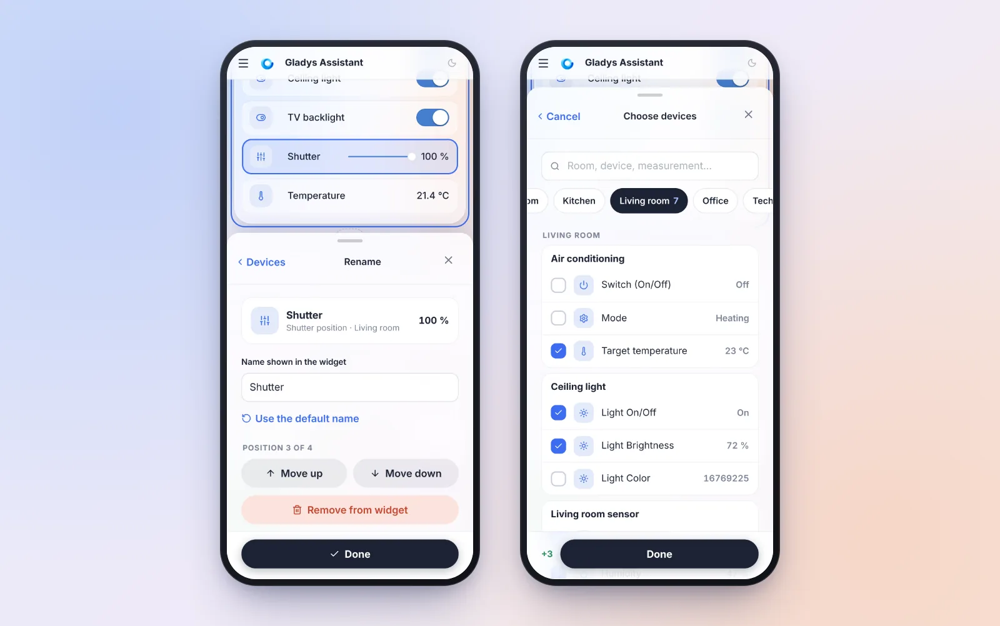
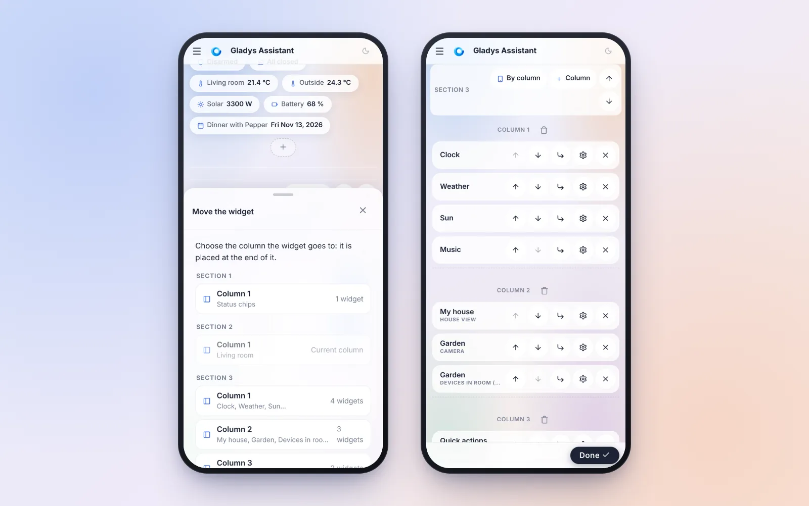
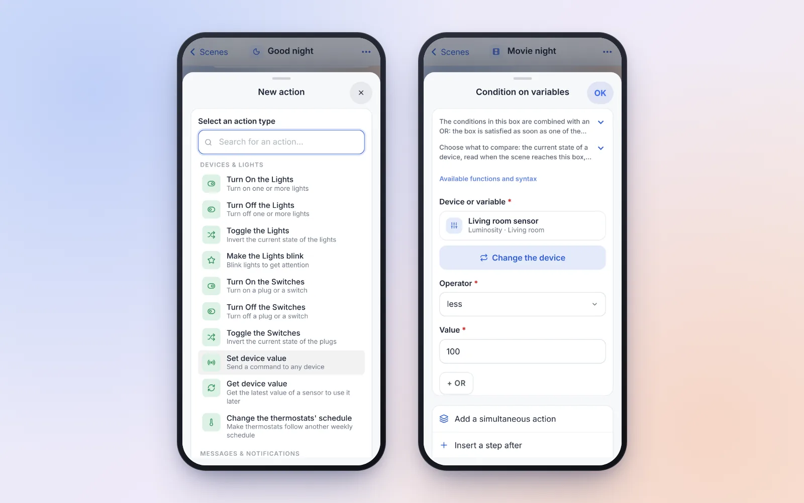
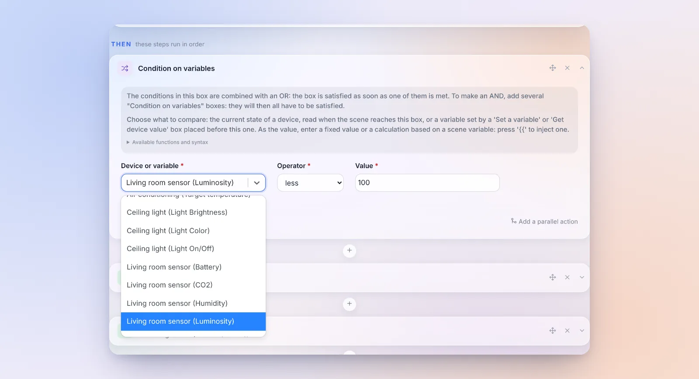
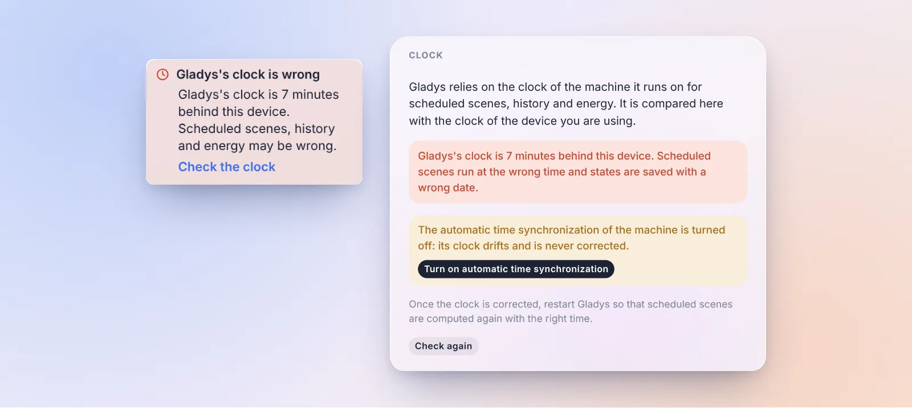
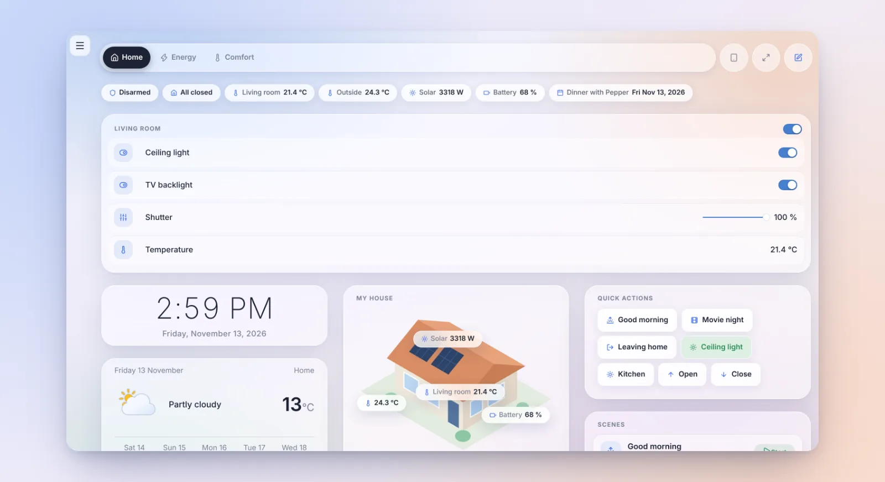

Hey everyone!

New version of Gladys today, 5.3.3 🎉

Once again, don't let the version number fool you. This release is almost entirely about one project: **Gladys on your phone**. Many of you check your dashboard on your smartphone, but as soon as you had to **change** something, a widget or a scene, you were facing a desktop form squeezed onto a small screen. Fields that zoom in by themselves on iPhone, 15-pixel buttons, changes lost on the slightest swipe back…

So we rebuilt dashboard editing and scene editing starting from the phone. On a computer, your habits don't change.

{/* truncate */}

## Edit the dashboard with your thumb

### The "Devices" widget, rebuilt from scratch

This was the hardest form to use on a phone: every device was an always-editable text field (one stray finger, and the keyboard opened), only 4 devices fit on the screen, and you added them one by one from a list of every device in the house, with no icon and no value.

There are now three views:

- **The list**: one row per device, with its icon, its name, its room and its current value. Reorder by dragging the handle, with a preview that follows your finger and automatic scrolling at the edges of the screen.
- **The detail**, when you tap a row: rename the device (or go back to its default name in one tap), move it up, move it down or remove it. The row being edited is **outlined in the widget's preview**, right above.
- **The picker**: a search, room chips, devices grouped by room then by device, with checkboxes and their current value. At the bottom, a summary of the changes ("+3", "−1"): a single confirmation adds and removes.

Removed a device by mistake? An "Undo" bar shows up. And an erased name takes the default name right away, instead of silently keeping the old one.

### The edit panel lets you see the widget

The panel that slides up from the bottom of the screen, shared by every widget, was reworked too:

- it opens **halfway**, so the widget you are editing stays visible above it; the handle expands it to full screen (a tap or a drag), and dragging it down closes it;
- the editor's action bar slides away while it is open, instead of eating its space;
- scrolling the page no longer closes it: it takes a real tap outside;
- every field is 16 pixels, the iPhone no longer zooms in, and the panel rises above the keyboard.

### Move a widget without drag and drop

On a phone, a widget could only move up or down inside its column. Every widget now has a **"Move to…"** button that lists every column of every section: one tap, and the widget lands there, highlighted.

For big rearrangements, the **"Reorganize"** button collapses every widget to its toolbar. On the demo dashboard, the page goes from 8,230 to 3,123 pixels high: getting across the dashboard is now a quick flick.

And a few details that make life easier:

- **Removing a widget no longer asks for confirmation**: an "Undo" message stays for 6 seconds.
- **No more lost changes**: "Cancel", the phone's back button, a link to another page or closing the tab now ask for confirmation when there are unsaved changes.
- **Order on a phone**: on a phone, a section with several columns is shown column after column. A "By column / By row" button in the section header shows it row by row instead: handy for a row of three lights.
- Deleting a dashboard moves to its settings, the bottom bar fits on one line, the editor's help can be dismissed for good, and the widget picker shows the six most used widgets first.

## Scenes, designed for the phone

Below 768 pixels wide, the scene pages now have a real phone layout.

**The scene list**: a search, tag chips, one row per scene with its last run and a button to start it. Swipe a scene to the left to disable or duplicate it. The **+** button only asks for a name, guesses an icon from that name, and opens the editor straight on the trigger picker.

**The editor** reads as a **numbered timeline**: "When", then "Then", with the "If… then… else…" blocks and their branches. While a scene runs, the step being executed is highlighted.

Each trigger, step and condition opens in **a panel that slides up from the bottom of the screen**, with exactly the same form as on a computer, but dressed for a finger: 48-pixel fields, switches instead of checkboxes, the days of the week as seven buttons, the phone's own time and date fields. Picking the type of an action opens in full screen, with the search ready to type. And to pick a device, the room-based picker of the dashboard opens.

The gestures are the ones you expect from an app:

- a panel closes when you drag it down, or with the phone's "back" button;
- swiping a step to the left deletes it, with an "Undo" button;
- a **long press** on a step lets you move it (the "•••" menu also offers "Reorder the steps", with arrows);
- the bottom bar shows "Run the scene", or "● 2 changes · Test · Save" when there are changes.

And on every screen size, computers included:

- **your changes are never silently lost again**: leaving the editor with changes asks for confirmation, and a draft is kept in the browser. If the iPhone kills the app in the background, or a back gesture takes you off the page, Gladys offers to restore it when you come back;
- a save error shows up where you can see it;
- summaries name things ("Ceiling light (Light Brightness) · 15 %") instead of showing identifiers.

## A condition can read the state of a device

It was one of the most common stumbling blocks for a first scene: to test the state of a device in a "Condition on variables" step, you first had to add a "Get device value" step, then compare its variable.

Not anymore: a condition now compares **either a variable or the current state of a device**, read when the scene reaches the condition. For example, "only dim the living room if the luminosity is below 100 lx", in a single step. It works in "If… then… else…" and "As long as… repeat…" blocks too.

On a computer, a single "Device or variable" field offers the variables of the previous steps, then every device of the house grouped by room. On a phone, a "Choose a device" button opens the room-based picker (see the screenshot above).

Two rules worth knowing: a device that has never reported a state verifies no condition, whatever the operator, and a deleted device stops the scene. Existing scenes, which compare a variable, don't change. Thanks to everyone who asked for it [on the forum](https://community.gladysassistant.com/t/6502)!

Two other small things in the scene editor:

- **The "AND" is shown** between the condition boxes of an "If… then… else…" or an "As long as… repeat…" block. Two stacked boxes looked like two alternatives, when both must be true.
- **Typing "{{" opens the list of variables** right away, as the help text says. Before, you had to type a third character.

## Gladys warns you when its clock is off

When the clock of the machine running Gladys is off (time synchronization turned off, dead mini PC battery…), everything that depends on time silently goes wrong: scheduled scenes run at the wrong time, history is saved in the past or the future, energy is counted on the wrong day. And nothing told you why.

Gladys now compares the server's time with the time of the device you are using (your phone or computer is almost always on time). Beyond a 20-second gap, a warning shows up in the menu.

In **Settings › System**, a new **"Clock"** card shows the measured gap and the state of the machine's time synchronization. If it is turned off, the most common cause, a **"Turn on automatic time synchronization"** button turns it back on in one click. Gladys contacts no outside service for this check.

## The side menu collapses on a computer

On a computer, an arrow at the bottom of the side menu, next to the dark mode button, **hides the menu**: the page gets the whole width back, handy for a large dashboard or for maps. A discreet button brings it back, and your choice is kept on that device. Thanks for [the request on the forum](https://community.gladysassistant.com/t/mettre-la-barre-laterale-gauche-en-mode-tiroir/10740)!

## Give us your feedback

We get very little feedback on what works well, or less well, in Gladys. So a **"Give feedback"** link now shows up on the page of every integration and in the profile menu. It opens a new topic on the forum, pre-filled with "What works well" / "What could be improved" and your Gladys version. Gladys sends nothing: you read the message and post it yourself.

Please use it, it really helps us know where to put our efforts!

## Zigbee2MQTT explains why it does not start

The [Zigbee2MQTT audit](https://community.gladysassistant.com/t/zigbee2mqtt-un-audit-pour-devenir-plus-simple-que-home-assistant/11498) continues, after 5.3.2, which already recognized the plugged dongle and preselected its port and model:

- **Startup errors are explained**, with the action to take: a dongle that does not answer (often a model other than the selected one, or a dongle used by other software), a network coordinator out of reach, a configuration refused by Zigbee2MQTT. Before, Gladys showed the last error line of the logs, in English, often unrelated.
- **SONOFF ZBDongle-E with an old firmware start on their own.** Many are still sold with a firmware the `ember` driver refuses. Gladys now switches by itself to the `ezsp` compatibility driver, and the setup page explains how to go back to `ember` after a firmware update.
- The **Tuya SPM02V3** three-phase meter reports all its measures: phase C, the voltage of each phase and the produced energy.

Thanks [@cicoub13](https://github.com/cicoub13) for all of this!

## And also

- **Thermostat**: for a pilot-wire heater regulated by Gladys, the "Force another order than frost protection at rest" option sends **Eco** or **Off** once the setpoint is reached, instead of frost protection. Some towel rails lock their boost under frost protection. And a heat pump switched on from its remote during an "Off" slot is now shown correctly. Thanks [@William-De71](https://github.com/William-De71)!
- **Scenes**: in the "Turn On / Turn Off / Toggle the Switches" actions, each socket of a power strip can be picked and driven, not only the first one. Thanks [@cicoub13](https://github.com/cicoub13)!
- **Matter**: decommissioning a node now asks for confirmation, lists the Gladys devices created from that node and offers to delete them too. Errors are shown instead of being ignored. Thanks [@bertrandda](https://github.com/bertrandda)!
- **Electricity price**: the widget and the price scenes follow the meter's **active** contract. After a tariff change, they kept using the old, expired contract.
- **External integrations**: an update that requires a newer version of Gladys is no longer offered as an update that does nothing. The card says "update Gladys first".
- **House view**: up to 50 pins per widget (instead of 20), and the editor warns you when the limit is reached instead of failing on save.
- **AI weekly digest**: numbers are written in your language and rounded ("111,34 kWh" for a French speaker, instead of "111.34 kWh").

## Fixes

- **Calendar**: a multi-day event that started before the displayed period (school holidays that began the previous month, for example) finally shows up, as does an event crossing midnight on its second day.
- **Scenes**: "Get calendar events" finds full-day events on the right day. "Today" returned tomorrow's.
- **Matter**: bulbs that don't expose their brightness bounds, like the Nanoleaf Essentials, are added without an error.
- **MQTT**: custom topics with several "+" work, and a topic no longer catches the messages of a topic that starts the same way (`livingroom` and `livingroom2`). Thanks [@huangkongsheng](https://github.com/huangkongsheng)!
- **Units**: the kWh/100 km ↔ kWh/100 mi conversions were inverted. Thanks [@huangkongsheng](https://github.com/huangkongsheng)!
- Dependencies with known high or critical vulnerabilities were updated.

That's 26 pull requests since version 5.3.2.

## Thanks to the contributors

A big thank you to [@cicoub13](https://github.com/cicoub13) for the big Zigbee2MQTT work and the power strips in scenes, to [@William-De71](https://github.com/William-De71) for the thermostat, to [@bertrandda](https://github.com/bertrandda) for the Matter decommissioning, and to [@huangkongsheng](https://github.com/huangkongsheng) for the MQTT, units and dates fixes. And thanks to everyone who reported bugs and ideas on the forum!

See you on [the forum](https://community.gladysassistant.com/) if you want to talk about this release :)

## How to update?

As always, Gladys updates automatically within 24 hours if you use Watchtower, otherwise you can do it in one click from the settings.

The [full CHANGELOG of 5.3.3](https://github.com/GladysAssistant/Gladys/releases/tag/v5.3.3) is on GitHub.
