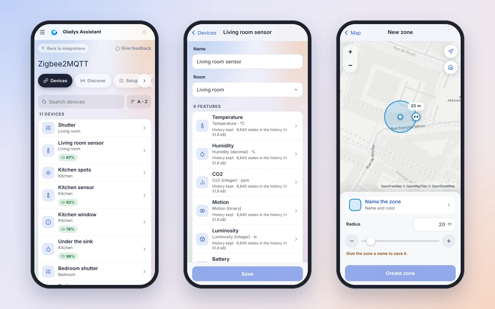
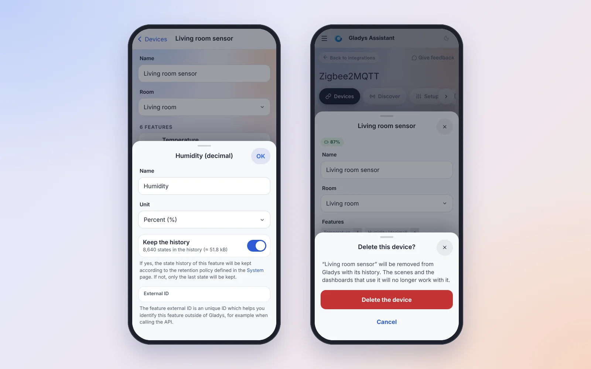
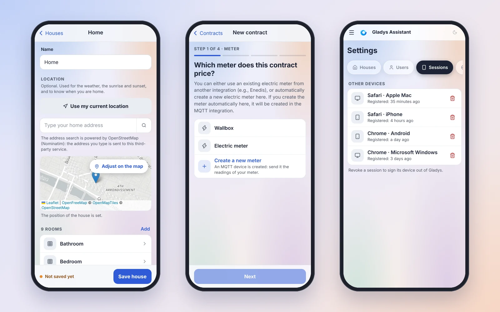
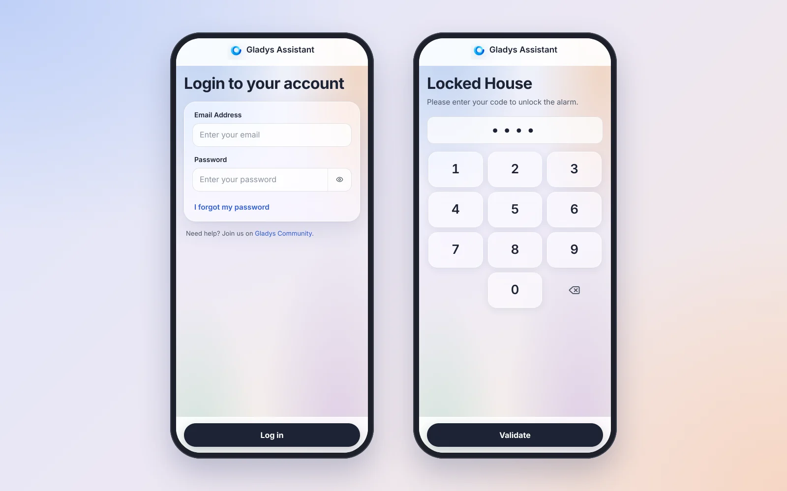
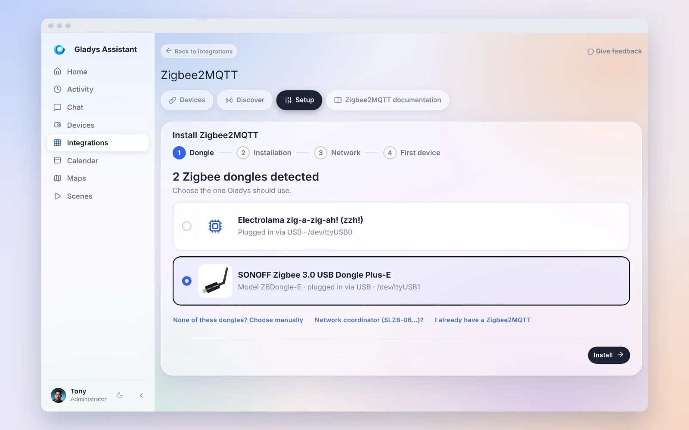
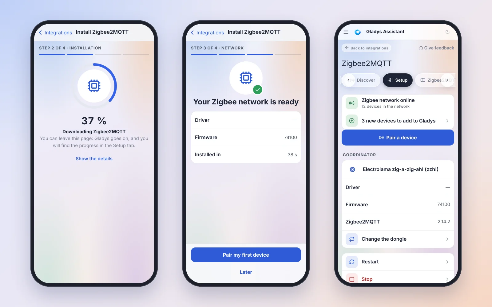
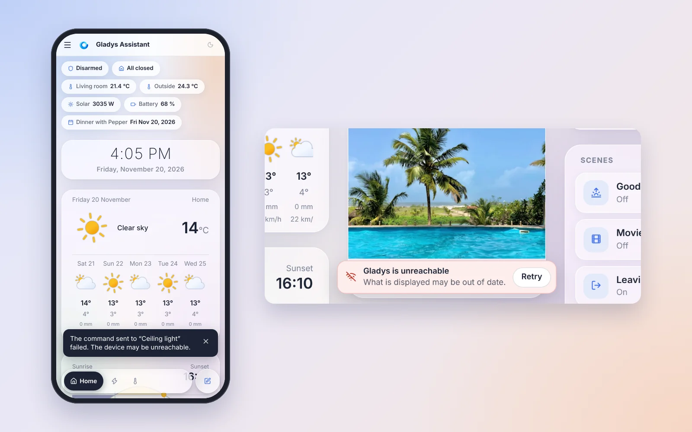
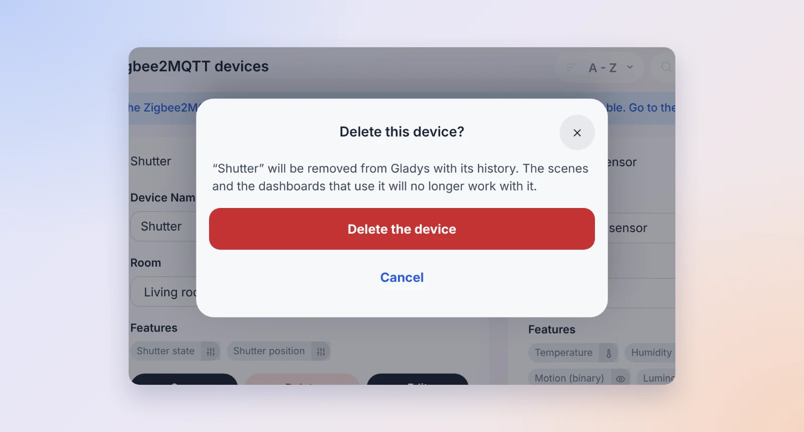
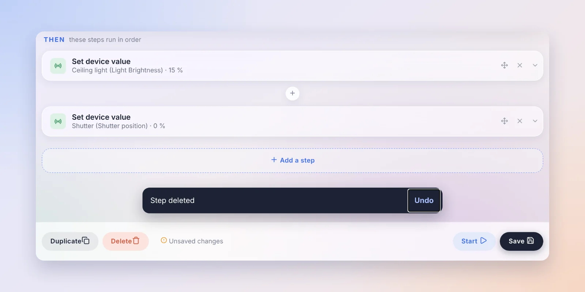

Hey everyone!

New version of Gladys today, 5.3.4 🎉

Last week, 5.3.3 rebuilt the dashboard and the scenes for the phone. This release finishes the job: **the rest of Gladys gets its phone layout**, from the sign-in page to the energy contract wizard, by way of every device page. On a computer, nothing changes.

There is a lot more in it: **Zigbee2MQTT gets a setup wizard and a dashboard**, and Gladys now **tells you when something goes wrong** instead of letting you believe everything worked.

{/* truncate */}

## All of Gladys, on your phone

Below 768 pixels wide (or on a phone held in landscape), the pages follow the same rules as the dashboard and the scenes: targets of at least 44 pixels, 16-pixel fields (the iPhone no longer zooms in), nothing that scrolls sideways, nothing destructive on a single tap, and your changes are never lost silently, the phone's "back" gesture included.

### Devices and their integrations

- **The page of a device**: the name and the room first, then one row per feature, which opens in a panel (name, unit, keep history, external id). Save is in the bottom bar, and a "Saved" message confirms it.
- **The "Devices" and "Discovery" tabs** of Matter, MQTT, Bluetooth, AirPlay, LAN Manager, Enedis, Thermostat, RTSP cameras, Zigbee2MQTT and every external integration: one row per device instead of a stack of desktop cards. Three Matter devices used to be 2,452 pixels of scrolling! A tap opens the device in a panel, with what the card showed.
- **Nothing is deleted on a single tap**: a confirmation names the device and what goes with it.
- **Closing a panel with unsaved changes** asks: "Save and close", "Close without saving" or "Keep editing".
- On the **Discovery** tabs, the scan is the main button of the page and says "Stop the scan" while it runs.
- For **RTSP cameras**, "Test connection" shows the image of the camera right in the panel.

### Houses, settings, energy and zones

- **Houses and rooms**: a room is renamed in a panel, deleted with an "Undo", and added with suggestions of common rooms. "Use my current location" places the house, and the alarm code is typed on a numeric keypad.
- **Settings**: sessions, services, background jobs, backups, system and Open API keys are lists of rows. Revoking a session, restoring a backup, rebooting or shutting down asks for confirmation first.
- **Energy contract wizard**: four steps (meter, template, settings, preview), with off-peak hours picked as time ranges.
- **Map zones**: the map fills the screen. Tap to place the zone, drag the circle to move it, drag the handle on its edge to resize it, with the radius shown live.
- **Onboarding**: the five steps of the first setup are full screen, with a progress bar and a single button at the bottom.

### Sign-in and locked keypad

The sign-in, password recovery and Gladys Plus pages get the right keyboard and autofill on every field, a button to show the password, and errors next to the field they are about.

The **locked keypad** of a wall tablet has big keys sized to the screen, never scrolled, and a two-column layout in landscape. And on Gladys Plus, setting up two-factor authentication **from the phone** now offers "Open my two-factor app" first: no more QR code to scan with the phone that displays it.

## Zigbee2MQTT: a setup wizard and a dashboard

The [Zigbee2MQTT audit](https://community.gladysassistant.com/t/zigbee2mqtt-un-audit-pour-devenir-plus-simple-que-home-assistant/11498) goes on, with its biggest step so far. Thanks [@cicoub13](https://github.com/cicoub13) for this huge piece of work!

### A wizard for the first installation

When nothing is set up, the Zigbee2MQTT page is now a four-step wizard:

1. **The dongle**: Gladys shows the dongle it detected, with its photo and its name. You can also pick a model by hand in a list grouped by brand, use a network coordinator (SLZB-06…), or connect to a Zigbee2MQTT that already runs elsewhere.
2. **The installation**, phase by phase. A failure is explained in plain words, with "Try again" or "Change dongle or model".
3. **Network ready**: the driver, the firmware and how long the installation took.
4. **First device**: joining is allowed for 4 minutes, then the Discovery tab.

### A faster installation, in the background

- **The installation runs in the background**: you can leave the page, the progress is still there when you come back (and in Settings › Tasks).
- **The two images are downloaded in parallel**, and as soon as you pick a dongle, before you even click "Install".
- **The MQTT broker starts once**, ready as soon as it answers: no more fixed waits and double restarts. On a Raspberry Pi 4, the images downloaded in about 15 seconds and Zigbee2MQTT answered 15 seconds after it started.
- **The free disk space is checked** before every download: a clear error instead of a full disk.
- **Updating the Zigbee2MQTT image no longer cuts your Zigbee network** during the download: the new image is downloaded first. Without Internet, the running version keeps running.

### A dashboard for a configured installation

The old setup page is replaced by a dashboard: the state of Zigbee2MQTT with the action to take (devices to add, a failure explained, "Restart"…), the coordinator, and the "Restart", "Stop" and "Advanced settings" buttons. **"Stop" is remembered**: neither a restart of Gladys nor a reboot of the machine starts Zigbee2MQTT again until you click "Start".

### And under the hood

- **The dongle is found again wherever it is plugged**: Gladys stores it by its stable path (`/dev/serial/by-id/…`), not by `/dev/ttyUSB0`, which can change at the next reboot. Existing installations are moved over by themselves.
- **Unplugged then plugged back, the dongle restarts Zigbee2MQTT on its own**, within about ten seconds, without restarting Gladys. A setup with a dongle that is not plugged in is refused before anything is saved.
- **A new device shows its values right away** when you add it to Gladys, instead of staying empty until its next report. Devices on mains are asked for their current values. Thanks to everyone who [reported it on the forum](https://community.gladysassistant.com/t/transfert-zigbee2mqtt-ha-vers-gladys/11582)!
- **New installations generate their own network keys**, like a standalone Zigbee2MQTT, and a lost or corrupted configuration file is restored from the backup Gladys keeps. If you move a coordinator to a new Gladys installation, restore your Gladys Plus backup **before** setting up Zigbee2MQTT to keep your network.

## Gladys tells you when something goes wrong

Until now, when Gladys was restarting, updating or off the network, the app looked alive and was not: values stopped moving, switches seemed to work, and nothing said so.

- **A command that fails is announced**: if the light could not be driven (device unreachable, integration not configured…), a message says so and the switch goes back to the real state. Only the page that sent the command shows the message: the wall tablet stays quiet when the command from your phone fails.
- **"Gladys is unreachable"**: after 4 seconds without a connection, a notice shows up on every page, with a "Retry" button. A dashboard reloads itself once Gladys is back.
- **The live connection reconnects until Gladys is back**. Before, it was retried only once: after an update or a Wi-Fi drop, a wall tablet could stay frozen silently until someone reloaded it.
- **The sign-in page tells failures apart**: wrong credentials, Gladys unreachable, too many attempts or server error. Before, everything was "Wrong email/password.", even a stopped server.
- **Gladys Plus**: the infinite spinner on iPhone, after the app spent time in the background, is fixed ([forum](https://community.gladysassistant.com/t/lag-multitache-ios/11587)).

## Fewer accidental deletions

On a computer, a red "Delete" button sat next to "Save" on every device card: one stray click, and the device was gone with its history.

- **Deleting a device now asks first, in 22 integrations**, with the same confirmation as on the phone.

- **In the scene editor on a computer, a deleted step can be restored** with an "Undo" message, as on the phone.

- **Disconnecting Gladys Plus asks first**, and warns that the backup key is deleted too. Revoking a session asks first.
- **A device with a long history is deleted on its own**: above 5,000 states, Gladys used to purge them in the background and ask you to come back and click "Delete" again. A single background task now purges the history and then deletes the device.

## Wall tablets: tablet mode from a URL

To set up a wall tablet (or ten), a URL is now enough: `/dashboard/<dashboard>?tablet_mode_house=<house>&fullscreen=force` opens the right dashboard, in tablet mode and full screen, without going through the menu. The "Tablet mode" menu shows the ready-to-use URL for the selected house, with a copy button. Handy when a kiosk browser was reset. Thanks [@vincentBesseau](https://github.com/vincentBesseau) ([forum](https://community.gladysassistant.com/t/deployer-le-mode-tablette-plein-ecran-via-une-url-tablet-mode-house/11354))!

## And also

- **AI chat**: messages sent by your scenes are now part of the conversation. If a scene asks "Should I turn the dryer off?", answering "Yes" is understood as an answer to that question ([forum](https://community.gladysassistant.com/t/contexte-de-longlet-discussion/11622)).
- **Calendar**: when you have no calendar, the page explains how to connect one, with links to the calendar integrations installed or to the catalog.
- **Nuki**: the native integration is deprecated in favor of the community [Gladys-Nuki](https://github.com/gboulvin/Gladys-Nuki) integration. A "Migrate" button moves your devices. The native integration keeps running for now.
- **Thermostat**: the dial stays within the range of the thermostat (a Tado X through Matter showed a dial from -100 to 200 °C!), and a manual setpoint on a virtual thermostat is kept within its range. A widget whose thermostat was deleted says so, and preset names stay inside their column in every language. Thanks [@William-De71](https://github.com/William-De71)!
- **Energy consumption widget**: the series are named after their device ("Living room outlet") instead of a long feature name followed by "(1)", "(2)", and the editor shows readable names.
- **Gladys Plus**: the invitation card reminds you to check the Spam folder, and someone who lost both their password and their two-factor app no longer goes round in circles in the recovery flow.

## Fixes

- **Gladys could freeze for minutes, even hours**, after a device was saved while integrations were publishing states. Thanks [@smuteau](https://github.com/smuteau) for the diagnosis and the fix ([forum](https://community.gladysassistant.com/t/nouveau-probleme-de-freeze-de-gladys/11625))!
- **Matter**: a command to an offline device no longer waits forever (it fails after 15 seconds), and the **Stop button of a scene** now ends an execution blocked inside an action ([forum](https://community.gladysassistant.com/t/scene-inarretable/11614)). "Update" on the Matter page keeps the name, the room and the energy settings of the device, and is no longer offered for every device that measures energy.
- **External integrations**: "Update" in the Discovery tab keeps the name you gave the device. Thanks [@smuteau](https://github.com/smuteau)!
- **MQTT**: the "Receive message from MQTT" trigger works with `+` and `#` wildcards, and Home Assistant devices whose "off" payload is `0` or `false` (a presence radar that stayed "detected") report their state correctly. Thanks [@zagg](https://github.com/zagg)!
- **Cameras**: the live stream starts for cameras whose scaled image had an odd height (an 896×512 sub-stream, for example).
- Autocorrection is really off on the email, password and code fields of the phone.

That's 38 pull requests since version 5.3.3.

## Thanks to the contributors

A big thank you to [@cicoub13](https://github.com/cicoub13) for the Zigbee2MQTT wizard, dashboard and installation, to [@William-De71](https://github.com/William-De71) for the thermostat, to [@smuteau](https://github.com/smuteau) for the freeze fix and the external integrations, to [@zagg](https://github.com/zagg) for MQTT, and to [@vincentBesseau](https://github.com/vincentBesseau) for tablet mode from a URL. And thanks to everyone who reported bugs and ideas on the forum!

See you on [the forum](https://community.gladysassistant.com/) if you want to talk about this release :)

## How to update?

As always, Gladys updates automatically within 24 hours if you use Watchtower, otherwise you can do it in one click from the settings.

The [full CHANGELOG of 5.3.4](https://github.com/GladysAssistant/Gladys/releases/tag/v5.3.4) is on GitHub.
