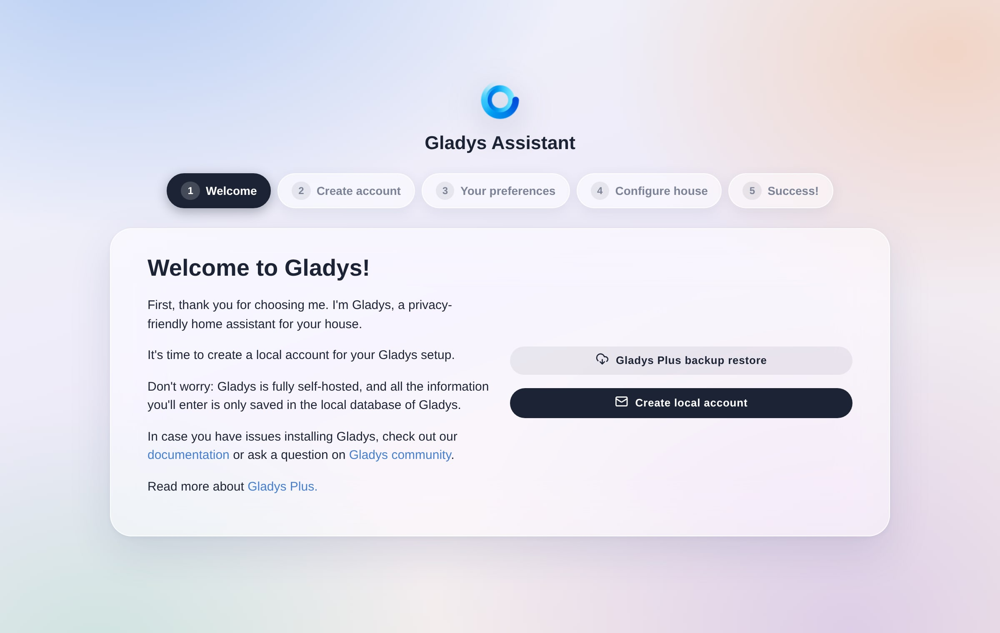

import {
  Roadmap,
  HowItWorks,
  InstallOptions,
  InstallOption,
  IntegrationChips,
  IntegrationsCount,
  Highlights,
} from "@site/src/components/docs/GettingStarted";
import GladysScreenshot from "@site/src/components/horizon/GladysScreenshot";
import JsonLd from "@site/src/components/seo/JsonLd";

**Gladys Assistant is a free and open-source smart home software.** It brings all your devices into one app, controls them from your phone, and automates your home, while running **at home**, not in someone else's cloud.

From zero to your first automation, here is the whole path:

<Roadmap
  label="The steps of this guide"
  steps={[
    { href: "#install", title: "Install Gladys", time: "~30 min" },
    { href: "#create-account", title: "Create your account", time: "2 min" },
    { href: "#connect-devices", title: "Connect your devices", time: "5 min per brand" },
    { href: "#automate", title: "Automate your home", time: "5 min" },
  ]}
/>

<GladysScreenshot lang="en" caption="The dashboard of Gladys: your devices, rooms, cameras and energy, on your computer and your phone." />

## How Gladys works {/* #how-it-works */}

<HowItWorks
  nodes={[
    { title: "Your devices", text: "Lights, sensors, plugs, heating, cameras… from any brand." },
    { title: "Gladys, at home", text: "On a small computer that stays on, like your Internet box." },
    { title: "Your phone & computer", text: "To control everything, from your sofa or from anywhere." },
  ]}
>

Gladys is **self-hosted**: instead of a subscription to a cloud, you install it once on a small computer at home. That is why there is an installation step, and it's what makes Gladys **private** (by default, your data stays at home) and **reliable** (your home keeps working even when the Internet is down).

</HowItWorks>

## Step 1: Install Gladys {/* #install */}

Pick the machine Gladys will run on. **Not sure? Take the mini-PC**: it's what most users run, and what I use at home.

<InstallOptions>
<InstallOption
  featured
  icon="cpu"
  badge="Recommended"
  title="On a mini-PC, with Gladys Assistant OS"
  facts={[["clock", "About 30 minutes"], ["check", "No command line"], ["refresh-cw", "Automatic updates"]]}
  cta="Install Gladys on a mini-PC"
  to="/docs/installation/mini-pc/"
>

Our official installer does all the work: write it to a USB drive, start the mini-PC from it, answer a few questions, and Gladys installs itself. It then keeps itself up to date.

- **A new mini-PC**: small, silent and frugal. I recommend the [Beelink Mini S13](https://www.amazon.com/s?k=Beelink+Mini+S13&tag=gladproj-21), see also our [mini-PC buying guide](/mini-pc-home-automation/).
- **A refurbished mini-PC**: often much cheaper. Look for at least 8 GB of RAM and an SSD.
- **A computer you already own**: an old PC with an Intel or AMD processor that starts in UEFI mode, an SSD of at least 16 GB and an Ethernet port can become your Gladys box (its disk will be erased).

</InstallOption>

<InstallOption
  icon="package"
  title="On a Raspberry Pi"
  facts={[["clock", "30 minutes to 1 hour"], ["check", "No command line"]]}
  cta="Install on a Raspberry Pi"
  to="/docs/installation/raspberry-pi/"
>

Already have a Raspberry Pi 3, 4 or 5? Flash our official 64-bit image with Raspberry Pi Imager: a great way to try Gladys. For everyday use in the long run, a mini-PC remains the better choice.

</InstallOption>

<InstallOption
  icon="server"
  title="On a server or a NAS you already run"
  facts={[["clock", "About 10 minutes with Docker"], ["terminal", "For self-hosting regulars"]]}
>

Gladys installs next to your other services, no new machine to buy:

- [Docker on Debian, Ubuntu or any Linux](/docs/installation/docker/)
- [Proxmox VE](/docs/installation/proxmox/), in a VM installed with Gladys Assistant OS
- [Synology NAS](/docs/installation/synology/)
- [Unraid NAS](/docs/installation/unraid/)

</InstallOption>
</InstallOptions>

## Step 2: Create your account {/* #create-account */}

Once Gladys is running, open it in your browser, from a computer or a phone on the same network:

- **[http://gladysassistant.local](http://gladysassistant.local)**: Gladys announces this name on your network, with Gladys Assistant OS, the Raspberry Pi image, Proxmox or Docker. On a Synology NAS, add the port you chose, for example `http://gladysassistant.local:8420`;
- otherwise (Unraid, some Android phones, guest networks…): the IP address of the machine, for example `http://192.168.1.42`, followed by the port on a NAS.

A short wizard guides you: create the administrator account, choose your preferences (language, units), then name your house and its rooms. It takes two minutes, and everything you enter stays in the local database of Gladys.

Moving from a previous installation? The **Gladys Plus backup restore** button of this screen brings back your whole setup.

## Step 3: Connect your devices {/* #connect-devices */}

In Gladys, open **Integrations** and pick the brand of your devices. Gladys works with <IntegrationsCount lang="en" />+ integrations, the most popular ones built in and the others installable in one click:

<IntegrationChips lang="en" allLabel="All {count}+ integrations" />

Each integration has its own page in this documentation, with the steps to follow.

:::tip[Starting from scratch? Go Zigbee]
If you are buying devices, I recommend **Zigbee**: a USB Zigbee dongle (about $30) plugged into your Gladys box, and the [Zigbee2MQTT integration](/docs/integrations/zigbee2mqtt/), let you use thousands of affordable sensors, plugs, bulbs and remotes, from any brand, with no vendor hub and no cloud. My selection of reliable models is on the [recommended hardware](/docs/installation/recommended-hardware/) page.
:::

Example: equip a living room for about $150

Start with one room, see what you like, then extend room by room.

| Device                                                    | Price  | Link                                                                                                                           |
| --------------------------------------------------------- | ------ | ------------------------------------------------------------------------------------------------------------------------------ |
| Zigbee Temperature/Humidity Sensor with Display           | $19.99 | [Amazon US](https://amzn.to/4i3oRP1)                                                                                           |
| ZigBee Smart Plug 4 Pack with Real-time Energy Monitoring | $16.99 | [Amazon US](https://amzn.to/3CRoBne)                                                                                           |
| IKEA TRÅDFRI E27 Bulb (Ceiling Light)                     | $13.99 | [IKEA US](https://www.ikea.com/us/en/p/tradfri-led-bulb-e26-1100-lumen-smart-wireless-dimmable-white-spectrum-globe-50545678/) |
| IKEA STYRBAR Remote (Brightness)                          | $13.99 | [IKEA US](https://www.ikea.com/us/en/p/styrbar-remote-control-smart-white-80488370/)                                           |
| Zigbee Motion Sensor 4 Pack                               | $75.99 | [Amazon US](https://amzn.to/4k2hb0X)                                                                                           |

## Step 4: Automate your home {/* #automate */}

This is where Gladys shines. Your devices show up on the **dashboard**, which you can [customize](/docs/dashboard/intro/) and share with your family. Then, **scenes** make your home work on its own: a trigger (a time, a sensor, someone coming home…), a few conditions, and actions.

<GladysScreenshot lang="en" shot="scene" alt="A scene in Gladys Assistant" />

A few ideas for a first scene:

<Highlights
  items={[
    { icon: "zap", title: "Light the hallway at night", text: "When motion is detected after sunset, turn the light on for 2 minutes." },
    { icon: "home", title: "Leave home with peace of mind", text: "When the house is empty, turn everything off and arm the alarm." },
    { icon: "thermometer", title: "Heat only when needed", text: "Lower the heating at night and when nobody is home." },
    { icon: "message-square", title: "Be warned right away", text: "Get a message when water leaks or a door opens during your holidays." },
  ]}
/>

👉 [Create your first scene](/docs/scenes/intro/)

To use Gladys like an app, [install it on your phone](/docs/installation/phone/). To control it when you're away, [Gladys Plus](/plus/), our optional service, gives you end-to-end encrypted remote access, with no network setup.

## Frequently asked questions {/* #faq */}

Is Gladys really free?

Yes. Gladys is open source (Apache 2.0 license) and free, with no limit on devices or features. [Gladys Plus](/plus/) is an optional paid service on top of it (remote access, daily backups, Google Home and Alexa, AI); it funds the development of the project.

Do I need to know how to code, or to use a terminal?

No. With Gladys Assistant OS or the Raspberry Pi image, you install Gladys without typing a single command, and everything else is done from the interface of Gladys.

Does Gladys work without Internet?

Yes. Gladys runs locally: your devices, your dashboard and your scenes keep working without Internet. You only need a connection to install Gladys and get updates, and for the integrations of cloud services.

I already use another smart home software, can I switch?

Yes, and Gladys can even run next to it while you move your devices over. Most Zigbee, Matter, Philips Hue or Shelly devices pair with Gladys directly. See how Gladys compares to [Home Assistant](/home-assistant-alternative/) or [Jeedom](/jeedom-alternative/).

<JsonLd
  data={{
    "@context": "https://schema.org",
    "@type": "FAQPage",
    mainEntity: [
      {
        "@type": "Question",
        name: "Is Gladys really free?",
        acceptedAnswer: {
          "@type": "Answer",
          text: "Yes. Gladys is open source (Apache 2.0 license) and free, with no limit on devices or features. Gladys Plus is an optional paid service on top of it (remote access, daily backups, Google Home and Alexa, AI); it funds the development of the project.",
        },
      },
      {
        "@type": "Question",
        name: "Do I need to know how to code, or to use a terminal?",
        acceptedAnswer: {
          "@type": "Answer",
          text: "No. With Gladys Assistant OS or the Raspberry Pi image, you install Gladys without typing a single command, and everything else is done from the interface of Gladys.",
        },
      },
      {
        "@type": "Question",
        name: "Does Gladys work without Internet?",
        acceptedAnswer: {
          "@type": "Answer",
          text: "Yes. Gladys runs locally: your devices, your dashboard and your scenes keep working without Internet. You only need a connection to install Gladys and get updates, and for the integrations of cloud services.",
        },
      },
      {
        "@type": "Question",
        name: "I already use another smart home software, can I switch?",
        acceptedAnswer: {
          "@type": "Answer",
          text: "Yes, and Gladys can even run next to it while you move your devices over. Most Zigbee, Matter, Philips Hue or Shelly devices pair with Gladys directly.",
        },
      },
    ],
  }}
/>

## Need help?

Stuck at any step? Ask on [the forum](https://community.gladysassistant.com/): the community and I answer every day.
