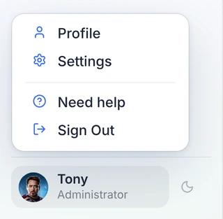
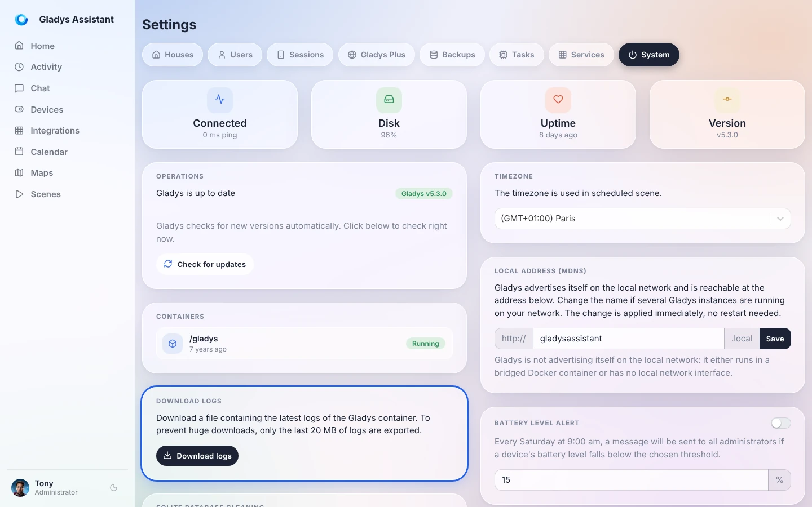
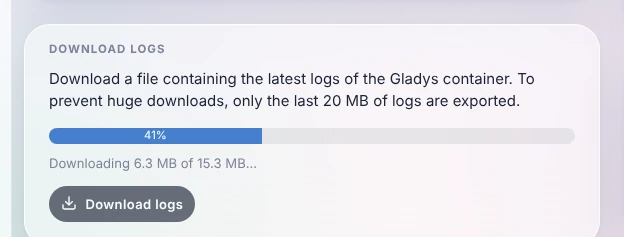

When something does not work as expected (an integration that will not start, a device that stops responding, a scene that does not run), the first thing to look at is the **Gladys logs**. They are also what you will be asked for on [the forum](https://community.gladysassistant.com/) to help you.

You don't need the command line: Gladys lets you download its logs **in one click**, right from the interface.

## Download the logs from the interface

Open Gladys in your browser, click on your name at the bottom left of the menu, then on **Settings**.



Open the **System** tab, then in the **Download logs** card, click on **Download logs**.



Gladys gathers the logs and downloads them in chunks: a progress bar shows how far along it is.



Once it is done, your browser saves a text file named like `gladys-logs-2026-10-26-101203.log`. You can open it with any text editor.

A few things to know:

- Only the **last 20 MB** of logs are exported, to keep the file small. This is more than enough to cover the last hours or days of activity.
- You need to be logged in with an **administrator** account.
- It also works **remotely through [Gladys Plus](/docs/plus/intro)**: no need to be at home to grab the logs.
- This button is available since Gladys Assistant v4.77. If you don't see it, [update Gladys](/docs/installation/faq).

## Share the logs on the forum

To get help, [create a topic on the forum](https://community.gladysassistant.com/) explaining your problem, and attach the log file (or paste the relevant lines in a code block).

Before posting, take a quick look at the file: logs can contain the names of your devices, local IP addresses or URLs of your services. Remove anything you don't want to share publicly.

## Read the logs from the command line

If the Gladys interface does not open at all, you can still read the logs from the machine running Gladys. Connect to it (with SSH for example) and run:

```bash
sudo docker logs gladys --tail=1000
```

This displays the last 1000 lines. To follow the logs live while you reproduce the problem, add `-f`:

```bash
sudo docker logs gladys --tail=100 -f
```

Press `Ctrl+C` to stop.

## Frequently asked questions

### Where are the Gladys logs stored?

Gladys runs in a Docker container, and writes its logs to the standard output of that container: Docker stores them on the host. That is why you read them through the interface or with `docker logs`, and not in a file of the `/var/lib/gladysassistant` folder.

### The download fails with "Unable to download the logs"

Gladys reads its logs through Docker. Check that Gladys runs in Docker and that the Docker socket is shared with the container (the `-v /var/run/docker.sock:/var/run/docker.sock` option of the [installation command](/docs/installation/docker)). If the problem persists, read the logs [from the command line](#read-the-logs-from-the-command-line).

### How do I see the logs of a community integration?

Each external integration runs in its own container and has its own logs: open the integration in Gladys and go to its **Logs** tab.
