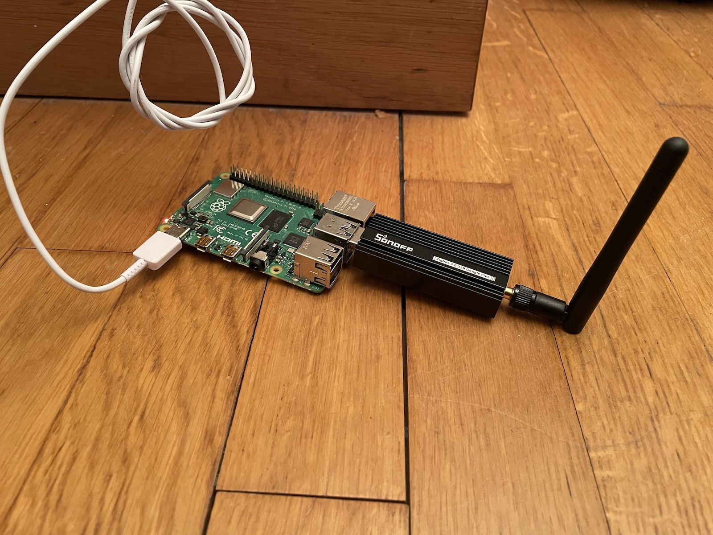
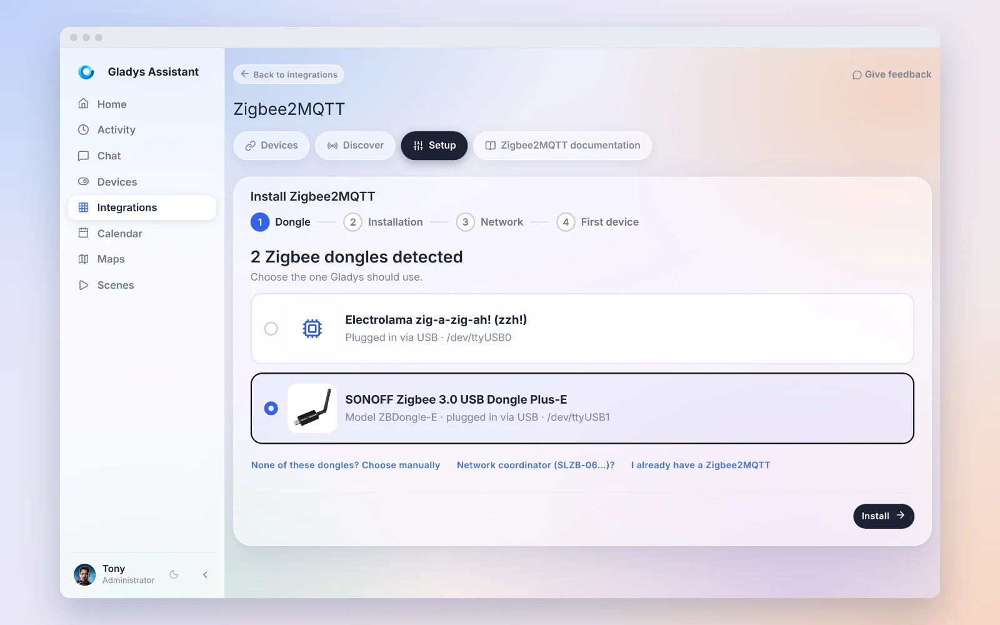
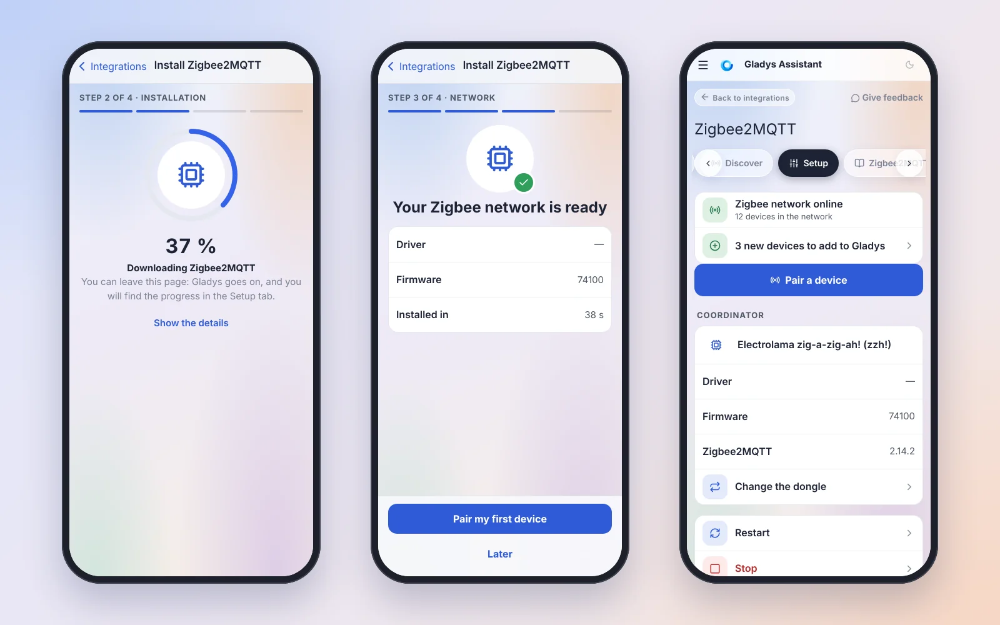
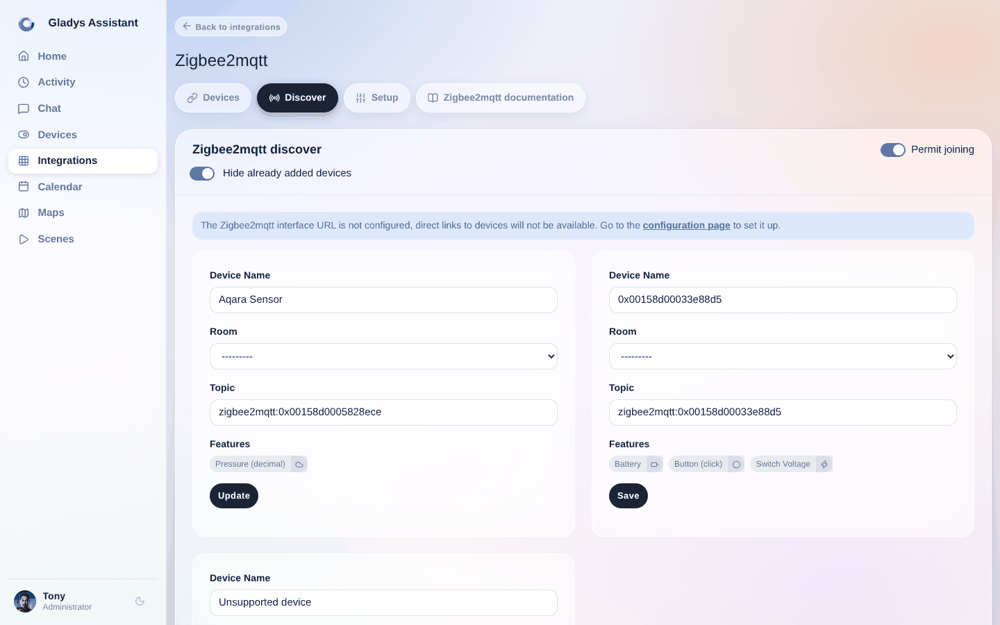
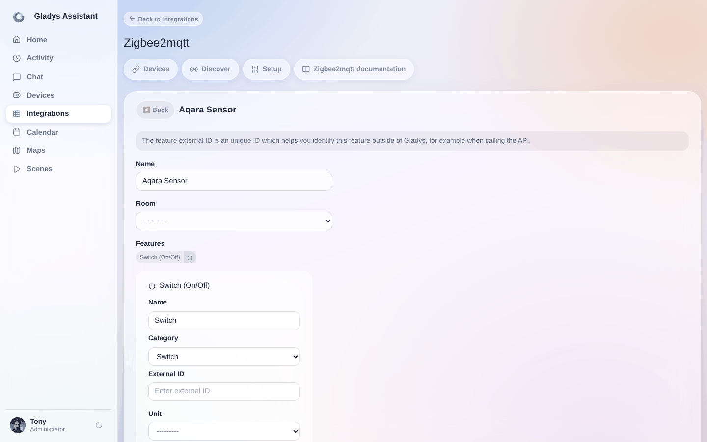

import JsonLd from '@site/src/components/seo/JsonLd';

Zigbee2MQTT lets you run your own **local Zigbee hub** with Gladys: you plug a USB Zigbee dongle into the machine running Gladys, and you control every Zigbee device directly from your home, with no cloud account and no vendor bridge. This tutorial shows you how to set it up, pair your dongle, and add devices.

:::tip[Coming from Home Assistant?]
Gladys installs and manages Zigbee2MQTT and its MQTT broker for you: see [Zigbee2MQTT without Home Assistant](/zigbee2mqtt-without-home-assistant/). Still choosing a dongle? Read the [Zigbee dongle buyer's guide](/best-zigbee-dongle/).
:::

In short, we'll connect your Zigbee devices directly to Gladys, without needing any third-party bridges (just by using a USB Zigbee dongle and the [Zigbee2Mqtt](https://www.zigbee2mqtt.io/) project).

You can check the list of compatible devices [here](https://www.zigbee2mqtt.io/supported-devices/).

Before you start, make sure you have a Zigbee coordinator: a USB dongle plugged into the machine running Gladys, or a network coordinator (see [Use a network coordinator](#use-a-network-coordinator) below). If Zigbee2MQTT already runs elsewhere, Gladys can also [connect to it](#connect-to-an-existing-zigbee2mqtt).

An easy & affordable USB dongle we tested with Gladys is the [Sonoff Zigbee 3.0 USB dongle](https://amzn.to/3JZwzJy).

The full list of compatible adapters can be found on [Zigbee2mqtt supported adapters list](https://www.zigbee2mqtt.io/guide/adapters/).

## Install Zigbee2MQTT with the setup wizard

Since Gladys 5.3.4, a four-step wizard guides you through the first installation. Gladys installs two containers for you, an MQTT broker and Zigbee2MQTT: there is nothing to type in a terminal. For this, Gladys must run in Docker with the `host` network, which is the case of every standard installation.

Plug your Zigbee dongle into the machine running Gladys (your Raspberry Pi, your mini-PC, your NAS).



In Gladys, go to `Integrations / Zigbee2Mqtt`, then open the `Setup` tab.



### Step 1: the dongle

Gladys recognizes the most common dongles (SONOFF ZBDongle-P and ZBDongle-E, Home Assistant Connect ZBT-1 and ZBT-2, ConBee II and III, SMLIGHT SLZB-06M and SLZB-07…). What the wizard shows depends on what is plugged in:

- **Zigbee dongle detected**: Gladys shows your dongle, with its photo and its name. You have nothing to choose.
- **2 Zigbee dongles detected** (or more): choose the one Gladys should use.
- **Gladys did not recognize your dongle**: choose its model in the list, grouped by brand. The search box finds a model by its name or its code (`dongle-e`, `sonoff p`, `conbee`, `skyconnect`…). The model is written on the dongle or on its box: it sets the driver Zigbee2MQTT uses to talk to it.
- **Plug in your Zigbee dongle**: no dongle is plugged in yet. Gladys detects it as soon as you plug it in, without reloading the page.

Links below lead to the other choices (on a phone, they are grouped under **Another dongle or another setup**):

- **Not the right dongle? Choose manually** (or **My dongle is plugged in but does not show up**): choose the port and the model by hand. The serial ports of the machine itself and of the GPIO HATs (like the RaspBee) are hidden: click on **Show the other serial ports (HAT/GPIO board, ports of the machine)** to see them.
- **Network coordinator (SLZB-06…)?**: see [Use a network coordinator](#use-a-network-coordinator).
- **I already have a Zigbee2MQTT**: see [Connect to an existing Zigbee2MQTT](#connect-to-an-existing-zigbee2mqtt).

Then click on **Install**. Gladys checks that the dongle is plugged in before saving anything. It even starts downloading Zigbee2MQTT as soon as a dongle is selected, before you click: the installation is all the faster.

:::tip
Plug the dongle at the end of a USB extension cable, away from USB 3 ports and from the Wi-Fi router: the Zigbee signal will only be better.
:::

:::info[EmberZNet dongle with an old firmware]
Many [EmberZNet](https://www.zigbee2mqtt.io/guide/adapters/emberznet.html) based dongles (like the Sonoff Zigbee 3.0 ZBDongle-E) are still sold with a firmware older than 7.4, which the `ember` driver of Zigbee2MQTT refuses. Since Gladys 5.3.3, you have nothing to do: Gladys detects it, switches your dongle to its `(legacy ezsp)` model and installs Zigbee2MQTT again with the `ezsp` compatibility driver. The installation shows **Old firmware: switching to ezsp…**, then the driver shows as `ezsp (compatibility)` once the network is ready, and on the dashboard.

The `ezsp` driver is deprecated, so we still recommend to [update the firmware of your dongle](https://www.zigbee2mqtt.io/guide/adapters/emberznet.html#firmware-flashing). Then, with the **Change** button of the dashboard, choose the model without `(legacy ezsp)` (or the `ember` type for a network coordinator) to go back to the `ember` driver.
:::

:::warning
If you run Gladys on an external disk connected in USB, you may have power issues as your Pi can struggle to give enough power to both the disk and the Zigbee USB key.

We recommend you use a externaly powered USB charging tower.

You can read more about it on ZigbeeMQTT website: [Zigbee2MQTT fails to start](https://www.zigbee2mqtt.io/guide/installation/20_zigbee2mqtt-fails-to-start.html)
:::

### Step 2: the installation

Gladys shows the progress, phase by phase: downloading Zigbee2MQTT and the MQTT broker (both at the same time, and only if they are not on the machine yet), starting the broker, starting Zigbee2MQTT, then the connection to the dongle. On a Raspberry Pi 4, the images downloaded in about 15 seconds in our tests, and Zigbee2MQTT answered 15 seconds after it started.

You can leave the page: the installation goes on in the background. You will find its progress in the `Setup` tab, and in **Settings > Tasks**.

Before each download, Gladys checks the free disk space, keeping 500 MB for the rest of Gladys: if there is not enough, it tells you so instead of filling the disk.

If the installation fails, Gladys explains why in a short title and a message, with the **Technical details** below. Click on **Try again**, or on **Change dongle or model**. The [troubleshooting section](#troubleshooting-common-zigbee2mqtt-errors) details each message.

If you close the page or restart Gladys before the end of a first installation, the wizard opens again where you left it, until Zigbee2MQTT has answered once.

### Step 3: the network is ready

**Your Zigbee network is ready**: Gladys shows the driver, the firmware of the coordinator and how long the installation took. Click on **Pair my first device**, or on **Later**.

### Step 4: the first device

Click on **Permit joining**: Gladys allows new devices to join the network for 4 minutes. Bring the device within 2 meters of the dongle and put it in pairing mode: often a long press (5 s) on its button; for a bulb, switch it on and off 5 to 6 times in a row. Then click on **Go to Discover** to add it to Gladys (see [Add devices](#add-devices)).

:::note[Gladys cannot install Zigbee2MQTT on this machine?]
If Gladys does not run in Docker, or if its container was not started with the `host` network, the wizard says so and links to the [installation command of Gladys](/docs/installation/docker/). You can still connect Gladys to a [Zigbee2MQTT that runs elsewhere](#connect-to-an-existing-zigbee2mqtt).
:::

## Use a network coordinator

Since Gladys 5, the coordinator doesn't have to be plugged into the machine running Gladys. A network coordinator (SMLIGHT SLZB-06/SLZB-07, ZigStar…) connects over Ethernet or Wi-Fi, so you can place it in the middle of your home, away from your server and from interference. Gladys still installs and manages Zigbee2MQTT for you.

In step 1 of the wizard, click on **Network coordinator (SLZB-06…)?**, then:

1. Enter the **Coordinator address**, shown in its web interface, with its TCP port: for example `tcp://192.168.1.20:6638` (the `tcp://` prefix is optional). Give the coordinator a fixed IP address on your router.
2. Choose the **Coordinator type**: **Silicon Labs chip** (SLZB-06M, SLZB-07…, `ember` driver), **Texas Instruments chip** (SLZB-06, SLZB-06P7…, `zstack` driver) or **dresden elektronik** (`deconz` driver). When in doubt, the documentation of your coordinator gives it.
3. Click on **Install**, then follow steps 2 to 4 as with a USB dongle.

## Connect to an existing Zigbee2MQTT

Zigbee2MQTT already runs elsewhere (Home Assistant, another machine…)? Gladys can connect to its MQTT broker, without installing anything. In step 1 of the wizard, click on **I already have a Zigbee2MQTT**, then enter:

- the **MQTT broker address**, for example `mqtt://192.168.1.30:1883`;
- the **User** and the **Password** of the broker;
- the **Zigbee2MQTT interface address** (optional), for the links to its web interface.

Then click on **Connect**. The network is ready once Zigbee2MQTT answers on the broker, not as soon as Gladys is connected to the broker. If it does not answer, check that Zigbee2MQTT is running and that its base topic (`mqtt.base_topic`) is `zigbee2mqtt`. Gladys needs Zigbee2MQTT 1.21 or later.

On the dashboard, **Disconnect** only disconnects Gladys: your Zigbee2MQTT keeps running. Resetting the integration only forgets the connection: your Zigbee2MQTT, its configuration and its devices are not touched.

## The Zigbee2MQTT dashboard

Once Zigbee2MQTT is installed, the `Setup` tab shows a dashboard. An installation set up before Gladys 5.3.4 lands on it directly: its configuration, its containers and its Zigbee network are kept.



### The state of Zigbee2MQTT

At the top, Gladys shows where Zigbee2MQTT stands, and the action to take:

- **Zigbee network online**, with the number of devices in the network. When devices joined the network but are not in Gladys yet, a link leads to the `Discover` tab (**1 new device to add to Gladys**). **Pair a device** allows new devices to join for 4 minutes.
- **Zigbee2MQTT is starting…**: Gladys waits for its answer. It only shows Zigbee2MQTT online once it has really started and answered Gladys.
- An installation, an update or a change of coordinator, with its progress.
- **Zigbee2MQTT does not start**: Gladys reads the Zigbee2MQTT logs and explains why, with what to do. Click on **Restart** once it is fixed, or on **Change dongle or model**. See [Troubleshooting common Zigbee2MQTT errors](#troubleshooting-common-zigbee2mqtt-errors).
- **Zigbee dongle unplugged**: see [Dongle unplugged or moved to another port](#dongle-unplugged-or-moved-to-another-port).
- **Zigbee2MQTT does not answer**: Gladys gets no answer from it; it may be crashing on startup. See the same troubleshooting section.
- **Gladys is not connected to the MQTT broker**: Gladys no longer receives the messages of Zigbee2MQTT.
- **Zigbee2MQTT is stopped**: since when, with a **Start** button.
- **The Zigbee2MQTT service is not started**: it was stopped in **Settings > Services**. Start it there.

As long as Zigbee2MQTT is not answering, the `Devices` and `Discover` tabs show a banner that says so, and device pairing is disabled. The banner goes away on its own as soon as Zigbee2MQTT is ready.

### The coordinator and the actions

Below, the dashboard shows your coordinator: its photo, its name, its driver, its firmware and the version of Zigbee2MQTT. Its **Change** button opens step 1 of the wizard to choose another dongle, the current one marked. If the new dongle uses another driver (a Texas Instruments chip instead of a Silicon Labs one, for example), Gladys warns you: Zigbee2MQTT cannot take your network over on it, and you will have to pair your devices again.

The buttons:

- **Restart** restarts Zigbee2MQTT: your devices do not respond for the few seconds it takes.
- **Stop** stops Zigbee2MQTT, and Gladys remembers it: neither a restart of Gladys nor a reboot of the machine starts it again until you click on **Start**. Handy to flash the dongle, for example.
- **Zigbee2MQTT interface** opens the web interface of Zigbee2MQTT. Since Gladys 5.3.4, it is enabled on every installation: an existing installation gets it at the next start of Gladys, which restarts Zigbee2MQTT once.

### Advanced settings

The **Advanced settings** gather:

- the **Port** of the Zigbee2MQTT interface (changing it restarts Zigbee2MQTT; its data is kept);
- the connection to the MQTT broker, for an [existing Zigbee2MQTT](#connect-to-an-existing-zigbee2mqtt);
- the state of each **component**: Gladys ↔ MQTT broker, MQTT broker and Zigbee2MQTT;
- the **External tools connection**: read-only credentials to connect tools such as Node-RED to the MQTT broker managed by Gladys, with a copy button. If the tool runs on another machine, replace `localhost` in the URL with the IP address of your Gladys machine;
- **Reset the integration**: removes the containers, the configuration and the Zigbee network. You will have to pair all your devices again: keep it for a fresh start.

If you leave this screen with unsaved changes, Gladys asks first.

### Zigbee2MQTT updates

When Gladys updates Zigbee2MQTT, it first downloads the new image while your Zigbee network keeps running, then replaces the container. Without Internet, or without enough disk space, the current version keeps running: the dashboard says that an update of Zigbee2MQTT is waiting, and Gladys tries again at its next start. The old images that no container uses are removed, so that they do not fill the disk.

## Dongle unplugged or moved to another port

Since Gladys 5.3.4, Gladys stores your dongle by its stable path (`/dev/serial/by-id/…`), not by its port name (`/dev/ttyUSB0`), which can change at the next reboot or when another USB device is plugged in. Plugged into another USB port, the dongle is found again. When Gladys starts, an existing installation whose dongle Gladys recognizes is moved over to the stable path on its own, without pairing anything again.

If you unplug the dongle, the dashboard shows **Zigbee dongle unplugged**. Plug it back in, on any port: Zigbee2MQTT starts again on its own within about ten seconds, without restarting Gladys. A Zigbee2MQTT you stopped yourself (from the dashboard, or with Docker) is left stopped: click on **Start** on the dashboard.

## Keep your Zigbee network

Your Zigbee network is defined by its network key, its PAN ID and its extended PAN ID, stored on the coordinator and in the Zigbee2MQTT configuration.

- Since Gladys 5.3.4, a new installation lets Zigbee2MQTT generate these settings, like a Zigbee2MQTT installed on its own.
- Gladys saves the Zigbee2MQTT configuration in its database every night. If the configuration file (`configuration.yaml`) is lost, empty or corrupted (by a power cut, for example), Gladys restores it from this backup at its next start: the network keeps its settings and its devices. A file that is not valid YAML is set aside as `configuration.yaml.invalid-<date>`. Without a backup, Gladys shows the error and leaves the file in place for you to fix it; then restart Gladys.
- To keep your network when you move your coordinator to a new Gladys installation, restore your Gladys Plus backup **before** setting up Zigbee2MQTT: see the [move to a new machine guide](/docs/installation/migrate).
- **Reset the integration**, or a new dongle that uses another driver, forms a new network: your devices must be paired again.

## Allow device association

To allow devices to join your Zigbee network, open the `Discover` tab, then click on the **Permit joining** button. Gladys shows joining as open once Zigbee2MQTT confirms it.



Since Gladys 5.3.4, joining closes on its own after about 4 minutes: you no longer have to come back to forbid it. Click on **Stop joining** to close it sooner.

## Add devices

To make your device join the network, please refer to its manual. In most cases, a long press on the physical button allows this operation.

The devices already associated to your Zigbee network will automatically appear in the list with detected features. You can rename them, associate them to a room using the drop-down list, then click on **Add to Gladys**. **Hide already added devices** keeps only the new ones.


Since Gladys 5.3.4, a device shows its values as soon as it is added: Gladys keeps the values Zigbee2MQTT sent since Gladys connected to it, and asks devices on mains (plugs, bulbs…) for their current values. A battery sensor that sent nothing since then shows its values at its next report: when a contact sensor is opened, within an hour or so for a temperature sensor.

## Modify the devices

If necessary, you can go to the `Devices` tab to modify/complete the configuration of your devices.

Click on the **Edit** button of a device. You can then edit its name, the room it belongs to and the name of each feature. On a phone, each device is a row that opens a panel with the same settings. Deleting a device asks for confirmation first.



## Usage

You can now use these Zigbee devices from the [Dashboard](../dashboard/devices.md) or from the [Scenes](../scenes/intro.md) automatically. Depending on the feature of each device, you will have access to measures, states or actions.

## Troubleshooting common Zigbee2MQTT errors

Most Zigbee2MQTT problems come from three things: the wrong USB port, the wrong adapter type, or 2.4 GHz interference. Here are the errors you are most likely to meet, and what they actually mean. Since Gladys 5.3.3, Gladys also names the cause and tells you what to do. Since Gladys 5.3.4, it shows a short title, a message and the technical details, in step 2 of the wizard or on the dashboard of the `Setup` tab: the titles in bold below are the ones it shows. To read the full logs of Zigbee2MQTT, run `sudo docker logs gladys-z2m-zigbee2mqtt` on the machine running Gladys.

### Error while starting zigbee-herdsman

Zigbee2MQTT could not talk to your dongle at all. When the driver gives up on the coordinator, Gladys shows **The Zigbee coordinator does not answer**. In the logs, the driver writes `Failed to connect to the adapter` (Texas Instruments, `zstack`), `Failed to start EZSP layer with status=HOST_FATAL_ERROR` (Silicon Labs, `ember`), `Failure to connect` (`ezsp`) or `failed to start adapter connection to firmware` (ConBee, `deconz`). Check, in this order:

1. The **dongle** shown on the dashboard is the one plugged in. Since Gladys 5.3.4, a dongle moved to another port is found again; if you use another dongle, choose it with the **Change** button.
2. The **dongle model** matches your hardware: it sets the driver Zigbee2MQTT uses. To fix it, click on **Change dongle or model**. A Silicon Labs dongle configured as a Texas Instruments one (or the opposite) fails here.
3. Nothing else is using the coordinator (Home Assistant, another Zigbee2MQTT…). Only one software can hold it.
4. The dongle has enough power. Unplug it, plug it back in through a **powered USB hub** or a short USB extension cable, and restart the integration. With a network coordinator, restart it.

### Failed to connect to the adapter (SRSP - SYS - ping after 6000ms)

This one is specific to Texas Instruments (CC2652 / ZBDongle-P) coordinators: the adapter is there, but it does not answer. Gladys shows it as **The Zigbee coordinator does not answer**. It is almost always a wrong port, a wrong adapter type in the settings, or a dongle that needs to be physically unplugged and replugged. If it persists, reflashing the coordinator firmware solves the remaining cases.

### Zigbee2MQTT cannot reach your network coordinator (ECONNREFUSED, ETIMEDOUT, ENOTFOUND)

With a [network coordinator](#use-a-network-coordinator), Gladys shows **Network coordinator unreachable** when the driver cannot open the connection to it: the logs show `connect ECONNREFUSED`, `connect ETIMEDOUT`, `connect EHOSTUNREACH` or `getaddrinfo ENOTFOUND`. Check that:

1. The coordinator is powered on and connected to your network: its web interface opens in your browser.
2. Its address and TCP port are the right ones, for example `tcp://192.168.1.20:6638`. To fix them, click on **Change** on the dashboard.
3. Its IP address did not change: give it a fixed IP address on your router.

### Refusing to start because configuration is not valid

Zigbee2MQTT refuses its configuration file (`configuration.yaml`) and waits without exiting. Gladys shows **Zigbee2MQTT configuration refused**, followed by the refused settings. Gladys writes this file for you, so this mostly happens after a manual edit: fix the listed settings in `configuration.yaml`, in the Zigbee2MQTT data folder. On a standard installation, it is `/var/lib/gladysassistant/zigbee2mqtt/z2m`. If you mounted another host folder when starting Gladys, this command prints the right one:

```bash
sudo docker inspect -f '{{range .Mounts}}{{if eq .Destination "/app/data"}}{{.Source}}{{end}}{{end}}' gladys-z2m-zigbee2mqtt
```

Then click on **Restart** on the dashboard. If you never edited the file, report it on the [Gladys forum](https://community.gladysassistant.com/) with the refused settings.

### Adapter EZSP protocol version (8) is not supported by host

Your EmberZNet (Silicon Labs) dongle, typically a **Sonoff ZBDongle-E**, runs a firmware older than 7.4, which the `ember` driver of Zigbee2MQTT refuses. Since Gladys 5.3.3, you usually have nothing to do: Gladys detects this error, switches your dongle to its `(legacy ezsp)` model (or a network coordinator to the `ezsp` adapter type), and installs Zigbee2MQTT again. The driver then shows as `ezsp (compatibility)` once the network is ready, and on the dashboard.

Gladys still shows an error (**Dongle firmware too old**) in two cases:

- Your model has no `(legacy ezsp)` variant: [update the dongle firmware](https://www.zigbee2mqtt.io/guide/adapters/emberznet.html#firmware-flashing).
- The firmware is **newer** than what Zigbee2MQTT supports: the `ezsp` driver would refuse it too, so Gladys shows the raw error. Flash a firmware version that Zigbee2MQTT supports.

The `ezsp` driver is deprecated. To go back to `ember`, update the dongle firmware, then, with the **Change** button of the dashboard, choose the model without `(legacy ezsp)` (or the `ember` type for a network coordinator).

### Zigbee dongle not found

Gladys shows **Zigbee dongle not found** when the dongle you chose is not plugged in: it refuses to save it, and an installation stops on it. Plug the dongle in, then click on **Try again**, or choose it again. If it still does not show up, check that the machine sees it with `ls /dev/serial/by-id/`. If Gladys runs in a virtual machine, the dongle must be passed through to it (see the [Proxmox guide](/docs/installation/proxmox)).

### Zigbee2MQTT does not answer

Zigbee2MQTT started, but it did not answer Gladys within 2 minutes, without telling why in its logs. Check that the selected model is the one of your coordinator, unplug and plug your dongle back in (or restart your network coordinator), then click on **Try again**. If it happens again, read the logs with `sudo docker logs gladys-z2m-zigbee2mqtt`.

### Not enough disk space

Gladys checks the free disk space before downloading Zigbee2MQTT, and keeps 500 MB for the rest of Gladys. It first removes the old Zigbee2MQTT images that no container uses. If that is not enough, it shows **Not enough disk space**: free up some space (see [The disk of my machine fills up](/docs/installation/troubleshooting#the-disk-of-my-machine-fills-up)), then click on **Try again**.

### MQTT failed to connect, exiting (connection refused: not authorized)

Zigbee2MQTT started, but the MQTT broker rejected its credentials. Gladys shows **MQTT connection refused** or **MQTT credentials refused**. In Gladys, both containers are managed for you, so you rarely need to touch a configuration file. If you also use the MQTT integration with your own broker, make sure you did not point Zigbee2MQTT at it with a different username or password. Otherwise, remove the broker container with `sudo docker rm -f gladys-z2m-mqtt`, then click on **Restart** on the dashboard: Gladys creates the broker again, with the credentials it stored.

### MAC channel access failure

This is a radio problem, not a software one: the coordinator cannot get a free slot on the air. The usual causes and fixes:

- The dongle is plugged directly into the machine, next to USB 3.0 ports, an SSD or the Raspberry Pi itself. Move it away with a **USB extension cable of about one metre**, which is the single most effective fix.
- Your Wi-Fi and your Zigbee network overlap on the 2.4 GHz band. Move your Wi-Fi channel, or your Zigbee channel, so they do not sit on top of each other.
- The device is too far from the coordinator. Add a mains powered Zigbee device (a plug or a bulb) in between: those act as routers and extend the mesh.

If your problem is not listed here, the [Zigbee2MQTT documentation](https://www.zigbee2mqtt.io/guide/installation/20_zigbee2mqtt-fails-to-start.html) covers startup failures in depth, and the [Gladys forum](https://community.gladysassistant.com/) is a good place to search for your exact message.

## Frequently asked questions

### How do I add a device to Zigbee2MQTT in Gladys?

Once Zigbee2MQTT is installed, open the `Discover` tab and click `Permit joining`, then put your device into pairing mode (usually a long press on its button). The device appears automatically in the list with its detected features, where you can rename it, assign it to a room and add it to Gladys. Since Gladys 5.3.4, joining closes on its own after about 4 minutes, and the device shows its values as soon as it is added.

### What USB Zigbee dongle should I use with a Raspberry Pi or NAS?

Any adapter on the [Zigbee2MQTT supported adapters list](https://www.zigbee2mqtt.io/guide/adapters/) works. An affordable dongle we tested with Gladys is the Sonoff Zigbee 3.0 USB dongle. Plug it into the machine running Gladys (your Raspberry Pi or NAS); if you boot from a USB disk, use a powered USB hub so the dongle gets enough power. Our [Zigbee dongle buyer's guide](/best-zigbee-dongle/) compares the most common models.

### Does Zigbee2MQTT with Gladys work without the cloud?

Yes. Zigbee2MQTT runs locally on your own hardware and talks to your devices through the USB dongle, so your Zigbee network keeps working with no internet connection and no manufacturer cloud account.

### Which port and settings should I select for my Zigbee dongle?

In Gladys go to `Integrations / Zigbee2Mqtt`, then `Setup`: since Gladys 5.3.4, a wizard guides the installation. It recognizes the most common dongles and shows them with their photo and their name: you have nothing to choose. Otherwise, choose your dongle model in the list, grouped by brand and searchable, so that Zigbee2MQTT uses the right driver. Gladys stores the dongle by its stable path, so it is found again even if you plug it into another USB port.

### Why does Zigbee2MQTT fail to start?

Nearly always because Zigbee2MQTT cannot reach the coordinator: the wrong USB port is selected, the dongle model in the settings does not match your hardware, the dongle is short on power, or its firmware is too old (the `EZSP protocol version is not supported` error on Sonoff ZBDongle-E dongles, which Gladys handles on its own since version 5.3.3, by switching to the `ezsp` driver). Since that version, Gladys also tells you the cause and what to do, on the dashboard of the `Setup` tab. Check the dongle and its model first, then unplug and replug the dongle through a powered hub or a USB extension cable.

### What happens if I unplug my Zigbee dongle?

Zigbee2MQTT stops, and the dashboard of the integration shows that the dongle is unplugged. Since Gladys 5.3.4, plug it back in, on any USB port: Zigbee2MQTT starts again on its own within about ten seconds, without restarting Gladys. If you stopped Zigbee2MQTT yourself, it stays stopped: click on **Start** on the dashboard.

### Why do my Zigbee devices keep disconnecting?

Interference on the 2.4 GHz band is the main cause, and it shows up as `MAC channel access failure` in the logs. Move the dongle away from the machine with a one metre USB extension cable, keep it clear of USB 3.0 ports and SSDs, make sure your Wi-Fi and Zigbee channels do not overlap, and add mains powered Zigbee devices, which act as routers and extend the mesh.

<JsonLd
  data={{
    "@context": "https://schema.org",
    "@type": "FAQPage",
    mainEntity: [
      {
        "@type": "Question",
        name: "How do I add a device to Zigbee2MQTT in Gladys?",
        acceptedAnswer: {
          "@type": "Answer",
          text: "Once Zigbee2MQTT is installed, open the Discover tab and click Permit joining, then put your device into pairing mode (usually a long press on its button). The device appears automatically in the list with its detected features, where you can rename it, assign it to a room and add it to Gladys. Since Gladys 5.3.4, joining closes on its own after about 4 minutes, and the device shows its values as soon as it is added.",
        },
      },
      {
        "@type": "Question",
        name: "What USB Zigbee dongle should I use with a Raspberry Pi or NAS?",
        acceptedAnswer: {
          "@type": "Answer",
          text: "Any adapter on the Zigbee2MQTT supported adapters list works. An affordable dongle tested with Gladys is the Sonoff Zigbee 3.0 USB dongle. Plug it into the machine running Gladys, such as your Raspberry Pi or NAS. If you boot from a USB disk, use a powered USB hub so the dongle gets enough power.",
        },
      },
      {
        "@type": "Question",
        name: "Does Zigbee2MQTT with Gladys work without the cloud?",
        acceptedAnswer: {
          "@type": "Answer",
          text: "Yes. Zigbee2MQTT runs locally on your own hardware and talks to your devices through the USB dongle, so your Zigbee network keeps working with no internet connection and no manufacturer cloud account.",
        },
      },
      {
        "@type": "Question",
        name: "Which port and settings should I select for my Zigbee dongle?",
        acceptedAnswer: {
          "@type": "Answer",
          text: "In Gladys go to Integrations then Zigbee2Mqtt, then Setup: since Gladys 5.3.4, a wizard guides the installation. It recognizes the most common dongles and shows them with their photo and their name: you have nothing to choose. Otherwise, choose your dongle model in the list, grouped by brand and searchable, so that Zigbee2MQTT uses the right driver. Gladys stores the dongle by its stable path, so it is found again even if you plug it into another USB port.",
        },
      },
      {
        "@type": "Question",
        name: "Why does Zigbee2MQTT fail to start?",
        acceptedAnswer: {
          "@type": "Answer",
          text: "Nearly always because Zigbee2MQTT cannot reach the coordinator: the wrong USB port is selected, the dongle model in the settings does not match your hardware, the dongle is short on power, or its firmware is too old (the EZSP protocol version is not supported error on Sonoff ZBDongle-E dongles, which Gladys handles on its own since version 5.3.3, by switching to the ezsp driver). Since that version, Gladys also tells you the cause and what to do, on the dashboard of the Setup tab. Check the dongle and its model first, then unplug and replug the dongle through a powered hub or a USB extension cable.",
        },
      },
      {
        "@type": "Question",
        name: "What happens if I unplug my Zigbee dongle?",
        acceptedAnswer: {
          "@type": "Answer",
          text: "Zigbee2MQTT stops, and the dashboard of the integration shows that the dongle is unplugged. Since Gladys 5.3.4, plug it back in, on any USB port: Zigbee2MQTT starts again on its own within about ten seconds, without restarting Gladys. If you stopped Zigbee2MQTT yourself, it stays stopped: click on Start on the dashboard.",
        },
      },
      {
        "@type": "Question",
        name: "Why do my Zigbee devices keep disconnecting?",
        acceptedAnswer: {
          "@type": "Answer",
          text: "Interference on the 2.4 GHz band is the main cause, and it shows up as MAC channel access failure in the logs. Move the dongle away from the machine with a one metre USB extension cable, keep it clear of USB 3.0 ports and SSDs, make sure your Wi-Fi and Zigbee channels do not overlap, and add mains powered Zigbee devices, which act as routers and extend the mesh.",
        },
      },
    ],
  }}
/>
