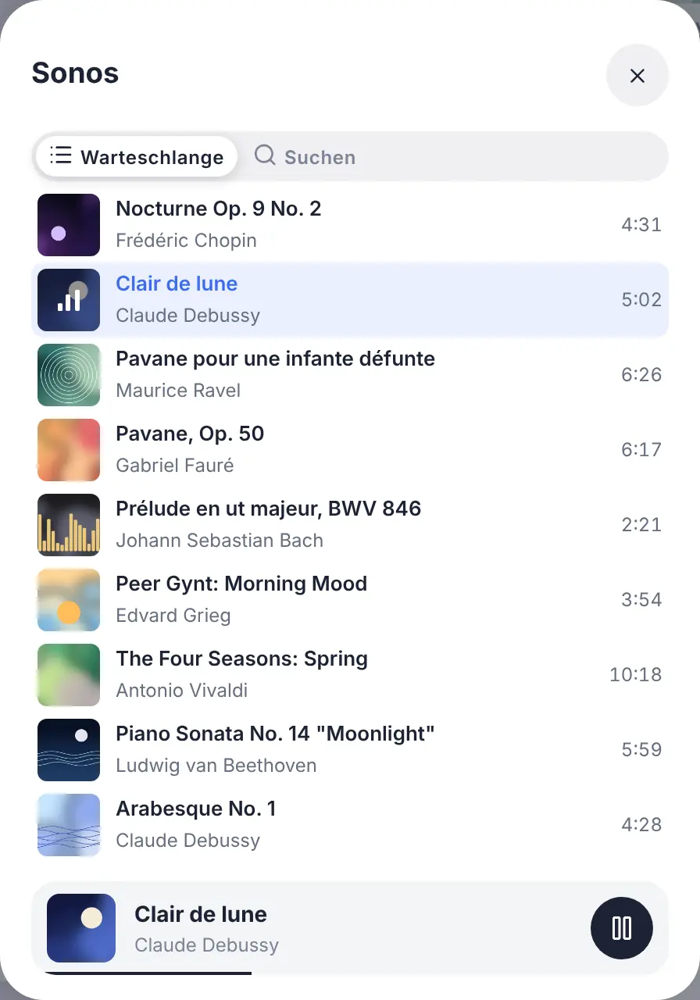
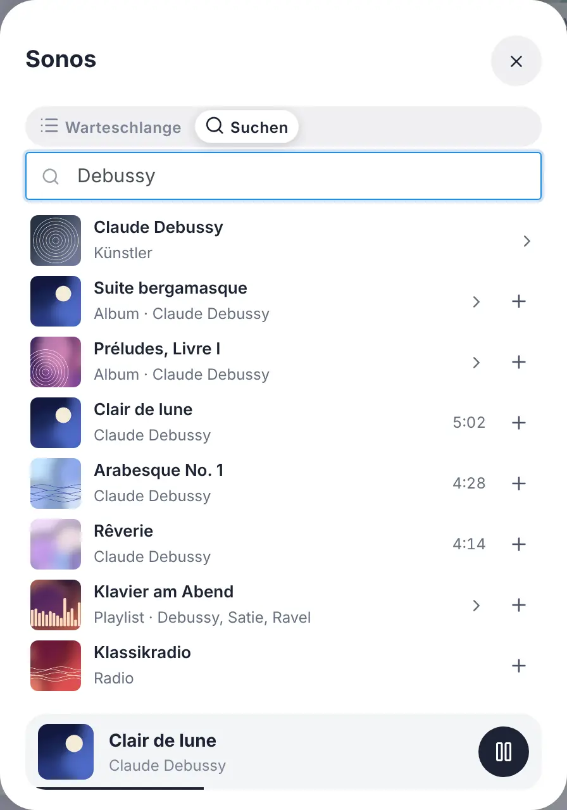
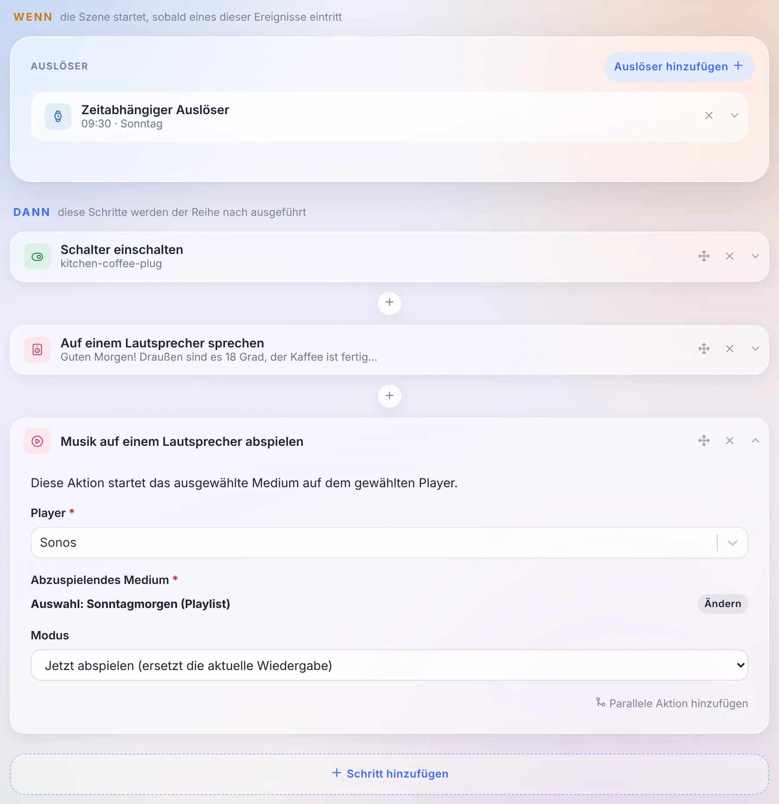
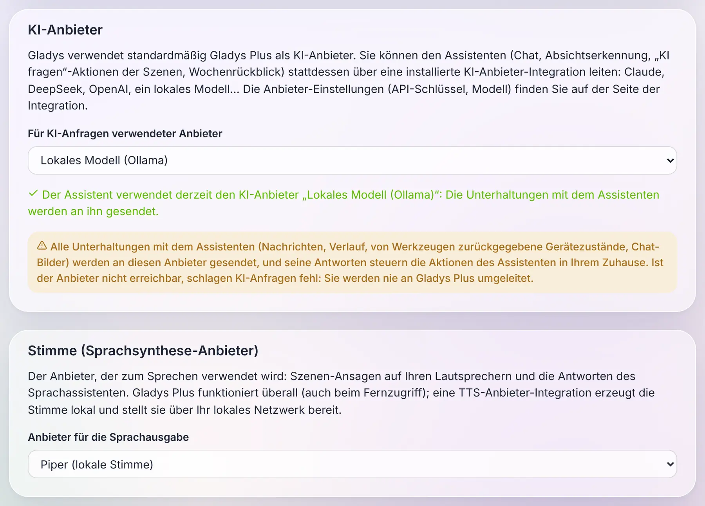
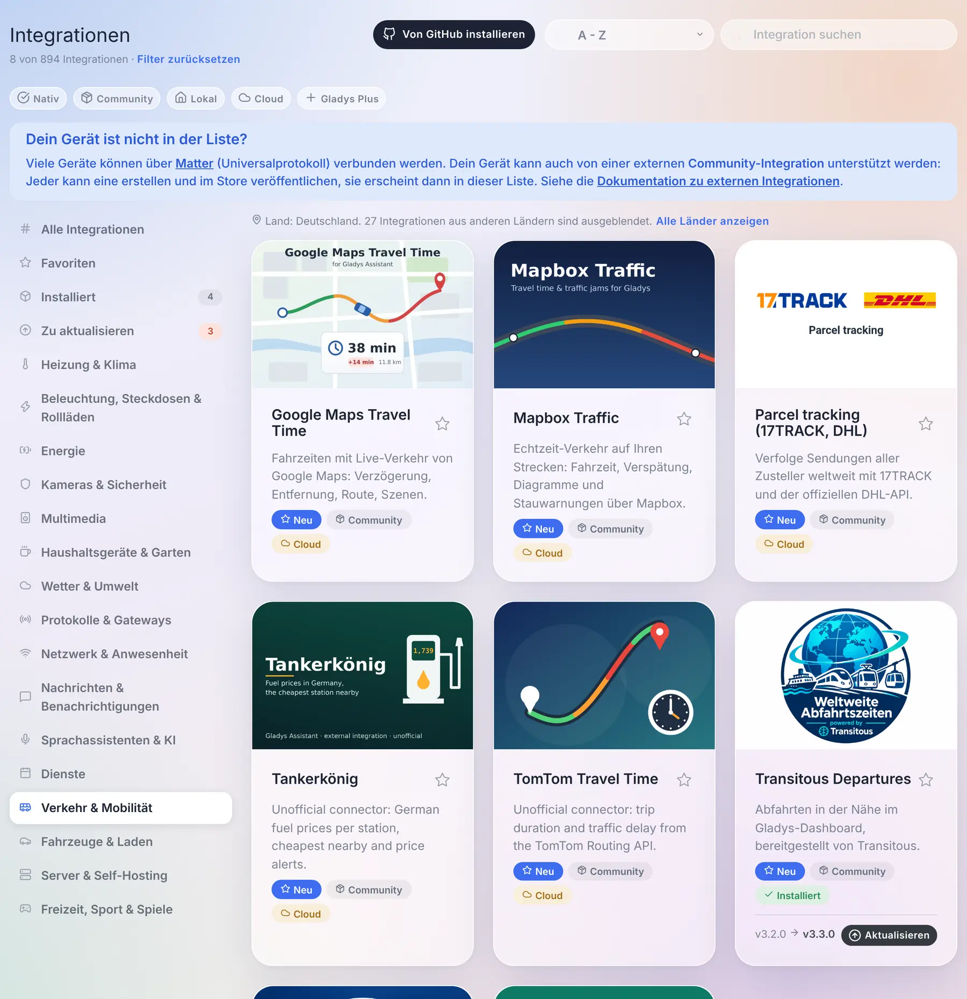
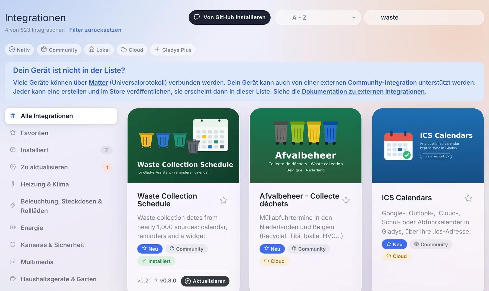

Hallo zusammen!

Heute gibt es eine neue Gladys-Version, die 5.3 🎉

Drei Dinge stecken in diesem Release. Das Musik-Widget wird zu **einem echten Player**: das Cover, der Titel, der Fortschritt, die Warteschlange und eine Suche, um ein Album oder eine Playlist zu starten. Der Assistent kann jetzt mit **der KI deiner Wahl** laufen, auch mit einem Modell, das bei dir zu Hause läuft, statt mit Gladys Plus. Und **die Stimme** ebenso: Die Ansagen der Szenen können von einer lokalen Sprachsynthese gesprochen werden.

{/* truncate */}

## Ein echter Musikplayer auf dem Dashboard

Bisher war das Musik-Widget von Gladys eine Fernbedienung: der Name des Lautsprechers, Wiedergabe, Pause, Weiter und ein Lautstärkeregler. Nichts verriet dir, was gerade lief.

Mit 5.3 wird es zu dem Player, den du aus den Apps von Spotify oder Sonos kennst: das **Cover** des Albums, der **Titel**, der **Künstler** und das **Album**, ein **Fortschrittsbalken**, den du zum Springen ziehen kannst, Zufallswiedergabe, Wiederholen (alles oder einen Titel) und die Lautstärke. Ein Live-Radio zeigt statt des Fortschrittsbalkens ein „Live“-Badge.

Zwei Schaltflächen am Ende der Lautstärkezeile öffnen den Rest, in einem Panel, das die Größe der Karte nie verändert:

- **die Warteschlange**, mit hervorgehobenem aktuellen Titel: Ein Tippen springt zu einem beliebigen Titel;

- **die Suche und die Bibliothek**: Gib einen Künstler, ein Album, eine Playlist oder einen Radiosender ein, tippe zum Abspielen oder füge den Eintrag mit der „+“-Schaltfläche zur Warteschlange hinzu. Ein Album oder eine Playlist lässt sich öffnen oder komplett abspielen.

Ein Detail, das zählt: Der Fortschrittsbalken wird nicht jede Sekunde vom Server aktualisiert. Der Player meldet seine Position nur, wenn etwas passiert (eine Pause, ein Sprung, ein neuer Titel), und das Dashboard berechnet den Rest. Ein Musikplayer kostet deine Datenbank nichts: Keiner seiner Zustände wird im Verlauf gespeichert.

### Eine Playlist aus einer Szene starten

Mit der neuen Aktion **„Musik auf einem Lautsprecher abspielen“** kann eine Szene einen Titel, ein Album, eine Playlist oder einen Radiosender starten. Du wählst ihn mit derselben Suche wie auf dem Dashboard aus und entscheidest, ob er ersetzt, was gerade läuft, oder in die Warteschlange kommt (direkt nach dem aktuellen Titel oder ans Ende).

Und weil der Titel jetzt ein Zustand des Geräts wie jeder andere ist, ist „wenn der Titel auf dem Küchenlautsprecher wechselt“ einfach der übliche Geräte-Auslöser, auf den Titel.

### Welche Player?

Dieser neue Player wird von **externen Integrationen** gespeist: Eine Integration veröffentlicht, was gerade läuft, und liefert die Cover, Gladys zeigt sie an und lädt in deinem Browser nie ein Bild aus dem Internet. Der Store hat bereits Integrationen für Sonos, Spotify, Jellyfin, Plex, Volumio, MPD, Lyrion oder Yamaha MusicCast, die jetzt alles haben, um diesen Player zum Leben zu erwecken: Ihre Autoren müssen nur die neuen Zustände veröffentlichen.

Die eingebauten Integrationen Sonos, Google Cast und AirPlay ändern sich nicht: Ihr Widget behält dieselben Bedienelemente, im neuen Stil. Und die eingebaute Sonos-Integration hat bereits ihre „Migrieren“-Schaltfläche zur Community-Integration: Deine Räume, Widgets und Szenen folgen dem Gerät.

## Wähle die KI deines Assistenten

Seit einigen Monaten unterhält sich der Assistent von Gladys mit dir, steuert dein Zuhause, erstellt Szenen und analysiert deine Kameras. Dahinter steckte immer dieselbe KI: die von Gladys Plus.

Mit 5.3 wird daraus **eine Wahl**. Eine externe Integration des neuen Typs **„KI-Anbieter“** kann dem Assistenten anstelle von Gladys Plus antworten: Claude, Mistral, OpenAI, DeepSeek oder **ein Modell, das auf deinem eigenen Rechner läuft**, mit Ollama. Du wählst ihn auf der Seite „Künstliche Intelligenz“ der Integrationen aus, und der ganze Assistent folgt: der Chat, die Aktion „Frage die KI“ in Szenen und der Wochenrückblick deines Zuhauses.

Was ich an der Funktionsweise spannend finde: **Der ganze Assistent läuft weiterhin in deinem Gladys**. Die Werkzeuge, der Kontext deines Zuhauses, der Gesprächsverlauf, die Aktionen auf deinen Geräten: Das alles bleibt lokal. Das Einzige, was zum Anbieter geht, ist eine Standardanfrage, die jede KI auf dem Markt versteht, und ihre Antwort kommt zu Gladys zurück, das sie prüft, bevor es handelt. Eine KI-Integration ist also ein schlanker Adapter, der jeden beliebigen Anbieter anbinden kann.

Drei Regeln waren mir wichtig:

- **Gladys Plus bleibt die Standardeinstellung.** Für dich ändert sich nichts, wenn du nichts anfasst.
- **Kein stiller Rückfall.** Wenn du ein lokales Modell gewählt hast, weil deine Gespräche zu Hause bleiben sollen, und dieses Modell ausfällt, sagt Gladys dir das. Es schickt deine Nachrichten nie hinter deinem Rücken an Gladys Plus.
- **Der Assistent ohne Gladys Plus.** Mit deinem eigenen Anbieter funktionieren der Chat, die Szenen und der Wochenrückblick ohne Gladys-Plus-Abo.

Eine ehrliche Warnung: Ein KI-Anbieter sieht jedes Gespräch, und seine Antworten lösen Aktionen in deinem Zuhause aus. Das ist das höchste Vertrauen, das du einer Integration schenken kannst, und Gladys sagt das deutlich, wenn du einen auswählst.

## Und auch die Stimme

Dieselbe Idee für die Sprachsynthese. Wenn eine Szene bisher auf einem Lautsprecher „die Waschmaschine ist fertig“ ansagte, kam die Stimme von Gladys Plus.

Eine Integration des neuen Typs **„Sprachsynthese“** kann diese Stimme jetzt erzeugen, lokal mit einer Engine wie Piper oder mit dem Cloud-Dienst deiner Wahl. Du wählst sie auf derselben Seite aus, und **die Ansagen der Szenen** auf deinen Lautsprechern laufen über sie. Das Audio wird in deinem Netzwerk erzeugt und bleibt ein paar Minuten im Speicher, die Zeit, die der Lautsprecher braucht, um es abzuholen.

Eine Einschränkung gibt es vorerst: Die Antworten des Sprachassistenten im Browser laufen weiterhin über Gladys Plus. Das Mikrofon eines Browsers verlangt HTTPS, und ein Browser weigert sich, in einer HTTPS-Seite einen Ton abzuspielen, der per HTTP aus deinem lokalen Netzwerk kommt.

## Ein Katalog für tausend Integrationen

Als Version 5 Ende August erschien, hatte der Store etwa siebzig Community-Integrationen. Heute sind es **785**, dazu die nativen. Die Integrationsseite war dafür nicht gedacht: Sie lud alle 30 Minuten den kompletten Store herunter (22 MB), und um etwas zu finden, musste man durch alles scrollen.

Das ändert sich:

- **Ein Katalog, der schnell lädt.** Gladys lädt jetzt einen schlanken Index von 1,4 MB herunter und holt die vollständige Beschreibung einer Integration erst, wenn du sie öffnest. Während des Ladens sagt die Seite das auch, statt die nativen Integrationen so anzuzeigen, als wären sie der ganze Katalog. Die Karten erscheinen seitenweise, mit einer Schaltfläche „Weitere Integrationen anzeigen“.
- **Die Suche ist der erste Filter.** Sie liest mehr als die Karte: alle Sprachen der Beschreibung, die vom Autor angegebenen Schlüsselwörter, den Autor selbst und die Länder. Die Ergebnisse sind sortiert (Namen, die mit deiner Eingabe beginnen, zuerst), und eine Suche durchsucht immer den ganzen Katalog, egal in welcher Kategorie du gerade bist.
- **Der Länderfilter, den niemand einstellen muss.** Verkehrsnetze, Stromanbieter, Müllabfuhr, Kinos: Viele Integrationen ergeben nur in einem Land Sinn. Gladys leitet dein Land aus der Zeitzone ab, mit der es bereits konfiguriert ist, und blendet die Integrationen anderer Länder in den Kategorien aus. Eine Zeile zeigt, wie viele ausgeblendet sind, mit einem Link „Alle Länder anzeigen“, und die Suche findet sie trotzdem.
- **Vier neue Kategorien**: *Verkehr & Mobilität*, *Fahrzeuge & Laden*, *Server & Self-Hosting* und *Freizeit, Sport & Spiele*. „Dienste“ war zu einem Sammelbecken mit 160 Integrationen geworden.
- **Kleine Dinge, die zählen**: ein „Installiert“-Badge auf den Karten, eine Sortierung „Zuletzt aktualisiert“, ein Zähler, der immer mit dem ganzen Katalog vergleicht („21 von 823 Integrationen“), mit einem einzigen Link „Filter zurücksetzen“, und wenn du von der Seite einer Integration zurückkommst, bist du genau dort, wo du in der Liste warst.

### Eine Integration direkt aus ihrer Karte aktualisieren

Wenn eine Community-Integration eine neue Version hat, zeigt ihre Karte jetzt die installierte Version, die neue und eine Schaltfläche **Aktualisieren**. Du musst die Integration nicht mehr öffnen.

Danke an [@cicoub13](https://github.com/cicoub13) dafür!

## Für Entwickler von Integrationen

- **Musikplayer**: Ein Player bekommt die „Wird gerade abgespielt“-Features (`title`, `artist`, `album`, `artwork`, `duration`, `position`, `shuffle`, `repeat`, `mute` und einen beschreibbaren `playback_state`), und das neue Manifest-Feld `music` gibt an, was die Integration auf Anfrage kann: `browse`, `search`, `queue` und `append`. Die Cover liefert die Integration hinter einem Schlüssel, nie als URL. Der Vertrag steht in [der Musik-Spezifikation](https://github.com/GladysAssistant/Gladys/blob/master/docs/specs/external-integrations/capabilities/music.md).
- **KI-Anbieter**: Der neue Typ `ai` empfängt OpenAI-kompatible Chat-Completion-Anfragen und antwortet mit einer OpenAI-kompatiblen Completion. [Die Spezifikation der KI-Anbieter](https://github.com/GladysAssistant/Gladys/blob/master/docs/specs/external-integrations/capabilities/ai-type.md) erklärt auch, wie man ein Modell auf dem Host erreicht und warum sein Kontextfenster konfiguriert werden muss.
- **Sprachsynthese-Anbieter**: Der neue Typ `tts` empfängt einen Text und eine Sprache und antwortet mit dem Audio. [Die Spezifikation der Sprachsynthese-Anbieter](https://github.com/GladysAssistant/Gladys/blob/master/docs/specs/external-integrations/capabilities/tts-type.md).
- **Katalog**: zwei neue optionale Manifest-Felder, `keywords` (Begriffe nur für die Suche: Marken, Modelle, bediente Städte) und `countries` (ISO-Codes der Länder, in denen die Integration nutzbar ist, ohne Angabe weltweit), und die vier neuen Kategorien `transport`, `vehicles`, `servers` und `leisure`.
- **Polling**: Ein gefundenes Gerät, das eine `poll_frequency` veröffentlicht, wird jetzt von Gladys abgefragt, ohne dass zusätzlich `should_poll` gesetzt werden muss.

Das SDK kapselt diese neuen Nachrichten noch nicht: Bis dahin verarbeitet eine Integration sie über ihre WebSocket-Verbindung, wie in den Spezifikationen beschrieben.

## Korrekturen

5.2.1 ist am Tag nach 5.2 erschienen. Das korrigieren sie und dieses Release:

- **Benutzer**: Du kannst deine eigene Rolle nicht mehr ändern, und der letzte Administrator einer Instanz kann diese Rolle nicht mehr verlieren. Bisher konnte sich ein einziger Administrator eine andere Rolle geben, und dann kam niemand mehr an die Benutzereinstellungen, um sie ihm zurückzugeben. Eine Instanz, die schon in dieser Lage ist, gibt ihrem ältesten Konto die Administratorrolle zurück.
- **Geräte**: Das Speichern eines Geräts setzt den aktuellen Wert seiner Features nicht mehr auf den Wert zurück, den die Seite beim Öffnen hatte. Danke [@Terdious](https://github.com/Terdious)!
- **Geräte**: Ein Gerät anzulegen, während Gladys gerade etwas anderes in seine Datenbank schreibt, schlägt nicht mehr mit dem Fehler „database is locked“ fehl.
- **Anmeldung**: Eine E-Mail mit Großbuchstaben oder Leerzeichen wird akzeptiert, bei der Anmeldung wie beim Zurücksetzen des Passworts.
- **Batterien**: Die Warnung bei schwacher Batterie lässt sich in den Einstellungen wirklich abschalten, und die Meldungen zu schwachen Batterien und fehlgeschlagenen Backups erreichen alle Administratoren, auch wenn der Versand an einen von ihnen fehlschlägt. Danke [@cicoub13](https://github.com/cicoub13)!
- **Energie**: Die Vorlagen für EDF Tarif Bleu, die mehr als zehn Jahre Preishistorie enthalten, lassen sich wieder auswählen: Die Historie außerhalb der Gültigkeit deines Vertrags wird verworfen, ohne die Kosten zu verändern.
- **Enedis**: Zähler lassen sich umbenennen, und ein neuer Zähler wird nach seinem PDL statt „Enedis“ benannt, sodass sich zwei Zähler unterscheiden lassen.
- **Zigbee2MQTT**: Der serielle Port des USB-Dongles ist immer der im Container eingebundene, egal welchen Pfad er auf dem Host hat. Das konnte den Start von Zigbee2MQTT verhindern.
- **Zigbee2MQTT**: Die vier Tasten des Philips Hue Tap werden erkannt.
- **Dashboard**: Text in einem Panel oder Dialog markieren oder einen Regler ziehen und die Maus außerhalb loslassen schließt ihn nicht mehr.
- **Unter der Haube**: Die Oberfläche wird jetzt mit Vite 8 gebaut. Danke [@bertrandda](https://github.com/bertrandda)!

Das sind 21 Pull Requests seit Version 5.2.

## Danke an die Mitwirkenden

Danke an [@cicoub13](https://github.com/cicoub13) für die Aktualisieren-Schaltfläche der Katalogkarten und die Batterie- und Backup-Meldungen, an [@Terdious](https://github.com/Terdious) für die Korrektur beim Speichern von Geräten und an [@bertrandda](https://github.com/bertrandda) für den Umstieg auf Vite 8. Und danke an alle, die sich diese Funktionen gewünscht und im Forum Bugs gemeldet haben!

Wir sehen uns im [Forum](https://community.gladysassistant.com/), wenn du über dieses Release sprechen möchtest :)

## Wie aktualisiere ich?

Wie immer aktualisiert sich Gladys innerhalb von 24 Stunden automatisch, wenn du Watchtower verwendest. Ansonsten kannst du das mit einem Klick in den Einstellungen erledigen.

Das [vollständige CHANGELOG von 5.3.0](https://github.com/GladysAssistant/Gladys/releases/tag/v5.3.0) findest du auf GitHub.
