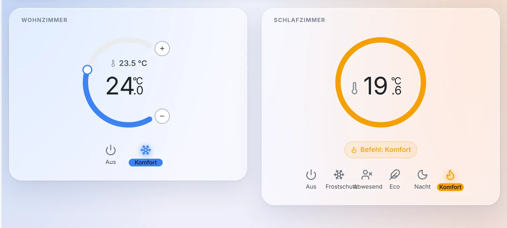
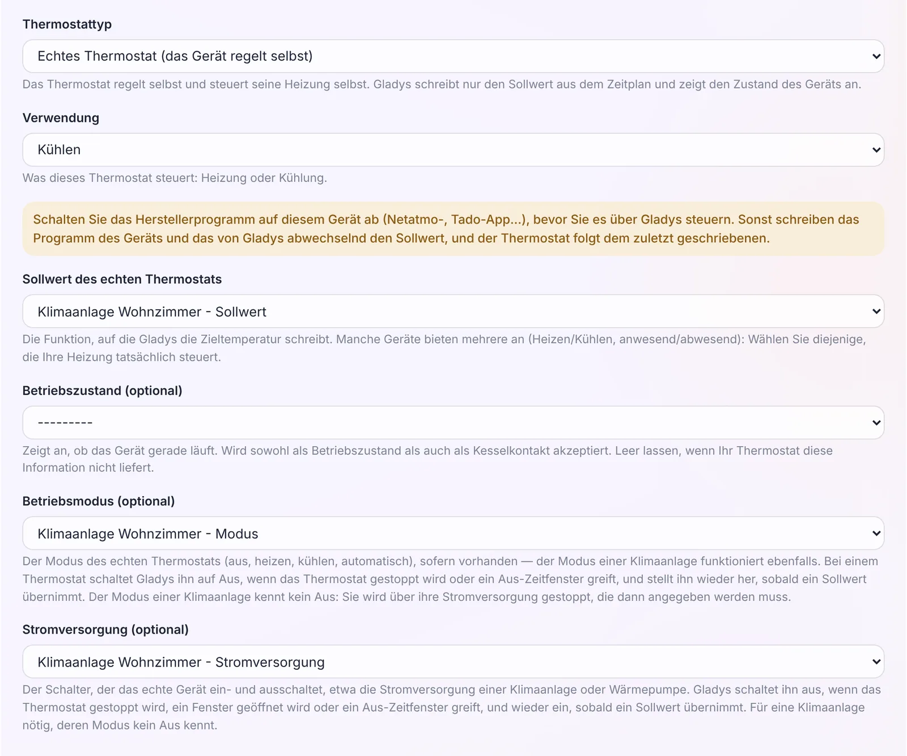
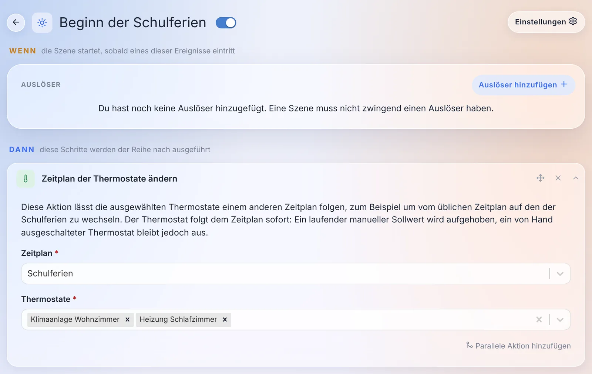
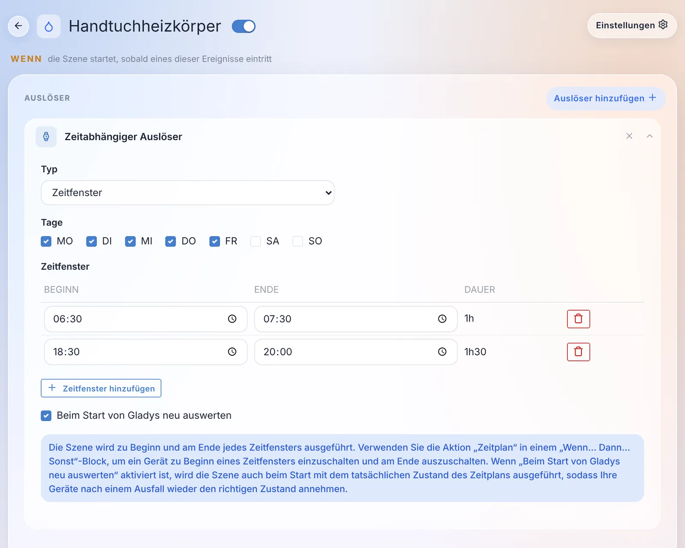

Hallo zusammen!

Heute gibt es eine neue Gladys-Version, die 5.3.1 🎉

Lass dich von der Versionsnummer nicht täuschen: Das ist nicht nur ein Bugfix-Release. Das mit 5.2 eingeführte Thermostat steuert jetzt **Klimaanlagen** und **Heizkörper mit Steuerleitung**, es wartet kurz, bevor es die Heizung bei offenem Fenster abschaltet, und eine Szene kann das ganze Haus auf den Ferien-Zeitplan umstellen. Szenen bekommen einen Auslöser **„Zeitfenster“**. Und bei Gladys Plus werden die Benutzer auf einer einzigen Seite verwaltet, die Zwei-Faktor-Authentifizierung lässt sich ohne E-Mail an den Support wiederherstellen, und Backups laufen jetzt jeden Tag.

{/* truncate */}

## Das Thermostat steuert Klimaanlagen

Mit 5.2 wurde Gladys zu deinem Thermostat, allerdings nur zum Heizen. Ab 5.3.1 kann eine **Klimaanlage** oder eine **Wärmepumpe** als „Echtes Thermostat (das Gerät regelt selbst)“ eingerichtet werden: Gladys schickt ihr den Sollwert und den Modus, den Rest erledigt die Klimaanlage.

Eine Klimaanlage hat eine Besonderheit: Ihr Modus kennt keine Position „Aus“. Deshalb hat das Formular ein neues Feld **„Stromversorgung (optional)“**. Gladys schaltet diese Stromversorgung ab, wenn das Thermostat gestoppt wird, ein Fenster geöffnet wird oder ein Aus-Zeitraum gilt, und schaltet sie wieder ein, sobald ein Sollwert übernimmt. Wenn du den Sollwert einer Klimaanlage auswählst, werden ihr Modus und ihre Stromversorgung automatisch ausgefüllt, und fehlt die Stromversorgung, warnt dich das Formular.

Ein paar Details, die zählen:

- **Voreinstellungen fürs Kühlen**: Komfort 24 °C, Eco 26 °C, Nacht 25 °C, Abwesend 28 °C und Frostschutz 30 °C statt der Heizwerte.
- **Die Fernbedienung wird respektiert.** Schaltest du die Klimaanlage mit ihrer Fernbedienung aus, stoppt das Thermostat bis zum nächsten Punkt des Zeitplans, statt sie hinter deinem Rücken wieder einzuschalten.
- **Mehrere Temperatursensoren**: Über „Temperatursensor hinzufügen“ kannst du mehrere auswählen, und Gladys regelt auf ihren Mittelwert. Ein Fühler, der seit über einer Stunde nichts gemeldet hat, wird aus dem Mittelwert herausgenommen, solange ein anderer noch meldet.
- **Mehrere Öffnungssensoren**: Jedes offene Fenster schaltet Heizung oder Kühlung ab.
- **Nach Raum gefilterte Listen**: Im Formular bieten die Gerätelisten nur die Geräte aus dem Raum des Thermostats an. Mit dem Schalter „Geräte aller Räume anzeigen“ werden sie erweitert, praktisch für ein offenes Wohnzimmer mit Küche.
- **Ein neuer Zustand „Thermostat: Aktive Voreinstellung“** folgt jedem Punkt des Zeitplans. Eine Szene kann also auslösen, wenn der Zeitplan zum Beispiel von Komfort auf Eco wechselt.

## Heizkörper mit Steuerleitung

In Frankreich haben elektrische Heizkörper sehr oft eine Steuerleitung („fil pilote“). Ein solcher Heizkörper behält sein eigenes Thermostat und gehorcht sechs Befehlen: Aus, Frostschutz, Eco, Komfort, Komfort -1 und Komfort -2.

5.3.1 bringt einen neuen Thermostat-Typ **„Heizkörper mit Steuerleitung (der Heizkörper regelt selbst)“**. Du wählst das Steuerleitungsmodul als Aktor, und die Tabelle der Voreinstellungen bekommt eine Spalte **„Gesendeter Befehl“**: Standardmäßig senden Frostschutz und Abwesend Frostschutz, Eco und Nacht senden Eco, und Komfort sendet Komfort. Komfort -1 und Komfort -2 stehen ebenfalls zur Wahl.

Das Widget dieses Typs (rechts im Screenshot oben im Artikel) hat keinen Drehregler: Ein Heizkörper mit Steuerleitung nimmt keinen Sollwert in Grad an. Es zeigt die Raumtemperatur, einen Ring in der Farbe des aktuellen Befehls und „Befehl: Komfort“, bzw. „Befehl Komfort wird gesendet…“, bis das Modul ihn bestätigt hat.

Wenn dir lieber ist, dass Gladys selbst anhand eines Raumsensors regelt, geht das auch: Ein „Virtuelles Thermostat (Gladys regelt)“ akzeptiert jetzt eine Steuerleitung als Aktor. Gladys sendet Komfort unterhalb des Sollwerts und Frostschutz darüber. Stell in diesem Fall den Komfort-Sollwert des Heizkörpers selbst hoch genug ein (zum Beispiel 24 °C): Er gehorcht dann Gladys, und dieser Wert bleibt eine Sicherheitsgrenze, falls Gladys stoppt.

Ein Tipp, an den dich auch das Formular erinnert: Schalte zuerst das eigene Programm des Moduls ab (den Heatzy-Zeitplan, das Tuya-Programm…), sonst überschreiben Modul und Gladys abwechselnd den Befehl. Ein am Modul selbst geänderter Befehl, per Taste oder Hersteller-App, wird als manuelle Änderung übernommen.

Danke an [@William-De71](https://github.com/William-De71), der das alles an einem echten Qubino-ZMNHJD-Modul getestet hat!

## Ein offenes Fenster schaltet nicht mehr sofort ab

Bisher reichte es, die Haustür zum Hereinkommen zu öffnen und hinter sich zu schließen, damit die Heizung innerhalb einer Sekunde abschaltete. Das Thermostat-Formular hat jetzt unter dem Öffnungssensor ein Feld **„Verzögerung vor dem Abschalten“**: **standardmäßig 60 Sekunden**, maximal eine Stunde, und 0, um sofort abzuschalten.

Ein Fenster, das vor Ablauf der Verzögerung wieder geschlossen wird, schaltet nichts ab, und der Hinweis „Fenster offen“ im Widget erscheint erst, wenn die Verzögerung abgelaufen ist.

Achtung, das ändert das Verhalten: Thermostate, die bereits einen Öffnungssensor haben, warten jetzt 60 Sekunden, bevor sie abschalten. Wenn du das sofortige Abschalten behalten möchtest, setz die Verzögerung auf 0.

## Der Ferien-Zeitplan, aus einer Szene

Eine neue Szenenaktion, **„Zeitplan der Thermostate ändern“**, stellt ein oder mehrere Thermostate auf einen anderen Zeitplan um. Das typische Beispiel: vom Zeitplan der Schulzeit auf den der Schulferien wechseln und wieder zurück.

Das Thermostat folgt dem neuen Zeitplan sofort. Ein laufender manueller Sollwert wird verworfen, aber ein von Hand gestopptes Thermostat bleibt gestoppt. Auch der KI-Assistent kennt diese Aktion, wenn er eine Szene für dich erstellt.

Zwei kleine Dinge im Zeitplan-Editor und im Widget:

- **„Ganztägig“**: ein Kästchen, um einen ganzen Tag abzudecken, statt 00:00 → 23:59 einzutippen und eine Minute unabgedeckt zu lassen. Nebenbei wurden mehrere Fehler behoben, durch die beim Speichern ein Teil eines Zeitplans verloren gehen konnte.
- **Die Anzeige ist animiert**: Wenn sich der Sollwert ändert, gleiten Bogen, Regler und Zahl zum neuen Wert, statt auf einen Schlag zu springen.

## Zeitfenster in Szenen

Ein Gerät nach einem Wochenplan zu steuern, brauchte bisher zwei Szenen, eine zum Einschalten und eine zum Ausschalten, die von Hand synchron gehalten werden mussten.

Der zeitgesteuerte Auslöser hat jetzt einen Typ **„Zeitfenster“**: Du hakst die Tage an, fügst Zeitfenster hinzu (Beginn und Ende), und die Szene läuft zu Beginn und am Ende jedes Zeitfensters. Zeitfenster über Mitternacht werden unterstützt (angezeigt als „+1T“).

Damit alles in eine einzige Szene passt, gibt es eine neue Bedingung **„Zeitplan“**: „Wir befinden uns in einem Zeitfenster“ oder „Wir befinden uns außerhalb der Zeitfenster“. In einem Block „Wenn… Dann… Sonst“ schaltet „Dann“ das Gerät zu Beginn eines Zeitfensters ein, und „Sonst“ schaltet es am Ende aus.

Und ein Kästchen **„Beim Start von Gladys neu auswerten“** führt die Szene beim Start mit dem aktuellen Zustand des Zeitplans aus: Nach einem Stromausfall sind deine Geräte wieder im richtigen Zustand.

Danke [@William-De71](https://github.com/William-De71), auch für diese Funktion!

## Eine Seite für die Benutzer

Wenn du Gladys Plus nutzt, hast du deine Benutzer bisher an drei Stellen verwaltet: Einstellungen › Benutzer, der Tab „Plus-Benutzer“ und „Remote-Benutzer“ in den Gladys-Plus-Einstellungen. Alles ist jetzt unter **Einstellungen › Benutzer** zusammengefasst.

Jeder Benutzer hat einen Bereich **„Fernzugriff · Gladys Plus“**, der zeigt, wo er steht: „Einladung gesendet“, „Wartet auf deine Autorisierung“, „Schlüssel geändert“, „Autorisiert“… Der Autorisierungsschalter und die zu vergleichenden Schlüssel-Fingerabdrücke sind direkt auf seiner Karte.

In der Gladys-Plus-App kann ein Administrator:

- einen Benutzer von seiner Karte aus **einladen**: Das mit der Einladung erstellte Konto wird automatisch mit diesem Benutzer verknüpft, die eingeladene Person muss nichts auswählen;
- ein bestehendes Gladys-Plus-Konto mit einem Benutzer **verknüpfen**, mit einem Klick, wenn die E-Mail-Adresse übereinstimmt;
- die **Zwei-Faktor-Authentifizierung** eines Benutzers **zurücksetzen**, bestätigt mit dem eigenen Code;
- jemanden aus Gladys Plus **entfernen**, ohne seinen Gladys-Benutzer oder seine Daten anzutasten.

Und wenn ein Benutzer von der Instanz nicht akzeptiert wird, zum Beispiel nach dem Zurücksetzen seines Gladys-Plus-Passworts, sieht er jetzt eine Seite, die erklärt, warum und was zu tun ist, statt einer einzeiligen Fehlermeldung.

## Zwei-Faktor-Authentifizierung ohne Support

Wer sein Handy verliert, verliert auch seine Zwei-Faktor-App. Bisher musstest du dem Support schreiben, damit dein Konto von Hand zurückgesetzt wird. Jetzt gibt es mehrere Wege, das selbst zu lösen:

- **Die App wechseln**: Unter Einstellungen › Sicherheit lässt dich bei Gladys Plus eine Karte „Deine Zwei-Faktor-App“ auf ein neues Handy umziehen. Du brauchst den Code der neuen App und den der aktuellen, oder einen Wiederherstellungscode, falls du sie verloren hast.
- **Neue Wiederherstellungscodes von deiner Gladys**: Ein lokal angemeldeter Administrator kann unter Einstellungen › Benutzer neue Codes für einen Benutzer erzeugen, indem er sein Gladys-Passwort erneut eingibt. Die alten Codes funktionieren dann nicht mehr.
- **Ein Zurücksetzen per E-Mail**, wenn keine Gladys mit dem Konto verbunden ist: Ein Link auf dem Anmeldebildschirm verschickt eine E-Mail, die eine Stunde gültig ist.

Das Anmeldeformular verlinkt außerdem auf [unseren neuen Leitfaden zur Fehlerbehebung bei der Zwei-Faktor-Authentifizierung](/de/docs/plus/two-factor-authentication/), der die häufigsten Ursachen abdeckt: eine falsch gehende Handyuhr, ein alter Eintrag in der App, ein neues Handy.

## Gladys-Plus-Backups jeden Tag

Drei Dinge stimmten bei den Gladys-Plus-Backups nicht:

- bei einem Fehlschlag bekam jeder Administrator bei jedem Versuch eine Nachricht, also eine Nachricht pro Nacht, solange das Problem bestand;
- umgekehrt wurden manche Fehlschläge nie gemeldet: Eine Gladys, die um 2 Uhr nachts aus oder offline war oder während des Backups neu gestartet wurde, meldete nichts;
- und die Regel „mehr als 24 Stunden seit dem letzten Backup“ führte zusammen mit einer zufälligen Startzeit dazu, dass die meisten Instanzen in der Praxis nur jeden zweiten Tag gesichert wurden.

Jetzt macht jede Instanz **ein Backup pro Tag**. Eine verpasste Nacht wird tagsüber und beim Start von Gladys nachgeholt. Administratoren werden nach **zwei Nächten ohne erfolgreiches Backup** gewarnt, danach einmal pro Woche, solange das Problem besteht, und ein letztes Mal, wenn alles wieder funktioniert. Ein Monat voller Fehlschläge bedeutet sechs Nachrichten statt dreißig. Die Backup-Seite zeigt außerdem einen Hinweis, wenn sie fehlschlagen, mit dem Datum des letzten erfolgreichen Backups und dem letzten Fehler.

## Zigbee2MQTT: Ein Gerät umzubenennen, macht nichts mehr kaputt

Ein Gerät in der Oberfläche von Zigbee2MQTT umzubenennen, hat die Verbindung zu Gladys zerstört: Das Gerät tauchte als neues Gerät in der Erkennung auf, Szenen funktionierten stillschweigend nicht mehr, und der Verlauf war zweigeteilt.

Gladys merkt sich jetzt die IEEE-Adresse jedes Geräts, seine Hardware-Kennung, die sich nie ändert. Passt ein Name nicht mehr, wird das Gerät über seine Adresse wiedergefunden: Szenen, Dashboards und Verlauf funktionieren weiter. Der in Gladys angezeigte Name folgt der Umbenennung, außer du hattest ihn angepasst. Du musst nichts tun: Bestehende Geräte erhalten ihre Adresse beim nächsten Start.

Außerdem bei Zigbee2MQTT:

- Geräte, deren Name ein „/“ enthält (wie „wohnzimmer/lampe“), senden ihre Zustände endlich an Gladys;
- die Tasten des Philips Hue Tap Dial Switch (RDM002) lösen Szenen aus. Danke [@cicoub13](https://github.com/cicoub13)!
- Geräte, die vor dem Energie-Monitoring hinzugefügt wurden, lassen sich aktualisieren, um ihre Verbrauchs- und Kosten-Features zu erhalten. Danke [@cicoub13](https://github.com/cicoub13)!

## Native Integrationen, die von der Community abgelöst werden

Seit Version 5 machen immer mehr Community-Integrationen es besser als ihre native Version. Diese zeigen jetzt im Katalog ein Abzeichen „Bald veraltet“ und auf ihrer Seite einen Hinweis auf den Nachfolger:

| Native Integration | Nachfolger                                                                                                                                   | Schaltfläche „Migrieren“ |
| ------------------ | -------------------------------------------------------------------------------------------------------------------------------------------- | ------------------------ |
| Tasmota            | [Gladys-Tasmota](https://github.com/gboulvin/Gladys-Tasmota)                                                                                 | ja                       |
| Google Cast        | [Gladys-Google-Cast](https://github.com/gboulvin/Gladys-Google-Cast)                                                                         | ja                       |
| eWeLink            | [gladys-sonoff-ewelink](https://github.com/William-De71/gladys-sonoff-ewelink)                                                               | ja                       |
| Broadlink          | [gladys-broadlink](https://github.com/prohand/gladys-broadlink)                                                                              | ja                       |
| Xiaomi             | [gladys-xiaomi-home](https://github.com/callemand/gladys-xiaomi-home) oder [gladys-xiaomi-miot](https://github.com/guim31/gladys-xiaomi-miot) | ja                       |
| Node-RED           | [Gladys-Node-RED](https://github.com/gboulvin/Gladys-Node-RED)                                                                               | –                        |
| CallMeBot          | [gladys-callmebot](https://github.com/GladysAssistant/gladys-callmebot)                                                                      | –                        |
| CalDAV             | [gladys-caldav-sync](https://github.com/bertrandda/gladys-caldav-sync)                                                                       | –                        |
| Nextcloud Talk     | [gladys-nextcloud-talk](https://github.com/bertrandda/gladys-nextcloud-talk)                                                                 | –                        |

Heute geht nichts kaputt: Die nativen Integrationen funktionieren weiter, und beide Versionen stehen während der Übergangszeit nebeneinander im Katalog. Die Schaltfläche „Migrieren“ neben „Löschen“ bei bereits erstellten Geräten überträgt Verlauf, Szenen und Dashboards auf das Gerät der neuen Integration. Bei Tasmota zum Beispiel werden Relais, Dimmer, Farben, Energiewerte, Temperatur und Luftfeuchtigkeit automatisch zugeordnet. Danke [@gboulvin](https://github.com/gboulvin) für die Tasmota-Migration!

AirPlay bleibt vorerst unterstützt: Das Gegenstück aus der Community deckt noch nicht alles ab.

## Und außerdem

- **Sprachassistent**: Bei Hintergrundgeräuschen wurde das Ende deines Satzes manchmal nie erkannt, und die Aufnahme lief bis zu 30 Sekunden weiter. Während des Zuhörens zeigt die Schaltfläche jetzt **„Senden“**: Ein Druck schickt ab, was du gesagt hast, statt es zu verwerfen. Dasselbe gilt für das Diktieren im Chat.
- **Externe Integrationen**: Die Geräteseite zeigt ein Batterie-Abzeichen in Grün, Orange oder Rot für Geräte, die ihren Batteriestand melden. Danke [@Terdious](https://github.com/Terdious)!
- **KI-Assistent**: Auf „Wie hoch ist die Luftfeuchtigkeit im Haus?“ kommt nicht mehr „Es gibt keinen Feuchtigkeitssensor“, weil das Modell nur nach Geräten ohne Raum gesucht hat.

## Sicherheit

- **Eine Passwortänderung meldet deine anderen Sitzungen ab.** Bisher blieb ein mit dem alten Passwort angemeldeter Browser bis zu einem Jahr angemeldet. Jetzt meldet eine Passwortänderung alle deine anderen Sitzungen ab, und ein Zurücksetzen über „Passwort vergessen“ meldet alle ab. API-Schlüssel (MCP, Webhooks, Open API) bleiben erhalten, aber Geräte im Tablet-Modus müssen sich neu anmelden.
- **Eine widerrufene Sitzung bleibt auch nach einem Neustart widerrufen**, und ein durch den Alarm gesperrtes Tablet erhält nach einem Update nicht mehr den vollen Zugriff zurück.
- **Das neue Passwort wird nicht mehr im Browser gespeichert**, nachdem du es in deinem Profil geändert hast.
- **Der MCP-Server** erstellt jetzt einen Server pro Anfrage: Zwei gleichzeitige Anfragen können nicht mehr die Antwort der jeweils anderen erhalten.
- Und Abhängigkeiten mit bekannten hohen oder kritischen Sicherheitslücken wurden aktualisiert.

## Korrekturen

- **Anmeldung**: Benutzer, deren E-Mail-Adresse vor 5.3 mit einem Leerzeichen oder Großbuchstaben gespeichert wurde, können sich wieder anmelden. Auf einer Instanz, auf der das der einzige Administrator war, kam niemand mehr hinein.
- **Passwort vergessen**: Text und Link kommen in einer einzigen Nachricht. Per E-Mail wurde der Link allein oft von Spamfiltern blockiert.
- **MQTT**: Nach dem Wiederherstellen eines Backups auf einem neuen Rechner wird der eingebaute MQTT-Broker mit seinen Zugangsdaten neu erstellt, statt zu verschwinden. Und ein Mosquitto-Update leert nicht mehr seine Benutzerliste.
- **Thermostat**: Eine Abweichung „bis zum nächsten Punkt“ endet bei der Zeitumstellung zur richtigen Zeit und richtet sich nach einem neu zum Zeitplan hinzugefügten Punkt. Die Hinweise nennen den Tag, wenn es nicht heute ist („bis morgen 14:00“). Auf dem iPad bleibt die Flamme in der Mitte der Anzeige.
- **Matter**: Eine Matter-Lampe erscheint im Geräte-Widget nicht mehr in zwei Zeilen (ein Schalter und eine Helligkeit), und Licht-Aktionen in Szenen schalten sie richtig ein.
- **CalDAV**: Wiederkehrende Termine wie ein Geburtstag hören nicht mehr zwei Jahre nach ihrem Import auf. Danke [@bertrandda](https://github.com/bertrandda)!
- **Karten**: Die Karte behält deinen Zoom und deine Position, statt sich bei jeder Standortaktualisierung neu auszurichten. Danke [@cicoub13](https://github.com/cicoub13)!
- **Szenen**: Die Fußzeile des Editors passt auf dem Handy in eine Zeile. Danke [@cicoub13](https://github.com/cicoub13)!
- **KI-Kontingent**: Der Countdown bis zum Zurücksetzen des Kontingents zeigt die richtige Anzahl an Tagen (30 Tage wurden als „0s“ angezeigt). Danke [@huangkongsheng](https://github.com/huangkongsheng)!
- **Zeitzonen**: 18 veraltete Abweichungen in der Zeitzonenliste wurden korrigiert, etwa Apia (Samoa), jetzt GMT+13:00 statt +14:00. Danke [@yu2971512385-ui](https://github.com/yu2971512385-ui)!
- **Musikplayer**: Lautstärke- und Fortschrittsbalken füllen ihre Spur bis zum Ende.

Das sind 45 Pull Requests seit Version 5.3.0.

## Danke an die Mitwirkenden

Ein riesiges Dankeschön an [@William-De71](https://github.com/William-De71), von dem die meisten Neuerungen beim Thermostat stammen (Klimaanlagen, Steuerleitung, Verzögerung bei offenem Fenster, Zeitplanwechsel, „Ganztägig“, animierte Anzeige) sowie die Zeitfenster in Szenen, dazu die Korrekturen für Matter, das iPad und den Musikplayer. Danke auch an [@cicoub13](https://github.com/cicoub13) für den Hue Tap Dial, die Energie älterer Zigbee2MQTT-Geräte, die Karten und den Szenen-Editor auf dem Handy, an [@gboulvin](https://github.com/gboulvin) für die Tasmota-Migration und die Community-Integrationen für Tasmota, Google Cast und Node-RED, an [@bertrandda](https://github.com/bertrandda) für CalDAV und Nextcloud Talk, an [@Terdious](https://github.com/Terdious) für die Batterie-Abzeichen, an [@huangkongsheng](https://github.com/huangkongsheng) für den Countdown des KI-Kontingents und an [@yu2971512385-ui](https://github.com/yu2971512385-ui) für die Zeitzonen. Und danke an alle, die sich diese Funktionen gewünscht und im Forum Fehler gemeldet haben!

Wir sehen uns im [Forum](https://community.gladysassistant.com/), wenn du über dieses Release sprechen möchtest :)

## Wie aktualisiere ich?

Wie immer aktualisiert sich Gladys innerhalb von 24 Stunden automatisch, wenn du Watchtower verwendest. Ansonsten kannst du das mit einem Klick in den Einstellungen erledigen.

Das [vollständige CHANGELOG von 5.3.1](https://github.com/GladysAssistant/Gladys/releases/tag/v5.3.1) findest du auf GitHub.
