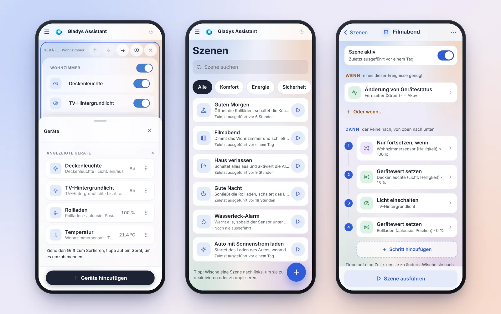
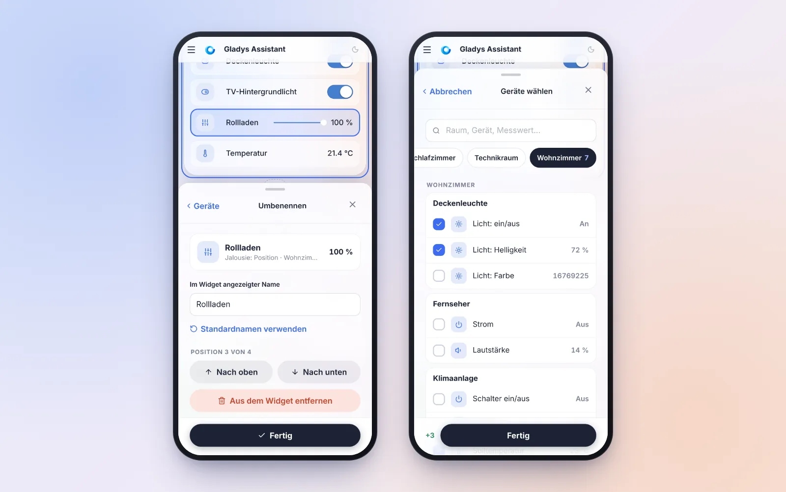
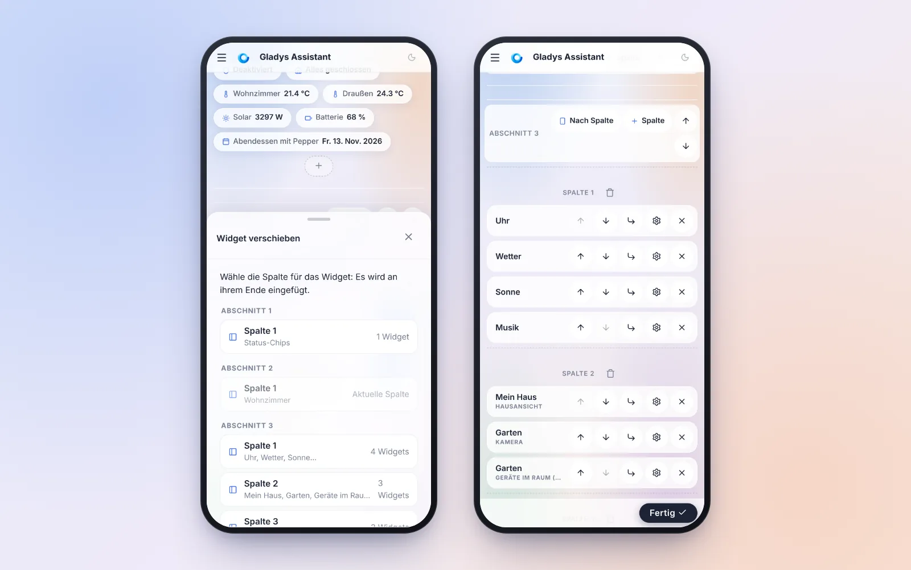
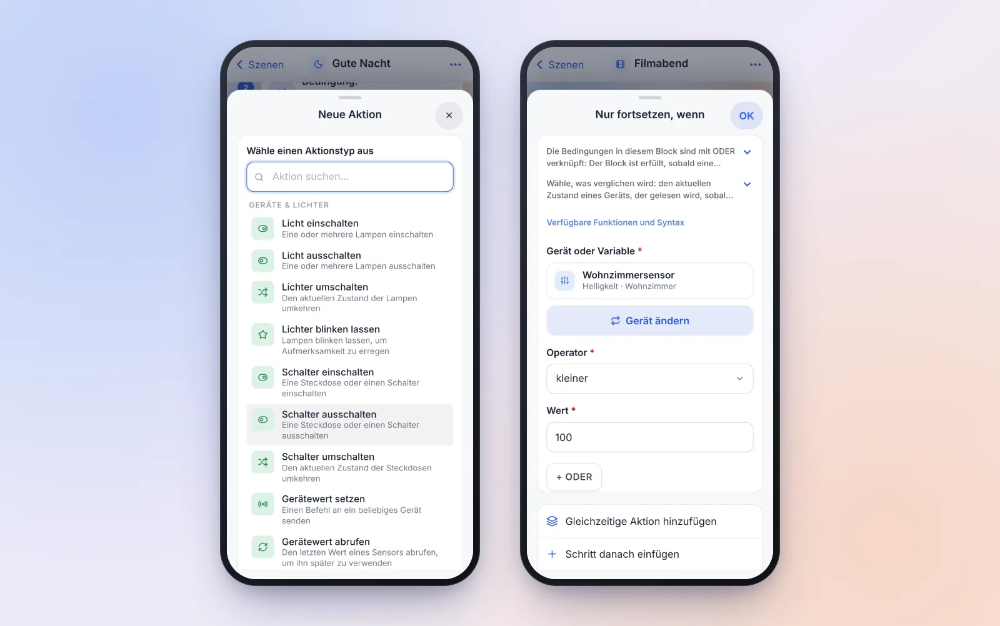
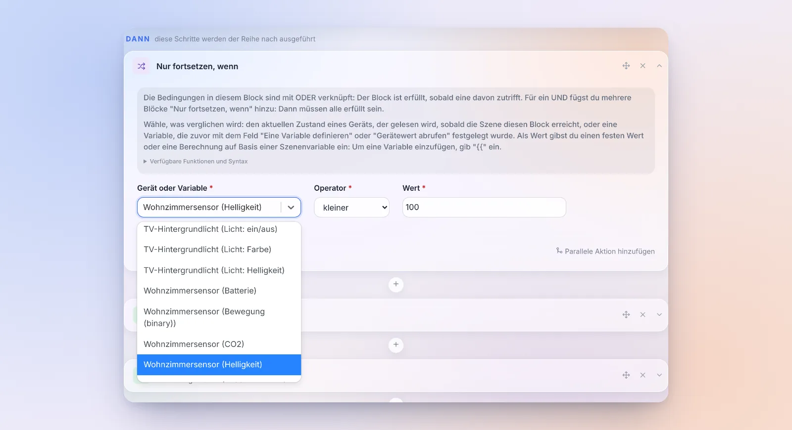
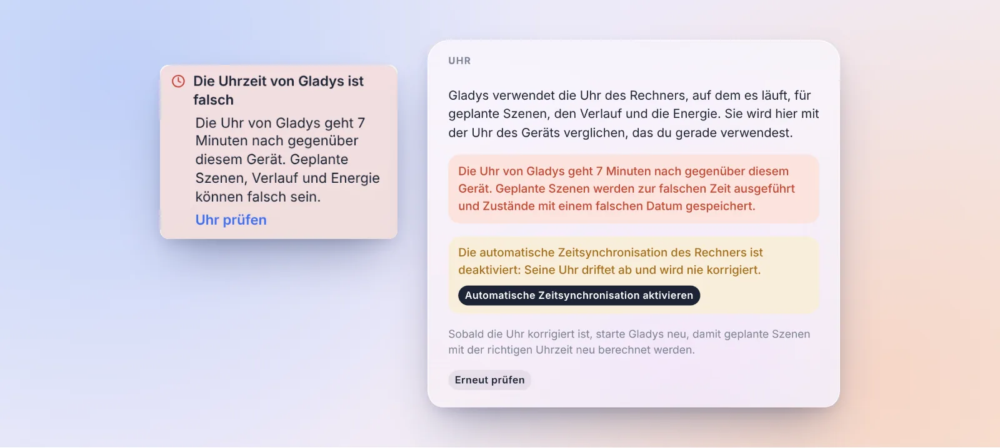
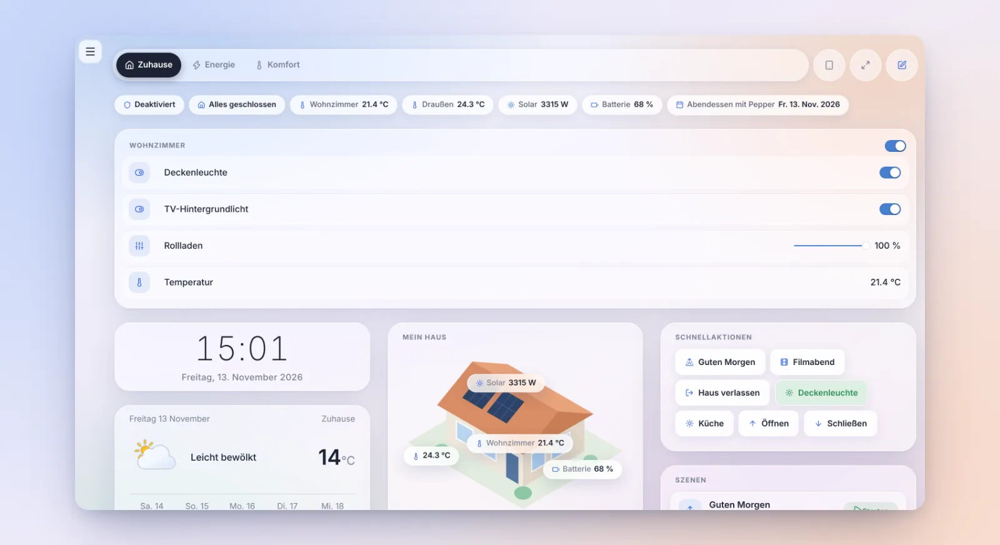

Hallo zusammen!

Heute gibt es eine neue Gladys-Version, die 5.3.3 🎉

Lass dich auch diesmal nicht von der Versionsnummer täuschen. Dieses Release dreht sich fast vollständig um ein Projekt: **Gladys auf dem Smartphone**. Viele von euch schauen sich ihr Dashboard auf dem Handy an, aber sobald man etwas **ändern** wollte, ein Widget oder eine Szene, stand man vor einem Desktop-Formular, das auf einen kleinen Bildschirm gequetscht war. Felder, die auf dem iPhone von selbst hineinzoomen, 15 Pixel große Buttons, Änderungen, die bei der kleinsten Zurück-Geste verloren gingen…

Deshalb haben wir das Bearbeiten des Dashboards und der Szenen vom Smartphone aus neu gedacht. Am Computer ändert sich an deinen Gewohnheiten nichts.

{/* truncate */}

## Das Dashboard mit dem Daumen bearbeiten

### Das Widget „Geräte“, komplett neu gebaut

Das war das mühsamste Formular auf dem Smartphone: Jedes Gerät war ein immer bearbeitbares Textfeld (ein verirrter Finger, und die Tastatur ging auf), nur 4 Geräte passten auf den Bildschirm, und man fügte sie einzeln aus einer Liste aller Geräte des Hauses hinzu, ohne Symbol und ohne Wert.

Jetzt gibt es drei Ansichten:

- **Die Liste**: eine Zeile pro Gerät, mit Symbol, Name, Raum und aktuellem Wert. Sortiert wird, indem man den Griff zieht, mit einer Vorschau, die dem Finger folgt, und automatischem Scrollen am Bildschirmrand.
- **Das Detail**, wenn du auf eine Zeile tippst: das Gerät umbenennen (oder mit einem Tipp zum Standardnamen zurückkehren), nach oben oder unten verschieben oder entfernen. Die bearbeitete Zeile wird **in der Vorschau des Widgets umrandet**, direkt darüber.
- **Die Auswahl**: eine Suche, Raum-Chips, Geräte nach Raum und dann nach Gerät gruppiert, mit Kontrollkästchen und ihrem aktuellen Wert. Unten eine Zusammenfassung der Änderungen („+3“, „−1“): Eine einzige Bestätigung fügt hinzu und entfernt.

Ein Gerät aus Versehen entfernt? Eine Leiste „Rückgängig“ erscheint. Und ein gelöschter Name übernimmt sofort den Standardnamen, statt still den alten zu behalten.

### Das Bearbeitungspanel lässt das Widget sichtbar

Auch das Panel, das von unten hereinfährt und von allen Widgets genutzt wird, wurde überarbeitet:

- es öffnet sich **auf halber Höhe**, damit das bearbeitete Widget darüber sichtbar bleibt; der Griff vergrößert es auf Vollbild (antippen oder ziehen), und nach unten ziehen schließt es;
- die Aktionsleiste des Editors verschwindet, solange es offen ist, statt ihm Platz wegzunehmen;
- Scrollen schließt es nicht mehr: Dafür braucht es ein echtes Tippen daneben;
- alle Felder haben 16 Pixel, das iPhone zoomt nicht mehr, und das Panel schiebt sich über die Tastatur.

### Ein Widget ohne Drag-and-drop verschieben

Auf dem Smartphone ließ sich ein Widget nur innerhalb seiner Spalte nach oben oder unten bewegen. Jedes Widget hat jetzt einen Button **„Verschieben nach…“**, der alle Spalten aller Abschnitte auflistet: ein Tipp, und das Widget landet dort, hervorgehoben.

Für größere Umbauten klappt der Button **„Neu anordnen“** jedes Widget auf seine Werkzeugleiste zusammen. Auf dem Demo-Dashboard schrumpft die Seite von 8.230 auf 3.123 Pixel Höhe: Quer durch das Dashboard reicht jetzt ein kurzes Wischen.

Und ein paar Details, die das Leben leichter machen:

- **Ein Widget zu entfernen fragt nicht mehr nach**: Eine Meldung „Rückgängig“ bleibt 6 Sekunden lang stehen.
- **Keine verlorenen Änderungen mehr**: „Abbrechen“, die Zurück-Taste des Smartphones, ein Link auf eine andere Seite oder das Schließen des Tabs fragen jetzt nach, wenn es ungespeicherte Änderungen gibt.
- **Reihenfolge auf dem Smartphone**: Auf dem Smartphone wird ein Abschnitt mit mehreren Spalten Spalte für Spalte angezeigt. Ein Button „Nach Spalte / Nach Zeile“ im Kopf des Abschnitts zeigt ihn stattdessen Zeile für Zeile an: praktisch für eine Reihe von drei Lampen.
- Das Löschen eines Dashboards wandert in seine Einstellungen, die untere Leiste passt in eine Zeile, die Hilfe des Editors lässt sich dauerhaft ausblenden, und die Widget-Auswahl zeigt zuerst die sechs meistgenutzten.

## Szenen, gemacht für das Smartphone

Unter 768 Pixeln Breite haben die Szenenseiten jetzt ein echtes Smartphone-Layout.

**Die Szenenliste**: eine Suche, Tag-Chips, eine Zeile pro Szene mit ihrer letzten Ausführung und einem Button zum Starten. Wische eine Szene nach links, um sie zu deaktivieren oder zu duplizieren. Der Button **+** fragt nur nach einem Namen, errät daraus ein Symbol und öffnet den Editor direkt auf der Auswahl des Auslösers.

**Der Editor** liest sich wie eine **nummerierte Zeitleiste**: „Wenn“, dann „Dann“, mit den „Wenn… dann… sonst…“-Blöcken und ihren Zweigen. Während eine Szene läuft, wird der gerade ausgeführte Schritt hervorgehoben.

Jeder Auslöser, jeder Schritt und jede Bedingung öffnet sich in **einem Panel, das von unten hereinfährt**, mit genau demselben Formular wie am Computer, aber für den Finger gemacht: 48 Pixel hohe Felder, Schalter statt Kontrollkästchen, die Wochentage als sieben Buttons, die nativen Zeit- und Datumsfelder des Smartphones. Die Auswahl des Aktionstyps öffnet sich im Vollbild, mit Suchfeld zum Lostippen. Und um ein Gerät auszuwählen, öffnet sich die Raum-Auswahl des Dashboards.

Die Gesten sind die, die man von einer App erwartet:

- ein Panel schließt sich, wenn du es nach unten ziehst, oder mit der Zurück-Taste des Smartphones;
- einen Schritt nach links wischen löscht ihn, mit einem Button „Rückgängig“;
- **langes Drücken** auf einen Schritt lässt ihn verschieben (das Menü „•••“ bietet auch „Schritte neu anordnen“, mit Pfeilen);
- die untere Leiste zeigt „Szene ausführen“ oder „● 2 Änderungen · Testen · Sichern“, wenn es Änderungen gibt.

Und auf allen Bildschirmgrößen, Computer eingeschlossen:

- **deine Änderungen gehen nie mehr still verloren**: Den Editor mit Änderungen zu verlassen fragt nach, und ein Entwurf wird im Browser gespeichert. Wenn das iPhone die App im Hintergrund beendet oder eine Zurück-Geste dich von der Seite bringt, bietet Gladys beim Zurückkommen an, ihn wiederherzustellen;
- ein Fehler beim Speichern erscheint dort, wo du ihn siehst;
- Zusammenfassungen nennen die Dinge beim Namen („Deckenleuchte (Licht: Helligkeit) · 15 %“), statt Kennungen anzuzeigen.

## Eine Bedingung kann den Zustand eines Geräts lesen

Das war eine der häufigsten Hürden bei der ersten Szene: Um den Zustand eines Geräts in einem Schritt „Nur fortsetzen, wenn“ zu prüfen, musste man zuerst einen Schritt „Gerätewert abrufen“ hinzufügen und dann dessen Variable vergleichen.

Das ist vorbei: Eine Bedingung vergleicht jetzt **entweder eine Variable oder den aktuellen Zustand eines Geräts**, gelesen in dem Moment, in dem die Szene die Bedingung erreicht. Zum Beispiel „das Wohnzimmer nur dimmen, wenn die Helligkeit unter 100 lx liegt“, in einem einzigen Schritt. Das funktioniert auch in den Blöcken „Wenn… dann… sonst…“ und „Solange… wiederholen…“.

Am Computer bietet ein einziges Feld „Gerät oder Variable“ die Variablen der vorherigen Schritte und dann alle Geräte des Hauses nach Raum gruppiert an. Auf dem Smartphone öffnet ein Button „Gerät auswählen“ die Raum-Auswahl (siehe Screenshot oben).

Zwei Regeln, die man kennen sollte: Ein Gerät, das noch nie einen Zustand gemeldet hat, erfüllt keine Bedingung, egal mit welchem Operator, und ein gelöschtes Gerät stoppt die Szene. Bestehende Szenen, die eine Variable vergleichen, ändern sich nicht. Danke an alle, die sich das [im Forum](https://community.gladysassistant.com/t/6502) gewünscht haben!

Zwei weitere Kleinigkeiten im Szeneneditor:

- **Das „UND“ wird angezeigt** zwischen den Bedingungsblöcken eines „Wenn… dann… sonst…“ oder eines „Solange… wiederholen…“. Zwei übereinander gestapelte Blöcke sahen wie zwei Alternativen aus, obwohl beide erfüllt sein müssen.
- **`{{` zu tippen öffnet sofort die Liste der Variablen**, wie es der Hilfetext verspricht. Vorher musste man ein drittes Zeichen tippen.

## Gladys warnt dich, wenn ihre Uhr falsch geht

Wenn die Uhr des Rechners, auf dem Gladys läuft, falsch geht (Zeitsynchronisation ausgeschaltet, leere Batterie im Mini-PC…), gerät alles, was von der Uhrzeit abhängt, still durcheinander: Geplante Szenen laufen zur falschen Zeit, der Verlauf wird in der Vergangenheit oder Zukunft gespeichert, die Energie wird auf den falschen Tag gebucht. Und nichts sagte dir, warum.

Gladys vergleicht jetzt die Uhrzeit des Servers mit der des Geräts, das du gerade benutzt (dein Smartphone oder Computer geht fast immer richtig). Ab 20 Sekunden Abweichung erscheint eine Warnung im Menü.

Unter **Einstellungen › System** zeigt eine neue Karte **„Uhr“** die gemessene Abweichung und den Zustand der Zeitsynchronisation des Rechners. Ist sie ausgeschaltet, die häufigste Ursache, schaltet ein Button **„Automatische Zeitsynchronisation aktivieren“** sie mit einem Klick wieder ein. Gladys kontaktiert für diese Prüfung keinen externen Dienst.

## Das Seitenmenü lässt sich am Computer einklappen

Am Computer **blendet ein Pfeil unten im Seitenmenü**, neben dem Button für den Dunkelmodus, **das Menü aus**: Die Seite bekommt die ganze Breite zurück, praktisch für ein großes Dashboard oder die Pläne. Ein dezenter Button holt es zurück, und deine Wahl bleibt auf diesem Gerät gespeichert. Danke für [den Wunsch im Forum](https://community.gladysassistant.com/t/mettre-la-barre-laterale-gauche-en-mode-tiroir/10740)!

## Sag uns deine Meinung

Wir bekommen sehr wenig Rückmeldung darüber, was in Gladys gut oder weniger gut funktioniert. Deshalb gibt es jetzt einen Link **„Feedback geben“** auf der Seite jeder Integration und im Profilmenü. Er öffnet ein neues Thema im Forum, vorausgefüllt mit „Was gut funktioniert“ / „Was verbessert werden könnte“ und deiner Gladys-Version. Gladys sendet nichts: Du liest die Nachricht und veröffentlichst sie selbst.

Nutze ihn gern, das hilft uns wirklich zu wissen, wo wir ansetzen sollen!

## Zigbee2MQTT erklärt, warum es nicht startet

Der [Zigbee2MQTT-Audit](https://community.gladysassistant.com/t/zigbee2mqtt-un-audit-pour-devenir-plus-simple-que-home-assistant/11498) geht weiter, nach 5.3.2, das bereits den eingesteckten Dongle erkannte und seinen Port und sein Modell vorauswählte:

- **Startfehler werden erklärt**, mit dem, was zu tun ist: ein Dongle, der nicht antwortet (oft ein anderes Modell als das gewählte oder ein Dongle, den eine andere Software nutzt), ein nicht erreichbarer Netzwerk-Koordinator, eine Konfiguration, die Zigbee2MQTT ablehnt. Vorher zeigte Gladys die letzte Fehlerzeile der Logs an, auf Englisch und oft ohne Zusammenhang.
- **SONOFF ZBDongle-E mit alter Firmware starten von selbst.** Viele werden noch mit einer Firmware verkauft, die der `ember`-Treiber ablehnt. Gladys wechselt jetzt selbstständig auf den Kompatibilitätstreiber `ezsp`, und die Einrichtungsseite erklärt, wie man nach einem Firmware-Update zu `ember` zurückkehrt.
- Der Drehstromzähler **Tuya SPM02V3** meldet alle seine Messwerte: Phase C, die Spannung jeder Phase und die erzeugte Energie.

Danke [@cicoub13](https://github.com/cicoub13) für all das!

## Außerdem

- **Thermostat**: Für einen Heizkörper mit Steuerleitung, den Gladys regelt, sendet die Option „Einen anderen Ruhebefehl als Frostschutz erzwingen“ nach Erreichen des Sollwerts **Eco** oder **Aus** statt Frostschutz. Manche Handtuchheizkörper sperren ihren Boost bei Frostschutz. Und eine Wärmepumpe, die während eines „Aus“-Zeitraums mit der Fernbedienung eingeschaltet wird, wird jetzt korrekt angezeigt. Danke [@William-De71](https://github.com/William-De71)!
- **Szenen**: In den Aktionen „Schalter einschalten / ausschalten / umschalten“ lässt sich jede Steckdose einer Steckdosenleiste auswählen und steuern, nicht mehr nur die erste. Danke [@cicoub13](https://github.com/cicoub13)!
- **Matter**: Das Stilllegen eines Knotens fragt jetzt nach, listet die aus diesem Knoten erstellten Gladys-Geräte auf und bietet an, sie ebenfalls zu löschen. Fehler werden angezeigt, statt ignoriert zu werden. Danke [@bertrandda](https://github.com/bertrandda)!
- **Strompreis**: Das Widget und die Preis-Szenen folgen dem **aktiven** Vertrag des Zählers. Nach einem Tarifwechsel nutzten sie weiter den alten, abgelaufenen Vertrag.
- **Externe Integrationen**: Ein Update, das eine neuere Gladys-Version voraussetzt, wird nicht mehr als Update angeboten, das nichts tut. Die Karte sagt „zuerst Gladys aktualisieren“.
- **Hausansicht**: bis zu 50 Pins pro Widget (statt 20), und der Editor warnt, wenn die Grenze erreicht ist, statt beim Speichern zu scheitern.
- **Wöchentliche KI-Zusammenfassung**: Zahlen werden in deiner Sprache geschrieben und gerundet („111,34 kWh“ statt „111.34 kWh“).

## Fehlerbehebungen

- **Kalender**: Ein mehrtägiger Termin, der vor dem angezeigten Zeitraum begonnen hat (zum Beispiel Ferien, die im Vormonat angefangen haben), wird endlich angezeigt, ebenso ein Termin über Mitternacht an seinem zweiten Tag.
- **Szenen**: „Kalenderereignisse abrufen“ findet ganztägige Termine am richtigen Tag. „Heute“ lieferte die von morgen.
- **Matter**: Lampen, die ihre Helligkeitsgrenzen nicht angeben, wie die Nanoleaf Essentials, werden ohne Fehler hinzugefügt.
- **MQTT**: Eigene Topics mit mehreren „+“ funktionieren, und ein Topic fängt keine Nachrichten eines Topics mehr ab, das gleich beginnt (`wohnzimmer` und `wohnzimmer2`). Danke [@huangkongsheng](https://github.com/huangkongsheng)!
- **Einheiten**: Die Umrechnungen kWh/100 km ↔ kWh/100 mi waren vertauscht. Danke [@huangkongsheng](https://github.com/huangkongsheng)!
- Abhängigkeiten mit bekannten hohen oder kritischen Sicherheitslücken wurden aktualisiert.

Das sind 26 Pull Requests seit Version 5.3.2.

## Danke an die Mitwirkenden

Ein großes Dankeschön an [@cicoub13](https://github.com/cicoub13) für die große Arbeit an Zigbee2MQTT und die Steckdosenleisten in Szenen, an [@William-De71](https://github.com/William-De71) für das Thermostat, an [@bertrandda](https://github.com/bertrandda) für das Stilllegen von Matter-Knoten und an [@huangkongsheng](https://github.com/huangkongsheng) für die Korrekturen bei MQTT, Einheiten und Datumsangaben. Und danke an alle, die im Forum Fehler und Ideen gemeldet haben!

Wir sehen uns im [Forum](https://community.gladysassistant.com/), wenn du über dieses Release sprechen möchtest :)

## Wie aktualisiere ich?

Wie immer aktualisiert sich Gladys innerhalb von 24 Stunden automatisch, wenn du Watchtower verwendest. Ansonsten kannst du das mit einem Klick in den Einstellungen erledigen.

Das [vollständige CHANGELOG von 5.3.3](https://github.com/GladysAssistant/Gladys/releases/tag/v5.3.3) findest du auf GitHub.
