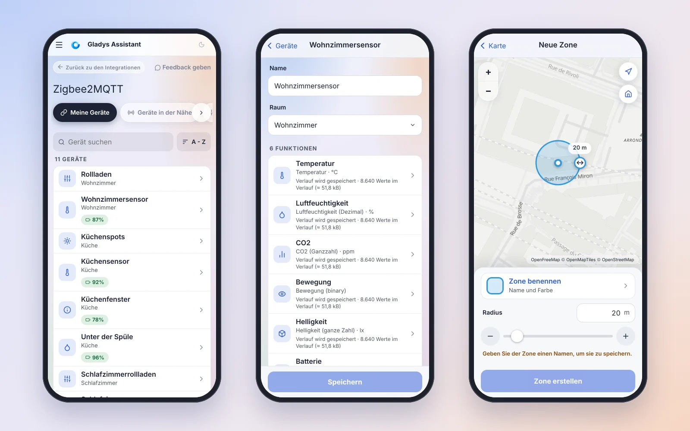
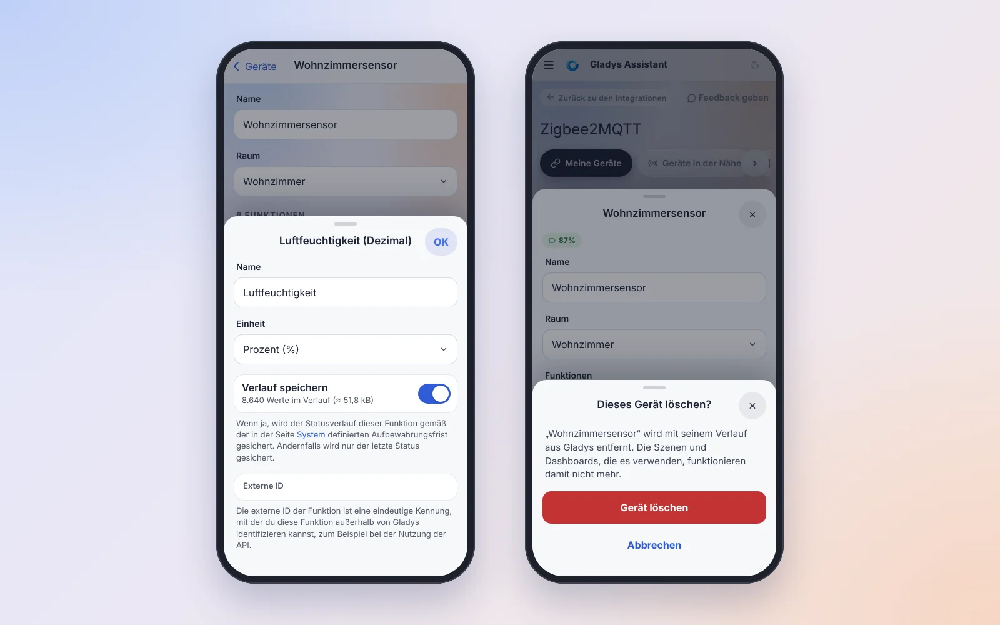
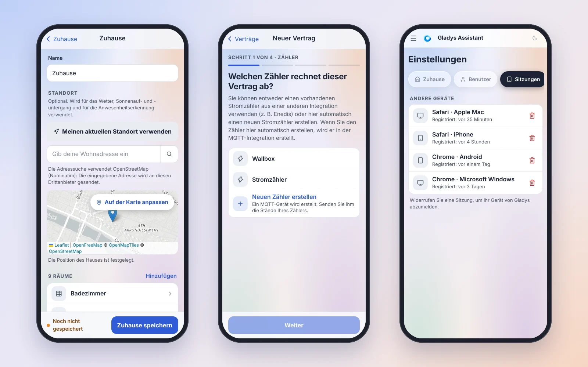
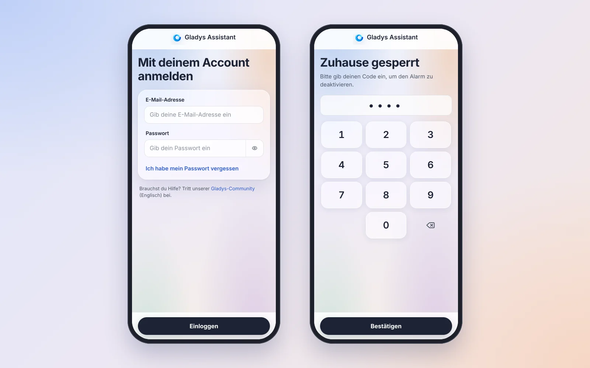
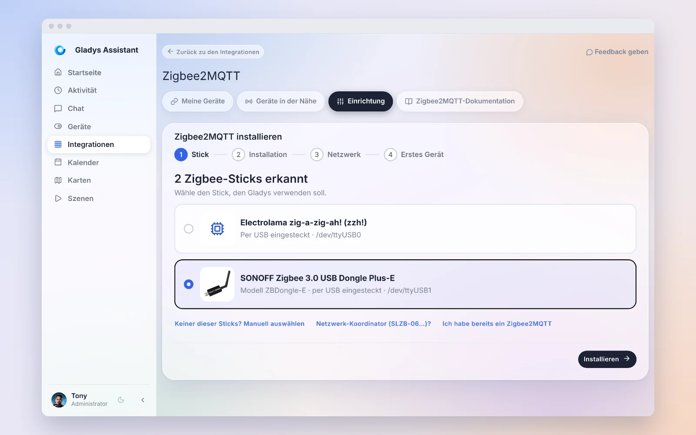
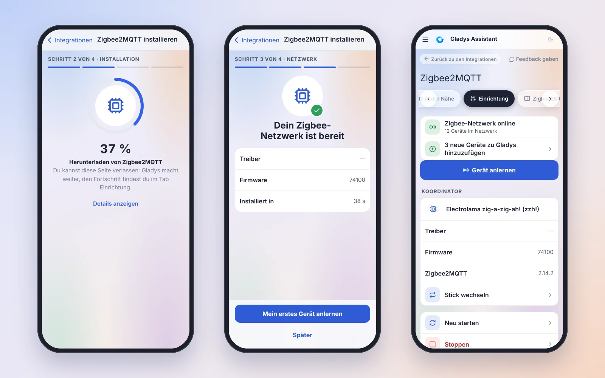
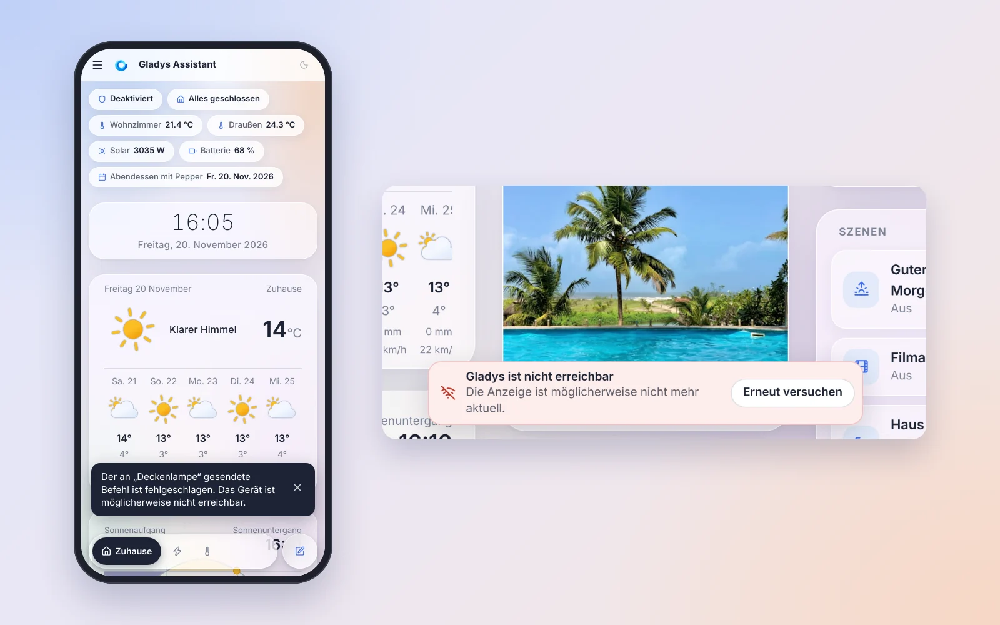
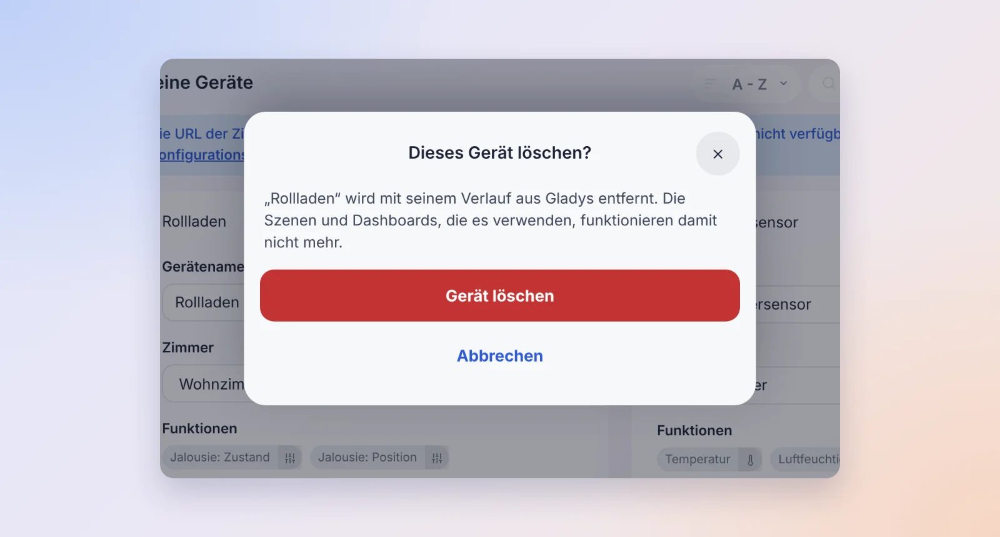
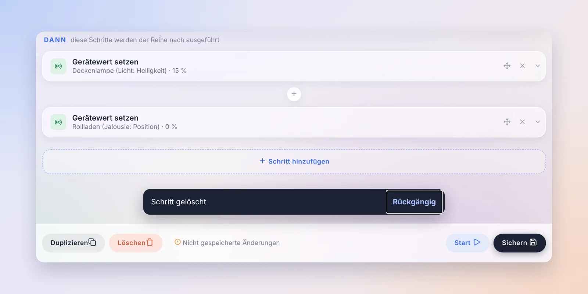

Hallo zusammen!

Heute gibt es eine neue Gladys-Version, die 5.3.4 🎉

Letzte Woche hat 5.3.3 das Dashboard und die Szenen für das Smartphone neu gebaut. Dieses Release bringt die Arbeit zu Ende: **der Rest von Gladys bekommt sein Smartphone-Layout**, von der Anmeldeseite bis zum Assistenten für Energieverträge, inklusive aller Geräteseiten. Am Computer bleiben die Layouts, wie sie sind.

Und es steckt noch viel mehr drin: **Zigbee2MQTT bekommt einen Einrichtungsassistenten und ein Dashboard**, und Gladys **sagt dir jetzt, wenn etwas schiefgeht**, statt dich glauben zu lassen, dass alles geklappt hat.

{/* truncate */}

## Ganz Gladys auf deinem Smartphone

Unter 768 Pixel Breite (oder auf einem quer gehaltenen Smartphone) folgen die Seiten denselben Regeln wie das Dashboard und die Szenen: Tippflächen von mindestens 44 Pixeln, Felder mit 16 Pixeln (das iPhone zoomt nicht mehr hinein), nichts, was seitlich scrollt, nichts Zerstörerisches mit einem einzigen Tippen, und deine Änderungen gehen nie stillschweigend verloren, auch nicht mit der „Zurück“-Geste des Smartphones.

### Geräte und ihre Integrationen

- **Die Seite eines Geräts**: zuerst Name und Raum, dann eine Zeile pro Funktion, die sich in einem Panel öffnet (Name, Einheit, Verlauf speichern, externe ID). Gespeichert wird in der unteren Leiste, und eine Meldung „Gespeichert“ bestätigt es.
- **Die Tabs mit den Geräten und der Geräteerkennung** von Matter, MQTT, Bluetooth, AirPlay, LAN Manager, Enedis, Thermostat, RTSP-Kameras, Zigbee2MQTT und allen externen Integrationen: eine Zeile pro Gerät statt eines Stapels von Desktop-Karten. Drei Matter-Geräte bedeuteten bisher 2.452 Pixel Scrollen! Ein Tippen öffnet das Gerät in einem Panel, mit allem, was die Karte zeigte.
- **Nichts wird mit einem einzigen Tippen gelöscht**: Eine Bestätigung nennt das Gerät und was mit ihm verschwindet.
- **Ein Panel mit ungespeicherten Änderungen schließen** fragt nach: „Speichern und schließen“, „Ohne Speichern schließen“ oder „Weiter bearbeiten“.
- In den **Erkennungs-Tabs** ist der Scan der Hauptknopf der Seite und heißt „Scan stoppen“, solange er läuft.
- Bei den **RTSP-Kameras** zeigt „Verbindung testen“ das Bild der Kamera direkt im Panel.

### Häuser, Einstellungen, Energie und Zonen

- **Häuser und Räume**: Ein Raum wird in einem Panel umbenannt, mit „Rückgängig“ gelöscht und mit Vorschlägen gängiger Räume hinzugefügt. „Meinen aktuellen Standort verwenden“ platziert das Haus, und der Alarmcode wird auf einem Ziffernblock eingegeben.
- **Einstellungen**: Sitzungen, Dienste, Hintergrundaufgaben, Backups, System und Open-API-Schlüssel werden zu Zeilenlisten. Eine Sitzung widerrufen, ein Backup wiederherstellen, neu starten oder herunterfahren fragt vorher nach.
- **Assistent für Energieverträge**: vier Schritte (Zähler, Vorlage, Einstellungen, Vorschau), die Nebenzeiten werden als Zeitbereiche gewählt.
- **Kartenzonen**: Die Karte füllt den Bildschirm. Ein Tippen platziert die Zone, du ziehst den Kreis, um sie zu verschieben, und den Griff an seinem Rand, um ihre Größe zu ändern, mit live angezeigtem Radius.
- **Ersteinrichtung**: Die fünf Schritte laufen im Vollbild, mit Fortschrittsbalken und einem einzigen Knopf unten.

### Anmeldung und Sperr-Tastenfeld

Die Seiten für Anmeldung, vergessenes Passwort und Gladys Plus haben auf jedem Feld die richtige Tastatur und das automatische Ausfüllen, einen Knopf zum Anzeigen des Passworts, und Fehler stehen neben dem betroffenen Feld.

Das **Sperr-Tastenfeld** eines Wandtablets hat große, an den Bildschirm angepasste Tasten, ohne Scrollen, und im Querformat ein zweispaltiges Layout. Und bei Gladys Plus bietet die Einrichtung der Zwei-Faktor-Authentifizierung **auf dem Smartphone** jetzt zuerst „Meine Zwei-Faktor-App öffnen“ an: kein QR-Code mehr, den man mit dem Smartphone scannen soll, das ihn gerade anzeigt.

## Zigbee2MQTT: ein Einrichtungsassistent und ein Dashboard

Das Zigbee2MQTT-Audit geht weiter, mit seinem bisher größten Schritt. Danke [@cicoub13](https://github.com/cicoub13) für diese riesige Arbeit!

### Ein Assistent für die erste Installation

Wenn noch nichts eingerichtet ist, ist die Zigbee2MQTT-Seite jetzt ein Assistent in vier Schritten:

1. **Der Stick**: Gladys zeigt den erkannten Stick mit Foto und Namen. Du kannst auch ein Modell von Hand aus einer nach Marken sortierten Liste wählen, einen Netzwerk-Koordinator (SLZB-06…) verwenden oder dich mit einem Zigbee2MQTT verbinden, das schon woanders läuft.
2. **Die Installation**, Phase für Phase. Ein Fehler wird verständlich erklärt, mit „Erneut versuchen“ oder „Stick oder Modell ändern“.
3. **Netzwerk bereit**: Treiber, Firmware und Dauer der Installation.
4. **Erstes Gerät**: Das Anlernen ist 4 Minuten lang erlaubt, danach geht es zum Erkennungs-Tab.

### Eine schnellere Installation im Hintergrund

- **Die Installation läuft im Hintergrund**: Du kannst die Seite verlassen, der Fortschritt ist noch da, wenn du zurückkommst (und unter Einstellungen › Aufgaben).
- **Die beiden Images werden parallel heruntergeladen**, und zwar schon, sobald du einen Stick wählst, noch bevor du auf „Installieren“ klickst.
- **Der MQTT-Broker startet nur einmal** und ist bereit, sobald er antwortet: Schluss mit festen Wartezeiten und doppelten Neustarts. Auf einem Raspberry Pi 4 waren die Images in etwa 15 Sekunden heruntergeladen, und Zigbee2MQTT antwortete 15 Sekunden nach seinem Start.
- **Der freie Speicherplatz wird vor jedem Download geprüft**: eine klare Fehlermeldung statt einer vollen Festplatte.
- **Ein Update des Zigbee2MQTT-Images unterbricht dein Zigbee-Netzwerk nicht mehr** während des Downloads: Das neue Image wird zuerst heruntergeladen. Ohne Internet läuft die vorhandene Version einfach weiter.

### Ein Dashboard für eine eingerichtete Installation

Die alte Einrichtungsseite wird durch ein Dashboard ersetzt: der Zustand von Zigbee2MQTT mit der passenden Aktion (Geräte zum Hinzufügen, ein erklärter Fehler, „Neu starten“…), der Koordinator und die Knöpfe „Neu starten“, „Stoppen“ und „Erweiterte Einstellungen“. **„Stoppen“ wird gemerkt**: Weder ein Neustart von Gladys noch ein Neustart des Rechners startet Zigbee2MQTT wieder, bis du auf „Starten“ klickst.

### Und unter der Haube

- **Der Stick wird wiedergefunden, egal wo er steckt**: Gladys speichert ihn über seinen stabilen Pfad (`/dev/serial/by-id/…`) und nicht mehr über `/dev/ttyUSB0`, das sich beim nächsten Neustart ändern kann. Bestehende Installationen werden automatisch umgestellt.
- **Abgezogen und wieder eingesteckt, startet der Stick Zigbee2MQTT von selbst neu**, in etwa zehn Sekunden, ohne Gladys neu zu starten. Eine Einrichtung mit einem nicht eingesteckten Stick wird abgelehnt, bevor irgendetwas gespeichert wird.
- **Ein neues Gerät zeigt seine Werte sofort**, wenn du es zu Gladys hinzufügst, statt bis zur nächsten Meldung leer zu bleiben. Geräte am Stromnetz werden nach ihren aktuellen Werten gefragt. Danke an alle, die es [im Forum gemeldet](https://community.gladysassistant.com/t/transfert-zigbee2mqtt-ha-vers-gladys/11582) haben!
- **Neue Installationen erzeugen ihre eigenen Netzwerkschlüssel**, wie ein eigenständig installiertes Zigbee2MQTT, und eine verlorene oder beschädigte Konfigurationsdatei wird aus dem Backup wiederhergestellt, das Gladys aufbewahrt. Wenn du einen Koordinator auf eine neue Gladys-Installation umziehst, stelle dein Gladys-Plus-Backup **vor** der Einrichtung von Zigbee2MQTT wieder her, um dein Netzwerk zu behalten.

## Gladys sagt dir, wenn etwas schiefgeht

Bisher sah die App lebendig aus, wenn Gladys neu startete, sich aktualisierte oder nicht mehr im Netzwerk war, war es aber nicht: Werte bewegten sich nicht mehr, Schalter schienen zu funktionieren, und nichts sagte es.

- **Ein fehlgeschlagener Befehl wird gemeldet**: Konnte die Lampe nicht gesteuert werden (Gerät nicht erreichbar, Integration nicht eingerichtet…), sagt es eine Meldung, und der Schalter springt auf den echten Zustand zurück. Nur die Seite, die den Befehl gesendet hat, zeigt die Meldung: Das Wandtablet bleibt still, wenn der Befehl von deinem Smartphone fehlschlägt.
- **„Gladys ist nicht erreichbar“**: Nach 4 Sekunden ohne Verbindung erscheint auf jeder Seite ein Hinweis mit einem Knopf „Erneut versuchen“. Ein Dashboard lädt sich von selbst neu, sobald Gladys wieder da ist.
- **Die Live-Verbindung verbindet sich neu, bis Gladys zurück ist**. Bisher wurde es nur einmal versucht: Nach einem Update oder einem WLAN-Ausfall konnte ein Wandtablet still eingefroren bleiben, bis es jemand neu lud.
- **Die Anmeldeseite unterscheidet die Fehler**: falsche Zugangsdaten, Gladys nicht erreichbar, zu viele Versuche oder Serverfehler. Bisher hieß es immer „Die Kombination aus E-Mail-Adresse und Passwort ist falsch.“, selbst bei einem gestoppten Server.
- **Gladys Plus**: Das endlose Laden auf dem iPhone, nachdem die App im Hintergrund war, ist behoben ([Forum](https://community.gladysassistant.com/t/lag-multitache-ios/11587)).

## Weniger versehentliches Löschen

Am Computer stand auf jeder Gerätekarte ein roter „Löschen“-Knopf direkt neben „Speichern“: ein falscher Klick, und das Gerät war samt Verlauf weg.

- **Ein Gerät zu löschen fragt jetzt vorher nach, in 22 Integrationen**, mit derselben Bestätigung wie auf dem Smartphone.

- **Im Szeneneditor am Computer lässt sich ein gelöschter Schritt wiederherstellen**, mit einer „Rückgängig“-Meldung wie auf dem Smartphone.

- **Die Trennung von Gladys Plus fragt vorher nach** und weist darauf hin, dass auch der Backup-Schlüssel gelöscht wird. Eine Sitzung zu widerrufen fragt vorher nach.
- **Ein Gerät mit langem Verlauf wird von selbst gelöscht**: Ab 5.000 Zuständen hat Gladys sie im Hintergrund gelöscht und dich gebeten, später ein zweites Mal auf „Löschen“ zu klicken. Jetzt löscht eine einzige Hintergrundaufgabe den Verlauf und danach das Gerät.

## Wandtablets: Tablet-Modus per URL

Um ein Wandtablet (oder zehn) einzurichten, reicht jetzt eine URL: `/dashboard/<dashboard>?tablet_mode_house=<haus>&fullscreen=force` öffnet das richtige Dashboard im Tablet-Modus und im Vollbild, ohne Umweg über das Menü. Das Menü „Tablet-Modus“ zeigt die fertige URL für das gewählte Haus, mit einem Knopf zum Kopieren. Praktisch, wenn ein Kiosk-Browser zurückgesetzt wurde. Danke [@vincentBesseau](https://github.com/vincentBesseau) ([Forum](https://community.gladysassistant.com/t/deployer-le-mode-tablette-plein-ecran-via-une-url-tablet-mode-house/11354))!

## Außerdem

- **KI-Chat**: Nachrichten, die deine Szenen senden, gehören jetzt zur Unterhaltung. Fragt eine Szene „Soll ich den Trockner ausschalten?“, wird ein „Ja“ als Antwort auf genau diese Frage verstanden ([Forum](https://community.gladysassistant.com/t/contexte-de-longlet-discussion/11622)).
- **Kalender**: Wenn du keinen Kalender hast, erklärt die Seite, wie du einen verbindest, mit Links zu den installierten Kalender-Integrationen oder zum Katalog.
- **Nuki**: Die native Integration ist zugunsten der Community-Integration [Gladys-Nuki](https://github.com/gboulvin/Gladys-Nuki) veraltet. Ein Knopf „Migrieren“ zieht deine Geräte um. Die native Integration läuft vorerst weiter.
- **Thermostat**: Der Drehregler bleibt im Bereich des Thermostats (ein Tado X über Matter zeigte einen Regler von -100 bis 200 °C!), und ein manueller Sollwert eines virtuellen Thermostats wird auf seinen Bereich begrenzt. Ein Widget, dessen Thermostat gelöscht wurde, sagt das, und die Namen der Voreinstellungen bleiben in jeder Sprache in ihrer Spalte, auch „Frostschutz“. Danke [@William-De71](https://github.com/William-De71)!
- **Energieverbrauchs-Widget**: Die Reihen tragen den Namen ihres Geräts („Steckdose Wohnzimmer“) statt eines langen Funktionsnamens mit „(1)“, „(2)“, und der Editor zeigt lesbare Namen.
- **Gladys Plus**: Die Einladungskarte erinnert daran, den Spam-Ordner zu prüfen, und wer sowohl sein Passwort als auch seine Zwei-Faktor-App verloren hat, dreht sich bei der Wiederherstellung nicht mehr im Kreis.

## Korrekturen

- **Gladys konnte minutenlang, sogar stundenlang einfrieren**, nachdem ein Gerät gespeichert wurde, während Integrationen Zustände veröffentlichten. Danke [@smuteau](https://github.com/smuteau) für die Diagnose und die Korrektur ([Forum](https://community.gladysassistant.com/t/nouveau-probleme-de-freeze-de-gladys/11625))!
- **Matter**: Ein Befehl an ein Offline-Gerät wartet nicht mehr ewig (er schlägt nach 15 Sekunden fehl), und der **Stopp-Knopf einer Szene** beendet jetzt eine Ausführung, die in einer Aktion hängt ([Forum](https://community.gladysassistant.com/t/scene-inarretable/11614)). „Aktualisieren“ auf der Matter-Seite behält Namen, Raum und Energieeinstellungen des Geräts und wird nicht mehr für jedes Gerät angeboten, das Energie misst.
- **Externe Integrationen**: „Aktualisieren“ im Erkennungs-Tab behält den Namen, den du dem Gerät gegeben hast. Danke [@smuteau](https://github.com/smuteau)!
- **MQTT**: Der Auslöser „MQTT-Message empfangen“ funktioniert mit den Platzhaltern `+` und `#`, und Home-Assistant-Geräte, deren „Aus“-Wert `0` oder `false` ist (ein Präsenzradar, das dauerhaft „erkannt“ meldete), melden ihren Zustand korrekt. Danke [@zagg](https://github.com/zagg)!
- **Kameras**: Der Livestream startet bei Kameras, deren skaliertes Bild eine ungerade Höhe hatte (zum Beispiel ein Substream mit 896×512).
- Die Autokorrektur ist auf den Feldern für E-Mail, Passwort und Code auf dem Smartphone wirklich ausgeschaltet.

Das sind 38 Pull Requests seit Version 5.3.3.

## Danke an die Mitwirkenden

Ein großes Dankeschön an [@cicoub13](https://github.com/cicoub13) für den Assistenten, das Dashboard und die Installation von Zigbee2MQTT, an [@William-De71](https://github.com/William-De71) für das Thermostat, an [@smuteau](https://github.com/smuteau) für die Korrektur des Einfrierens und die externen Integrationen, an [@zagg](https://github.com/zagg) für MQTT und an [@vincentBesseau](https://github.com/vincentBesseau) für den Tablet-Modus per URL. Und danke an alle, die im Forum Fehler und Ideen gemeldet haben!

Wir sehen uns im [Forum](https://community.gladysassistant.com/), wenn du über dieses Release sprechen möchtest :)

## Wie aktualisiere ich?

Wie immer aktualisiert sich Gladys innerhalb von 24 Stunden automatisch, wenn du Watchtower verwendest. Ansonsten kannst du das mit einem Klick in den Einstellungen erledigen.

Das [vollständige CHANGELOG von 5.3.4](https://github.com/GladysAssistant/Gladys/releases/tag/v5.3.4) findest du auf GitHub.
