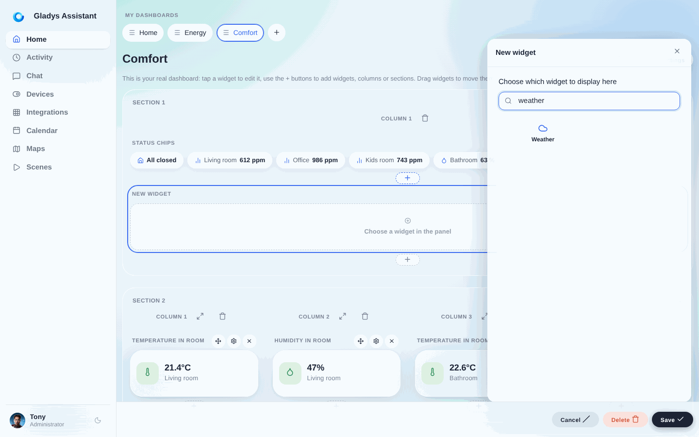
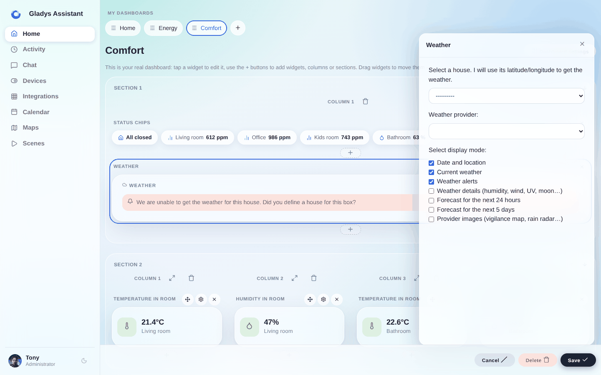
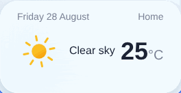

Du kannst das Wetter für deinen Standort auf dem Dashboard anzeigen.

## Voraussetzungen

- Du musst vorher eine Wetter-Integration aus dem [Integrationskatalog](/de/docs/integrations/) installiert und konfiguriert haben, etwa [OpenWeather](/de/docs/integrations/external/openweather/), Météo France oder Open-Meteo.
- Du musst dein Haus in den Einstellungen konfiguriert und auf der Karte platziert haben, damit der Wetteranbieter den Breiten- und Längengrad deines Hauses kennt.

## Konfiguration

Öffne das Dashboard und klicke auf „Bearbeiten“.

Füge ein Widget „Wetter“ hinzu:

Wähle anschließend dein Haus und die Anzeigeoptionen aus:

Klicke auf „Speichern“.

Jetzt solltest du das Wetter sehen!

