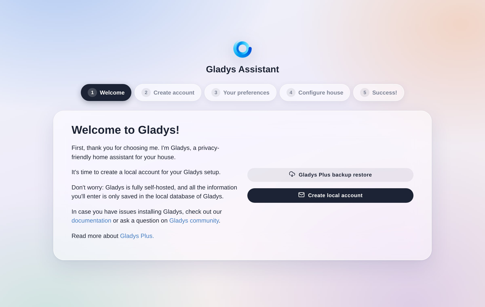

import {
  Roadmap,
  HowItWorks,
  InstallOptions,
  InstallOption,
  IntegrationChips,
  IntegrationsCount,
  Highlights,
} from "@site/src/components/docs/GettingStarted";
import GladysScreenshot from "@site/src/components/horizon/GladysScreenshot";

**Gladys Assistant ist eine kostenlose, quelloffene Smart-Home-Software.** Sie bringt alle deine Geräte in einer App zusammen, steuert sie von deinem Smartphone aus und automatisiert dein Zuhause, und das alles **bei dir zu Hause**, nicht in der Cloud eines anderen.

Von null bis zu deiner ersten Automatisierung, hier ist der ganze Weg:

<Roadmap
  label="Die Schritte dieser Anleitung"
  steps={[
    { href: "#install", title: "Gladys installieren", time: "~30 Min." },
    { href: "#create-account", title: "Konto anlegen", time: "2 Min." },
    { href: "#connect-devices", title: "Geräte verbinden", time: "5 Min. pro Marke" },
    { href: "#automate", title: "Zuhause automatisieren", time: "5 Min." },
  ]}
/>

<GladysScreenshot lang="de" caption="Das Dashboard von Gladys: deine Geräte, Räume, Kameras und dein Energieverbrauch, auf dem Computer und auf dem Smartphone." />

## So funktioniert Gladys {/* #how-it-works */}

<HowItWorks
  nodes={[
    { title: "Deine Geräte", text: "Lampen, Sensoren, Steckdosen, Heizung, Kameras … von jeder Marke." },
    { title: "Gladys, bei dir zu Hause", text: "Auf einem kleinen Computer, der immer läuft, wie dein Internet-Router." },
    { title: "Dein Smartphone & Computer", text: "Um alles zu steuern, vom Sofa aus oder von unterwegs." },
  ]}
>

Gladys ist **selbst gehostet**: Statt eines Cloud-Abos installierst du Gladys einmal auf einem kleinen Computer bei dir zu Hause. Deshalb gibt es einen Installationsschritt, und genau das macht Gladys **privat** (deine Daten verlassen nie dein Zuhause) und **zuverlässig** (dein Zuhause funktioniert weiter, auch wenn das Internet ausfällt).

</HowItWorks>

## Schritt 1: Gladys installieren {/* #install */}

Wähle den Rechner, auf dem Gladys laufen soll. **Unsicher? Nimm den Mini-PC**: Den nutzen die meisten, und ich auch bei mir zu Hause.

<InstallOptions>
<InstallOption
  featured
  icon="cpu"
  badge="Empfohlen"
  title="Auf einem Mini-PC, mit Gladys Assistant OS"
  facts={[["clock", "Etwa 30 Minuten"], ["check", "Keine Kommandozeile"], ["refresh-cw", "Automatische Updates"]]}
  cta="Gladys auf einem Mini-PC installieren"
  to="/de/docs/installation/mini-pc/"
>

Unser offizieller Installer erledigt die ganze Arbeit: Du schreibst ihn auf einen USB-Stick, startest den Mini-PC davon, beantwortest ein paar Fragen, und Gladys installiert sich von selbst. Danach hält es sich automatisch auf dem neuesten Stand.

- **Ein neuer Mini-PC**: klein, leise und sparsam. Ich empfehle den [Beelink Mini S13](https://www.amazon.com/s?k=Beelink+Mini+S13&tag=gladproj-21), siehe auch unseren [Mini-PC-Kaufratgeber](/de/mini-pc-home-automation/).
- **Ein generalüberholter Mini-PC**: oft deutlich günstiger. Achte auf mindestens 8 GB RAM und eine SSD.
- **Ein Computer, den du schon hast**: Ein alter PC mit Intel- oder AMD-Prozessor, einer SSD mit mindestens 16 GB und einem Ethernet-Anschluss kann deine Gladys-Box werden (seine Festplatte wird gelöscht).

</InstallOption>

<InstallOption
  icon="package"
  title="Auf einem Raspberry Pi"
  facts={[["clock", "30 Minuten bis 1 Stunde"], ["check", "Keine Kommandozeile"]]}
  cta="Auf einem Raspberry Pi installieren"
  to="/de/docs/installation/raspberry-pi/"
>

Du hast schon einen Raspberry Pi 3, 4 oder 5? Spiele unser offizielles 64-Bit-Image mit dem Raspberry Pi Imager auf: ideal, um Gladys kennenzulernen. Für den langfristigen Alltagsbetrieb bleibt ein Mini-PC die bessere Wahl.

</InstallOption>

<InstallOption
  icon="server"
  title="Auf einem Server oder NAS, den du schon betreibst"
  facts={[["clock", "Etwa 10 Minuten"], ["terminal", "Für Docker-Nutzer"]]}
>

Gladys läuft neben deinen anderen Diensten, ohne dass du einen neuen Rechner kaufen musst:

- [Docker unter Debian, Ubuntu oder jedem Linux](/de/docs/installation/docker/)
- [Proxmox VE](/de/docs/installation/proxmox/)
- [Synology-NAS](/de/docs/installation/synology/)
- [Unraid-NAS](/de/docs/installation/unraid/)

</InstallOption>
</InstallOptions>

## Schritt 2: Konto anlegen {/* #create-account */}

Sobald Gladys läuft, öffne es in deinem Browser, auf einem Computer oder Smartphone im selben Netzwerk:

- mit Gladys Assistant OS oder dem Raspberry-Pi-Image: **[http://gladysassistant.local](http://gladysassistant.local)**,
- sonst: die IP-Adresse des Rechners, zum Beispiel `http://192.168.1.42`.

Ein kurzer Assistent führt dich durch die Einrichtung: Lege das Administratorkonto an, wähle deine Einstellungen (Sprache, Einheiten) und gib deinem Zuhause und seinen Räumen einen Namen. Das dauert zwei Minuten, und alles, was du eingibst, bleibt in der lokalen Datenbank von Gladys.

Du kommst von einer früheren Installation? Mit der Schaltfläche **Gladys-Plus-Backup wiederherstellen** auf diesem Bildschirm holst du deine gesamte Konfiguration zurück.

## Schritt 3: Geräte verbinden {/* #connect-devices */}

Öffne in Gladys die **Integrationen** und wähle die Marke deiner Geräte. Gladys unterstützt mehr als <IntegrationsCount lang="de" /> Integrationen: die beliebtesten sind direkt eingebaut, die anderen mit einem Klick installiert.

<IntegrationChips lang="de" allLabel="Alle {count}+ Integrationen" />

Jede Integration hat in dieser Dokumentation ihre eigene Seite, mit den Schritten zur Einrichtung.

:::tip[Du fängst bei null an? Setz auf Zigbee]
Wenn du Geräte kaufst, empfehle ich **Zigbee**: Ein USB-Zigbee-Stick (rund 30 €) an deiner Gladys-Box und die [Zigbee2MQTT-Integration](/de/docs/integrations/zigbee2mqtt/) öffnen dir Tausende günstiger Sensoren, Steckdosen, Lampen und Fernbedienungen, von jeder Marke, ohne Hersteller-Bridge und ohne Cloud. Meine Auswahl zuverlässiger Modelle findest du auf der Seite [Empfohlene Hardware](/de/docs/installation/recommended-hardware/).
:::

Beispiel: ein Wohnzimmer für rund 150 $ ausstatten

Fang mit einem Raum an, schau, was dir gefällt, und erweitere dann Raum für Raum.

| Gerät                                                        | Preis  | Link                                                                                                                           |
| ------------------------------------------------------------ | ------ | ------------------------------------------------------------------------------------------------------------------------------ |
| Zigbee-Temperatur-/Feuchtigkeitssensor mit Display           | $19,99 | [Amazon US](https://amzn.to/4i3oRP1)                                                                                           |
| ZigBee-Steckdosen im 4er-Pack mit Echtzeit-Verbrauchsmessung | $16,99 | [Amazon US](https://amzn.to/3CRoBne)                                                                                           |
| IKEA-TRÅDFRI-E27-Glühbirne (Deckenleuchte)                   | $13,99 | [IKEA US](https://www.ikea.com/us/en/p/tradfri-led-bulb-e26-1100-lumen-smart-wireless-dimmable-white-spectrum-globe-50545678/) |
| IKEA-STYRBAR-Fernbedienung (Helligkeit)                      | $13,99 | [IKEA US](https://www.ikea.com/us/en/p/styrbar-remote-control-smart-white-80488370/)                                           |
| Zigbee-Bewegungsmelder im 4er-Pack                           | $75,99 | [Amazon US](https://amzn.to/4k2hb0X)                                                                                           |

## Schritt 4: Zuhause automatisieren {/* #automate */}

Hier zeigt Gladys, was es kann. Deine Geräte erscheinen auf dem **Dashboard**, das du [anpassen](/de/docs/dashboard/intro/) und mit deiner Familie teilen kannst. Dann lassen **Szenen** dein Zuhause von selbst arbeiten: ein Auslöser (eine Uhrzeit, ein Sensor, jemand kommt nach Hause …), ein paar Bedingungen und Aktionen.

<GladysScreenshot lang="de" shot="scene" alt="Eine Szene in Gladys Assistant" />

Ein paar Ideen für eine erste Szene:

<Highlights
  items={[
    { icon: "zap", title: "Den Flur nachts beleuchten", text: "Wird nach Sonnenuntergang eine Bewegung erkannt, das Licht für 2 Minuten einschalten." },
    { icon: "home", title: "Beruhigt das Haus verlassen", text: "Ist das Haus leer, alles ausschalten und die Alarmanlage scharf schalten." },
    { icon: "thermometer", title: "Nur heizen, wenn nötig", text: "Die Heizung nachts und bei Abwesenheit herunterfahren." },
    { icon: "message-square", title: "Sofort gewarnt werden", text: "Eine Nachricht erhalten, wenn Wasser ausläuft oder im Urlaub eine Tür aufgeht." },
  ]}
/>

👉 [Deine erste Szene erstellen](/de/docs/scenes/intro/)

Um Gladys wie eine App zu nutzen, [installiere es auf deinem Smartphone](/de/docs/installation/phone/). Um es von unterwegs zu steuern, bietet dir [Gladys Plus](/de/plus/), unser optionaler Dienst, einen Ende-zu-Ende-verschlüsselten Fernzugriff, ganz ohne Netzwerkkonfiguration.

## Häufige Fragen {/* #faq */}

Ist Gladys wirklich kostenlos?

Ja. Gladys ist quelloffen (Apache-2.0-Lizenz) und kostenlos, ohne Begrenzung bei Geräten oder Funktionen. [Gladys Plus](/de/plus/) ist ein optionaler, kostenpflichtiger Zusatzdienst (Fernzugriff, tägliche Backups, Google Home und Alexa, KI); er finanziert die Entwicklung des Projekts.

Muss ich programmieren oder ein Terminal benutzen können?

Nein. Mit Gladys Assistant OS oder dem Raspberry-Pi-Image installierst du Gladys, ohne einen einzigen Befehl einzutippen, und alles Weitere erledigst du in der Oberfläche von Gladys.

Funktioniert Gladys ohne Internet?

Ja. Gladys läuft lokal: Deine Geräte, dein Dashboard und deine Szenen funktionieren auch ohne Internet weiter. Eine Verbindung brauchst du nur für die Installation, für Updates und für die Integrationen von Cloud-Diensten.

Ich nutze schon eine andere Smart-Home-Software, kann ich wechseln?

Ja, und Gladys kann sogar parallel laufen, während du deine Geräte umziehst. Die meisten Zigbee-, Matter-, Philips-Hue- oder Shelly-Geräte lassen sich direkt mit Gladys koppeln. Sieh dir an, wie sich Gladys mit [Home Assistant](/de/home-assistant-alternative/) vergleicht.

## Brauchst du Hilfe?

Du kommst bei einem Schritt nicht weiter? Frag im [Forum](https://community.gladysassistant.com/): Die Community und ich antworten jeden Tag.
