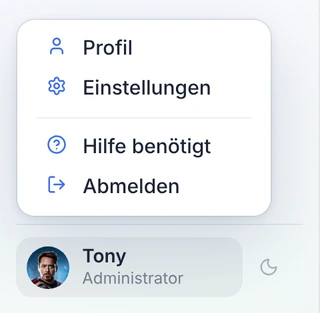
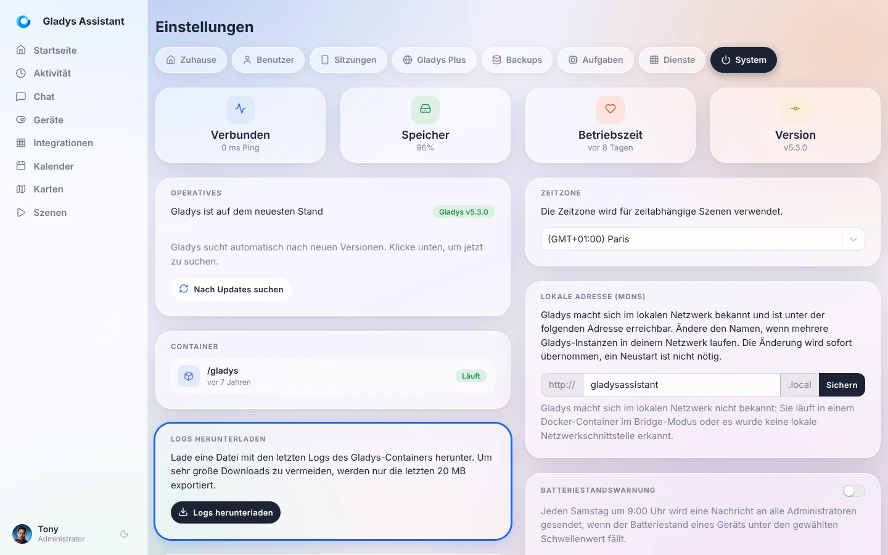
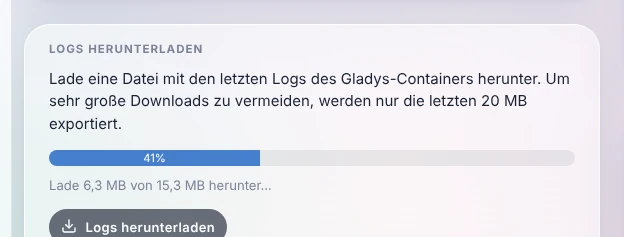

Wenn etwas nicht wie erwartet funktioniert (eine Integration startet nicht, ein Gerät reagiert nicht mehr, eine Szene wird nicht ausgeführt), schaust du dir als Erstes die **Logs von Gladys** an. Genau danach wirst du auch im [Forum](https://community.gladysassistant.com/) gefragt, wenn du Hilfe brauchst.

Du brauchst keine Kommandozeile: Gladys lässt dich seine Logs **mit einem Klick** direkt in der Oberfläche herunterladen.

## Logs in der Oberfläche herunterladen

Öffne Gladys im Browser, klicke unten links im Menü auf deinen Namen und dann auf **Einstellungen**.



Öffne den Tab **System** und klicke in der Karte **Logs herunterladen** auf **Logs herunterladen**.



Gladys sammelt die Logs und lädt sie in Teilen herunter: Ein Fortschrittsbalken zeigt dir, wie weit der Download ist.



Danach speichert dein Browser eine Textdatei mit einem Namen wie `gladys-logs-2026-10-26-101203.log`. Du kannst sie mit jedem Texteditor öffnen.

Gut zu wissen:

- Es werden nur die **letzten 20 MB** an Logs exportiert, damit die Datei klein bleibt. Das reicht locker für die letzten Stunden oder Tage.
- Du musst mit einem **Administrator**-Konto angemeldet sein.
- Es funktioniert auch **aus der Ferne über [Gladys Plus](/de/docs/plus/intro)**: Du musst nicht zu Hause sein, um die Logs zu holen.
- Den Button gibt es seit Gladys Assistant v4.77. Wenn du ihn nicht siehst, [aktualisiere Gladys](/de/docs/installation/faq).

## Logs im Forum teilen

Um Hilfe zu bekommen, [erstelle ein Thema im Forum](https://community.gladysassistant.com/), beschreibe dein Problem und hänge die Log-Datei an (oder füge die relevanten Zeilen in einen Codeblock ein).

Wirf vor dem Posten einen kurzen Blick in die Datei: Logs können die Namen deiner Geräte, lokale IP-Adressen oder URLs deiner Dienste enthalten. Entferne alles, was du nicht öffentlich teilen möchtest.

## Logs über die Kommandozeile lesen

Wenn sich die Oberfläche von Gladys gar nicht öffnet, kannst du die Logs trotzdem auf dem Rechner lesen, auf dem Gladys läuft. Verbinde dich damit (zum Beispiel per SSH) und führe aus:

```bash
sudo docker logs gladys --tail=1000
```

Das zeigt die letzten 1000 Zeilen an. Um die Logs live zu verfolgen, während du das Problem nachstellst, füge `-f` hinzu:

```bash
sudo docker logs gladys --tail=100 -f
```

Mit `Strg+C` beendest du die Anzeige.

## Häufig gestellte Fragen

### Wo werden die Logs von Gladys gespeichert?

Gladys läuft in einem Docker-Container und schreibt seine Logs in die Standardausgabe dieses Containers: Docker speichert sie auf dem Host. Deshalb liest du sie über die Oberfläche oder mit `docker logs` und nicht in einer Datei im Ordner `/var/lib/gladysassistant`.

### Der Download schlägt mit „Logs konnten nicht heruntergeladen werden“ fehl

Gladys liest seine Logs über Docker. Prüfe, ob Gladys in Docker läuft und ob der Docker-Socket mit dem Container geteilt ist (die Option `-v /var/run/docker.sock:/var/run/docker.sock` des [Installationsbefehls](/de/docs/installation/docker)). Wenn das Problem bleibt, lies die Logs [über die Kommandozeile](#logs-über-die-kommandozeile-lesen).

### Wie sehe ich die Logs einer Community-Integration?

Jede externe Integration läuft in einem eigenen Container und hat eigene Logs: Öffne die Integration in Gladys und gehe in ihren Tab **Protokolle**.
