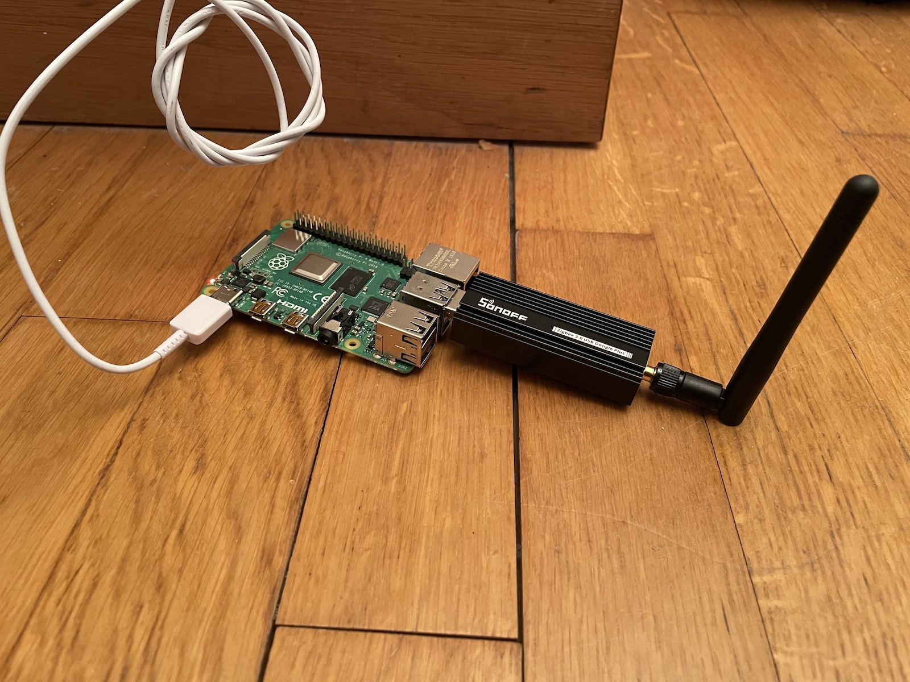
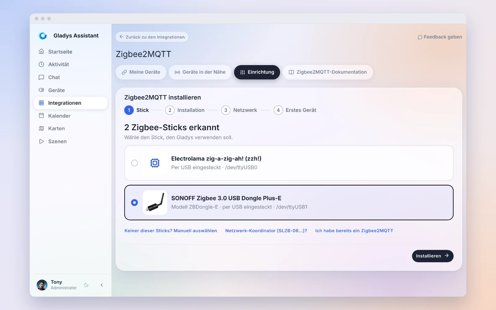
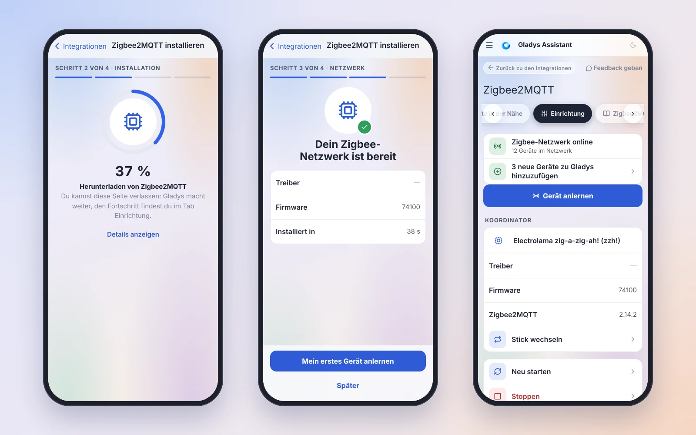
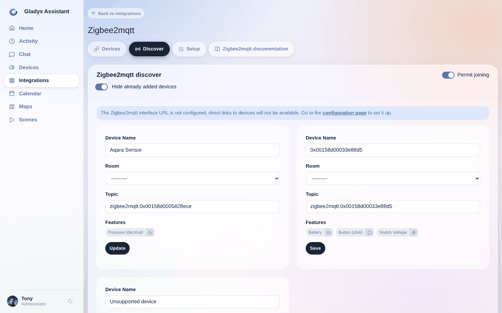
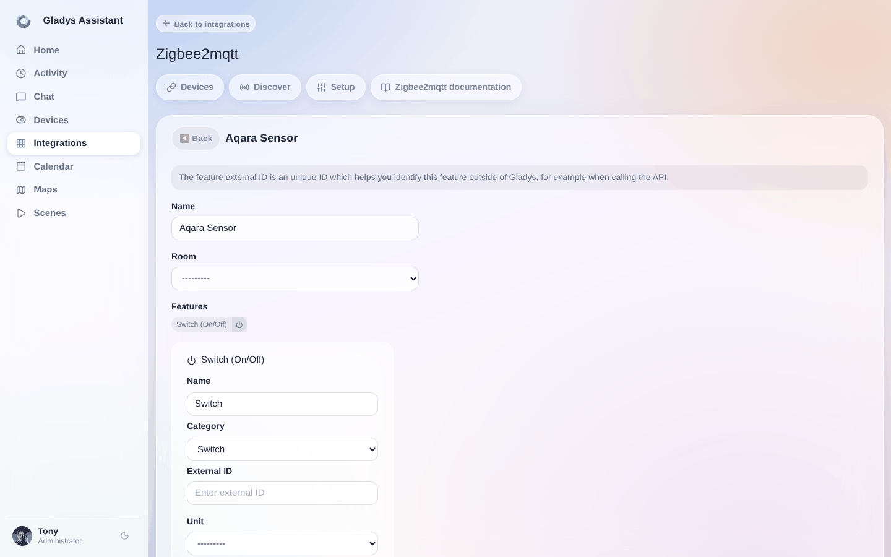

import JsonLd from '@site/src/components/seo/JsonLd';

Mit Zigbee2MQTT betreibst du deinen eigenen **lokalen Zigbee-Hub** mit Gladys: Du steckst einen USB-Zigbee-Dongle in den Rechner, auf dem Gladys läuft, und steuerst jedes Zigbee-Gerät direkt von zu Hause aus, ohne Cloud-Konto und ohne Hersteller-Bridge. Diese Anleitung zeigt dir, wie du alles einrichtest, deinen Dongle koppelst und Geräte hinzufügst.

:::tip[Du kommst von Home Assistant?]
Gladys installiert und verwaltet Zigbee2MQTT und den zugehörigen MQTT-Broker für dich: Siehe [Zigbee2MQTT ohne Home Assistant](/de/zigbee2mqtt-without-home-assistant/). Du suchst noch einen Dongle? Lies unseren [Kaufratgeber für Zigbee-Dongles](/de/best-zigbee-dongle/).
:::

Kurz gesagt verbinden wir deine Zigbee-Geräte direkt mit Gladys, ganz ohne Drittanbieter-Bridges (nur mit einem USB-Zigbee-Dongle und dem Projekt [Zigbee2Mqtt](https://www.zigbee2mqtt.io/)).

Die Liste der kompatiblen Geräte findest du [hier](https://www.zigbee2mqtt.io/supported-devices/).

Bevor du loslegst, stelle sicher, dass du einen Zigbee-Koordinator hast: entweder einen USB-Dongle, der im Rechner mit Gladys steckt, oder einen Netzwerk-Koordinator (siehe [Einen Netzwerk-Koordinator verwenden](#use-a-network-coordinator) weiter unten). Läuft Zigbee2MQTT schon woanders, kann sich Gladys auch [damit verbinden](#connect-to-an-existing-zigbee2mqtt).

Ein einfacher und günstiger USB-Dongle, den wir mit Gladys getestet haben, ist der [Sonoff Zigbee 3.0 USB Dongle](https://amzn.to/3JZwzJy).

Die vollständige Liste der kompatiblen Adapter findest du in der [Liste der von Zigbee2mqtt unterstützten Adapter](https://www.zigbee2mqtt.io/guide/adapters/).

## Zigbee2MQTT mit dem Einrichtungsassistenten installieren {/* #install-zigbee2mqtt-with-the-setup-wizard */}

Seit Gladys 5.3.4 führt dich ein Assistent in vier Schritten durch die erste Installation. Gladys installiert zwei Container für dich, einen MQTT-Broker und Zigbee2MQTT: Du musst nichts in ein Terminal tippen. Dafür muss Gladys in Docker mit dem Netzwerk `host` laufen, was bei jeder Standardinstallation der Fall ist.

Stecke deinen Zigbee-Dongle in den Rechner, auf dem Gladys läuft (deinen Raspberry Pi, deinen Mini-PC, dein NAS).



Gehe in Gladys auf `Integrationen / Zigbee2Mqtt` und öffne den Tab `Einrichtung`.



### Schritt 1: der Stick

Gladys erkennt die gängigsten Dongles (SONOFF ZBDongle-P und ZBDongle-E, Home Assistant Connect ZBT-1 und ZBT-2, ConBee II und III, SMLIGHT SLZB-06M und SLZB-07…). Was der Assistent anzeigt, hängt davon ab, was eingesteckt ist:

- **Zigbee-Stick erkannt**: Gladys zeigt deinen Dongle mit Foto und Namen. Du musst nichts auswählen.
- **2 Zigbee-Sticks erkannt** (oder mehr): Wähle den aus, den Gladys verwenden soll.
- **Gladys hat deinen Stick nicht erkannt**: Wähle sein Modell in der nach Marken gruppierten Liste. Das Suchfeld findet ein Modell über seinen Namen oder seinen Code (`dongle-e`, `sonoff p`, `conbee`, `skyconnect`…). Das Modell steht auf dem Dongle oder seiner Verpackung: Es legt den Treiber fest, mit dem Zigbee2MQTT mit ihm spricht.
- **Stecke deinen Zigbee-Stick ein**: Noch ist kein Dongle eingesteckt. Gladys erkennt ihn, sobald du ihn einsteckst, ohne die Seite neu zu laden.

Links darunter führen zu den anderen Möglichkeiten (auf dem Smartphone sind sie unter **Anderer Stick oder andere Installation** zusammengefasst):

- **Nicht der richtige Stick? Manuell auswählen** (oder **Mein Stick ist eingesteckt, erscheint aber nicht**): Wähle Port und Modell von Hand. Die seriellen Ports des Rechners selbst und der GPIO-HATs (wie das RaspBee) sind ausgeblendet: Klicke auf **Weitere serielle Ports anzeigen (HAT/GPIO-Platine, Ports des Rechners)**, um sie zu sehen.
- **Netzwerk-Koordinator (SLZB-06…)?**: siehe [Einen Netzwerk-Koordinator verwenden](#use-a-network-coordinator).
- **Ich habe bereits ein Zigbee2MQTT**: siehe [Mit einem bestehenden Zigbee2MQTT verbinden](#connect-to-an-existing-zigbee2mqtt).

Klicke dann auf **Installieren**. Gladys prüft, ob der Dongle eingesteckt ist, bevor es irgendetwas speichert. Es lädt Zigbee2MQTT sogar schon herunter, sobald ein Dongle ausgewählt ist, bevor du klickst: So geht die Installation umso schneller.

:::tip
Stecke den Dongle an das Ende eines USB-Verlängerungskabels, weg von USB-3-Ports und vom WLAN-Router: Das Zigbee-Signal wird dadurch nur besser.
:::

:::info[EmberZNet-Dongle mit alter Firmware]
Viele Dongles auf Basis von [EmberZNet](https://www.zigbee2mqtt.io/guide/adapters/emberznet.html) (zum Beispiel der Sonoff Zigbee 3.0 ZBDongle-E) werden noch mit einer Firmware älter als 7.4 verkauft, die der `ember`-Treiber von Zigbee2MQTT ablehnt. Seit Gladys 5.3.3 musst du nichts tun: Gladys erkennt das, stellt deinen Dongle auf sein Modell `(legacy ezsp)` um und installiert Zigbee2MQTT mit dem Kompatibilitätstreiber `ezsp` neu. Die Installation zeigt **Alte Firmware: Wechsel zu ezsp…**, danach wird der Treiber als `ezsp (Kompatibilität)` angezeigt, sobald das Netzwerk bereit ist, und im Dashboard.

Der `ezsp`-Treiber ist veraltet, daher empfehlen wir trotzdem, die [Firmware deines Dongles zu aktualisieren](https://www.zigbee2mqtt.io/guide/adapters/emberznet.html#firmware-flashing). Wähle danach mit der Schaltfläche **Ändern** im Dashboard das Modell ohne `(legacy ezsp)` (oder den Typ `ember` für einen Netzwerk-Koordinator), um zum `ember`-Treiber zurückzukehren.
:::

:::warning
Wenn du Gladys auf einer externen USB-Festplatte betreibst, kann es zu Stromproblemen kommen, da dein Pi Schwierigkeiten haben kann, sowohl die Festplatte als auch den Zigbee-USB-Stick ausreichend zu versorgen.

Wir empfehlen dir einen USB-Hub mit eigener Stromversorgung.

Mehr dazu liest du auf der Website von Zigbee2MQTT: [Zigbee2MQTT fails to start](https://www.zigbee2mqtt.io/guide/installation/20_zigbee2mqtt-fails-to-start.html)
:::

### Schritt 2: die Installation

Gladys zeigt den Fortschritt Phase für Phase: Herunterladen von Zigbee2MQTT und des MQTT-Brokers (beide gleichzeitig, und nur wenn sie noch nicht auf dem Rechner sind), Starten des Brokers, Starten von Zigbee2MQTT, dann die Verbindung mit dem Stick. Auf einem Raspberry Pi 4 waren die Images in unseren Tests in etwa 15 Sekunden heruntergeladen, und Zigbee2MQTT antwortete 15 Sekunden nach seinem Start.

Du kannst die Seite verlassen: Die Installation läuft im Hintergrund weiter. Ihren Fortschritt findest du im Tab `Einrichtung` und unter **Einstellungen > Aufgaben**.

Vor jedem Download prüft Gladys den freien Speicherplatz und hält 500 MB für den Rest von Gladys frei: Reicht er nicht, sagt Gladys es dir, statt die Festplatte zu füllen.

Schlägt die Installation fehl, erklärt Gladys den Grund mit einem kurzen Titel und einer Meldung, darunter die **Technischen Details**. Klicke auf **Erneut versuchen** oder auf **Stick oder Modell ändern**. Der [Abschnitt zur Fehlerbehebung](#häufige-zigbee2mqtt-fehler-beheben) erklärt jede Meldung.

Schließt du die Seite oder startest Gladys vor dem Ende einer ersten Installation neu, öffnet sich der Assistent wieder dort, wo du aufgehört hast, bis Zigbee2MQTT einmal geantwortet hat.

### Schritt 3: das Netzwerk ist bereit

**Dein Zigbee-Netzwerk ist bereit**: Gladys zeigt den Treiber, die Firmware des Koordinators und die Dauer der Installation. Klicke auf **Mein erstes Gerät anlernen** oder auf **Später**.

### Schritt 4: das erste Gerät

Klicke auf **Anlernen aktivieren**: Gladys erlaubt neuen Geräten 4 Minuten lang, dem Netzwerk beizutreten. Bringe das Gerät auf höchstens 2 Meter an den Dongle heran und versetze es in den Anlernmodus: oft ein langer Druck (5 s) auf seine Taste; eine Lampe schaltest du 5- bis 6-mal hintereinander ein und aus. Klicke dann auf **Geräte in der Nähe öffnen**, um es zu Gladys hinzuzufügen (siehe [Geräte hinzufügen](#add-devices)).

:::note[Gladys kann Zigbee2MQTT auf diesem Rechner nicht installieren?]
Läuft Gladys nicht in Docker oder wurde sein Container nicht mit dem Netzwerk `host` gestartet, sagt der Assistent es dir und verweist auf den [Installationsbefehl von Gladys](/de/docs/installation/docker/). Du kannst Gladys trotzdem mit einem [Zigbee2MQTT verbinden, das woanders läuft](#connect-to-an-existing-zigbee2mqtt).
:::

## Einen Netzwerk-Koordinator verwenden {/* #use-a-network-coordinator */}

Seit Gladys 5 muss der Koordinator nicht mehr im Rechner mit Gladys stecken. Ein Netzwerk-Koordinator (SMLIGHT SLZB-06/SLZB-07, ZigStar…) verbindet sich per Ethernet oder WLAN, sodass du ihn mitten in deinem Zuhause platzieren kannst, weit weg von deinem Server und von Störquellen. Gladys installiert und verwaltet Zigbee2MQTT weiterhin für dich.

Klicke in Schritt 1 des Assistenten auf **Netzwerk-Koordinator (SLZB-06…)?** und dann:

1. Gib die **Adresse des Koordinators** ein, die in seiner Weboberfläche steht, mit ihrem TCP-Port: zum Beispiel `tcp://192.168.1.20:6638` (das Präfix `tcp://` ist optional). Gib dem Koordinator in deinem Router eine feste IP-Adresse.
2. Wähle den **Typ des Koordinators**: **Silicon-Labs-Chip** (SLZB-06M, SLZB-07…, Treiber `ember`), **Texas-Instruments-Chip** (SLZB-06, SLZB-06P7…, Treiber `zstack`) oder **dresden elektronik** (Treiber `deconz`). Im Zweifel steht er in der Dokumentation deines Koordinators.
3. Klicke auf **Installieren** und folge dann den Schritten 2 bis 4 wie mit einem USB-Dongle.

## Mit einem bestehenden Zigbee2MQTT verbinden {/* #connect-to-an-existing-zigbee2mqtt */}

Zigbee2MQTT läuft schon woanders (Home Assistant, ein anderer Rechner…)? Gladys kann sich mit seinem MQTT-Broker verbinden, ohne etwas zu installieren. Klicke in Schritt 1 des Assistenten auf **Ich habe bereits ein Zigbee2MQTT** und gib Folgendes ein:

- die **Adresse des MQTT-Brokers**, zum Beispiel `mqtt://192.168.1.30:1883`;
- den **Benutzer** und das **Passwort** des Brokers;
- die **Adresse der Zigbee2MQTT-Oberfläche** (optional), für die Links zu seiner Weboberfläche.

Klicke dann auf **Verbinden**. Das Netzwerk ist bereit, sobald Zigbee2MQTT auf dem Broker antwortet, nicht schon, wenn Gladys mit dem Broker verbunden ist. Antwortet es nicht, prüfe, ob Zigbee2MQTT läuft und ob sein Basis-Topic (`mqtt.base_topic`) `zigbee2mqtt` ist. Gladys braucht Zigbee2MQTT 1.21 oder neuer.

Im Dashboard trennt **Trennen** nur Gladys: Dein Zigbee2MQTT läuft weiter. Das Zurücksetzen der Integration vergisst nur die Verbindung: Dein Zigbee2MQTT, seine Konfiguration und seine Geräte bleiben unberührt.

## Das Zigbee2MQTT-Dashboard {/* #the-zigbee2mqtt-dashboard */}

Sobald Zigbee2MQTT installiert ist, zeigt der Tab `Einrichtung` ein Dashboard. Eine Installation, die vor Gladys 5.3.4 eingerichtet wurde, landet direkt darauf: Ihre Konfiguration, ihre Container und ihr Zigbee-Netzwerk bleiben erhalten.



### Der Zustand von Zigbee2MQTT

Oben zeigt Gladys, wo Zigbee2MQTT steht, und was zu tun ist:

- **Zigbee-Netzwerk online**, mit der Anzahl der Geräte im Netzwerk. Sind Geräte dem Netzwerk beigetreten, aber noch nicht in Gladys, führt ein Link zum Tab `Geräte in der Nähe` (**1 neues Gerät zu Gladys hinzuzufügen**). **Gerät anlernen** erlaubt neuen Geräten 4 Minuten lang den Beitritt.
- **Zigbee2MQTT startet…**: Gladys wartet auf seine Antwort. Es zeigt Zigbee2MQTT erst als online an, wenn es wirklich gestartet ist und Gladys geantwortet hat.
- Eine Installation, ein Update oder ein Wechsel des Koordinators, mit dem Fortschritt.
- **Zigbee2MQTT startet nicht**: Gladys liest die Logs von Zigbee2MQTT und erklärt den Grund, mit dem, was zu tun ist. Klicke auf **Neu starten**, sobald es behoben ist, oder auf **Stick oder Modell ändern**. Siehe [Häufige Zigbee2MQTT-Fehler beheben](#häufige-zigbee2mqtt-fehler-beheben).
- **Zigbee-Stick ausgesteckt**: siehe [Stick ausgesteckt oder an einen anderen Port gesteckt](#dongle-unplugged-or-moved-to-another-port).
- **Zigbee2MQTT antwortet nicht**: Gladys bekommt keine Antwort von ihm; es stürzt vielleicht beim Start ab. Siehe denselben Abschnitt zur Fehlerbehebung.
- **Gladys ist nicht mit dem MQTT-Broker verbunden**: Gladys empfängt die Nachrichten von Zigbee2MQTT nicht mehr.
- **Zigbee2MQTT ist gestoppt**: seit wann, mit einer Schaltfläche **Starten**.
- **Der Zigbee2MQTT-Dienst ist nicht gestartet**: Er wurde unter **Einstellungen > Dienste** gestoppt. Starte ihn dort.

Solange Zigbee2MQTT nicht antwortet, zeigen die Tabs `Meine Geräte` und `Geräte in der Nähe` ein Banner, das darauf hinweist, und das Anlernen von Geräten ist deaktiviert. Das Banner verschwindet von selbst, sobald Zigbee2MQTT bereit ist.

### Der Koordinator und die Aktionen

Darunter zeigt das Dashboard deinen Koordinator: sein Foto, seinen Namen, seinen Treiber, seine Firmware und die Version von Zigbee2MQTT. Seine Schaltfläche **Ändern** öffnet Schritt 1 des Assistenten, um einen anderen Dongle zu wählen; der aktuelle ist markiert. Verwendet der neue Dongle einen anderen Treiber (zum Beispiel einen Texas-Instruments-Chip statt eines Silicon-Labs-Chips), warnt dich Gladys: Zigbee2MQTT kann dein Netzwerk darauf nicht übernehmen, und du musst deine Geräte neu anlernen.

Die Schaltflächen:

- **Neu starten** startet Zigbee2MQTT neu: Deine Geräte reagieren in den wenigen Sekunden nicht.
- **Stoppen** stoppt Zigbee2MQTT, und Gladys merkt es sich: Weder ein Neustart von Gladys noch ein Neustart des Rechners startet es wieder, bis du auf **Starten** klickst. Praktisch, um zum Beispiel den Dongle zu flashen.
- **Zigbee2MQTT-Oberfläche** öffnet die Weboberfläche von Zigbee2MQTT. Seit Gladys 5.3.4 ist sie bei jeder Installation aktiviert: Eine bestehende Installation bekommt sie beim nächsten Start von Gladys, das Zigbee2MQTT dabei einmal neu startet.

### Erweiterte Einstellungen

Die **Erweiterten Einstellungen** enthalten:

- den **Port** der Zigbee2MQTT-Oberfläche (eine Änderung startet Zigbee2MQTT neu; seine Daten bleiben erhalten);
- die Verbindung zum MQTT-Broker, für ein [bestehendes Zigbee2MQTT](#connect-to-an-existing-zigbee2mqtt);
- den Zustand jeder **Komponente**: Gladys ↔ MQTT-Broker, MQTT-Broker und Zigbee2MQTT;
- die **Verbindung für externe Tools**: schreibgeschützte Zugangsdaten, um Tools wie Node-RED mit dem von Gladys verwalteten MQTT-Broker zu verbinden, mit einer Kopieren-Schaltfläche. Läuft das Tool auf einem anderen Rechner, ersetze `localhost` in der URL durch die IP-Adresse deines Gladys-Rechners;
- **Integration zurücksetzen**: entfernt die Container, die Konfiguration und das Zigbee-Netzwerk. Du musst alle deine Geräte neu anlernen: Behalte das für einen Neuanfang vor.

Verlässt du diese Ansicht mit ungespeicherten Änderungen, fragt Gladys vorher nach.

### Updates von Zigbee2MQTT

Wenn Gladys Zigbee2MQTT aktualisiert, lädt es zuerst das neue Image herunter, während dein Zigbee-Netzwerk weiterläuft, und ersetzt dann den Container. Ohne Internet oder ohne genug Speicherplatz läuft die aktuelle Version weiter: Das Dashboard zeigt an, dass ein Update von Zigbee2MQTT wartet, und Gladys versucht es beim nächsten Start erneut. Alte Images, die kein Container mehr verwendet, werden entfernt, damit sie die Festplatte nicht füllen.

## Stick ausgesteckt oder an einen anderen Port gesteckt {/* #dongle-unplugged-or-moved-to-another-port */}

Seit Gladys 5.3.4 speichert Gladys deinen Dongle über seinen stabilen Pfad (`/dev/serial/by-id/…`) und nicht über seinen Portnamen (`/dev/ttyUSB0`), der sich beim nächsten Neustart oder beim Einstecken eines anderen USB-Geräts ändern kann. An einem anderen USB-Port wird der Dongle wiedergefunden. Beim Start von Gladys wird eine bestehende Installation, deren Dongle Gladys erkennt, von selbst auf den stabilen Pfad umgestellt, ohne dass etwas neu angelernt werden muss.

Steckst du den Dongle aus, zeigt das Dashboard **Zigbee-Stick ausgesteckt**. Stecke ihn wieder ein, an einem beliebigen Port: Zigbee2MQTT startet innerhalb von etwa zehn Sekunden von selbst wieder, ohne Neustart von Gladys. Ein Zigbee2MQTT, das du selbst gestoppt hast (im Dashboard oder mit Docker), bleibt gestoppt: Klicke im Dashboard auf **Starten**.

## Dein Zigbee-Netzwerk behalten {/* #keep-your-zigbee-network */}

Dein Zigbee-Netzwerk wird durch seinen Netzwerkschlüssel, seine PAN-ID und seine erweiterte PAN-ID bestimmt, die auf dem Koordinator und in der Konfiguration von Zigbee2MQTT gespeichert sind.

- Seit Gladys 5.3.4 lässt eine neue Installation Zigbee2MQTT diese Einstellungen selbst erzeugen, wie bei einem eigenständig installierten Zigbee2MQTT.
- Gladys sichert die Konfiguration von Zigbee2MQTT jede Nacht in seiner Datenbank. Geht die Konfigurationsdatei (`configuration.yaml`) verloren, ist sie leer oder beschädigt (zum Beispiel durch einen Stromausfall), stellt Gladys sie beim nächsten Start aus dieser Sicherung wieder her: Das Netzwerk behält seine Einstellungen und seine Geräte. Eine Datei, die kein gültiges YAML ist, wird als `configuration.yaml.invalid-<Datum>` beiseitegelegt. Ohne Sicherung zeigt Gladys den Fehler an und lässt die Datei liegen, damit du sie korrigieren kannst; starte Gladys danach neu.
- Um dein Netzwerk zu behalten, wenn du deinen Koordinator auf eine neue Gladys-Installation umziehst, stelle dein Gladys-Plus-Backup wieder her, **bevor** du Zigbee2MQTT einrichtest: siehe die [Anleitung zum Umzug auf einen neuen Rechner](/de/docs/installation/migrate).
- **Integration zurücksetzen** oder ein neuer Dongle mit einem anderen Treiber bildet ein neues Netzwerk: Deine Geräte müssen neu angelernt werden.

## Kopplung von Geräten erlauben

Damit Geräte deinem Zigbee-Netzwerk beitreten können, öffne den Tab `Geräte in der Nähe` und klicke auf die Schaltfläche **Anlernen aktivieren**. Gladys zeigt den Beitritt erst als geöffnet an, wenn Zigbee2MQTT es bestätigt.


Seit Gladys 5.3.4 schließt sich der Beitritt nach etwa 4 Minuten von selbst: Du musst nicht mehr zurückkommen, um ihn zu sperren. Klicke auf **Anlernen beenden**, um ihn früher zu schließen.

## Geräte hinzufügen {/* #add-devices */}

Wie du dein Gerät dem Netzwerk beitreten lässt, steht in seiner Anleitung. Meistens genügt ein langer Druck auf die physische Taste.

Die bereits mit deinem Zigbee-Netzwerk gekoppelten Geräte erscheinen automatisch mit ihren erkannten Funktionen in der Liste. Du kannst sie umbenennen, über die Auswahlliste einem Raum zuordnen und dann auf **Zu Gladys hinzufügen** klicken. **Bereits hinzugefügte Geräte ausblenden** zeigt nur die neuen.



Seit Gladys 5.3.4 zeigt ein Gerät seine Werte, sobald es hinzugefügt ist: Gladys behält die Werte, die Zigbee2MQTT gesendet hat, seit Gladys mit ihm verbunden ist, und fragt Geräte am Stromnetz (Steckdosen, Lampen…) nach ihren aktuellen Werten. Ein batteriebetriebener Sensor, der seitdem nichts gesendet hat, zeigt seine Werte bei seiner nächsten Meldung: wenn ein Kontaktsensor geöffnet wird, nach etwa einer Stunde bei einem Temperatursensor.

## Die Geräte bearbeiten

Bei Bedarf kannst du im Tab `Meine Geräte` die Konfiguration deiner Geräte anpassen oder ergänzen.

Klicke bei einem Gerät auf den Button **Bearbeiten**. Dann kannst du seinen Namen, den Raum, zu dem es gehört, und den Namen jeder Funktion ändern. Auf dem Smartphone ist jedes Gerät eine Zeile, die ein Fenster mit denselben Einstellungen öffnet. Das Löschen eines Geräts fragt vorher nach einer Bestätigung.



## Verwendung

Du kannst diese Zigbee-Geräte jetzt über das [Dashboard](../dashboard/devices.md) oder automatisch in den [Szenen](../scenes/intro.md) verwenden. Je nach Funktion des jeweiligen Geräts hast du Zugriff auf Messwerte, Zustände oder Aktionen.

## Häufige Zigbee2MQTT-Fehler beheben

Die meisten Zigbee2MQTT-Probleme haben drei Ursachen: den falschen USB-Port, den falschen Adaptertyp oder Störungen im 2,4-GHz-Band. Hier sind die Fehler, auf die du am wahrscheinlichsten stößt, und was sie tatsächlich bedeuten. Seit Gladys 5.3.3 nennt dir Gladys auch die Ursache und was zu tun ist. Seit Gladys 5.3.4 zeigt es einen kurzen Titel, eine Meldung und die technischen Details, in Schritt 2 des Assistenten oder im Dashboard des Tabs `Einrichtung`: Die fett gedruckten Titel unten sind die, die es anzeigt. Die vollständigen Logs von Zigbee2MQTT liest du mit `sudo docker logs gladys-z2m-zigbee2mqtt` auf dem Rechner, auf dem Gladys läuft.

### Error while starting zigbee-herdsman

Zigbee2MQTT konnte überhaupt nicht mit deinem Dongle kommunizieren. Wenn der Treiber aufgibt, zeigt Gladys **Der Zigbee-Koordinator antwortet nicht** an. In den Logs schreibt der Treiber `Failed to connect to the adapter` (Texas Instruments, `zstack`), `Failed to start EZSP layer with status=HOST_FATAL_ERROR` (Silicon Labs, `ember`), `Failure to connect` (`ezsp`) oder `failed to start adapter connection to firmware` (ConBee, `deconz`). Prüfe in dieser Reihenfolge:

1. Der im Dashboard angezeigte **Dongle** ist der eingesteckte. Seit Gladys 5.3.4 wird ein an einen anderen Port umgesteckter Dongle wiedergefunden; verwendest du einen anderen Dongle, wähle ihn mit der Schaltfläche **Ändern** aus.
2. Das **Dongle-Modell** passt zu deiner Hardware: Es bestimmt den Treiber, den Zigbee2MQTT verwendet. Ein Silicon-Labs-Dongle, der als Texas-Instruments-Dongle konfiguriert ist (oder umgekehrt), scheitert genau hier. Zum Korrigieren klicke auf **Stick oder Modell ändern**.
3. Keine andere Software verwendet den Koordinator (Home Assistant, ein anderes Zigbee2MQTT…). Nur eine einzige kann ihn belegen.
4. Der Dongle bekommt genug Strom. Ziehe ihn ab, stecke ihn über einen **USB-Hub mit eigener Stromversorgung** oder ein kurzes USB-Verlängerungskabel wieder ein und starte die Integration neu. Einen Netzwerk-Koordinator startest du neu.

### Failed to connect to the adapter (SRSP - SYS - ping after 6000ms)

Dieser Fehler betrifft speziell Koordinatoren von Texas Instruments (CC2652 / ZBDongle-P): Der Adapter ist vorhanden, antwortet aber nicht. Gladys zeigt ihn als **Der Zigbee-Koordinator antwortet nicht** an. Fast immer liegt es an einem falschen Port, einem falschen Adaptertyp in den Einstellungen oder einem Dongle, der physisch abgezogen und wieder eingesteckt werden muss. Besteht das Problem weiter, löst ein erneutes Flashen der Koordinator-Firmware die übrigen Fälle.

### Zigbee2MQTT kann deinen Netzwerk-Koordinator nicht erreichen (ECONNREFUSED, ETIMEDOUT, ENOTFOUND)

Mit einem [Netzwerk-Koordinator](#use-a-network-coordinator) zeigt Gladys **Netzwerk-Koordinator nicht erreichbar** an, wenn der Treiber keine Verbindung zu ihm aufbauen kann: In den Logs steht `connect ECONNREFUSED`, `connect ETIMEDOUT`, `connect EHOSTUNREACH` oder `getaddrinfo ENOTFOUND`. Prüfe, ob:

1. Der Koordinator eingeschaltet und mit deinem Netzwerk verbunden ist: Seine Weboberfläche öffnet sich in deinem Browser.
2. Seine Adresse und sein TCP-Port stimmen, zum Beispiel `tcp://192.168.1.20:6638`. Zum Korrigieren klicke im Dashboard auf **Ändern**.
3. Seine IP-Adresse sich nicht geändert hat: Gib ihm in deinem Router eine feste IP-Adresse.

### Refusing to start because configuration is not valid

Zigbee2MQTT lehnt seine Konfigurationsdatei (`configuration.yaml`) ab und wartet, ohne sich zu beenden. Gladys zeigt **Konfiguration von Zigbee2MQTT abgelehnt** an, gefolgt von den abgelehnten Einstellungen. Gladys schreibt diese Datei für dich, daher passiert das vor allem nach einer manuellen Änderung: Korrigiere die angezeigten Einstellungen in `configuration.yaml` im Datenordner von Zigbee2MQTT. Bei einer Standardinstallation ist das `/var/lib/gladysassistant/zigbee2mqtt/z2m`. Wenn du beim Start von Gladys einen anderen Ordner des Hosts eingebunden hast, zeigt dir dieser Befehl den richtigen an:

```bash
sudo docker inspect -f '{{range .Mounts}}{{if eq .Destination "/app/data"}}{{.Source}}{{end}}{{end}}' gladys-z2m-zigbee2mqtt
```

Klicke danach im Dashboard auf **Neu starten**. Wenn du die Datei nie geändert hast, melde es mit den abgelehnten Einstellungen im [Gladys-Forum](https://community.gladysassistant.com/).

### Adapter EZSP protocol version (8) is not supported by host

Dein EmberZNet-Dongle (Silicon Labs), typischerweise ein **Sonoff ZBDongle-E**, läuft mit einer Firmware älter als 7.4, die der `ember`-Treiber von Zigbee2MQTT ablehnt. Seit Gladys 5.3.3 musst du meistens nichts tun: Gladys erkennt diesen Fehler, stellt deinen Dongle auf sein Modell `(legacy ezsp)` um (oder einen Netzwerk-Koordinator auf den Adaptertyp `ezsp`) und installiert Zigbee2MQTT neu. Der Treiber wird dann als `ezsp (Kompatibilität)` angezeigt, sobald das Netzwerk bereit ist, und im Dashboard.

In zwei Fällen zeigt Gladys weiterhin einen Fehler an (**Firmware des Sticks zu alt**):

- Dein Modell hat keine `(legacy ezsp)`-Variante: [Aktualisiere die Firmware des Dongles](https://www.zigbee2mqtt.io/guide/adapters/emberznet.html#firmware-flashing).
- Die Firmware ist **neuer**, als Zigbee2MQTT unterstützt: Der `ezsp`-Treiber würde sie ebenfalls ablehnen, daher zeigt Gladys den unveränderten Fehler an. Flashe eine Firmware-Version, die Zigbee2MQTT unterstützt.

Der `ezsp`-Treiber ist veraltet. Um zu `ember` zurückzukehren, aktualisiere die Firmware des Dongles und wähle dann mit der Schaltfläche **Ändern** im Dashboard das Modell ohne `(legacy ezsp)` (oder den Typ `ember` für einen Netzwerk-Koordinator).

### Zigbee-Stick nicht gefunden

Gladys zeigt **Zigbee-Stick nicht gefunden** an, wenn der gewählte Dongle nicht eingesteckt ist: Es speichert ihn nicht, und eine Installation bricht deshalb ab. Stecke den Dongle ein und klicke auf **Erneut versuchen**, oder wähle ihn erneut aus. Erscheint er immer noch nicht, prüfe mit `ls /dev/serial/by-id/`, ob der Rechner ihn sieht. Läuft Gladys in einer virtuellen Maschine, muss der Dongle an sie durchgereicht werden (siehe die [Proxmox-Anleitung](/de/docs/installation/proxmox)).

### Zigbee2MQTT antwortet nicht

Zigbee2MQTT ist gestartet, hat Gladys aber nicht innerhalb von 2 Minuten geantwortet, ohne in seinen Logs einen Grund zu nennen. Prüfe, ob das ausgewählte Modell das deines Koordinators ist, ziehe deinen Dongle ab und stecke ihn wieder ein (oder starte deinen Netzwerk-Koordinator neu) und klicke dann auf **Erneut versuchen**. Passiert es wieder, lies die Logs mit `sudo docker logs gladys-z2m-zigbee2mqtt`.

### Nicht genug Speicherplatz

Gladys prüft den freien Speicherplatz, bevor es Zigbee2MQTT herunterlädt, und hält 500 MB für den Rest von Gladys frei. Zuerst entfernt es alte Zigbee2MQTT-Images, die kein Container verwendet. Reicht das nicht, zeigt es **Nicht genug Speicherplatz** an: Schaffe Platz (siehe [Die Festplatte meines Rechners läuft voll](/de/docs/installation/troubleshooting#die-festplatte-meines-rechners-läuft-voll)) und klicke dann auf **Erneut versuchen**.

### MQTT failed to connect, exiting (connection refused: not authorized)

Zigbee2MQTT ist gestartet, aber der MQTT-Broker hat die Zugangsdaten abgelehnt. Gladys zeigt **MQTT-Verbindung abgelehnt** oder **MQTT-Zugangsdaten abgelehnt** an. In Gladys werden beide Container für dich verwaltet, du musst also selten eine Konfigurationsdatei anfassen. Wenn du zusätzlich die MQTT-Integration mit einem eigenen Broker nutzt, achte darauf, dass du Zigbee2MQTT nicht mit einem anderen Benutzernamen oder Passwort auf diesen Broker verwiesen hast. Andernfalls entferne den Broker-Container mit `sudo docker rm -f gladys-z2m-mqtt` und klicke dann im Dashboard auf **Neu starten**: Gladys erstellt den Broker mit den gespeicherten Zugangsdaten neu.

### MAC channel access failure

Das ist ein Funkproblem, kein Softwareproblem: Der Koordinator findet keinen freien Sendeplatz. Die üblichen Ursachen und Lösungen:

- Der Dongle steckt direkt im Rechner, neben USB-3.0-Ports, einer SSD oder dem Raspberry Pi selbst. Setze ihn mit einem **USB-Verlängerungskabel von etwa einem Meter** ab – das ist die mit Abstand wirksamste Lösung.
- Dein WLAN und dein Zigbee-Netzwerk überschneiden sich im 2,4-GHz-Band. Ändere deinen WLAN-Kanal oder deinen Zigbee-Kanal, damit sie sich nicht überlagern.
- Das Gerät ist zu weit vom Koordinator entfernt. Platziere ein Zigbee-Gerät mit Netzstrom (eine Steckdose oder eine Lampe) dazwischen: Solche Geräte arbeiten als Router und erweitern das Mesh.

Falls dein Problem hier nicht aufgeführt ist, behandelt die [Zigbee2MQTT-Dokumentation](https://www.zigbee2mqtt.io/guide/installation/20_zigbee2mqtt-fails-to-start.html) Startfehler ausführlich, und im [Gladys-Forum](https://community.gladysassistant.com/) kannst du gut nach deiner genauen Fehlermeldung suchen.

## Häufige Fragen

### Wie füge ich in Gladys ein Gerät zu Zigbee2MQTT hinzu?

Sobald Zigbee2MQTT installiert ist, öffne den Tab `Geräte in der Nähe`, klicke auf `Anlernen aktivieren` und versetze dein Gerät dann in den Kopplungsmodus (meist durch einen langen Druck auf seine Taste). Das Gerät erscheint automatisch mit seinen erkannten Funktionen in der Liste, wo du es umbenennen, einem Raum zuordnen und zu Gladys hinzufügen kannst. Seit Gladys 5.3.4 schließt sich der Beitritt nach etwa 4 Minuten von selbst, und das Gerät zeigt seine Werte, sobald es hinzugefügt ist.

### Welchen USB-Zigbee-Dongle sollte ich mit einem Raspberry Pi oder NAS verwenden?

Jeder Adapter aus der [Liste der von Zigbee2MQTT unterstützten Adapter](https://www.zigbee2mqtt.io/guide/adapters/) funktioniert. Ein günstiger Dongle, den wir mit Gladys getestet haben, ist der Sonoff Zigbee 3.0 USB Dongle. Stecke ihn in den Rechner, auf dem Gladys läuft (deinen Raspberry Pi oder dein NAS); wenn du von einer USB-Festplatte bootest, verwende einen USB-Hub mit eigener Stromversorgung, damit der Dongle genug Strom bekommt. Unser [Kaufratgeber für Zigbee-Dongles](/de/best-zigbee-dongle/) vergleicht die gängigsten Modelle.

### Funktioniert Zigbee2MQTT mit Gladys ohne Cloud?

Ja. Zigbee2MQTT läuft lokal auf deiner eigenen Hardware und kommuniziert über den USB-Dongle mit deinen Geräten. Dein Zigbee-Netzwerk funktioniert also ohne Internetverbindung und ohne Cloud-Konto beim Hersteller.

### Welchen Port und welche Einstellungen sollte ich für meinen Zigbee-Dongle wählen?

Gehe in Gladys zu `Integrationen / Zigbee2Mqtt` und dann zu `Einrichtung`: Seit Gladys 5.3.4 führt dich ein Assistent durch die Installation. Er erkennt die gängigsten Dongles und zeigt sie mit Foto und Namen an: Du musst nichts auswählen. Andernfalls wählst du dein Dongle-Modell in der nach Marken gruppierten, durchsuchbaren Liste, damit Zigbee2MQTT den richtigen Treiber verwendet. Gladys speichert den Dongle über seinen stabilen Pfad, sodass er auch an einem anderen USB-Port wiedergefunden wird.

### Warum startet Zigbee2MQTT nicht?

Fast immer, weil Zigbee2MQTT den Koordinator nicht erreicht: Der falsche USB-Port ist ausgewählt, das Dongle-Modell in den Einstellungen passt nicht zu deiner Hardware, der Dongle bekommt zu wenig Strom, oder seine Firmware ist zu alt (der Fehler `EZSP protocol version is not supported` bei Sonoff-ZBDongle-E-Dongles, den Gladys seit Version 5.3.3 selbst löst, indem es auf den `ezsp`-Treiber umstellt). Seit dieser Version zeigt dir Gladys auch die Ursache und was zu tun ist, im Dashboard des Tabs `Einrichtung`. Prüfe zuerst den Dongle und sein Modell, ziehe den Dongle dann ab und stecke ihn über einen USB-Hub mit eigener Stromversorgung oder ein USB-Verlängerungskabel wieder ein.

### Was passiert, wenn ich meinen Zigbee-Dongle ausstecke?

Zigbee2MQTT stoppt, und das Dashboard der Integration zeigt an, dass der Stick ausgesteckt ist. Seit Gladys 5.3.4 steckst du ihn einfach wieder ein, an einem beliebigen USB-Port: Zigbee2MQTT startet innerhalb von etwa zehn Sekunden von selbst wieder, ohne Neustart von Gladys. Hast du Zigbee2MQTT selbst gestoppt, bleibt es gestoppt: Klicke im Dashboard auf **Starten**.

### Warum verlieren meine Zigbee-Geräte immer wieder die Verbindung?

Hauptursache sind Störungen im 2,4-GHz-Band, die in den Logs als `MAC channel access failure` auftauchen. Setze den Dongle mit einem ein Meter langen USB-Verlängerungskabel vom Rechner ab, halte ihn von USB-3.0-Ports und SSDs fern, stelle sicher, dass sich deine WLAN- und Zigbee-Kanäle nicht überschneiden, und füge Zigbee-Geräte mit Netzstrom hinzu, die als Router arbeiten und das Mesh erweitern.

<JsonLd
  data={{
    "@context": "https://schema.org",
    "@type": "FAQPage",
    mainEntity: [
      {
        "@type": "Question",
        name: "Wie füge ich in Gladys ein Gerät zu Zigbee2MQTT hinzu?",
        acceptedAnswer: {
          "@type": "Answer",
          text: "Sobald Zigbee2MQTT installiert ist, öffne den Tab Geräte in der Nähe, klicke auf Anlernen aktivieren und versetze dein Gerät dann in den Kopplungsmodus (meist durch einen langen Druck auf seine Taste). Das Gerät erscheint automatisch mit seinen erkannten Funktionen in der Liste, wo du es umbenennen, einem Raum zuordnen und zu Gladys hinzufügen kannst. Seit Gladys 5.3.4 schließt sich der Beitritt nach etwa 4 Minuten von selbst, und das Gerät zeigt seine Werte, sobald es hinzugefügt ist.",
        },
      },
      {
        "@type": "Question",
        name: "Welchen USB-Zigbee-Dongle sollte ich mit einem Raspberry Pi oder NAS verwenden?",
        acceptedAnswer: {
          "@type": "Answer",
          text: "Jeder Adapter aus der Liste der von Zigbee2MQTT unterstützten Adapter funktioniert. Ein günstiger, mit Gladys getesteter Dongle ist der Sonoff Zigbee 3.0 USB Dongle. Stecke ihn in den Rechner, auf dem Gladys läuft, zum Beispiel deinen Raspberry Pi oder dein NAS. Wenn du von einer USB-Festplatte bootest, verwende einen USB-Hub mit eigener Stromversorgung, damit der Dongle genug Strom bekommt.",
        },
      },
      {
        "@type": "Question",
        name: "Funktioniert Zigbee2MQTT mit Gladys ohne Cloud?",
        acceptedAnswer: {
          "@type": "Answer",
          text: "Ja. Zigbee2MQTT läuft lokal auf deiner eigenen Hardware und kommuniziert über den USB-Dongle mit deinen Geräten. Dein Zigbee-Netzwerk funktioniert also ohne Internetverbindung und ohne Cloud-Konto beim Hersteller.",
        },
      },
      {
        "@type": "Question",
        name: "Welchen Port und welche Einstellungen sollte ich für meinen Zigbee-Dongle wählen?",
        acceptedAnswer: {
          "@type": "Answer",
          text: "Gehe in Gladys zu Integrationen, dann Zigbee2Mqtt und dann zu Einrichtung: Seit Gladys 5.3.4 führt dich ein Assistent durch die Installation. Er erkennt die gängigsten Dongles und zeigt sie mit Foto und Namen an: Du musst nichts auswählen. Andernfalls wählst du dein Dongle-Modell in der nach Marken gruppierten, durchsuchbaren Liste, damit Zigbee2MQTT den richtigen Treiber verwendet. Gladys speichert den Dongle über seinen stabilen Pfad, sodass er auch an einem anderen USB-Port wiedergefunden wird.",
        },
      },
      {
        "@type": "Question",
        name: "Warum startet Zigbee2MQTT nicht?",
        acceptedAnswer: {
          "@type": "Answer",
          text: "Fast immer, weil Zigbee2MQTT den Koordinator nicht erreicht: Der falsche USB-Port ist ausgewählt, das Dongle-Modell in den Einstellungen passt nicht zu deiner Hardware, der Dongle bekommt zu wenig Strom, oder seine Firmware ist zu alt (der Fehler EZSP protocol version is not supported bei Sonoff-ZBDongle-E-Dongles, den Gladys seit Version 5.3.3 selbst löst, indem es auf den ezsp-Treiber umstellt). Seit dieser Version zeigt dir Gladys auch die Ursache und was zu tun ist, im Dashboard des Tabs Einrichtung. Prüfe zuerst den Dongle und sein Modell, ziehe den Dongle dann ab und stecke ihn über einen USB-Hub mit eigener Stromversorgung oder ein USB-Verlängerungskabel wieder ein.",
        },
      },
      {
        "@type": "Question",
        name: "Was passiert, wenn ich meinen Zigbee-Dongle ausstecke?",
        acceptedAnswer: {
          "@type": "Answer",
          text: "Zigbee2MQTT stoppt, und das Dashboard der Integration zeigt an, dass der Stick ausgesteckt ist. Seit Gladys 5.3.4 steckst du ihn einfach wieder ein, an einem beliebigen USB-Port: Zigbee2MQTT startet innerhalb von etwa zehn Sekunden von selbst wieder, ohne Neustart von Gladys. Hast du Zigbee2MQTT selbst gestoppt, bleibt es gestoppt: Klicke im Dashboard auf Starten.",
        },
      },
      {
        "@type": "Question",
        name: "Warum verlieren meine Zigbee-Geräte immer wieder die Verbindung?",
        acceptedAnswer: {
          "@type": "Answer",
          text: "Hauptursache sind Störungen im 2,4-GHz-Band, die in den Logs als MAC channel access failure auftauchen. Setze den Dongle mit einem ein Meter langen USB-Verlängerungskabel vom Rechner ab, halte ihn von USB-3.0-Ports und SSDs fern, stelle sicher, dass sich deine WLAN- und Zigbee-Kanäle nicht überschneiden, und füge Zigbee-Geräte mit Netzstrom hinzu, die als Router arbeiten und das Mesh erweitern.",
        },
      },
    ],
  }}
/>
