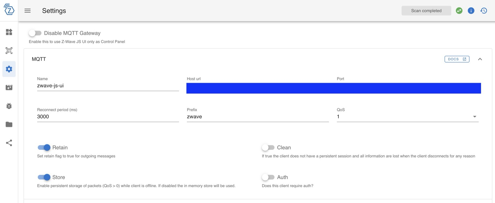
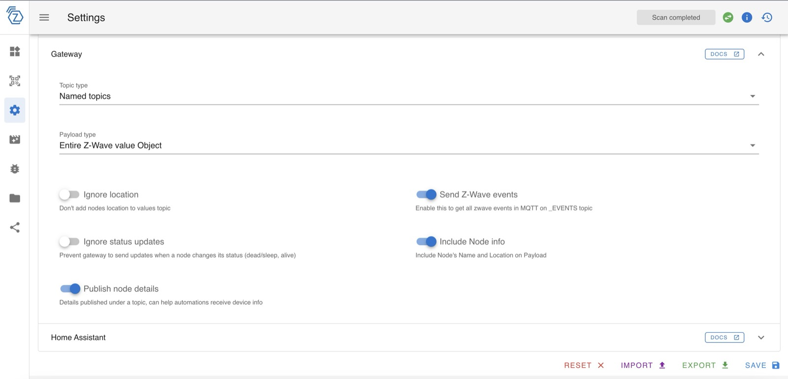

:::warning[Diese integrierte Integration ist veraltet]

Seit Gladys 4.86 ist diese integrierte Z-Wave JS UI-Integration **veraltet**. Nutze stattdessen die **[Community-Integration Z-Wave JS UI](/de/docs/integrations/external/z-wave-js-ui/)**: Sie wird mit einem Klick aus dem Integrationskatalog installiert, nutzt dieselbe Z-Wave JS UI- und MQTT-Konfiguration und unterstützt mehr Geräte (Thermostate, Fil-Pilote-Module, Szenentaster, Rauch-, CO- und Wassersensoren, Batteriestand…).

Du nutzt bereits diese integrierte Integration? Installiere die Community-Integration, lege deine Geräte über ihren Tab **Discovery** an und klicke dann bei jedem bestehenden Gerät auf **Migrieren**, um es samt Verlauf auf das neue zu übertragen. Sind alle Geräte migriert, deaktiviere die integrierte Integration.

Diese Seite bleibt für bestehende Installationen online.

:::

Gladys Assistant bietet eine Integration mit [Z-Wave JS UI](https://zwave-js.github.io/zwave-js-ui/#/), einer Software zur Steuerung von Z-Wave-Geräten. Sie läuft **lokal** auf deiner eigenen Hardware, sodass dein Z-Wave-Netzwerk ohne Cloud-Konto funktioniert.

Gladys verbindet sich mit demselben MQTT-Broker wie Z-Wave JS UI und empfängt MQTT-Nachrichten, sobald sich der Status eines Geräts ändert.

:::note[Den passenden Z-Wave-USB-Stick für deine Region wählen]
Z-Wave nutzt je nach Wohnort eine andere Funkfrequenz, dein Stick muss also zu deinem Land passen: **908,42 MHz in den USA und Kanada**, 868,42 MHz in Europa. Für Nordamerika sind unter anderem der [Zooz ZST10 700 / ZST39](https://www.amazon.com/s?k=Zooz%20Z-Wave%20USB%20stick%20ZST39) und der [Aeotec Z-Stick 7](https://www.amazon.com/s?k=Aeotec%20Z-Stick%207) (US-Version) beliebt. Achte darauf, das US/Kanada-Modell zu kaufen und nicht das EU-Modell.
:::

## Z-Wave JS UI installieren

Die Installationsanleitung für Z-Wave JS UI findest du auf der Website von [Z-Wave JS UI](https://zwave-js.github.io/zwave-js-ui/#/).

## Z-Wave JS UI konfigurieren

Damit die Integration mit Gladys richtig funktioniert, sind 2 Einstellungen nötig.

Zuerst musst du in den Einstellungen die MQTT-Parameter festlegen, insbesondere das Feld „Name“, das das MQTT-Topic bestimmt, an das die Nachrichten gesendet werden.

Konfiguriere anschließend den Bereich „Gateway“ wie folgt:

## Gladys mit Z-Wave JS UI verbinden

Damit Gladys mit Z-Wave JS UI kommunizieren kann, musst du Gladys die URL und die Verbindungsdaten des MQTT-Brokers angeben, auf dem Z-Wave JS UI veröffentlicht.

Trage diese Informationen im Tab „Konfiguration“ ein.

## Z-Wave JS UI-Geräte erkennen

Im Tab „Erkannt“ siehst du die Geräte, die deine Z-Wave JS UI-Instanz bereitstellt.

Du kannst sie dann mit einem einzigen Klick zu Gladys hinzufügen!

## Unterstützte Funktionen

- **Tür-/Fenstersensoren**: Erkennen den Status offen/geschlossen, zum Beispiel der [Fibaro Door Opening Sensor](https://www.amazon.de/s?k=Fibaro%20Door%20Window%20Sensor%202).
- **Binäre Schalter**: Steuern Lampen oder Steckdosen (an/aus). Unterstützte Geräte sind unter anderem:
  - [Fibaro Wall Plug](https://www.fibaro.com/en/products/wall-plug/)
  - [Fibaro Switches](https://www.fibaro.com/en/products/switches/)
- **Lufttemperatursensoren**: Überwachen die Raumtemperatur.
- **Energiemessung**: Erfasst den Energieverbrauch für Auswertungen.
- **Vorhang-/Rollladensteuerung**: Öffnen, Schließen und Abfragen der Position. Unterstützte Geräte sind unter anderem:
  - [Fibaro Walli Roller Shutter](https://manuals.fibaro.com/fr/walli-roller-shutter/)
  - [Qubino Flush Shutter](https://qubino.com/products/flush-shutter/)
- **Dimmer**: Helligkeit anpassen oder spannungsgesteuerte Geräte steuern. Unterstützte Geräte sind unter anderem:
  - [Fibaro Walli Dimmer](https://manuals.fibaro.com/fr/walli-dimmer/)
  - [Fibaro Dimmer 2](https://manuals.fibaro.com/fr/dimmer-2/)
- **Helligkeitssensoren**: Messen das Umgebungslicht.
- **Alarmsensoren**: Erkennen Sicherheitsbedrohungen.
- **Binäre Sensoren**: Unterstützen verschiedene An/Aus-Erkennungsszenarien.

Wenn dein Gerät derzeit nicht unterstützt wird, sag uns im Forum Bescheid!

## Häufige Fragen

### Wie füge ich ein Z-Wave-Gerät zu Gladys hinzu?

Kopple das Gerät zuerst mit Z-Wave JS UI (über dessen eigenen Inklusionsprozess). Sobald es in deinem Z-Wave-Netzwerk ist, öffne in der Z-Wave JS UI-Integration von Gladys den Tab „Erkannt“, um die Geräte zu sehen, die deine Instanz bereitstellt, und füge die gewünschten mit einem einzigen Klick zu Gladys hinzu.

### Welchen Z-Wave-USB-Stick sollte ich in den USA oder Kanada verwenden?

Wähle einen Stick für die nordamerikanische Frequenz 908,42 MHz, zum Beispiel den Zooz ZST10 700 / ZST39 oder den Aeotec Z-Stick 7 (US-Version). Ein europäischer Stick mit 868,42 MHz kommuniziert nicht mit US- oder kanadischen Z-Wave-Geräten, prüfe vor dem Kauf also immer die Region.

### Verbindet sich Gladys direkt mit Z-Wave oder über Z-Wave JS UI?

Gladys verbindet sich über Z-Wave JS UI per MQTT. Z-Wave JS UI steuert den USB-Stick und veröffentlicht die Gerätezustände auf einem MQTT-Broker, und Gladys abonniert diesen Broker, um Zustände in Echtzeit zu lesen und Befehle zu senden.

### Funktioniert Z-Wave mit Gladys lokal ohne Cloud?

Ja. Z-Wave JS UI, der MQTT-Broker und Gladys laufen alle auf deiner eigenen Hardware, sodass deine Z-Wave-Automatisierungen ohne Internetverbindung und ohne Hersteller-Cloud weiterlaufen.

