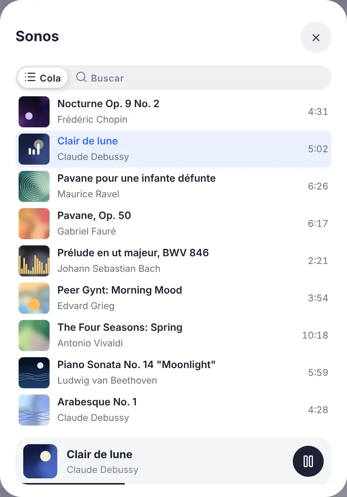
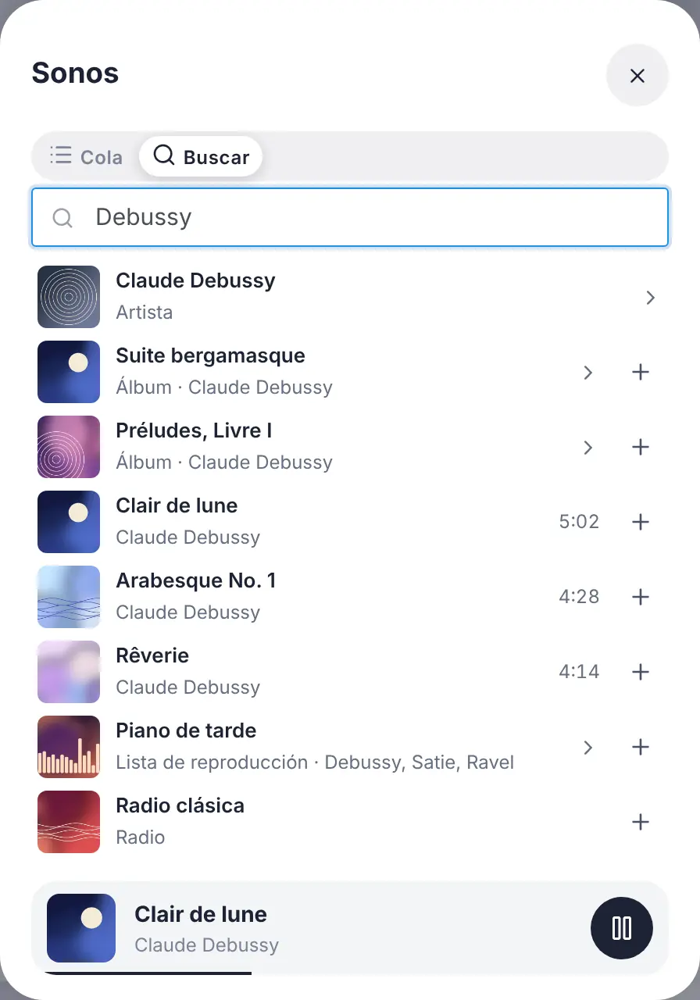
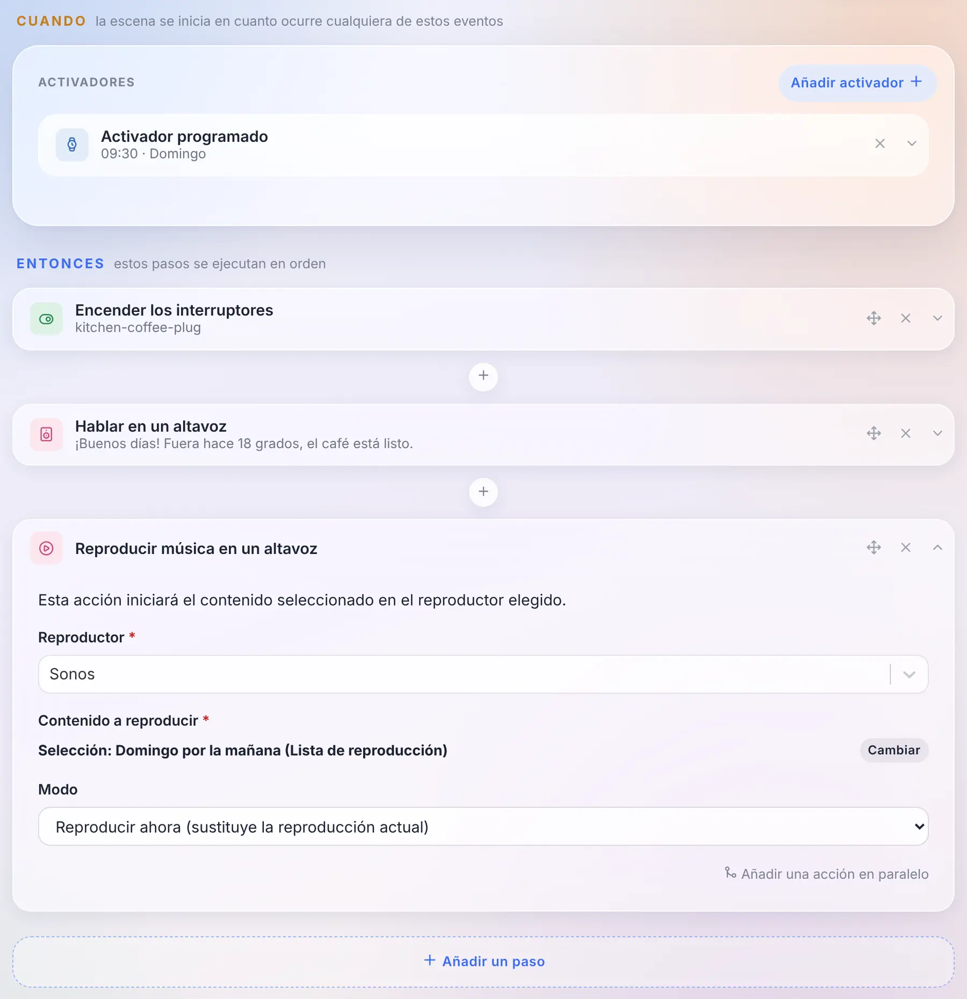
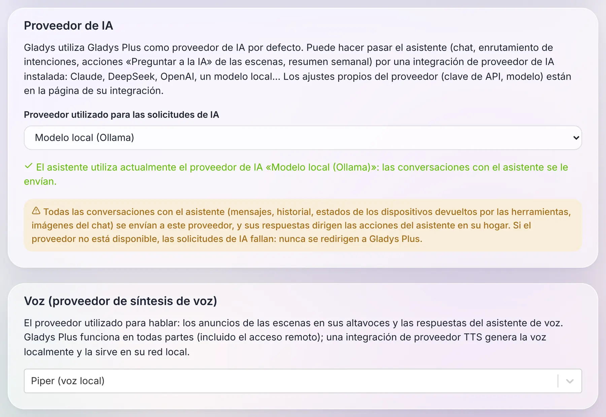
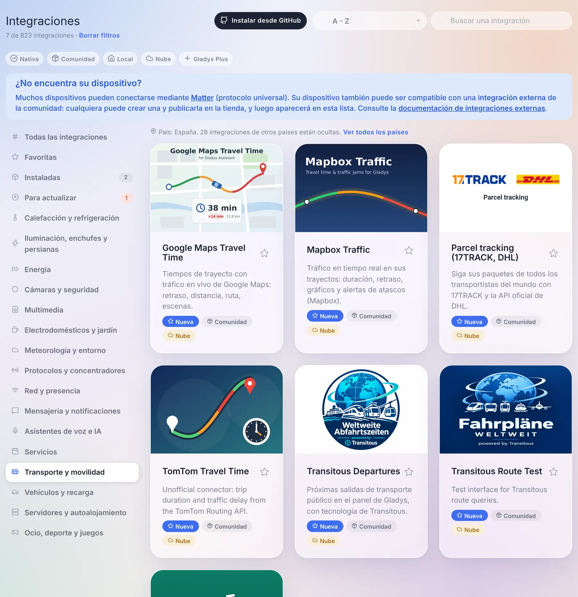
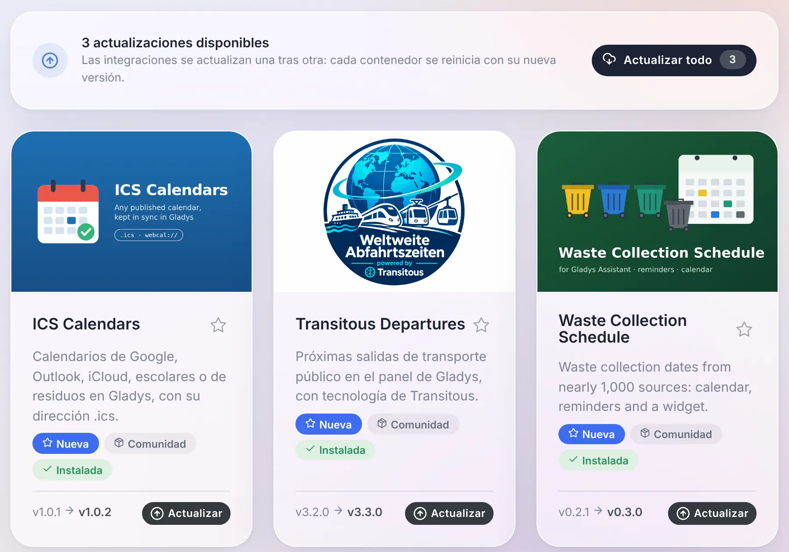

¡Hola a todos!

Hoy llega una nueva versión de Gladys, la 5.3 🎉

Esta trae tres novedades. El widget de música se convierte en **un reproductor de verdad**: la carátula, el título, el progreso, la cola y una búsqueda para lanzar un álbum o una lista. El asistente ya puede funcionar con **la IA que elijas**, incluido un modelo que funciona en tu casa, en lugar de Gladys Plus. Y **la voz** también: los anuncios de las escenas pueden pronunciarse con un motor de síntesis de voz local.

{/* truncate */}

## Un reproductor de música de verdad en el panel

Hasta ahora, el widget de música de Gladys era un mando a distancia: el nombre del altavoz, reproducir, pausa, siguiente y un control de volumen. Nada te decía qué estaba sonando.

En la 5.3 se convierte en el reproductor que conoces de las aplicaciones de Spotify o Sonos: la **carátula** del álbum, el **título**, el **artista** y el **álbum**, una **barra de progreso** que puedes arrastrar para avanzar, la reproducción aleatoria, la repetición (de todo o de una sola canción) y el volumen. Una radio en directo muestra una etiqueta «En directo» en lugar de la barra de progreso.

Dos botones al final de la fila del volumen abren el resto, en un panel que nunca cambia el tamaño de la tarjeta:

- **la cola**, con la canción actual resaltada: un toque salta a cualquier canción;

- **la búsqueda y la biblioteca**: escribe un artista, un álbum, una lista o una radio, tócalo para reproducirlo o añádelo a la cola con el botón «+». Un álbum o una lista se puede abrir o reproducir entero.

Un detalle que importa: la barra de progreso no la refresca el servidor cada segundo. El reproductor solo informa de su posición cuando pasa algo (una pausa, un salto, una canción nueva), y el panel calcula el resto. Un reproductor de música no le cuesta nada a tu base de datos: ninguno de sus estados se guarda en el historial.

### Lanzar una lista desde una escena

Una nueva acción **«Reproducir música en un altavoz»** permite a una escena lanzar una canción, un álbum, una lista o una radio. La eliges con la misma búsqueda que en el panel, y decides si sustituye a lo que está sonando o si entra en la cola (justo después de la canción actual, o al final).

Y como la canción ya es un estado del dispositivo como cualquier otro, «cuando cambia la canción en el altavoz de la cocina» es simplemente el disparador de dispositivo de siempre, sobre el título.

### ¿Qué reproductores?

Este nuevo reproductor se alimenta de las **integraciones externas**: una integración publica lo que está sonando y sirve las carátulas, Gladys las muestra y nunca carga en tu navegador una imagen de internet. La tienda ya tiene integraciones para Sonos, Spotify, Jellyfin, Plex, Volumio, MPD, Lyrion o Yamaha MusicCast, que ahora tienen todo lo necesario para dar vida a este reproductor: a sus autores solo les queda publicar los nuevos estados.

Las integraciones nativas de Sonos, Google Cast y AirPlay no cambian: su widget conserva los mismos controles, con el nuevo estilo. Y la integración nativa de Sonos ya tiene su botón «Migrar» hacia la integración de la comunidad: tus habitaciones, widgets y escenas siguen al dispositivo.

## Elige la IA de tu asistente

Desde hace unos meses, el asistente de Gladys conversa contigo, controla tu casa, crea escenas y analiza tus cámaras. Detrás estaba siempre la misma IA: la de Gladys Plus.

En la 5.3 pasa a ser **una elección**. Una integración externa del nuevo tipo **«Proveedor de IA»** puede responder al asistente en lugar de Gladys Plus: Claude, Mistral, OpenAI, DeepSeek o **un modelo que funciona en tu propia máquina** con Ollama. Lo eliges en la página Inteligencia artificial de las integraciones, y todo el asistente lo sigue: el chat, la acción «Preguntar a la IA» de las escenas y el resumen semanal de la casa.

Para que quede claro lo que sale hoy: la 5.3 trae los tipos «Proveedor de IA» y «Síntesis de voz», y los proveedores llegarán al catálogo a medida que la comunidad los publique. La captura de arriba usa integraciones de ejemplo. Y la integración Ollama que ya está en la tienda es otra cosa: permite a una escena hacer una pregunta a un modelo local, no es un proveedor de IA para el asistente.

Lo que me parece interesante de cómo funciona: **todo el asistente sigue funcionando en tu Gladys**. Las herramientas, el contexto de tu casa, el historial de la conversación, las acciones sobre tus dispositivos: todo eso se queda en local. Lo único que va al proveedor es una petición estándar, la que entienden todas las IA del mercado, y su respuesta vuelve a Gladys, que la comprueba antes de actuar. Una integración de IA es, por tanto, un simple adaptador, capaz de conectar cualquier proveedor.

Tres reglas que me importaban:

- **Gladys Plus sigue siendo la opción por defecto.** No cambia nada para ti si no tocas nada.
- **Nada de recurrir a Gladys Plus en silencio.** Si elegiste un modelo local porque quieres que tus conversaciones se queden en casa, y ese modelo deja de funcionar, Gladys te lo dice. Nunca envía tus mensajes a Gladys Plus a tus espaldas.
- **El asistente sin Gladys Plus.** Con tu propio proveedor, el chat, las escenas y el resumen semanal funcionan sin suscripción a Gladys Plus.

Una advertencia honesta: un proveedor de IA ve cada conversación, y sus respuestas desencadenan acciones en tu casa. Es el nivel de confianza más alto que puedes dar a una integración, y Gladys lo dice claramente cuando seleccionas uno.

## Y también la voz

La misma idea para la síntesis de voz. Hasta ahora, cuando una escena anunciaba «la lavadora ha terminado» en un altavoz, la voz venía de Gladys Plus.

Una integración del nuevo tipo **«Síntesis de voz»** ya puede generar esa voz, en local con un motor como Piper, o con el servicio en la nube que elijas. La eliges en la misma página, y **los anuncios de las escenas** en tus altavoces pasan por ella. El audio se genera en tu red y se queda en memoria unos minutos, el tiempo que tarda el altavoz en ir a buscarlo.

Una limitación, por ahora: con una voz local, las respuestas del asistente de voz en el navegador son solo texto. El micrófono de un navegador exige HTTPS, y un navegador se niega a reproducir, dentro de una página en HTTPS, un sonido servido por HTTP en tu red local. Gladys nunca cambia a Gladys Plus a tus espaldas: si quieres que el asistente hable en el navegador, mantén Gladys Plus como voz.

## Un catálogo pensado para mil integraciones

Cuando salió la versión 5 a finales de agosto, la tienda tenía unas setenta integraciones de la comunidad. Hoy tiene **785**, más las nativas. La página de integraciones no estaba pensada para eso: descargaba la tienda completa (22 MB) cada 30 minutos, y encontrar algo significaba desplazarse por todo.

Esto es lo que cambia:

- **Un catálogo que carga rápido.** Gladys ahora descarga un índice ligero de 1,4 MB y solo va a buscar el archivo completo de una integración, unos pocos kilobytes, cuando la abres, la instalas o la actualizas. Mientras carga, la página lo dice, en lugar de mostrar las integraciones nativas como si fueran todo el catálogo. Las tarjetas aparecen página a página, con un botón «Mostrar más integraciones».
- **La búsqueda es el primer filtro.** Lee más que la tarjeta: todos los idiomas de la descripción, las palabras clave declaradas por el autor, el propio autor y los países. Los resultados están ordenados (primero los nombres que empiezan por lo que has escrito), y una búsqueda siempre recorre todo el catálogo, estés en la categoría que estés.
- **El filtro de país que nadie tiene que configurar.** Redes de transporte, proveedores de electricidad, recogida de residuos, cines: muchas integraciones solo tienen sentido en un país. Gladys deduce tu país de la zona horaria con la que ya está configurada, y oculta en las categorías las integraciones de otros países. Una línea indica cuántas están ocultas, con un enlace «Ver todos los países», y la búsqueda las sigue encontrando.
- **Cuatro categorías nuevas**: *Transporte y movilidad*, *Vehículos y recarga*, *Servidores y autoalojamiento* y *Ocio, deporte y juegos*. «Servicios» se había convertido en un cajón de sastre de 160 integraciones.
- **Pequeñas cosas que cuentan**: una etiqueta «Instalada» en las tarjetas, un orden «Última actualización», un contador que siempre compara con el catálogo completo («21 de 823 integraciones») con un único enlace «Borrar filtros», y cuando vuelves de la página de una integración, estás exactamente donde estabas en la lista.

### Actualizar tus integraciones desde el catálogo

Cuando una integración de la comunidad tiene una versión nueva, su tarjeta muestra ahora la versión instalada, la nueva y un botón **Actualizar**. Ya no hace falta abrir la integración.

Y cuando hay varias esperando, la vista **Para actualizar** se abre con un botón **Actualizar todo**. Las integraciones se actualizan una tras otra, no todas a la vez, lo que cuida una Raspberry Pi o un NAS, y el panel sigue el progreso. Si una falla, aparece en una lista con un enlace a su página, y las demás continúan.

¡Gracias a [@cicoub13](https://github.com/cicoub13) por las dos!

## Para los desarrolladores de integraciones

- **Reproductores de música**: un reproductor gana las funcionalidades de «reproduciendo ahora» (`title`, `artist`, `album`, `artwork`, `duration`, `position`, `shuffle`, `repeat`, `mute` y un `playback_state` modificable), y el nuevo campo `music` del manifiesto declara lo que la integración sabe hacer bajo demanda: `browse`, `search`, `queue` y `append`. Las carátulas las sirve la integración detrás de una clave, nunca como URL. El contrato está en [la especificación de música](https://github.com/GladysAssistant/Gladys/blob/master/docs/specs/external-integrations/capabilities/music.md).
- **Proveedores de IA**: el nuevo tipo `ai` recibe peticiones de chat completion compatibles con OpenAI y responde con una completion compatible con OpenAI. [La especificación de los proveedores de IA](https://github.com/GladysAssistant/Gladys/blob/master/docs/specs/external-integrations/capabilities/ai-type.md) explica también cómo llegar a un modelo que funciona en el host, y por qué hay que configurar su ventana de contexto.
- **Proveedores de síntesis de voz**: el nuevo tipo `tts` recibe un texto y un idioma, y responde con el audio. [La especificación de los proveedores de síntesis de voz](https://github.com/GladysAssistant/Gladys/blob/master/docs/specs/external-integrations/capabilities/tts-type.md).
- **Catálogo**: dos nuevos campos opcionales en el manifiesto, `keywords` (términos solo para la búsqueda: marcas, modelos, ciudades atendidas) y `countries` (los códigos ISO de los países donde la integración se puede usar; si falta, significa en todo el mundo), y las cuatro nuevas categorías `transport`, `vehicles`, `servers` y `leisure`.
- **Polling**: un dispositivo descubierto que publica una `poll_frequency` ahora lo consulta Gladys sin necesidad de poner también `should_poll`.

El [SDK v0.16.0](https://github.com/GladysAssistant/integration-sdk-js) lo soporta todo: `onAiChat` para los proveedores de IA, `onTtsSynthesize` para la síntesis de voz, y `publishNowPlaying`, `artworkKey` y los handlers `onMusic*` para los reproductores de música.

## Correcciones

La 5.2.1 salió al día siguiente de la 5.2. Esto es lo que corrigen ella y esta versión:

- **Usuarios**: ya no puedes cambiar tu propio rol, y el último administrador de una instancia ya no puede perder ese rol. Hasta ahora, un administrador que era el único podía darse otro rol, y luego nadie podía acceder a los ajustes de usuarios para devolvérselo. Una instancia que ya está en esa situación devuelve el rol de administrador a su cuenta más antigua.
- **Dispositivos**: guardar un dispositivo ya no devuelve el valor actual de sus funcionalidades al que tenía la página cuando se abrió. ¡Gracias [@Terdious](https://github.com/Terdious)!
- **Dispositivos**: crear un dispositivo mientras Gladys escribe otra cosa en su base de datos ya no falla con un error «database is locked».
- **Inicio de sesión**: se acepta un correo escrito con mayúsculas o espacios, al iniciar sesión y al restablecer la contraseña.
- **Baterías**: desactivar el aviso de batería baja en los ajustes lo desactiva de verdad, y los mensajes de batería baja y de copia de seguridad fallida llegan a todos los administradores, aunque falle el envío a uno de ellos. ¡Gracias [@cicoub13](https://github.com/cicoub13)!
- **Energía**: las plantillas de EDF Tarif Bleu, que llevan más de diez años de historial de precios, se pueden volver a seleccionar: el historial fuera de la validez de tu contrato se descarta, sin cambiar los costes.
- **Enedis**: los contadores se pueden renombrar, y un contador nuevo recibe el nombre de su PDL en lugar de «Enedis», lo que permite distinguir dos contadores.
- **Zigbee2MQTT**: el puerto serie del dongle USB es siempre el montado en el contenedor, sea cual sea su ruta en el host, lo que podía impedir que Zigbee2MQTT arrancara.
- **Zigbee2MQTT**: se reconocen los cuatro botones del interruptor Philips Hue Tap.
- **Panel**: seleccionar texto o arrastrar un control deslizante en un panel o una ventana, y soltar el ratón fuera, ya no lo cierra.
- **Dispositivos**: las listas de dispositivos ya no llevan la imagen de cada cámara (hasta 150 kB cada una): cargan más rápido, y guardar una cámara ya no falla porque la petición es demasiado grande.
- **Energía**: un contrato nuevo puede reutilizar el nombre de uno existente, como un contrato Tempo renovado. ¡Gracias [@cicoub13](https://github.com/cicoub13)!
- **Ajustes**: un usuario que no es administrador ya llega a los ajustes desde el menú, y solo ve las pestañas que puede usar. ¡Gracias [@cicoub13](https://github.com/cicoub13)!
- **Escenas**: el resumen de una acción sobre una persiana muestra el dispositivo y el valor elegido, y el editor resalta el botón seleccionado. ¡Gracias [@cicoub13](https://github.com/cicoub13)!
- **Widgets**: los botones de los widgets de integraciones conservan el color de sus iconos en el tema Horizon. ¡Gracias a Stefan Bauer!
- **HomeKit**: los modos predefinidos de un radiador se mantienen correctos en la app Casa, y una petición que falla recibe una respuesta en lugar de dejar la app Casa esperando. ¡Gracias [@Dreamthy](https://github.com/Dreamthy)!
- **Bajo el capó**: la interfaz ahora se construye con Vite 8. ¡Gracias [@bertrandda](https://github.com/bertrandda)!

En total, 32 pull requests desde la versión 5.2.

## Gracias a los colaboradores

Gracias a [@cicoub13](https://github.com/cicoub13) por los botones de actualización del catálogo, «Actualizar todo» incluido, los mensajes de batería y de copia de seguridad, los ajustes de los usuarios que no son administradores, las acciones sobre persianas en las escenas y los contratos de energía que comparten nombre, a [@Terdious](https://github.com/Terdious) por la corrección al guardar dispositivos, a [@Dreamthy](https://github.com/Dreamthy) por los radiadores en HomeKit, a Stefan Bauer por los iconos de los widgets en el tema Horizon, a [@bertrandda](https://github.com/bertrandda) por el paso a Vite 8, y a [@William-De71](https://github.com/William-De71) por unos tests que siguen en verde con el cambio de hora. ¡Y gracias a todos los que habéis pedido estas funcionalidades y reportado bugs en el foro!

Nos vemos en [el foro](https://community.gladysassistant.com/) si quieres hablar de esta versión :)

## ¿Cómo actualizar?

Como siempre, Gladys se actualiza automáticamente en un plazo de 24 horas si usas Watchtower; si no, puedes hacerlo con un clic desde los ajustes.

El [CHANGELOG completo de la 5.3.0](https://github.com/GladysAssistant/Gladys/releases/tag/v5.3.0) está en GitHub.
