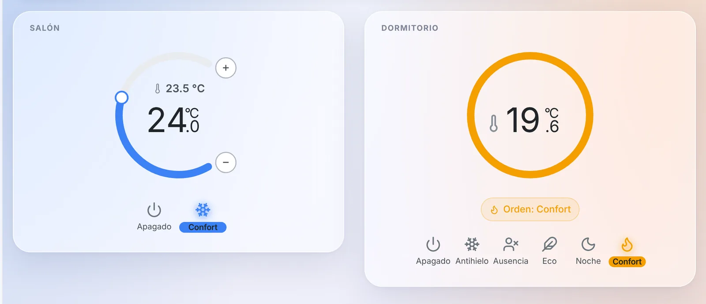
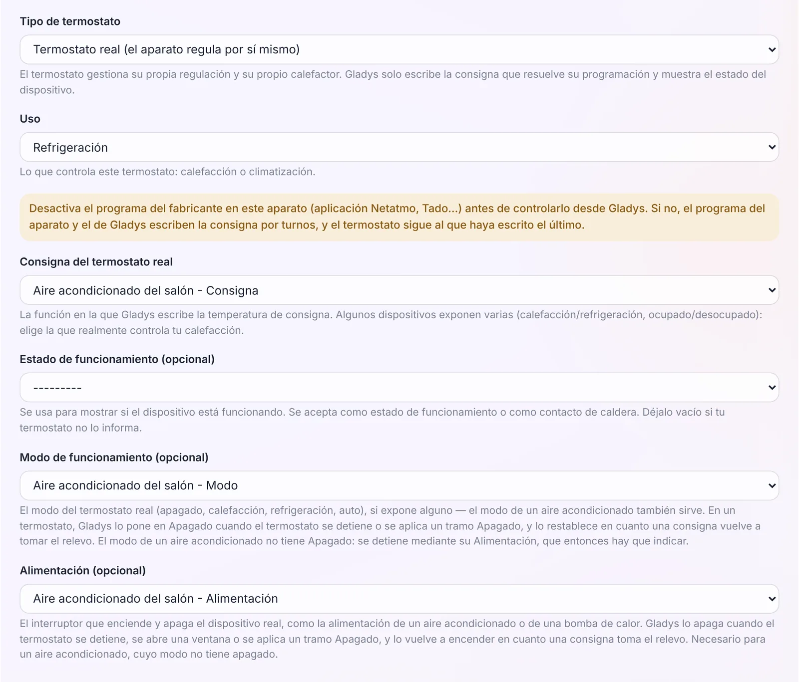
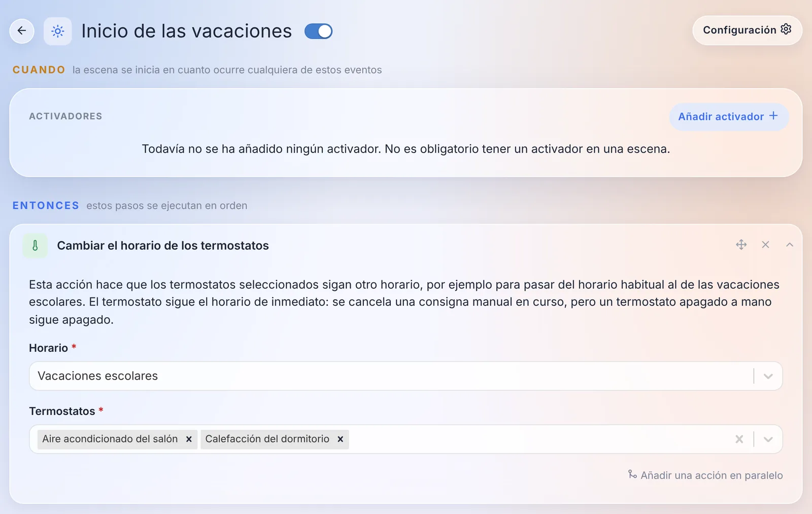
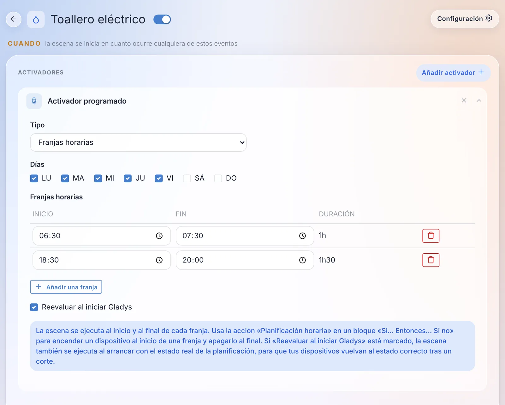

¡Hola a todos!

Hoy llega una nueva versión de Gladys, la 5.3.1 🎉

Que no te engañe el número: no es solo una versión de correcciones. El termostato que llegó con la 5.2 ahora controla **aires acondicionados** y **radiadores con hilo piloto**, espera un poco antes de cortar la calefacción cuando se abre una ventana, y una escena puede pasar toda la casa al horario de vacaciones. Las escenas ganan un activador **«Franjas horarias»**. Y en Gladys Plus, los usuarios se gestionan en una sola página, la doble autenticación se recupera sin escribir al soporte, y las copias de seguridad pasan a ser diarias.

{/* truncate */}

## El termostato controla el aire acondicionado

Con la 5.2, Gladys se convirtió en tu termostato, pero solo para la calefacción. En la 5.3.1, un **aire acondicionado** o una **bomba de calor** puede configurarse como «Termostato real (el aparato regula por sí mismo)»: Gladys le envía la consigna y el modo, y el aire acondicionado hace el resto.

Un aire acondicionado tiene una particularidad: su modo no tiene posición «apagado». Por eso el formulario tiene un nuevo campo **«Alimentación (opcional)»**. Gladys corta esa alimentación cuando el termostato se detiene, se abre una ventana o se aplica un tramo Apagado, y la vuelve a encender cuando una consigna retoma el control. Cuando eliges la consigna de un aire acondicionado, su modo y su alimentación se rellenan solos, y si falta la alimentación, el formulario te avisa.

Algunos detalles que importan:

- **Preajustes pensados para refrigerar**: Confort 24 °C, Eco 26 °C, Noche 25 °C, Ausencia 28 °C y Antihielo 30 °C, en lugar de los valores de calefacción.
- **Se respeta el mando a distancia.** Si apagas el aire acondicionado con su mando, el termostato se detiene hasta el siguiente punto del horario, en lugar de volver a encenderlo a tus espaldas.
- **Varios sensores de temperatura**: un botón «Añadir un sensor de temperatura» permite poner varios, y Gladys regula según su media. Una sonda que lleva más de una hora sin dar señales queda fuera de la media mientras otra siga respondiendo.
- **Varios sensores de apertura**: cualquier ventana abierta corta la calefacción o la refrigeración.
- **Listas filtradas por habitación**: en el formulario, las listas de dispositivos solo proponen los de la habitación del termostato. Un interruptor «Mostrar los dispositivos de todas las habitaciones» las amplía, algo práctico para un salón abierto a la cocina.
- **Un nuevo estado «Preajuste activo del termostato»** sigue cada punto del horario. Una escena puede activarse cuando el horario pasa, por ejemplo, de Confort a Eco.

## Los radiadores con hilo piloto

En Francia, muchos radiadores eléctricos tienen un hilo piloto («fil pilote»). Un radiador con hilo piloto conserva su propio termostato y obedece seis órdenes: apagado, antihielo, eco, confort, confort -1 y confort -2.

La 5.3.1 añade un tipo de termostato **«Radiador con hilo piloto (el radiador regula por sí mismo)»**. Eliges el módulo de hilo piloto como actuador, y la tabla de preajustes gana una columna **«Orden enviada»**: por defecto, Antihielo y Ausencia envían antihielo, Eco y Noche envían eco, y Confort envía confort. Confort -1 y confort -2 también están disponibles.

El widget de este tipo (a la derecha en la captura al principio del artículo) no tiene rueda: un radiador con hilo piloto no acepta una consigna en grados. Muestra la temperatura de la habitación, un anillo del color de la orden en curso y «Orden: Confort», o «Enviando la orden Confort…» mientras el módulo no la haya confirmado.

Si prefieres que Gladys regule ella misma a partir de un sensor de la habitación, también es posible: un «Termostato virtual (Gladys regula)» acepta ahora un hilo piloto como actuador. Gladys envía confort por debajo de la consigna y antihielo por encima. En ese caso, ajusta la consigna de confort del propio radiador lo bastante alta (24 °C, por ejemplo): obedece a Gladys, y ese valor sigue siendo un techo de seguridad si Gladys se detiene.

Un consejo, que el formulario te recuerda: desactiva primero el programa propio del módulo (el horario de Heatzy, el programa de Tuya…); si no, el módulo y Gladys se irán sobrescribiendo la orden por turnos. Una orden cambiada en el propio módulo, con su botón o la aplicación del fabricante, se toma como un cambio manual.

¡Gracias a [@William-De71](https://github.com/William-De71), que probó todo esto con un módulo Qubino ZMNHJD real!

## Una ventana abierta ya no corta al instante

Hasta ahora, abrir la puerta de entrada para entrar y cerrarla detrás de ti cortaba la calefacción en un segundo. El formulario del termostato tiene ahora un campo **«Retardo antes del corte»** bajo el sensor de apertura: **60 segundos por defecto**, hasta una hora, y 0 para mantener el corte inmediato.

Una ventana que se cierra antes de que acabe el retardo no corta nada, y el aviso «Ventana abierta» del widget solo aparece una vez transcurrido el retardo.

Atención, esto cambia el comportamiento: los termostatos que ya tienen un sensor de apertura esperan ahora 60 segundos antes de cortar. Si quieres mantener el corte inmediato, pon el retardo a 0.

## El horario de vacaciones, desde una escena

Una nueva acción de escena, **«Cambiar el horario de los termostatos»**, pasa uno o varios termostatos a otro horario. El ejemplo típico: pasar del horario del curso escolar al de las vacaciones escolares, y volver.

El termostato sigue el nuevo horario de inmediato. Se cancela una consigna manual en curso, pero un termostato apagado a mano sigue apagado. El asistente de IA también conoce esta acción cuando crea una escena por ti.

Dos pequeñas cosas más en el editor de horarios y en el widget:

- **«Todo el día»**: una casilla para cubrir un día entero, en lugar de escribir 00:00 → 23:59 y dejar un minuto sin cubrir. De paso, se han corregido varios errores que podían hacer desaparecer parte de un horario al guardarlo.
- **El indicador se anima**: cuando cambia la consigna, el arco, el cursor y la cifra se deslizan hasta el nuevo valor en lugar de saltar de golpe.

## Franjas horarias en las escenas

Controlar un dispositivo según un horario semanal requería hasta ahora dos escenas, una para encender y otra para apagar, que había que mantener sincronizadas a mano.

El activador programado tiene ahora un tipo **«Franjas horarias»**: marcas los días, añades franjas (un inicio y un fin), y la escena se ejecuta al inicio y al final de cada franja. Se admiten las franjas que pasan la medianoche (se muestran como «+1d»).

Para hacerlo todo en una sola escena, hay una nueva condición **«Planificación horaria»**: «Estamos dentro de una franja horaria» o «Estamos fuera de las franjas horarias». En un bloque «Si… entonces… si no», el «entonces» enciende el dispositivo al inicio de una franja, y el «si no» lo apaga al final.

Y una casilla **«Reevaluar al iniciar Gladys»** ejecuta la escena al arrancar con el estado actual de la planificación: tras un corte de luz, tus dispositivos vuelven al estado correcto.

¡Gracias también por esta a [@William-De71](https://github.com/William-De71)!

## Una sola página para los usuarios

Si usas Gladys Plus, gestionabas a tus usuarios en tres sitios: Ajustes › Usuarios, la pestaña «Usuarios Plus» y «Usuarios remotos» en los ajustes de Gladys Plus. Ahora todo está reunido en **Ajustes › Usuarios**.

Cada usuario tiene una sección **«Acceso remoto · Gladys Plus»** que indica en qué punto está: «Invitación enviada», «Esperando su autorización», «Claves modificadas», «Autorizado»… El interruptor de autorización y las huellas de las claves que hay que comparar están directamente en su tarjeta.

Desde la aplicación Gladys Plus, un administrador puede:

- **invitar** a un usuario desde su tarjeta: la cuenta creada con la invitación se vincula automáticamente a ese usuario, la persona invitada no tiene nada que elegir;
- **vincular** una cuenta de Gladys Plus existente a un usuario, con un clic cuando el correo coincide;
- **restablecer la doble autenticación** de un usuario, confirmando con su propio código;
- **retirar** a alguien de Gladys Plus, sin tocar su usuario de Gladys ni sus datos.

Y cuando un usuario no es aceptado por la instancia, por ejemplo tras restablecer su contraseña de Gladys Plus, ahora ve una página que explica por qué y qué hacer, en lugar de un error de una línea.

## La doble autenticación, sin pasar por el soporte

Perder el móvil es perder la aplicación de doble autenticación. Hasta ahora, había que escribir al soporte para que restablecieran tu cuenta a mano. Ahora hay varias formas de resolverlo tú mismo:

- **Cambiar de aplicación**: en Ajustes › Seguridad, en Gladys Plus, una tarjeta «Su aplicación de doble factor» permite pasar a un móvil nuevo. Necesitas el código de la nueva aplicación y el de la actual, o un código de recuperación si la has perdido.
- **Nuevos códigos de recuperación desde tu Gladys**: un administrador, conectado en local, puede generar nuevos códigos para un usuario desde Ajustes › Usuarios, volviendo a escribir su contraseña de Gladys. Los códigos antiguos dejan de funcionar.
- **Un restablecimiento por correo** cuando ninguna Gladys está conectada a la cuenta: un enlace en la pantalla de inicio de sesión envía un correo válido durante una hora.

El formulario de inicio de sesión enlaza también con [nuestra nueva guía para resolver problemas de doble autenticación](/es/docs/plus/two-factor-authentication/), que cubre las causas más habituales: el reloj del móvil desajustado, una entrada antigua en la aplicación, un móvil nuevo.

## Copias de seguridad de Gladys Plus todos los días

Tres cosas fallaban con las copias de seguridad de Gladys Plus:

- cuando una copia fallaba, cada administrador recibía un mensaje en cada intento, es decir, un mensaje por noche mientras duraba el problema;
- al contrario, algunos fallos nunca se notificaban: una Gladys apagada o desconectada a las 2 de la madrugada, o reiniciada durante la copia, no decía nada;
- y la regla «más de 24 horas desde la última copia», combinada con una hora de inicio aleatoria, hacía que en la práctica la mayoría de las instancias se copiaran un día de cada dos.

Ahora, cada instancia hace **una copia de seguridad al día**. Una noche perdida se recupera durante el día y al arrancar Gladys. Los administradores reciben un aviso a partir de **dos noches sin una copia correcta**, luego una vez por semana mientras dure el problema, y una última vez cuando todo vuelve a funcionar. Un mes de fallos son seis mensajes en lugar de treinta. La página de copias de seguridad muestra además un aviso cuando fallan, con la fecha de la última copia correcta y el último error.

## Zigbee2MQTT: renombrar un dispositivo ya no rompe nada

Renombrar un dispositivo en la interfaz de Zigbee2MQTT rompía su vínculo con Gladys: el dispositivo volvía a aparecer como nuevo en la detección, las escenas dejaban de funcionar sin avisar y el historial quedaba partido en dos.

Gladys guarda ahora la dirección IEEE de cada dispositivo, su identificador de hardware, que nunca cambia. Cuando un nombre ya no coincide, el dispositivo se encuentra por su dirección: escenas, paneles e historial siguen funcionando. El nombre mostrado en Gladys sigue al cambio de nombre, salvo si lo habías personalizado. No tienes que hacer nada: los dispositivos existentes obtienen su dirección en el siguiente arranque.

También en Zigbee2MQTT:

- los dispositivos cuyo nombre contiene una «/» (como «salon/lampara») por fin envían sus estados a Gladys;
- los botones del interruptor Philips Hue Tap Dial (RDM002) activan las escenas. ¡Gracias [@cicoub13](https://github.com/cicoub13)!
- los dispositivos añadidos antes del seguimiento energético pueden actualizarse para recibir sus funciones de consumo y coste. ¡Gracias [@cicoub13](https://github.com/cicoub13)!

## Integraciones nativas sustituidas por la comunidad

Desde la versión 5, cada vez más integraciones de la comunidad lo hacen mejor que su versión nativa. Estas muestran ahora una insignia «Próximamente obsoleta» en el catálogo, y un aviso en su página que indica su sustituta:

| Integración nativa | Sustituta                                                                                                                                   | Botón «Migrar» |
| ------------------ | ------------------------------------------------------------------------------------------------------------------------------------------- | -------------- |
| Tasmota            | [Gladys-Tasmota](https://github.com/gboulvin/Gladys-Tasmota)                                                                                | sí             |
| Google Cast        | [Gladys-Google-Cast](https://github.com/gboulvin/Gladys-Google-Cast)                                                                        | sí             |
| eWeLink            | [gladys-sonoff-ewelink](https://github.com/William-De71/gladys-sonoff-ewelink)                                                              | sí             |
| Broadlink          | [gladys-broadlink](https://github.com/prohand/gladys-broadlink)                                                                             | sí             |
| Xiaomi             | [gladys-xiaomi-home](https://github.com/callemand/gladys-xiaomi-home) o [gladys-xiaomi-miot](https://github.com/guim31/gladys-xiaomi-miot)  | sí             |
| Node-RED           | [Gladys-Node-RED](https://github.com/gboulvin/Gladys-Node-RED)                                                                              | –              |
| CallMeBot          | [gladys-callmebot](https://github.com/GladysAssistant/gladys-callmebot)                                                                     | –              |
| CalDAV             | [gladys-caldav-sync](https://github.com/bertrandda/gladys-caldav-sync)                                                                      | –              |
| Nextcloud Talk     | [gladys-nextcloud-talk](https://github.com/bertrandda/gladys-nextcloud-talk)                                                                | –              |

Hoy no se rompe nada: las integraciones nativas siguen funcionando, y las dos versiones conviven en el catálogo durante la transición. El botón «Migrar», junto a «Eliminar» en los dispositivos ya creados, traslada el historial, las escenas y los paneles al dispositivo de la nueva integración. En Tasmota, por ejemplo, relés, reguladores, colores, mediciones de energía, temperatura y humedad se asocian automáticamente. ¡Gracias [@gboulvin](https://github.com/gboulvin) por la migración de Tasmota!

AirPlay sigue siendo compatible por ahora: su equivalente de la comunidad todavía no lo cubre todo.

## Y además

- **Asistente de voz**: con ruido alrededor, a veces nunca se detectaba el final de tu frase, y la grabación seguía hasta 30 segundos. Mientras escucha, el botón muestra ahora **«Enviar»**: al pulsarlo se envía lo que has dicho, en lugar de borrarlo. Lo mismo para el dictado en el chat.
- **Integraciones externas**: la página de dispositivos muestra una insignia de batería, verde, naranja o roja, para los dispositivos que publican su nivel de batería. ¡Gracias [@Terdious](https://github.com/Terdious)!
- **Asistente de IA**: a «¿cuál es la humedad en la casa?» ya no responde «no hay ningún sensor de humedad» porque el modelo solo buscaba dispositivos sin habitación.

## Seguridad

- **Cambiar la contraseña cierra las demás sesiones.** Hasta ahora, un navegador conectado con la contraseña antigua seguía conectado hasta un año. Ahora, cambiar la contraseña cierra todas tus demás sesiones, y un restablecimiento desde «contraseña olvidada» las cierra todas. Las claves de API (MCP, webhooks, Open API) se conservan, pero las tabletas en modo tableta tendrán que volver a iniciar sesión.
- **Una sesión revocada sigue revocada tras un reinicio**, y una tableta bloqueada por la alarma ya no recupera el acceso completo tras una actualización.
- **La nueva contraseña ya no se guarda en el navegador** después de cambiarla desde tu perfil.
- **El servidor MCP** crea ahora un servidor por petición: dos peticiones simultáneas ya no pueden recibir la respuesta de la otra.
- Y se han actualizado las dependencias con vulnerabilidades conocidas altas o críticas.

## Correcciones

- **Inicio de sesión**: los usuarios cuyo correo se guardó antes de la 5.3 con un espacio o con mayúsculas pueden volver a iniciar sesión. En una instancia en la que era el único administrador, nadie podía entrar.
- **Contraseña olvidada**: el texto y el enlace llegan en un solo mensaje. Por correo, el enlace solo solía quedar bloqueado por los filtros antispam.
- **MQTT**: tras restaurar una copia de seguridad en una máquina nueva, el bróker MQTT integrado se vuelve a crear con sus credenciales, en lugar de desaparecer. Y una actualización de Mosquitto ya no vacía su lista de usuarios.
- **Termostato**: una excepción «hasta el siguiente punto» termina a la hora correcta en un cambio de hora, y se ajusta a un nuevo punto añadido al horario. Los avisos indican el día cuando no es hoy («hasta mañana 14:00»). En iPad, la llama se queda en el centro del indicador.
- **Matter**: una bombilla Matter ya no aparece en dos filas (un interruptor y un brillo) en el widget de dispositivos, y las acciones de escena sobre las luces la encienden correctamente.
- **CalDAV**: los eventos recurrentes, como un cumpleaños, ya no se detienen dos años después de su importación. ¡Gracias [@bertrandda](https://github.com/bertrandda)!
- **Mapas**: el mapa conserva tu zoom y tu posición en lugar de reencuadrarse con cada actualización de ubicación. ¡Gracias [@cicoub13](https://github.com/cicoub13)!
- **Escenas**: el pie del editor cabe en una línea en el móvil. ¡Gracias [@cicoub13](https://github.com/cicoub13)!
- **Cuota de IA**: la cuenta atrás hasta el reinicio de la cuota muestra el número correcto de días (30 días mostraban «0s»). ¡Gracias [@huangkongsheng](https://github.com/huangkongsheng)!
- **Zonas horarias**: se han corregido 18 desfases obsoletos en la lista de zonas horarias, como Apia (Samoa), ahora en GMT+13:00 en lugar de +14:00. ¡Gracias [@yu2971512385-ui](https://github.com/yu2971512385-ui)!
- **Reproductor de música**: las barras de volumen y de progreso llegan hasta el final de su pista.

Son 45 pull requests desde la versión 5.3.0.

## Gracias a los colaboradores

Un enorme gracias a [@William-De71](https://github.com/William-De71), a quien debemos la mayoría de las novedades del termostato (aire acondicionado, hilo piloto, retardo de apertura, cambio de horario, «Todo el día», animación del indicador) y las franjas horarias de las escenas, además de las correcciones de Matter, del iPad y del reproductor de música. Gracias también a [@cicoub13](https://github.com/cicoub13) por el Hue Tap Dial, la energía de los dispositivos Zigbee2MQTT antiguos, los mapas y el editor de escenas en el móvil, a [@gboulvin](https://github.com/gboulvin) por la migración de Tasmota y las integraciones de la comunidad para Tasmota, Google Cast y Node-RED, a [@bertrandda](https://github.com/bertrandda) por CalDAV y Nextcloud Talk, a [@Terdious](https://github.com/Terdious) por las insignias de batería, a [@huangkongsheng](https://github.com/huangkongsheng) por la cuenta atrás de la cuota de IA, y a [@yu2971512385-ui](https://github.com/yu2971512385-ui) por las zonas horarias. ¡Y gracias a todos los que pidieron estas funciones y reportaron errores en el foro!

Nos vemos en [el foro](https://community.gladysassistant.com/) si quieres hablar de esta versión :)

## ¿Cómo actualizar?

Como siempre, Gladys se actualiza automáticamente en un plazo de 24 horas si usas Watchtower; si no, puedes hacerlo con un clic desde los ajustes.

El [CHANGELOG completo de la 5.3.1](https://github.com/GladysAssistant/Gladys/releases/tag/v5.3.1) está en GitHub.
