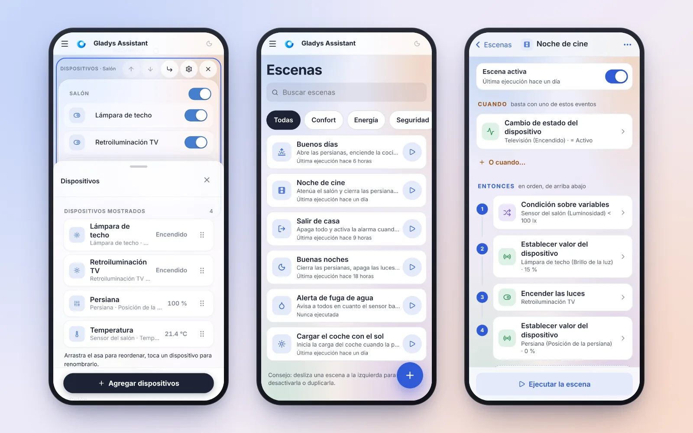
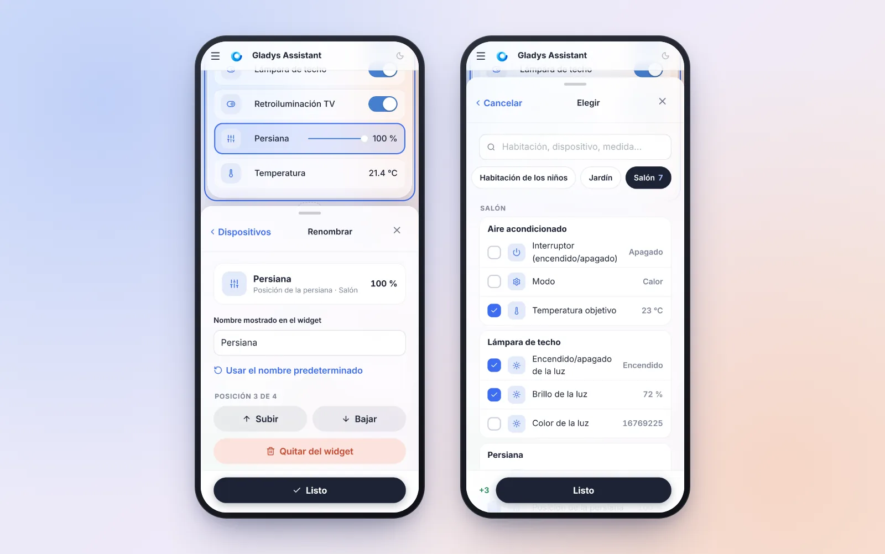
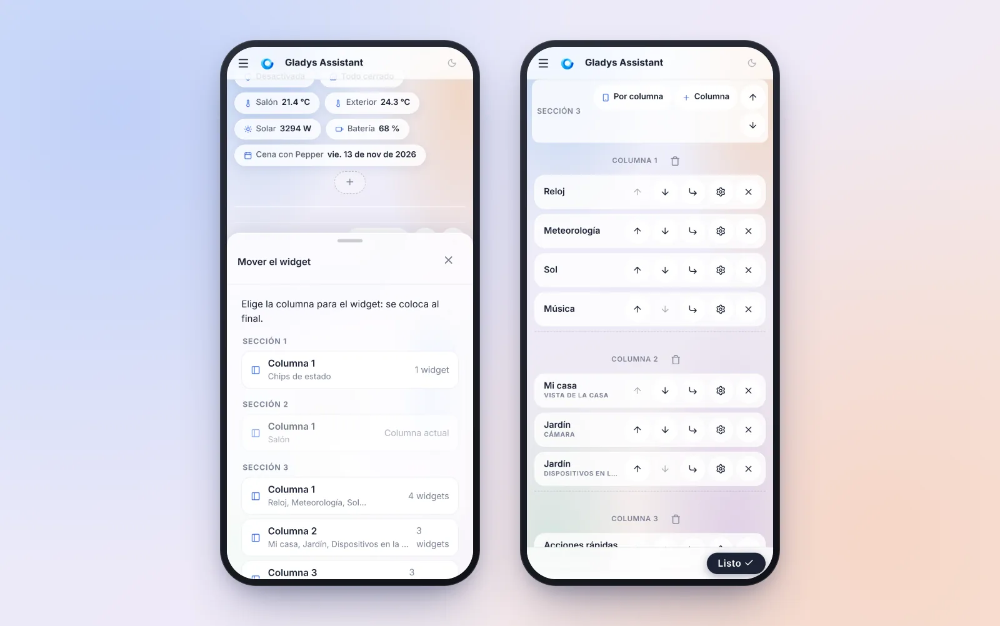
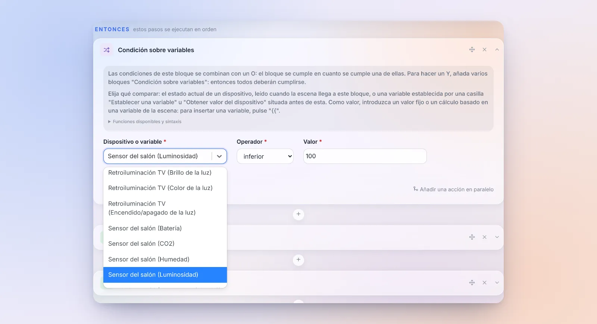
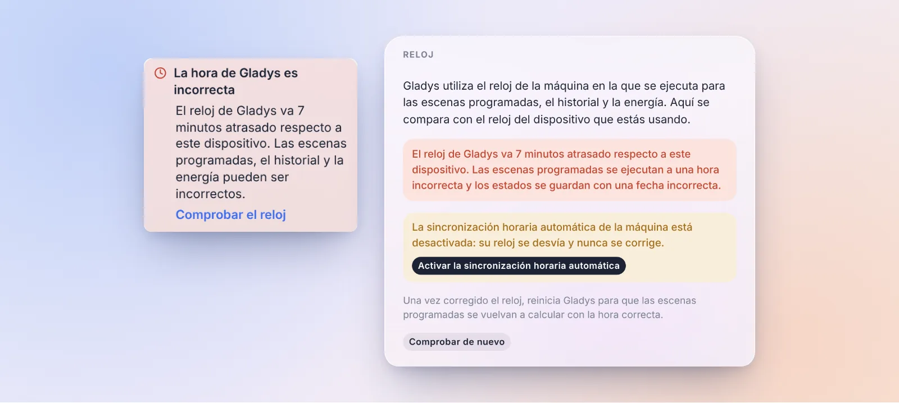
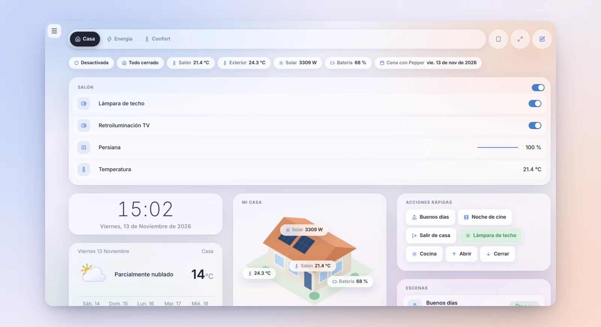

¡Hola a todos!

Hoy llega una nueva versión de Gladys, la 5.3.3 🎉

Una vez más, que no te engañe el número. Esta versión está dedicada casi por completo a un proyecto: **Gladys en el móvil**. Muchos de vosotros consultáis el panel desde el smartphone, pero en cuanto había que **cambiar** algo, un widget o una escena, te encontrabas con un formulario de ordenador apretado en una pantalla pequeña. Campos que hacen zoom solos en el iPhone, botones de 15 píxeles, cambios perdidos al menor gesto de volver…

Así que hemos rehecho la edición del panel y la de las escenas empezando por el móvil. En el ordenador, tus costumbres no cambian.

{/* truncate */}

## El panel se edita con el pulgar

### El widget «Dispositivos», rehecho desde cero

Era el formulario más incómodo en el móvil: cada dispositivo era un campo de texto siempre editable (un dedo despistado y se abría el teclado), solo cabían 4 dispositivos en pantalla, y se añadían uno a uno desde una lista con todos los dispositivos de la casa, sin icono ni valor.

Ahora hay tres vistas:

- **La lista**: una fila por dispositivo, con su icono, su nombre, su habitación y su valor actual. Se reordena arrastrando el asa, con una vista previa que sigue al dedo y desplazamiento automático en los bordes de la pantalla.
- **El detalle**, al tocar una fila: cambiar el nombre del dispositivo (o volver al nombre por defecto con un toque), subirlo, bajarlo o quitarlo. La fila que se está editando aparece **recuadrada en la vista previa del widget**, justo encima.
- **El selector**: una búsqueda, chips por habitación, los dispositivos agrupados por habitación y luego por dispositivo, con casillas y su valor actual. Abajo, el resumen de los cambios («+3», «−1»): una sola validación añade y quita.

¿Has quitado un dispositivo por error? Aparece una barra «Deshacer». Y un nombre borrado toma enseguida el nombre por defecto, en lugar de conservar el antiguo sin decir nada.

### El panel de edición deja ver el widget

El panel que sube desde abajo de la pantalla, común a todos los widgets, también se ha rehecho:

- se abre **a media altura**, para que el widget que editas siga visible encima; el asa lo amplía a pantalla completa (un toque o arrastrando), y arrastrarlo hacia abajo lo cierra;
- la barra de acciones del editor se oculta mientras está abierto, en lugar de quitarle sitio;
- desplazar la página ya no lo cierra: hace falta un toque real fuera de él;
- todos los campos miden 16 píxeles, el iPhone ya no hace zoom, y el panel sube por encima del teclado.

### Mover un widget sin arrastrar y soltar

En el móvil, un widget solo podía subir o bajar dentro de su columna. Ahora cada widget tiene un botón **«Mover a…»** que lista todas las columnas de todas las secciones: un toque, y el widget aparece allí, resaltado.

Para los grandes cambios, el botón **«Reorganizar»** pliega cada widget a su barra de herramientas. En el panel de la demo, la página pasa de 8230 a 3123 píxeles de alto: cruzar el panel ya solo requiere un pequeño gesto.

Y algunos detalles que facilitan la vida:

- **Eliminar un widget ya no pide confirmación**: un mensaje «Deshacer» se queda 6 segundos.
- **Se acabaron los cambios perdidos**: «Cancelar», el botón de volver del móvil, un enlace a otra página o cerrar la pestaña piden confirmación cuando quedan cambios sin guardar.
- **El orden en el móvil**: en el móvil, una sección de varias columnas se muestra columna tras columna. Un botón «Por columna / Por fila» en la cabecera de la sección permite mostrarla fila por fila: práctico para una fila de tres luces.
- Eliminar un panel pasa a sus ajustes, la barra inferior cabe en una línea, la ayuda del editor se oculta para siempre, y el selector de widgets muestra primero los seis más usados.

## Escenas pensadas para el móvil

Por debajo de 768 píxeles de ancho, las páginas de escenas tienen ahora un verdadero diseño de móvil.

**La lista de escenas**: una búsqueda, chips por etiqueta, una fila por escena con su última ejecución y un botón para lanzarla. Desliza una escena hacia la izquierda para desactivarla o duplicarla. El botón **+** solo pide un nombre, adivina un icono a partir de ese nombre, y abre el editor directamente en la elección del activador.

**El editor** se lee como una **línea de tiempo numerada**: «Cuando», luego «Entonces», con los bloques «Si… entonces… si no…» y sus ramas. Mientras se ejecuta una escena, el paso en curso queda resaltado.

Cada activador, cada paso y cada condición se abre en **un panel que sube desde abajo de la pantalla**, con exactamente el mismo formulario que en el ordenador, pero adaptado al dedo: campos de 48 píxeles, interruptores en lugar de casillas, los días de la semana como siete botones, los campos de hora y fecha nativos del móvil. La elección del tipo de acción se abre a pantalla completa, con la búsqueda lista para escribir. Y para elegir un dispositivo, se abre el selector por habitaciones del panel.

Los gestos son los que se esperan de una app:

- un panel se cierra arrastrándolo hacia abajo, o con el botón «volver» del móvil;
- deslizar un paso hacia la izquierda lo elimina, con un botón «Deshacer»;
- una **pulsación larga** sobre un paso permite moverlo (el menú «•••» también ofrece «Reordenar los pasos», con flechas);
- la barra inferior muestra «Ejecutar la escena», o «● 2 cambios · Probar · Guardar» cuando hay cambios.

Y en todos los tamaños de pantalla, ordenador incluido:

- **tus cambios ya nunca se pierden en silencio**: salir del editor con cambios pide confirmación, y se guarda un borrador en el navegador. Si el iPhone cierra la app en segundo plano, o un gesto de volver te saca de la página, Gladys te ofrece restaurarlo al volver;
- un error al guardar aparece donde lo ves;
- los resúmenes nombran las cosas («Lámpara de techo (Brillo de la luz) · 15 %») en lugar de mostrar identificadores.

## Una condición puede leer el estado de un dispositivo

Era uno de los obstáculos más frecuentes en una primera escena: para comprobar el estado de un dispositivo en una «Condición sobre variables», primero había que añadir un paso «Obtener valor del dispositivo» y luego comparar su variable.

Ya no hace falta: una condición compara ahora **o bien una variable, o bien el estado actual de un dispositivo**, leído en el momento en que la escena llega a la condición. Por ejemplo, «atenuar el salón solo si la luminosidad es inferior a 100 lx», en un solo paso. También funciona en los bloques «Si… entonces… si no…» y «Mientras… repetir…».

En el ordenador, un único campo «Dispositivo o variable» propone las variables de los pasos anteriores y luego todos los dispositivos de la casa agrupados por habitación. En el móvil, un botón «Elegir un dispositivo» abre el selector por habitaciones (mira la captura de más arriba).

Dos reglas que conviene conocer: un dispositivo que nunca ha comunicado un estado no cumple ninguna condición, sea cual sea el operador, y un dispositivo eliminado detiene la escena. Las escenas existentes, que comparan una variable, no cambian. ¡Gracias a quienes lo habían pedido [en el foro](https://community.gladysassistant.com/t/6502)!

Otras dos cosas pequeñas en el editor de escenas:

- **Se muestra el «Y»** entre los bloques de condiciones de un «Si… entonces… si no…» o de un «Mientras… repetir…». Dos bloques apilados parecían dos alternativas, cuando ambos deben cumplirse.
- **Escribir «{{» abre la lista de variables** enseguida, como dice el texto de ayuda. Antes había que escribir un tercer carácter.

## Gladys te avisa cuando su reloj va mal

Cuando el reloj de la máquina en la que se ejecuta Gladys va mal (sincronización horaria desactivada, pila del mini PC agotada…), todo lo que depende de la hora se desajusta en silencio: las escenas programadas se ejecutan a la hora equivocada, el historial se guarda en el pasado o en el futuro, la energía se cuenta en el día equivocado. Y nada te decía por qué.

Gladys compara ahora la hora del servidor con la del dispositivo que estás usando (tu móvil o tu ordenador casi siempre están en hora). A partir de 20 segundos de diferencia, aparece un aviso en el menú.

En **Configuración › Sistema**, una nueva tarjeta **«Reloj»** muestra la diferencia medida y el estado de la sincronización horaria de la máquina. Si está desactivada, que es la causa más frecuente, un botón **«Activar la sincronización horaria automática»** la vuelve a activar con un clic. Gladys no contacta con ningún servicio externo para hacer esta comprobación.

## El menú lateral se pliega en el ordenador

En el ordenador, una flecha en la parte inferior del menú lateral, junto al botón del modo oscuro, **oculta el menú**: la página recupera todo el ancho, práctico para un panel grande o para los planos. Un botón discreto lo hace volver, y tu elección se guarda en ese dispositivo. ¡Gracias por [la petición en el foro](https://community.gladysassistant.com/t/mettre-la-barre-laterale-gauche-en-mode-tiroir/10740)!

## Danos tu opinión

Recibimos muy pocas opiniones sobre lo que funciona bien, o no tan bien, en Gladys. Por eso aparece un enlace **«Dar mi opinión»** en la página de cada integración y en el menú del perfil. Abre un nuevo tema en el foro, ya rellenado con «Lo que funciona bien» / «Lo que se podría mejorar» y tu versión de Gladys. Gladys no envía nada: tú revisas el mensaje y lo publicas.

¡Úsalo sin dudar, nos ayuda mucho a saber dónde poner nuestros esfuerzos!

## Zigbee2MQTT explica por qué no arranca

Seguimos con [la auditoría de Zigbee2MQTT](https://community.gladysassistant.com/t/zigbee2mqtt-un-audit-pour-devenir-plus-simple-que-home-assistant/11498), después de la 5.3.2, que ya reconocía el dongle conectado y preseleccionaba su puerto y su modelo:

- **Los errores de arranque se explican**, con lo que hay que hacer: un dongle que no responde (a menudo un modelo distinto del elegido, o un dongle usado por otro programa), un coordinador de red inaccesible, una configuración rechazada por Zigbee2MQTT. Antes, Gladys mostraba la última línea de error de los logs, en inglés, a menudo sin relación.
- **Los SONOFF ZBDongle-E con un firmware antiguo arrancan solos.** Muchos se siguen vendiendo con un firmware que el driver `ember` rechaza. Gladys cambia ahora por sí sola al driver de compatibilidad `ezsp`, y la página de configuración explica cómo volver a `ember` tras actualizar el firmware.
- El contador trifásico **Tuya SPM02V3** comunica todas sus medidas: la fase C, la tensión de cada fase y la energía producida.

¡Gracias [@cicoub13](https://github.com/cicoub13) por todo esto!

## Y además

- **Termostato**: para un radiador con hilo piloto que regula Gladys, la opción «Forzar otra orden que antihielo en reposo» envía **Eco** o **Apagado** una vez alcanzada la consigna, en lugar de antihielo. Algunos toalleros bloquean su modo boost en antihielo. Y una bomba de calor encendida con su mando durante una franja «Apagado» ahora se muestra correctamente. ¡Gracias [@William-De71](https://github.com/William-De71)!
- **Escenas**: en las acciones «Encender / Apagar / Alternar los interruptores», se puede elegir y controlar cada toma de una regleta, y no solo la primera. ¡Gracias [@cicoub13](https://github.com/cicoub13)!
- **Matter**: retirar un nodo ahora pide confirmación, lista los dispositivos de Gladys creados a partir de ese nodo y propone eliminarlos también. Los errores se muestran en lugar de ignorarse. ¡Gracias [@bertrandda](https://github.com/bertrandda)!
- **Precio de la electricidad**: el widget y las escenas de precio siguen el contrato **activo** del contador. Tras un cambio de tarifa, seguían usando el contrato antiguo, ya caducado.
- **Integraciones externas**: una actualización que requiere una versión más reciente de Gladys ya no se ofrece como una actualización que no hace nada. La tarjeta indica «actualiza primero Gladys».
- **Vista de la casa**: hasta 50 pines por widget (en lugar de 20), y el editor avisa cuando se alcanza el límite en lugar de fallar al guardar.
- **Resumen semanal de la IA**: los números se escriben en tu idioma y se redondean («111,34 kWh» en lugar de «111.34 kWh»).

## Correcciones

- **Calendario**: un evento de varios días que empezó antes del periodo mostrado (unas vacaciones que empezaron el mes anterior, por ejemplo) por fin aparece, igual que un evento que pasa la medianoche en su segundo día.
- **Escenas**: «Obtener eventos del calendario» encuentra los eventos de día completo en el día correcto. «Hoy» devolvía los de mañana.
- **Matter**: las bombillas que no indican sus límites de brillo, como la Nanoleaf Essentials, se añaden sin error.
- **MQTT**: los topics personalizados con varios «+» funcionan, y un topic ya no capta los mensajes de un topic que empieza igual (`salon` y `salon2`). ¡Gracias [@huangkongsheng](https://github.com/huangkongsheng)!
- **Unidades**: las conversiones kWh/100 km ↔ kWh/100 mi estaban invertidas. ¡Gracias [@huangkongsheng](https://github.com/huangkongsheng)!
- Se han actualizado las dependencias con vulnerabilidades conocidas altas o críticas.

Son 26 pull requests desde la versión 5.3.2.

## Gracias a los colaboradores

Muchas gracias a [@cicoub13](https://github.com/cicoub13) por el gran trabajo en Zigbee2MQTT y las regletas en las escenas, a [@William-De71](https://github.com/William-De71) por el termostato, a [@bertrandda](https://github.com/bertrandda) por la retirada de nodos Matter, y a [@huangkongsheng](https://github.com/huangkongsheng) por las correcciones de MQTT, unidades y fechas. ¡Y gracias a todos los que habéis comunicado errores e ideas en el foro!

Nos vemos en [el foro](https://community.gladysassistant.com/) si quieres hablar de esta versión :)

## ¿Cómo actualizar?

Como siempre, Gladys se actualiza automáticamente en un plazo de 24 horas si usas Watchtower; si no, puedes hacerlo con un clic desde los ajustes.

El [CHANGELOG completo de la 5.3.3](https://github.com/GladysAssistant/Gladys/releases/tag/v5.3.3) está en GitHub.
