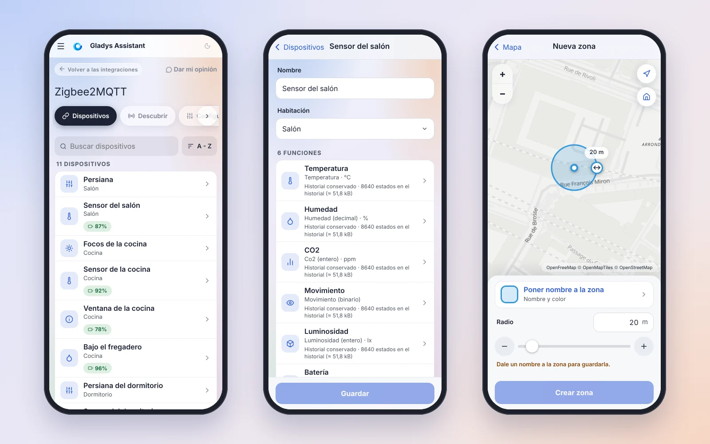
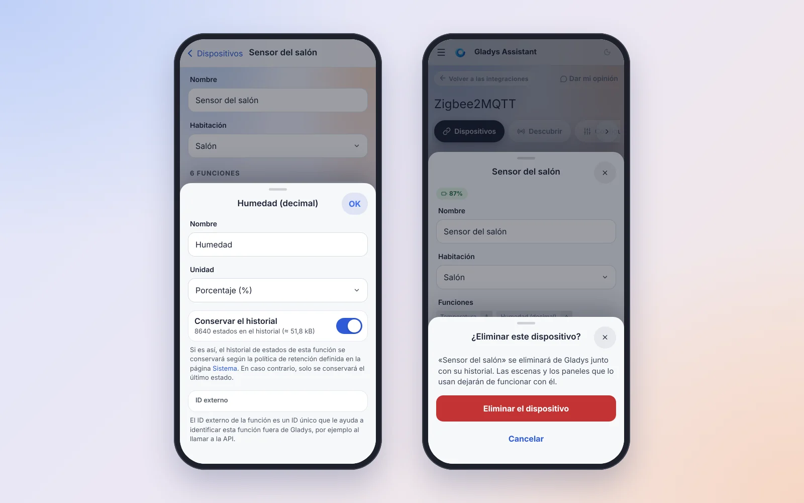
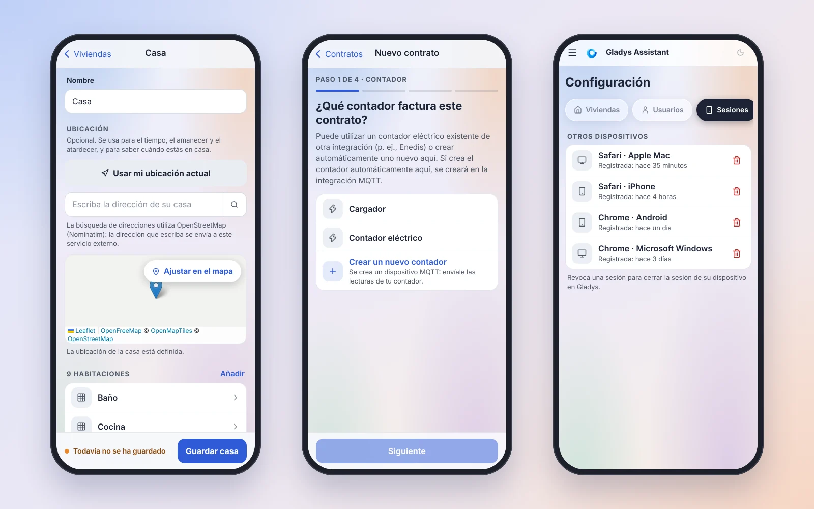
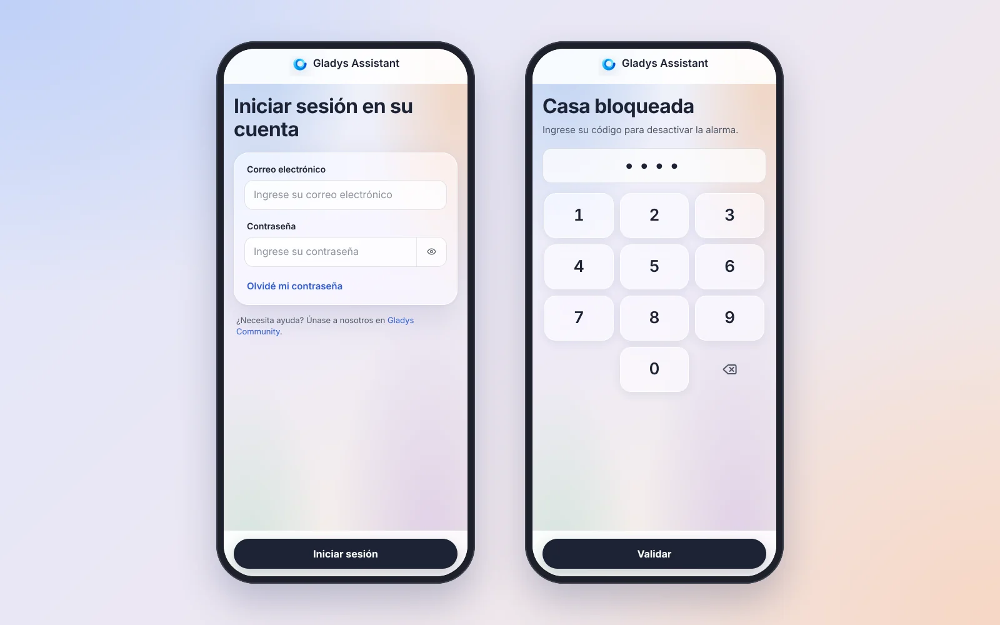
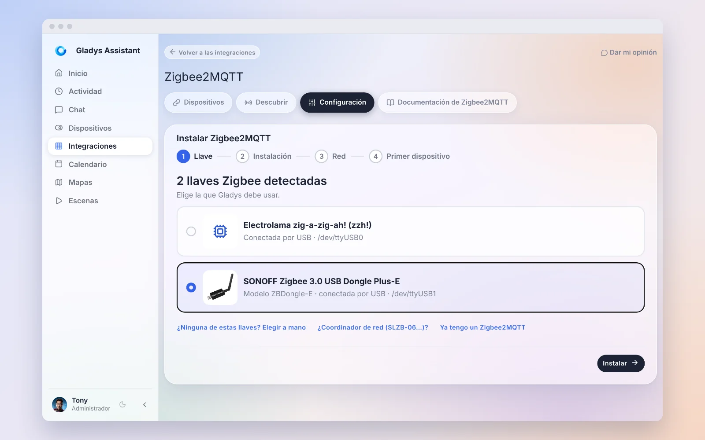
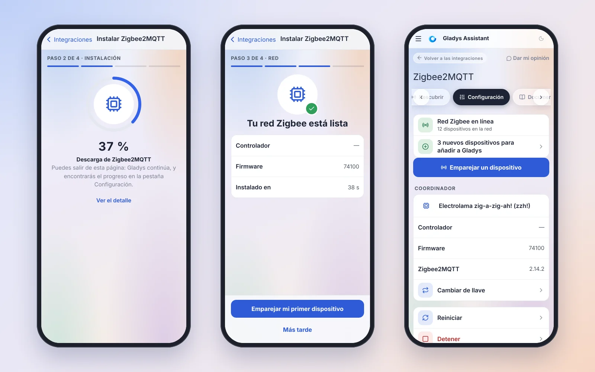
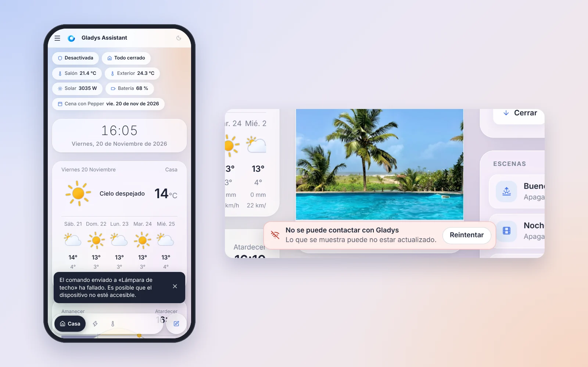
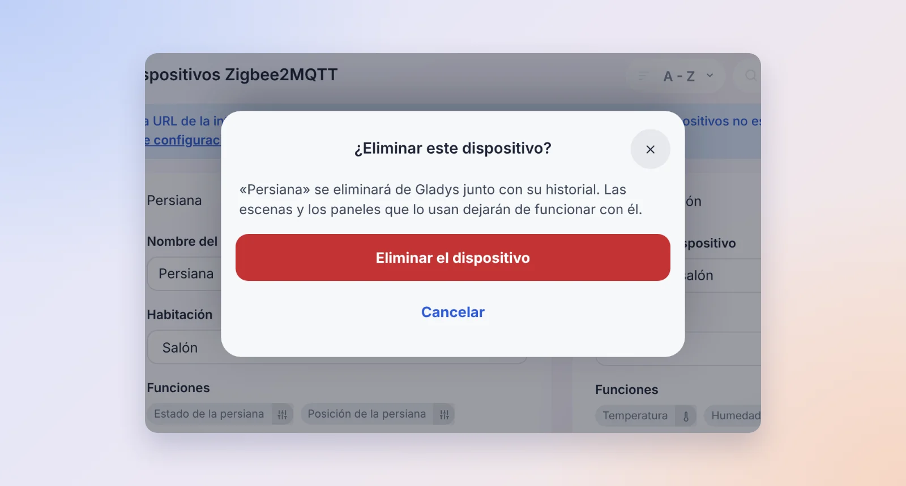
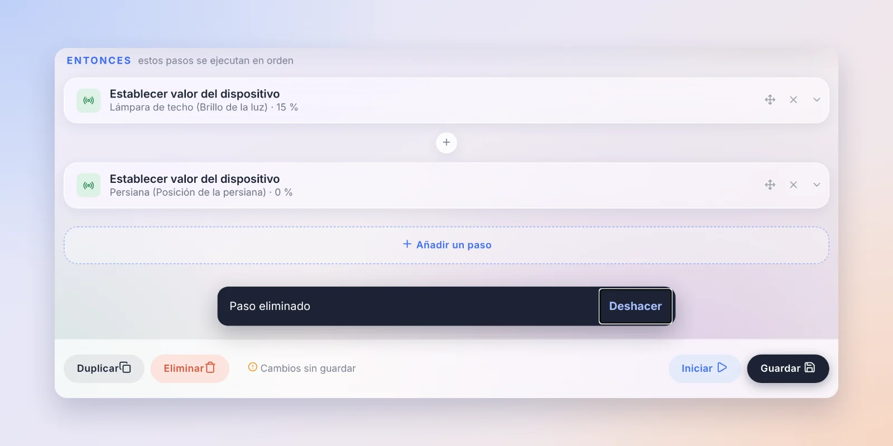

¡Hola a todos!

Hoy llega una nueva versión de Gladys, la 5.3.4 🎉

La semana pasada, la 5.3.3 rehízo el panel y las escenas para el móvil. Esta versión termina el trabajo: **el resto de Gladys pasa al diseño para móvil**, desde la página de inicio de sesión hasta el asistente de contratos de energía, pasando por todas las páginas de los dispositivos. En el ordenador, los diseños no cambian.

Y trae mucho más: **Zigbee2MQTT estrena un asistente de instalación y un panel de control**, y Gladys **ahora te avisa cuando algo va mal**, en lugar de dejarte creer que todo ha funcionado.

{/* truncate */}

## Todo Gladys, en tu móvil

Por debajo de 768 píxeles de ancho (o en un móvil en horizontal), las páginas siguen las mismas reglas que el panel y las escenas: zonas táctiles de al menos 44 píxeles, campos de 16 píxeles (el iPhone ya no hace zoom), nada que se desplace hacia los lados, nada destructivo con un solo toque, y tus cambios nunca se pierden en silencio, ni siquiera con el gesto «atrás» del móvil.

### Los dispositivos y sus integraciones

- **La página de un dispositivo**: primero el nombre y la habitación, luego una fila por funcionalidad, que se abre en un panel (nombre, unidad, conservar el historial, ID externo). Se guarda desde la barra inferior, y un mensaje «Guardado» lo confirma.
- **Las pestañas de dispositivos y de descubrimiento** de Matter, MQTT, Bluetooth, AirPlay, LAN Manager, Enedis, Termostato, cámaras RTSP, Zigbee2MQTT y todas las integraciones externas: una fila por dispositivo en lugar de una pila de tarjetas de ordenador. ¡Tres dispositivos Matter ocupaban 2452 píxeles de desplazamiento! Un toque abre el dispositivo en un panel, con lo que mostraba la tarjeta.
- **Nada se elimina con un solo toque**: una confirmación nombra el dispositivo y lo que se va con él.
- **Cerrar un panel con cambios sin guardar** pregunta: «Guardar y cerrar», «Cerrar sin guardar» o «Seguir editando».
- En las pestañas de **descubrimiento**, el escaneo es el botón principal de la página, y pasa a «Detener el escaneo» mientras está en marcha.
- En las **cámaras RTSP**, «Probar conexión» muestra la imagen de la cámara directamente en el panel.

### Viviendas, ajustes, energía y zonas

- **Viviendas y habitaciones**: una habitación se renombra en un panel, se elimina con un «Deshacer» y se añade con sugerencias de habitaciones habituales. «Usar mi ubicación actual» sitúa la vivienda, y el código de alarma se escribe en un teclado numérico.
- **Ajustes**: sesiones, servicios, tareas en segundo plano, copias de seguridad, sistema y claves de Open API se convierten en listas de filas. Revocar una sesión, restaurar una copia de seguridad, reiniciar o apagar pide confirmación antes.
- **Asistente de contratos de energía**: cuatro pasos (contador, plantilla, parámetros, vista previa), con las horas valle elegidas como franjas horarias.
- **Zonas del mapa**: el mapa ocupa toda la pantalla. Un toque coloca la zona, arrastras el círculo para moverla y el tirador de su borde para cambiar su tamaño, con el radio mostrado en directo.
- **Primera configuración**: los cinco pasos van a pantalla completa, con una barra de progreso y un único botón abajo.

### Inicio de sesión y teclado de bloqueo

Las páginas de inicio de sesión, de contraseña olvidada y de Gladys Plus tienen el teclado y el autocompletado adecuados en cada campo, un botón para mostrar la contraseña, y los errores junto al campo al que se refieren.

El **teclado de bloqueo** de una tableta de pared tiene teclas grandes adaptadas a la pantalla, sin desplazamiento, y un diseño a dos columnas en horizontal. Y en Gladys Plus, configurar la autenticación de dos factores **desde el móvil** ahora propone primero «Abrir mi aplicación 2FA»: se acabó escanear un código QR con el mismo móvil que lo muestra.

## Zigbee2MQTT: un asistente de instalación y un panel de control

La auditoría de Zigbee2MQTT continúa, con su paso más grande hasta ahora. ¡Gracias [@cicoub13](https://github.com/cicoub13) por este enorme trabajo!

### Un asistente para la primera instalación

Cuando no hay nada configurado, la página de Zigbee2MQTT es ahora un asistente en cuatro pasos:

1. **La llave**: Gladys muestra la llave que ha detectado, con su foto y su nombre. También puedes elegir un modelo a mano en una lista ordenada por marca, usar un coordinador de red (SLZB-06…) o conectarte a un Zigbee2MQTT que ya funciona en otro sitio.
2. **La instalación**, fase a fase. Un fallo se explica con palabras claras, con «Reintentar» o «Cambiar de llave o de modelo».
3. **Red lista**: el controlador, el firmware y la duración de la instalación.
4. **Primer dispositivo**: la incorporación se permite durante 4 minutos, y luego a la pestaña de descubrimiento.

### Una instalación más rápida, en segundo plano

- **La instalación se ejecuta en segundo plano**: puedes salir de la página, el progreso sigue ahí cuando vuelves (y en Ajustes › Tareas).
- **Las dos imágenes se descargan en paralelo**, y en cuanto eliges una llave, antes incluso de hacer clic en «Instalar».
- **El broker MQTT arranca una sola vez**, listo en cuanto responde: se acabaron las esperas fijas y los reinicios dobles. En una Raspberry Pi 4, las imágenes se descargaron en unos 15 segundos y Zigbee2MQTT respondía 15 segundos después de arrancar.
- **Se comprueba el espacio libre en disco** antes de cada descarga: un error claro en lugar de un disco lleno.
- **Actualizar la imagen de Zigbee2MQTT ya no corta tu red Zigbee** durante la descarga: la nueva imagen se descarga primero. Sin Internet, la versión instalada sigue funcionando.

### Un panel de control para una instalación configurada

La antigua página de configuración se sustituye por un panel de control: el estado de Zigbee2MQTT con la acción que toca (dispositivos por añadir, un fallo explicado, «Reiniciar»…), el coordinador y los botones «Reiniciar», «Detener» y «Ajustes avanzados». **«Detener» se recuerda**: ni un reinicio de Gladys ni un reinicio de la máquina vuelven a arrancar Zigbee2MQTT hasta que hagas clic en «Arrancar».

### Y por dentro

- **La llave se encuentra esté donde esté enchufada**: Gladys la guarda por su ruta estable (`/dev/serial/by-id/…`) y ya no por `/dev/ttyUSB0`, que puede cambiar en el siguiente reinicio. Las instalaciones existentes se pasan solas.
- **Desenchufada y vuelta a enchufar, la llave vuelve a arrancar Zigbee2MQTT sola**, en unos diez segundos, sin reiniciar Gladys. Una configuración con una llave que no está enchufada se rechaza antes de guardar nada.
- **Un dispositivo nuevo muestra sus valores enseguida** al añadirlo a Gladys, en lugar de quedarse vacío hasta su próximo envío. A los dispositivos conectados a la red eléctrica se les piden sus valores actuales. ¡Gracias a quienes lo [comunicasteis en el foro](https://community.gladysassistant.com/t/transfert-zigbee2mqtt-ha-vers-gladys/11582)!
- **Las nuevas instalaciones generan sus propias claves de red**, como un Zigbee2MQTT instalado por separado, y un archivo de configuración perdido o dañado se restaura desde la copia de seguridad que guarda Gladys. Si trasladas un coordinador a una nueva instalación de Gladys, restaura tu copia de seguridad de Gladys Plus **antes** de configurar Zigbee2MQTT para conservar tu red.

## Gladys te avisa cuando algo va mal

Hasta ahora, cuando Gladys se reiniciaba, se actualizaba o salía de la red, la aplicación parecía viva pero no lo estaba: los valores dejaban de moverse, los interruptores parecían funcionar, y nada lo decía.

- **Un comando que falla se anuncia**: si la luz no se ha podido controlar (dispositivo inaccesible, integración sin configurar…), un mensaje lo dice y el interruptor vuelve al estado real. Solo la página que envió el comando muestra el mensaje: la tableta de pared se queda callada cuando falla el comando de tu móvil.
- **«No se puede contactar con Gladys»**: tras 4 segundos sin conexión, aparece un aviso en todas las páginas, con un botón «Reintentar». Un panel se recarga solo cuando Gladys vuelve.
- **La conexión en directo se reconecta hasta que Gladys vuelve**. Antes solo se reintentaba una vez: tras una actualización o un corte de wifi, una tableta de pared podía quedarse congelada en silencio hasta que alguien la recargaba.
- **La página de inicio de sesión distingue los errores**: credenciales incorrectas, Gladys inaccesible, demasiados intentos o error del servidor. Antes todo era «Correo electrónico o contraseña incorrectos.», incluso con el servidor parado.
- **Gladys Plus**: la carga infinita en el iPhone, después de que la aplicación pasara un rato en segundo plano, está corregida ([foro](https://community.gladysassistant.com/t/lag-multitache-ios/11587)).

## Menos eliminaciones por error

En el ordenador, un botón rojo «Eliminar» estaba junto a «Guardar» en cada tarjeta de dispositivo: un clic despistado y el dispositivo desaparecía con su historial.

- **Eliminar un dispositivo ahora pide confirmación, en 22 integraciones**, con la misma confirmación que en el móvil.

- **En el editor de escenas del ordenador, un paso eliminado se puede recuperar** con un mensaje «Deshacer», como en el móvil.

- **Desconectar Gladys Plus pide confirmación** y avisa de que la clave de copia de seguridad también se elimina. Revocar una sesión pide confirmación.
- **Un dispositivo con un historial largo se elimina solo**: por encima de 5000 estados, Gladys los purgaba en segundo plano y te pedía volver a hacer clic en «Eliminar» más tarde. Ahora una única tarea en segundo plano purga el historial y luego elimina el dispositivo.

## Tabletas de pared: el modo tableta desde una URL

Para configurar una tableta de pared (o diez), ahora basta una URL: `/dashboard/<panel>?tablet_mode_house=<vivienda>&fullscreen=force` abre el panel correcto, en modo tableta y a pantalla completa, sin pasar por el menú. El menú «Modo tableta» muestra la URL lista para usar de la vivienda elegida, con un botón para copiarla. Muy útil cuando se ha restablecido un navegador en modo quiosco. ¡Gracias [@vincentBesseau](https://github.com/vincentBesseau) ([foro](https://community.gladysassistant.com/t/deployer-le-mode-tablette-plein-ecran-via-une-url-tablet-mode-house/11354))!

## Y además

- **Chat con la IA**: los mensajes que envían tus escenas ahora forman parte de la conversación. Si una escena pregunta «¿Apago la secadora?», responder «Sí» se entiende como respuesta a esa pregunta ([foro](https://community.gladysassistant.com/t/contexte-de-longlet-discussion/11622)).
- **Calendario**: cuando no tienes ningún calendario, la página explica cómo conectar uno, con enlaces a las integraciones de calendario instaladas o al catálogo.
- **Nuki**: la integración nativa queda obsoleta en favor de la integración de la comunidad [Gladys-Nuki](https://github.com/gboulvin/Gladys-Nuki). Un botón «Migrar» traslada tus dispositivos. La integración nativa sigue funcionando por ahora.
- **Termostato**: el dial se queda dentro del rango del termostato (¡un Tado X a través de Matter mostraba un dial de -100 a 200 °C!), y una consigna manual en un termostato virtual se limita a su rango. Un widget cuyo termostato se ha eliminado lo indica, y los nombres de los preajustes caben en su columna en todos los idiomas. ¡Gracias [@William-De71](https://github.com/William-De71)!
- **Widget de consumo de energía**: las series llevan el nombre de su dispositivo («Enchufe del salón») en lugar de un largo nombre de funcionalidad seguido de «(1)», «(2)», y el editor muestra nombres legibles.
- **Gladys Plus**: la tarjeta de invitación recuerda revisar la carpeta de spam, y quien ha perdido a la vez su contraseña y su aplicación de doble factor ya no da vueltas en círculo en la recuperación.

## Correcciones

- **Gladys podía quedarse congelado durante minutos, incluso horas**, después de guardar un dispositivo mientras las integraciones publicaban estados. ¡Gracias [@smuteau](https://github.com/smuteau) por el diagnóstico y la corrección ([foro](https://community.gladysassistant.com/t/nouveau-probleme-de-freeze-de-gladys/11625))!
- **Matter**: un comando a un dispositivo desconectado ya no espera para siempre (falla a los 15 segundos), y el **botón Detener de una escena** ahora termina una ejecución bloqueada dentro de una acción ([foro](https://community.gladysassistant.com/t/scene-inarretable/11614)). «Actualizar» en la página de Matter conserva el nombre, la habitación y los ajustes de energía del dispositivo, y ya no se propone para cada dispositivo que mide energía.
- **Integraciones externas**: «Actualizar» en la pestaña de descubrimiento conserva el nombre que le diste al dispositivo. ¡Gracias [@smuteau](https://github.com/smuteau)!
- **MQTT**: el disparador «Recibir mensaje de MQTT» funciona con los comodines `+` y `#`, y los dispositivos de Home Assistant cuyo valor «apagado» es `0` o `false` (un radar de presencia que se quedaba en «detectado») informan bien de su estado. ¡Gracias [@zagg](https://github.com/zagg)!
- **Cámaras**: la emisión en directo arranca en las cámaras cuya imagen redimensionada tenía una altura impar (un subflujo de 896×512, por ejemplo).
- La autocorrección está realmente desactivada en los campos de correo, contraseña y código del móvil.

Son 38 pull requests desde la versión 5.3.3.

## Gracias a los colaboradores

Muchas gracias a [@cicoub13](https://github.com/cicoub13) por el asistente, el panel de control y la instalación de Zigbee2MQTT, a [@William-De71](https://github.com/William-De71) por el termostato, a [@smuteau](https://github.com/smuteau) por la corrección del bloqueo y las integraciones externas, a [@zagg](https://github.com/zagg) por MQTT, y a [@vincentBesseau](https://github.com/vincentBesseau) por el modo tableta desde una URL. ¡Y gracias a todos los que habéis comunicado errores e ideas en el foro!

Nos vemos en [el foro](https://community.gladysassistant.com/) si quieres hablar de esta versión :)

## ¿Cómo actualizar?

Como siempre, Gladys se actualiza automáticamente en un plazo de 24 horas si usas Watchtower; si no, puedes hacerlo con un clic desde los ajustes.

El [CHANGELOG completo de la 5.3.4](https://github.com/GladysAssistant/Gladys/releases/tag/v5.3.4) está en GitHub.
