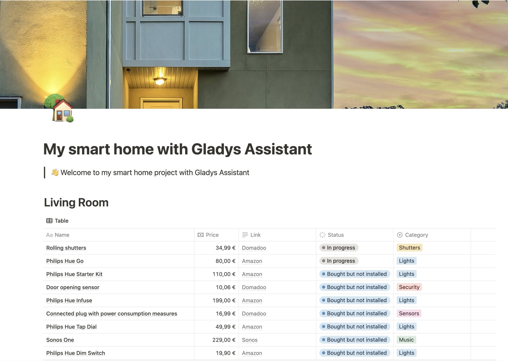
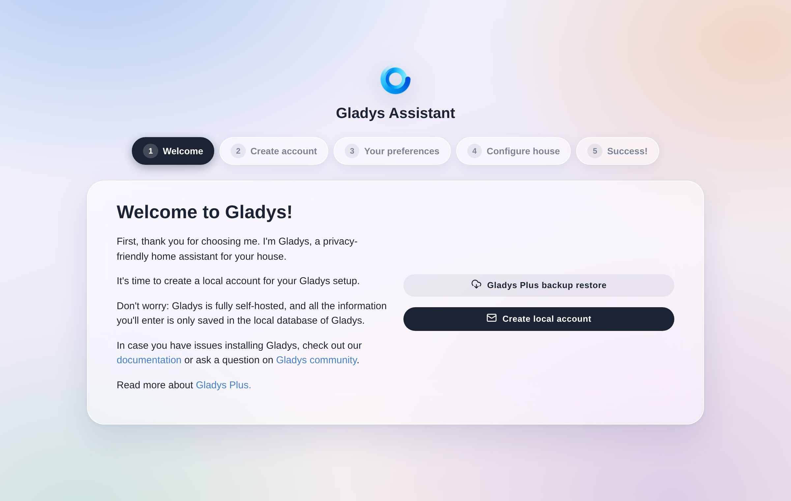

Cuando empiezas en la domótica, puede ser difícil saber por dónde empezar.

## Elige tu central domótica

Gladys Assistant es un software autoalojado, lo que significa que todo funciona en local, en una central domótica. ¡Es uno de sus puntos fuertes!

Tienes varias opciones para ejecutar Gladys:

### Opción 1: Mini-PC con Gladys Assistant OS (recomendado)

La mayoría de los usuarios ejecutan Gladys en un mini-PC. Es la mejor relación calidad-precio para una instalación a largo plazo.

Instalarlo es muy sencillo con **Gladys Assistant OS**, nuestro instalador oficial: lo grabas en una memoria USB, arrancas el mini-PC desde ella y respondes a unas pocas preguntas. Gladys se instala automáticamente y después se mantiene actualizado por sí solo. Sin línea de comandos.

- **Mini-PC nuevo** (Beelink, Intel NUC…), por ejemplo el [Beelink Mini S13 en Amazon](https://www.amazon.com/s?k=Beelink+Mini+S13&tag=gladproj-21)
- **Mini-PC reacondicionado**: suele ser más barato en las webs de segunda mano. Busca al menos 8 GB de RAM y un SSD.
- **Un ordenador que ya tienes**: un PC antiguo, un Intel NUC cogiendo polvo… Cualquier ordenador con un procesador Intel o AMD puede convertirse en tu central Gladys (su disco se borrará).

👉 [Instalar Gladys en un mini-PC con Gladys Assistant OS](/es/docs/installation/mini-pc/)

### Opción 2: Raspberry Pi

- Una forma estupenda de descubrir Gladys si ya tienes una a mano
- Configuración simplificada con nuestra imagen oficial de 64 bits (Pi 3, 4 y 5)
- 👉 [Guía de instalación en una Raspberry Pi](/es/docs/installation/raspberry-pi/)
- Para un uso diario a largo plazo, un mini-PC sigue siendo la mejor opción

### Opción 3: Un servidor o un NAS que ya tienes en marcha

Si ya tienes una máquina que ejecuta otros servicios, puedes instalar Gladys en ella con Docker, junto a lo que ya funciona:

- **Cualquier servidor Linux con Debian o Ubuntu**: consulta la [guía de instalación con Docker](/es/docs/installation/docker/)
- **NAS Synology o Unraid**: consulta las guías de [Synology](/es/docs/installation/synology/) y de [Unraid](/es/docs/installation/unraid/)
- **Servidor Proxmox VE**: ejecuta Gladys en una VM Debian, consulta la [guía de instalación en Proxmox](/es/docs/installation/proxmox/)

## Instalar Gladys Assistant

Según el hardware elegido, puedes seguir uno de los siguientes tutoriales:

- **Recomendado:** [Instalar Gladys Assistant en un mini-PC con Gladys Assistant OS](/es/docs/installation/mini-pc/)
- [Instalar Gladys Assistant en una Raspberry Pi](/es/docs/installation/raspberry-pi/)
- [Instalar Gladys Assistant con Docker en Debian, Ubuntu o cualquier equipo Linux](/es/docs/installation/docker/)
- [Instalar Gladys Assistant en Proxmox VE](/es/docs/installation/proxmox/)
- [Instalar Gladys Assistant en un NAS Synology](/es/docs/installation/synology/)
- [Instalar Gladys Assistant en un NAS Unraid](/es/docs/installation/unraid/)

## Define tu proyecto de hogar inteligente

Lo más importante es definir las automatizaciones que quieres poner en marcha en tu casa: iluminación conectada, una alarma para proteger tu hogar, ahorro de energía apagando los dispositivos que no usas o la calefacción…

Una buena forma de organizarte es crear una tabla (en Excel, Google Sheets o Notion) en la que enumeres, habitación por habitación, todos los dispositivos que quieres integrar.

### Ejemplo: salón

| Nombre                                                               | Precio | Enlace                                                                                                                         |
| -------------------------------------------------------------------- | ------ | ------------------------------------------------------------------------------------------------------------------------------ |
| Sensor de temperatura/humedad Zigbee con pantalla                    | $19,99 | [Amazon US](https://amzn.to/4i3oRP1)                                                                                           |
| Pack de 4 enchufes inteligentes ZigBee con medición de consumo en tiempo real | €16.99 | [Amazon US](https://amzn.to/3CRoBne)                                                                                  |
| Bombilla IKEA TRÅDFRI E27 (luz de techo)                             | $13,99 | [IKEA US](https://www.ikea.com/us/en/p/tradfri-led-bulb-e26-1100-lumen-smart-wireless-dimmable-white-spectrum-globe-50545678/) |
| Mando IKEA STYRBAR (brillo)                                          | $13,99 | [IKEA US](https://www.ikea.com/us/en/p/styrbar-remote-control-smart-white-80488370/)                                           |
| Pack de 4 sensores de movimiento Zigbee                              | $75,99 | [Amazon US](https://amzn.to/4k2hb0X)                                                                                           |

La idea no es necesariamente comprarlo todo de una vez, sino planificar y equipar tu casa poco a poco, salvo que acabes de mudarte y quieras instalarlo todo de inmediato.

## Configurar tu hogar inteligente {/* #configuring-your-smart-home */}

Una vez que Gladys esté funcionando en tu casa, puedes acceder a él desde tu navegador web y empezar a configurar tu hogar.

A partir de ahí, solo tienes que seguir los pasos: crea la cuenta de administrador principal de tu hogar inteligente, responde a algunas preferencias y ponle nombre a tu casa. Solo lleva un par de minutos.

¡Listo! Ya tienes un sistema de hogar inteligente con Gladys en tu casa.

Ahora puedes configurar las distintas integraciones disponibles en Gladys.

Si tienes alguna pregunta, ¡únete a nosotros [en el foro](https://community.gladysassistant.com/)!
