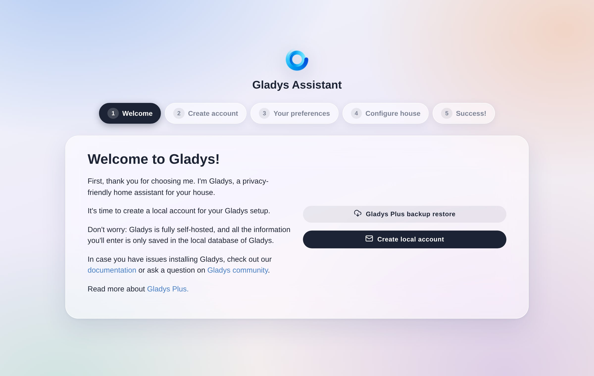

import {
  Roadmap,
  HowItWorks,
  InstallOptions,
  InstallOption,
  IntegrationChips,
  IntegrationsCount,
  Highlights,
} from "@site/src/components/docs/GettingStarted";
import GladysScreenshot from "@site/src/components/horizon/GladysScreenshot";
import JsonLd from "@site/src/components/seo/JsonLd";

**Gladys Assistant es un software de domótica gratuito y de código abierto.** Reúne todos tus dispositivos en una sola aplicación, te permite controlarlos desde tu móvil y automatiza tu casa, funcionando **en tu casa**, no en la nube de otro.

De cero a tu primera automatización, este es todo el camino:

<Roadmap
  label="Los pasos de esta guía"
  steps={[
    { href: "#install", title: "Instalar Gladys", time: "~30 min" },
    { href: "#create-account", title: "Crear tu cuenta", time: "2 min" },
    { href: "#connect-devices", title: "Conectar tus dispositivos", time: "5 min por marca" },
    { href: "#automate", title: "Automatizar tu casa", time: "5 min" },
  ]}
/>

<GladysScreenshot lang="es" caption="El panel de control de Gladys: tus dispositivos, habitaciones, cámaras y energía, en el ordenador y en el móvil." />

## Cómo funciona Gladys {/* #how-it-works */}

<HowItWorks
  nodes={[
    { title: "Tus dispositivos", text: "Luces, sensores, enchufes, calefacción, cámaras… de cualquier marca." },
    { title: "Gladys, en tu casa", text: "En un pequeño ordenador siempre encendido, como tu router." },
    { title: "Tu móvil y tu ordenador", text: "Para controlarlo todo, desde el sofá o desde cualquier lugar." },
  ]}
>

Gladys es **autoalojado**: en lugar de suscribirte a una nube, lo instalas una sola vez en un pequeño ordenador en casa. Por eso hay un paso de instalación, y es lo que hace que Gladys sea **privado** (por defecto, tus datos se quedan en casa) y **fiable** (tu casa sigue funcionando aunque se caiga Internet).

</HowItWorks>

## Paso 1: instalar Gladys {/* #install */}

Elige el equipo en el que funcionará Gladys. **¿Dudas? Elige el mini-PC**: es lo que usa la mayoría, y lo que uso yo en casa.

<InstallOptions>
<InstallOption
  featured
  icon="cpu"
  badge="Recomendado"
  title="En un mini-PC, con Gladys Assistant OS"
  facts={[["clock", "Unos 30 minutos"], ["check", "Sin línea de comandos"], ["refresh-cw", "Actualizaciones automáticas"]]}
  cta="Instalar Gladys en un mini-PC"
  to="/es/docs/installation/mini-pc/"
>

Nuestro instalador oficial hace todo el trabajo: lo grabas en una memoria USB, arrancas el mini-PC desde ella, respondes a unas pocas preguntas y Gladys se instala solo. Después, se mantiene actualizado automáticamente.

- **Un mini-PC nuevo**: pequeño, silencioso y de bajo consumo. Recomiendo el [Beelink Mini S13](https://www.amazon.com/s?k=Beelink+Mini+S13&tag=gladproj-21); consulta también nuestra [guía de compra de mini-PC](/es/mini-pc-home-automation/).
- **Un mini-PC reacondicionado**: a menudo mucho más barato. Busca al menos 8 GB de RAM y un SSD.
- **Un ordenador que ya tengas**: un PC antiguo con procesador Intel o AMD que arranque en modo UEFI, un SSD de al menos 16 GB y un puerto Ethernet puede convertirse en tu central Gladys (su disco se borrará).

</InstallOption>

<InstallOption
  icon="package"
  title="En una Raspberry Pi"
  facts={[["clock", "De 30 minutos a 1 hora"], ["check", "Sin línea de comandos"]]}
  cta="Instalar en una Raspberry Pi"
  to="/es/docs/installation/raspberry-pi/"
>

¿Ya tienes una Raspberry Pi 3, 4 o 5? Graba nuestra imagen oficial de 64 bits con Raspberry Pi Imager: ideal para descubrir Gladys. Para un uso diario a largo plazo, un mini-PC sigue siendo la mejor opción.

</InstallOption>

<InstallOption
  icon="server"
  title="En un servidor o un NAS que ya tengas"
  facts={[["clock", "Unos 10 minutos con Docker"], ["terminal", "Para habituales del autoalojamiento"]]}
>

Gladys se instala junto a tus otros servicios, sin comprar un equipo nuevo:

- [Docker en Debian, Ubuntu o cualquier Linux](/es/docs/installation/docker/)
- [Proxmox VE](/es/docs/installation/proxmox/), en una VM instalada con Gladys Assistant OS
- [NAS Synology](/es/docs/installation/synology/)
- [NAS Unraid](/es/docs/installation/unraid/)

</InstallOption>
</InstallOptions>

## Paso 2: crear tu cuenta {/* #create-account */}

Cuando Gladys esté en marcha, ábrelo en tu navegador, desde un ordenador o un móvil conectado a la misma red:

- **[http://gladysassistant.local](http://gladysassistant.local)**: Gladys anuncia este nombre en tu red, con Gladys Assistant OS, la imagen para Raspberry Pi, Proxmox o Docker. En un NAS Synology, añade el puerto que elegiste, por ejemplo `http://gladysassistant.local:8420`;
- si no (Unraid, algunos móviles Android, redes de invitados…): la dirección IP del equipo, por ejemplo `http://192.168.1.42`, seguida del puerto en un NAS.

Un breve asistente te guía: crea la cuenta de administrador, elige tus preferencias (idioma, unidades) y pon nombre a tu casa y a sus habitaciones. Son dos minutos, y todo lo que introduces se queda en la base de datos local de Gladys.

¿Vienes de una instalación anterior? El botón **Restaurar copia de seguridad de Gladys Plus** de esta pantalla recupera toda tu configuración.

## Paso 3: conectar tus dispositivos {/* #connect-devices */}

En Gladys, abre **Integraciones** y elige la marca de tus dispositivos. Gladys funciona con más de <IntegrationsCount lang="es" /> integraciones: las más populares vienen incluidas y las demás se instalan con un clic.

<IntegrationChips lang="es" allLabel="Las {count}+ integraciones" />

Cada integración tiene su propia página en esta documentación, con los pasos a seguir.

:::tip[¿Empiezas de cero? Apuesta por Zigbee]
Si vas a comprar dispositivos, te recomiendo **Zigbee**: un adaptador USB Zigbee (unos 30 €) conectado a tu central Gladys y la [integración Zigbee2MQTT](/es/docs/integrations/zigbee2mqtt/) te dan acceso a miles de sensores, enchufes, bombillas y mandos asequibles, de cualquier marca, sin pasarela del fabricante y sin nube. Mi selección de modelos fiables está en la página de [hardware recomendado](/es/docs/installation/recommended-hardware/).
:::

Ejemplo: equipar un salón por unos 150 $

Empieza por una habitación, mira lo que te gusta y luego amplía habitación por habitación.

| Dispositivo                                                                   | Precio | Enlace                                                                                                                         |
| ----------------------------------------------------------------------------- | ------ | ------------------------------------------------------------------------------------------------------------------------------ |
| Sensor de temperatura/humedad Zigbee con pantalla                             | $19,99 | [Amazon US](https://amzn.to/4i3oRP1)                                                                                           |
| Pack de 4 enchufes inteligentes ZigBee con medición de consumo en tiempo real | $16,99 | [Amazon US](https://amzn.to/3CRoBne)                                                                                           |
| Bombilla IKEA TRÅDFRI E27 (luz de techo)                                      | $13,99 | [IKEA US](https://www.ikea.com/us/en/p/tradfri-led-bulb-e26-1100-lumen-smart-wireless-dimmable-white-spectrum-globe-50545678/) |
| Mando IKEA STYRBAR (brillo)                                                   | $13,99 | [IKEA US](https://www.ikea.com/us/en/p/styrbar-remote-control-smart-white-80488370/)                                           |
| Pack de 4 sensores de movimiento Zigbee                                       | $75,99 | [Amazon US](https://amzn.to/4k2hb0X)                                                                                           |

## Paso 4: automatizar tu casa {/* #automate */}

Aquí es donde Gladys brilla. Tus dispositivos aparecen en el **panel de control**, que puedes [personalizar](/es/docs/dashboard/intro/) y compartir con tu familia. Después, las **escenas** hacen que tu casa funcione sola: un disparador (una hora, un sensor, alguien que llega a casa…), algunas condiciones y acciones.

<GladysScreenshot lang="es" shot="scene" alt="Una escena en Gladys Assistant" />

Algunas ideas para una primera escena:

<Highlights
  items={[
    { icon: "zap", title: "Iluminar el pasillo de noche", text: "Cuando se detecta movimiento después de la puesta de sol, encender la luz durante 2 minutos." },
    { icon: "home", title: "Salir de casa tranquilo", text: "Cuando la casa está vacía, apagarlo todo y activar la alarma." },
    { icon: "thermometer", title: "Calentar solo cuando hace falta", text: "Bajar la calefacción por la noche y cuando no hay nadie." },
    { icon: "message-square", title: "Enterarte al instante", text: "Recibir un mensaje si hay una fuga de agua o se abre una puerta durante tus vacaciones." },
  ]}
/>

👉 [Crear tu primera escena](/es/docs/scenes/intro/)

Para usar Gladys como una app, [instálalo en tu móvil](/es/docs/installation/phone/). Para controlarlo cuando estás fuera, [Gladys Plus](/es/plus/), nuestro servicio opcional, te ofrece un acceso remoto cifrado de extremo a extremo, sin configurar nada en tu red.

## Preguntas frecuentes {/* #faq */}

¿Gladys es realmente gratuito?

Sí. Gladys es de código abierto (licencia Apache 2.0) y gratuito, sin límite de dispositivos ni de funciones. [Gladys Plus](/es/plus/) es un servicio de pago opcional que lo complementa (acceso remoto, copias de seguridad diarias, Google Home y Alexa, IA); financia el desarrollo del proyecto.

¿Necesito saber programar o usar un terminal?

No. Con Gladys Assistant OS o la imagen para Raspberry Pi, instalas Gladys sin escribir un solo comando, y todo lo demás se hace desde la interfaz de Gladys.

¿Gladys funciona sin Internet?

Sí. Gladys funciona en local: tus dispositivos, tu panel de control y tus escenas siguen funcionando sin Internet. Solo necesitas conexión para instalar Gladys, recibir las actualizaciones y usar las integraciones de servicios en la nube.

Ya uso otro software de domótica, ¿puedo cambiar?

Sí, y Gladys puede incluso funcionar en paralelo mientras pasas tus dispositivos. La mayoría de los dispositivos Zigbee, Matter, Philips Hue o Shelly se emparejan directamente con Gladys. Mira cómo se compara Gladys con [Home Assistant](/es/home-assistant-alternative/).

<JsonLd
  data={{
    "@context": "https://schema.org",
    "@type": "FAQPage",
    mainEntity: [
      {
        "@type": "Question",
        name: "¿Gladys es realmente gratuito?",
        acceptedAnswer: {
          "@type": "Answer",
          text: "Sí. Gladys es de código abierto (licencia Apache 2.0) y gratuito, sin límite de dispositivos ni de funciones. Gladys Plus es un servicio de pago opcional que lo complementa (acceso remoto, copias de seguridad diarias, Google Home y Alexa, IA); financia el desarrollo del proyecto.",
        },
      },
      {
        "@type": "Question",
        name: "¿Necesito saber programar o usar un terminal?",
        acceptedAnswer: {
          "@type": "Answer",
          text: "No. Con Gladys Assistant OS o la imagen para Raspberry Pi, instalas Gladys sin escribir un solo comando, y todo lo demás se hace desde la interfaz de Gladys.",
        },
      },
      {
        "@type": "Question",
        name: "¿Gladys funciona sin Internet?",
        acceptedAnswer: {
          "@type": "Answer",
          text: "Sí. Gladys funciona en local: tus dispositivos, tu panel de control y tus escenas siguen funcionando sin Internet. Solo necesitas conexión para instalar Gladys, recibir las actualizaciones y usar las integraciones de servicios en la nube.",
        },
      },
      {
        "@type": "Question",
        name: "Ya uso otro software de domótica, ¿puedo cambiar?",
        acceptedAnswer: {
          "@type": "Answer",
          text: "Sí, y Gladys puede incluso funcionar en paralelo mientras pasas tus dispositivos. La mayoría de los dispositivos Zigbee, Matter, Philips Hue o Shelly se emparejan directamente con Gladys.",
        },
      },
    ],
  }}
/>

## ¿Necesitas ayuda?

¿Te has atascado en algún paso? Pregunta en [el foro](https://community.gladysassistant.com/): la comunidad y yo respondemos todos los días.
