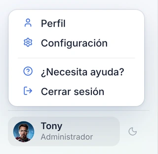
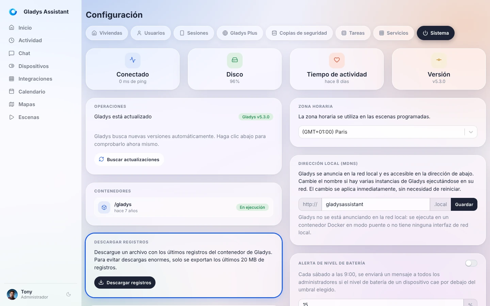
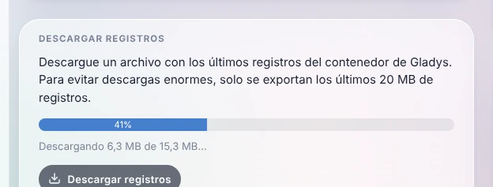

Cuando algo no funciona como esperabas (una integración que no arranca, un dispositivo que deja de responder, una escena que no se ejecuta), lo primero que hay que mirar son los **registros (logs) de Gladys**. También es lo que te pedirán en [el foro](https://community.gladysassistant.com/) para ayudarte.

No necesitas la línea de comandos: Gladys te permite descargar sus registros **con un clic**, directamente desde la interfaz.

## Descargar los registros desde la interfaz

Abre Gladys en tu navegador, haz clic en tu nombre abajo a la izquierda del menú y luego en **Configuración**.



Abre la pestaña **Sistema** y, en la tarjeta **Descargar registros**, haz clic en **Descargar registros**.



Gladys reúne los registros y los descarga por partes: una barra de progreso muestra cuánto falta.



Al terminar, tu navegador guarda un archivo de texto con un nombre como `gladys-logs-2026-10-26-101203.log`. Puedes abrirlo con cualquier editor de texto.

Conviene saber:

- Solo se exportan los **últimos 20 MB** de registros, para que el archivo sea ligero. Es más que suficiente para cubrir las últimas horas o días de actividad.
- Tienes que haber iniciado sesión con una cuenta de **administrador**.
- También funciona **a distancia a través de [Gladys Plus](/es/docs/plus/intro)**: no hace falta estar en casa para obtener los registros.
- Este botón está disponible desde Gladys Assistant v4.77. Si no lo ves, [actualiza Gladys](/es/docs/installation/faq).

## Compartir los registros en el foro

Para obtener ayuda, [crea un tema en el foro](https://community.gladysassistant.com/) explicando tu problema y adjunta el archivo de registros (o pega las líneas relevantes en un bloque de código).

Antes de publicar, echa un vistazo al archivo: los registros pueden contener los nombres de tus dispositivos, direcciones IP locales o las URL de tus servicios. Quita lo que no quieras compartir públicamente.

## Leer los registros desde la línea de comandos

Si la interfaz de Gladys no se abre en absoluto, puedes leer los registros desde la máquina en la que se ejecuta Gladys. Conéctate a ella (por SSH, por ejemplo) y ejecuta:

```bash
sudo docker logs gladys --tail=1000
```

Esto muestra las últimas 1000 líneas. Para seguir los registros en directo mientras reproduces el problema, añade `-f`:

```bash
sudo docker logs gladys --tail=100 -f
```

Pulsa `Ctrl+C` para salir.

## Preguntas frecuentes

### ¿Dónde se guardan los registros de Gladys?

Gladys se ejecuta en un contenedor Docker y escribe sus registros en la salida estándar de ese contenedor: es Docker quien los guarda en la máquina anfitriona. Por eso se leen desde la interfaz o con `docker logs`, y no en un archivo de la carpeta `/var/lib/gladysassistant`.

### La descarga falla con «No se pudieron descargar los registros»

Gladys lee sus registros a través de Docker. Comprueba que Gladys se ejecuta en Docker y que el socket de Docker está compartido con el contenedor (la opción `-v /var/run/docker.sock:/var/run/docker.sock` del [comando de instalación](/es/docs/installation/docker)). Si el problema continúa, lee los registros [desde la línea de comandos](#leer-los-registros-desde-la-línea-de-comandos).

### ¿Cómo veo los registros de una integración de la comunidad?

Cada integración externa se ejecuta en su propio contenedor y tiene sus propios registros: abre la integración en Gladys y ve a su pestaña **Registros**.
