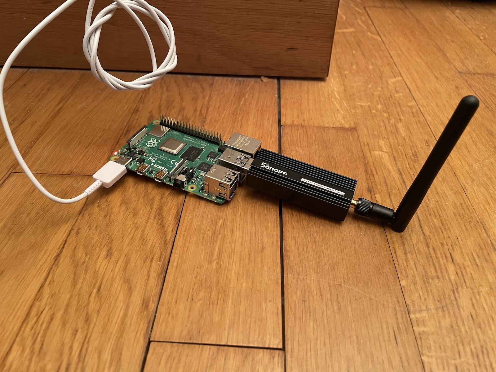
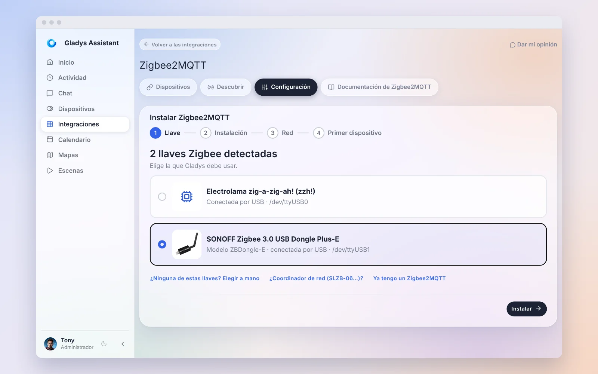
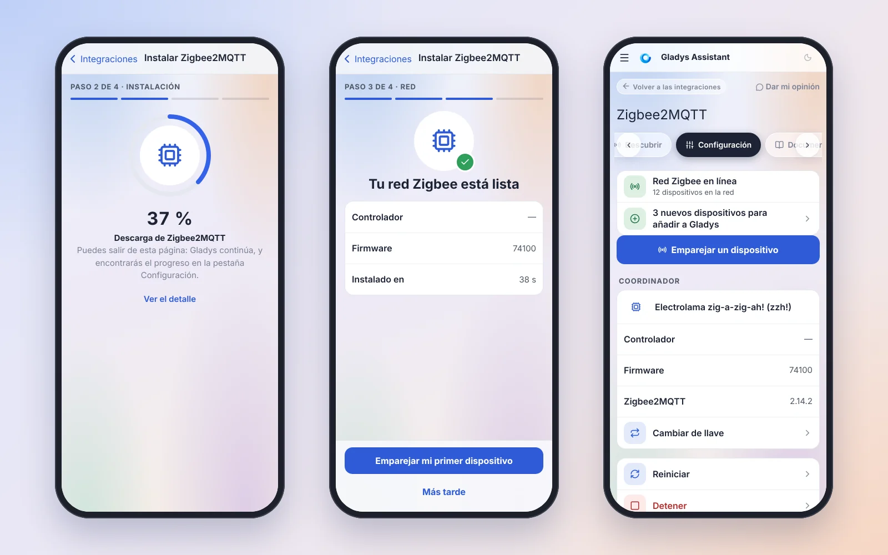
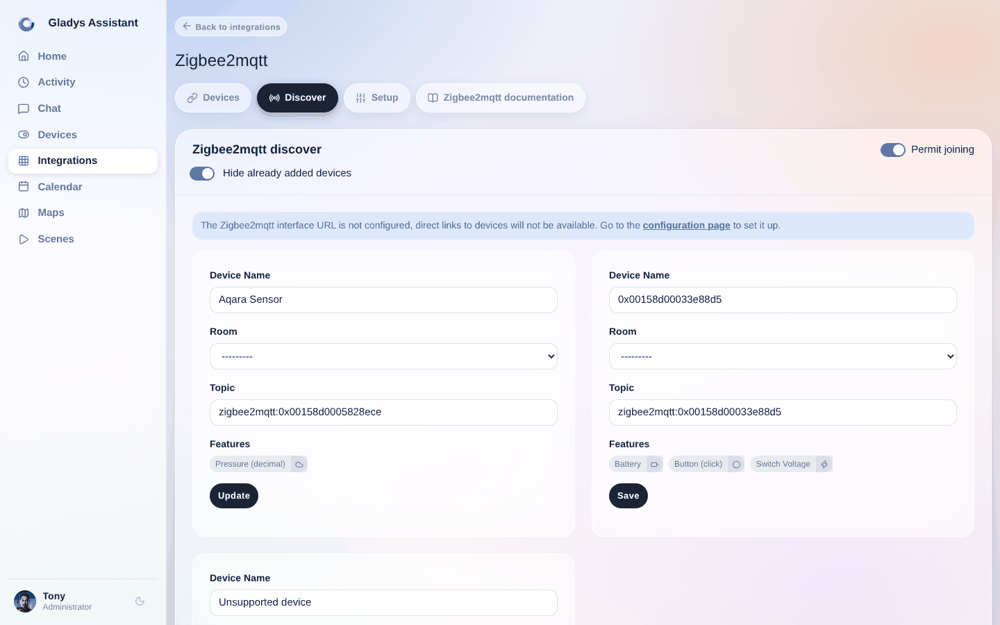
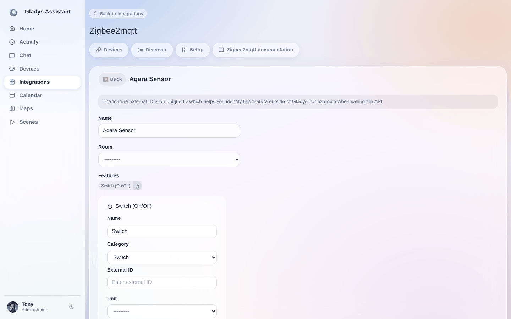

import JsonLd from '@site/src/components/seo/JsonLd';

Zigbee2MQTT te permite tener tu propio **hub Zigbee local** con Gladys: conectas un dongle USB Zigbee a la máquina en la que funciona Gladys y controlas todos tus dispositivos Zigbee directamente desde casa, sin cuenta en la nube y sin el puente del fabricante. Este tutorial te muestra cómo configurarlo, emparejar tu dongle y añadir dispositivos.

:::tip[¿Vienes de Home Assistant?]
Gladys instala y gestiona por ti Zigbee2MQTT y su broker MQTT: consulta [Zigbee2MQTT sin Home Assistant](/es/zigbee2mqtt-without-home-assistant/). ¿Todavía estás eligiendo un dongle? Lee nuestra [guía de compra de dongles Zigbee](/es/best-zigbee-dongle/).
:::

En resumen, vamos a conectar tus dispositivos Zigbee directamente a Gladys, sin necesidad de puentes de terceros (solo con un dongle USB Zigbee y el proyecto [Zigbee2Mqtt](https://www.zigbee2mqtt.io/)).

Puedes consultar la lista de dispositivos compatibles [aquí](https://www.zigbee2mqtt.io/supported-devices/).

Antes de empezar, asegúrate de tener un coordinador Zigbee: un dongle USB conectado a la máquina en la que funciona Gladys, o un coordinador de red (consulta [Usar un coordinador de red](#use-a-network-coordinator) más abajo). Si Zigbee2MQTT ya funciona en otro lugar, Gladys también puede [conectarse a él](#connect-to-an-existing-zigbee2mqtt).

Un dongle USB sencillo y económico que hemos probado con Gladys es el [dongle USB Sonoff Zigbee 3.0](https://amzn.to/3JZwzJy).

La lista completa de adaptadores compatibles está disponible en la [lista de adaptadores compatibles con Zigbee2mqtt](https://www.zigbee2mqtt.io/guide/adapters/).

## Instalar Zigbee2MQTT con el asistente de configuración {/* #install-zigbee2mqtt-with-the-setup-wizard */}

Desde Gladys 5.3.4, un asistente de cuatro pasos te guía en la primera instalación. Gladys instala dos contenedores por ti, un broker MQTT y Zigbee2MQTT: no hay nada que escribir en un terminal. Para ello, Gladys debe funcionar en Docker con la red `host`, como en cualquier instalación estándar.

Conecta tu dongle Zigbee a la máquina en la que funciona Gladys (tu Raspberry Pi, tu mini-PC, tu NAS).



En Gladys, ve a `Integraciones / Zigbee2Mqtt` y abre la pestaña `Configuración`.



### Paso 1: la llave

Gladys reconoce los dongles más habituales (SONOFF ZBDongle-P y ZBDongle-E, Home Assistant Connect ZBT-1 y ZBT-2, ConBee II y III, SMLIGHT SLZB-06M y SLZB-07…). Lo que muestra el asistente depende de lo que esté conectado:

- **Llave Zigbee detectada**: Gladys muestra tu dongle, con su foto y su nombre. No tienes nada que elegir.
- **2 llaves Zigbee detectadas** (o más): elige la que Gladys debe usar.
- **Gladys no ha reconocido tu llave**: elige su modelo en la lista, agrupada por marca. El buscador encuentra un modelo por su nombre o su código (`dongle-e`, `sonoff p`, `conbee`, `skyconnect`…). El modelo está escrito en el dongle o en su caja: determina el controlador que usa Zigbee2MQTT para hablar con él.
- **Conecta tu llave Zigbee**: todavía no hay ningún dongle conectado. Gladys lo detecta en cuanto lo conectas, sin recargar la página.

Debajo, unos enlaces llevan a las demás opciones (en el móvil, están agrupadas en **Otra llave u otra instalación**):

- **¿No es la llave correcta? Elegir a mano** (o **Mi llave está conectada pero no aparece**): elige el puerto y el modelo a mano. Los puertos serie de la propia máquina y de las placas HAT/GPIO (como la RaspBee) están ocultos: haz clic en **Mostrar los demás puertos serie (placa HAT/GPIO, puertos de la máquina)** para verlos.
- **¿Coordinador de red (SLZB-06…)?**: consulta [Usar un coordinador de red](#use-a-network-coordinator).
- **Ya tengo un Zigbee2MQTT**: consulta [Conectarse a un Zigbee2MQTT existente](#connect-to-an-existing-zigbee2mqtt).

Después, haz clic en **Instalar**. Gladys comprueba que el dongle está conectado antes de guardar nada. Incluso empieza a descargar Zigbee2MQTT en cuanto se selecciona un dongle, antes de que hagas clic: así la instalación es aún más rápida.

:::tip
Conecta el dongle al final de un cable alargador USB, lejos de los puertos USB 3 y del router Wi-Fi: la señal Zigbee solo puede mejorar.
:::

:::info[Dongle EmberZNet con un firmware antiguo]
Muchos dongles basados en [EmberZNet](https://www.zigbee2mqtt.io/guide/adapters/emberznet.html) (como el Sonoff Zigbee 3.0 ZBDongle-E) se siguen vendiendo con un firmware anterior a la versión 7.4, que el controlador `ember` de Zigbee2MQTT rechaza. Desde Gladys 5.3.3, no tienes que hacer nada: Gladys lo detecta, cambia tu dongle a su modelo `(legacy ezsp)` y vuelve a instalar Zigbee2MQTT con el controlador de compatibilidad `ezsp`. La instalación muestra **Firmware antiguo: cambio a ezsp…** y, después, el controlador aparece como `ezsp (compatibilidad)` cuando la red está lista, y en el panel.

El controlador `ezsp` está obsoleto, así que te recomendamos igualmente [actualizar el firmware de tu dongle](https://www.zigbee2mqtt.io/guide/adapters/emberznet.html#firmware-flashing). Después, con el botón **Cambiar** del panel, elige el modelo sin `(legacy ezsp)` (o el tipo `ember` para un coordinador de red) para volver al controlador `ember`.
:::

:::warning
Si ejecutas Gladys en un disco externo conectado por USB, puedes tener problemas de alimentación, ya que tu Pi puede tener dificultades para suministrar suficiente energía tanto al disco como al dongle USB Zigbee.

Te recomendamos usar un hub USB con alimentación externa.

Puedes leer más al respecto en la web de Zigbee2MQTT: [Zigbee2MQTT fails to start](https://www.zigbee2mqtt.io/guide/installation/20_zigbee2mqtt-fails-to-start.html)
:::

### Paso 2: la instalación

Gladys muestra el progreso, fase por fase: descarga de Zigbee2MQTT y del broker MQTT (las dos a la vez, y solo si todavía no están en la máquina), inicio del broker, inicio de Zigbee2MQTT y, por último, la conexión a la llave. En una Raspberry Pi 4, las imágenes se descargaron en unos 15 segundos en nuestras pruebas, y Zigbee2MQTT respondió 15 segundos después de arrancar.

Puedes salir de la página: la instalación continúa en segundo plano. Encontrarás su progreso en la pestaña `Configuración`, y en **Ajustes > Tareas**.

Antes de cada descarga, Gladys comprueba el espacio libre en disco y reserva 500 MB para el resto de Gladys: si no hay suficiente, te lo dice en lugar de llenar el disco.

Si la instalación falla, Gladys explica el motivo con un título corto y un mensaje, con los **Detalles técnicos** debajo. Haz clic en **Reintentar** o en **Cambiar de llave o de modelo**. La [sección de solución de problemas](#solucionar-los-errores-habituales-de-zigbee2mqtt) detalla cada mensaje.

Si cierras la página o reinicias Gladys antes del final de una primera instalación, el asistente vuelve a abrirse donde lo dejaste, hasta que Zigbee2MQTT haya respondido una vez.

### Paso 3: la red está lista

**Tu red Zigbee está lista**: Gladys muestra el controlador, el firmware del coordinador y lo que ha tardado la instalación. Haz clic en **Emparejar mi primer dispositivo** o en **Más tarde**.

### Paso 4: el primer dispositivo

Haz clic en **Permitir la incorporación**: Gladys permite que nuevos dispositivos se unan a la red durante 4 minutos. Acerca el dispositivo a menos de 2 metros del dongle y ponlo en modo de emparejamiento: a menudo, una pulsación larga (5 s) en su botón; una bombilla, enciéndela y apágala 5 o 6 veces seguidas. Después, haz clic en **Ir a Descubrir** para añadirlo a Gladys (consulta [Añadir dispositivos](#add-devices)).

:::note[¿Gladys no puede instalar Zigbee2MQTT en esta máquina?]
Si Gladys no funciona en Docker, o si su contenedor no se inició con la red `host`, el asistente te lo indica y enlaza al [comando de instalación de Gladys](/es/docs/installation/docker/). Aun así, puedes conectar Gladys a un [Zigbee2MQTT que funciona en otro lugar](#connect-to-an-existing-zigbee2mqtt).
:::

## Usar un coordinador de red {/* #use-a-network-coordinator */}

Desde Gladys 5, el coordinador ya no tiene que estar conectado a la máquina en la que funciona Gladys. Un coordinador de red (SMLIGHT SLZB-06/SLZB-07, ZigStar…) se conecta por Ethernet o Wi-Fi, así que puedes colocarlo en el centro de tu casa, lejos de tu servidor y de las interferencias. Gladys sigue instalando y gestionando Zigbee2MQTT por ti.

En el paso 1 del asistente, haz clic en **¿Coordinador de red (SLZB-06…)?** y después:

1. Introduce la **Dirección del coordinador**, que aparece en su interfaz web, con su puerto TCP: por ejemplo `tcp://192.168.1.20:6638` (el prefijo `tcp://` es opcional). Asigna al coordinador una dirección IP fija en tu router.
2. Elige el **Tipo de coordinador**: **Chip Silicon Labs** (SLZB-06M, SLZB-07…, controlador `ember`), **Chip Texas Instruments** (SLZB-06, SLZB-06P7…, controlador `zstack`) o **dresden elektronik** (controlador `deconz`). En caso de duda, lo indica la documentación de tu coordinador.
3. Haz clic en **Instalar** y sigue los pasos 2 a 4 como con un dongle USB.

## Conectarse a un Zigbee2MQTT existente {/* #connect-to-an-existing-zigbee2mqtt */}

¿Zigbee2MQTT ya funciona en otro lugar (Home Assistant, otra máquina…)? Gladys puede conectarse a su broker MQTT sin instalar nada. En el paso 1 del asistente, haz clic en **Ya tengo un Zigbee2MQTT** e introduce:

- la **Dirección del broker MQTT**, por ejemplo `mqtt://192.168.1.30:1883`;
- el **Usuario** y la **Contraseña** del broker;
- la **Dirección de la interfaz de Zigbee2MQTT** (opcional), para los enlaces a su interfaz web.

Después, haz clic en **Conectar**. La red está lista cuando Zigbee2MQTT responde en el broker, no en cuanto Gladys se conecta al broker. Si no responde, comprueba que Zigbee2MQTT está en marcha y que su topic base (`mqtt.base_topic`) es `zigbee2mqtt`. Gladys necesita Zigbee2MQTT 1.21 o posterior.

En el panel, **Desconectar** solo desconecta Gladys: tu Zigbee2MQTT sigue funcionando. Restablecer la integración solo olvida la conexión: tu Zigbee2MQTT, su configuración y sus dispositivos no se tocan.

## El panel de Zigbee2MQTT {/* #the-zigbee2mqtt-dashboard */}

Una vez instalado Zigbee2MQTT, la pestaña `Configuración` muestra un panel. Una instalación configurada antes de Gladys 5.3.4 llega directamente a él: su configuración, sus contenedores y su red Zigbee se conservan.



### El estado de Zigbee2MQTT

Arriba, Gladys muestra en qué punto está Zigbee2MQTT y la acción que hay que realizar:

- **Red Zigbee en línea**, con el número de dispositivos de la red. Cuando hay dispositivos que se han unido a la red pero todavía no están en Gladys, un enlace lleva a la pestaña `Descubrir` (**1 nuevo dispositivo para añadir a Gladys**). **Emparejar un dispositivo** permite que nuevos dispositivos se unan durante 4 minutos.
- **Zigbee2MQTT está arrancando…**: Gladys espera su respuesta. Solo muestra Zigbee2MQTT en línea cuando de verdad ha arrancado y ha respondido a Gladys.
- Una instalación, una actualización o un cambio de coordinador, con su progreso.
- **Zigbee2MQTT no arranca**: Gladys lee los registros de Zigbee2MQTT y explica el motivo, con lo que hay que hacer. Haz clic en **Reiniciar** una vez solucionado, o en **Cambiar de llave o de modelo**. Consulta [Solucionar los errores habituales de Zigbee2MQTT](#solucionar-los-errores-habituales-de-zigbee2mqtt).
- **Llave Zigbee desconectada**: consulta [Llave desconectada o conectada en otro puerto](#dongle-unplugged-or-moved-to-another-port).
- **Zigbee2MQTT no responde**: Gladys no recibe respuesta suya; puede que se bloquee al arrancar. Consulta la misma sección de solución de problemas.
- **Gladys no está conectado al broker MQTT**: Gladys ya no recibe los mensajes de Zigbee2MQTT.
- **Zigbee2MQTT está detenido**: desde cuándo, con un botón **Arrancar**.
- **El servicio Zigbee2MQTT no está iniciado**: se detuvo en **Ajustes > Servicios**. Inícialo allí.

Mientras Zigbee2MQTT no responda, las pestañas `Dispositivos` y `Descubrir` muestran un aviso que lo indica, y el emparejamiento de dispositivos está desactivado. El aviso desaparece solo en cuanto Zigbee2MQTT está listo.

### El coordinador y las acciones

Debajo, el panel muestra tu coordinador: su foto, su nombre, su controlador, su firmware y la versión de Zigbee2MQTT. Su botón **Cambiar** abre el paso 1 del asistente para elegir otro dongle, con el actual marcado. Si el nuevo dongle usa otro controlador (un chip Texas Instruments en lugar de uno Silicon Labs, por ejemplo), Gladys te avisa: Zigbee2MQTT no puede retomar tu red en él, y tendrás que volver a emparejar tus dispositivos.

Los botones:

- **Reiniciar** reinicia Zigbee2MQTT: tus dispositivos no responden durante los pocos segundos que tarda.
- **Detener** detiene Zigbee2MQTT, y Gladys lo recuerda: ni un reinicio de Gladys ni un reinicio de la máquina lo vuelven a arrancar hasta que hagas clic en **Arrancar**. Práctico, por ejemplo, para flashear el dongle.
- **Interfaz de Zigbee2MQTT** abre la interfaz web de Zigbee2MQTT. Desde Gladys 5.3.4, está activada en todas las instalaciones: una instalación existente la obtiene en el siguiente arranque de Gladys, que reinicia Zigbee2MQTT una vez.

### Ajustes avanzados

Los **Ajustes avanzados** reúnen:

- el **Puerto** de la interfaz de Zigbee2MQTT (cambiarlo reinicia Zigbee2MQTT; sus datos se conservan);
- la conexión al broker MQTT, para un [Zigbee2MQTT existente](#connect-to-an-existing-zigbee2mqtt);
- el estado de cada **componente**: Gladys ↔ broker MQTT, broker MQTT y Zigbee2MQTT;
- la **Conexión de herramientas externas**: credenciales de solo lectura para conectar herramientas como Node-RED al broker MQTT gestionado por Gladys, con un botón para copiarlas. Si la herramienta funciona en otra máquina, sustituye `localhost` en la URL por la dirección IP de tu máquina Gladys;
- **Restablecer la integración**: elimina los contenedores, la configuración y la red Zigbee. Tendrás que volver a emparejar todos tus dispositivos: resérvalo para empezar de cero.

Si sales de esta pantalla con cambios sin guardar, Gladys te pregunta antes.

### Actualizaciones de Zigbee2MQTT

Cuando Gladys actualiza Zigbee2MQTT, primero descarga la nueva imagen mientras tu red Zigbee sigue funcionando y, después, sustituye el contenedor. Sin Internet, o sin espacio suficiente en disco, la versión actual sigue funcionando: el panel indica que una actualización de Zigbee2MQTT está pendiente, y Gladys lo vuelve a intentar en su siguiente arranque. Las imágenes antiguas que ningún contenedor usa se eliminan, para que no llenen el disco.

## Llave desconectada o conectada en otro puerto {/* #dongle-unplugged-or-moved-to-another-port */}

Desde Gladys 5.3.4, Gladys guarda tu dongle por su ruta estable (`/dev/serial/by-id/…`), y no por el nombre de su puerto (`/dev/ttyUSB0`), que puede cambiar en el siguiente reinicio o al conectar otro dispositivo USB. Conectado en otro puerto USB, el dongle se vuelve a encontrar. Cuando arranca Gladys, una instalación existente cuyo dongle reconoce Gladys se pasa sola a la ruta estable, sin volver a emparejar nada.

Si desconectas el dongle, el panel muestra **Llave Zigbee desconectada**. Vuelve a conectarlo, en cualquier puerto: Zigbee2MQTT vuelve a arrancar solo en unos diez segundos, sin reiniciar Gladys. Un Zigbee2MQTT que hayas detenido tú mismo (desde el panel o con Docker) se queda detenido.

## Conservar tu red Zigbee {/* #keep-your-zigbee-network */}

Tu red Zigbee se define por su clave de red, su PAN ID y su PAN ID extendido, guardados en el coordinador y en la configuración de Zigbee2MQTT.

- Desde Gladys 5.3.4, una nueva instalación deja que Zigbee2MQTT genere estos ajustes, como un Zigbee2MQTT instalado por separado.
- Gladys guarda la configuración de Zigbee2MQTT en su base de datos cada noche. Si el archivo de configuración (`configuration.yaml`) se pierde, queda vacío o se corrompe (por un corte de luz, por ejemplo), Gladys lo restaura desde esta copia en su siguiente arranque: la red conserva sus ajustes y sus dispositivos. Un archivo que no es YAML válido se aparta como `configuration.yaml.invalid-<fecha>`. Sin copia, Gladys muestra el error y deja el archivo en su sitio para que lo corrijas; después, reinicia Gladys.
- Para conservar tu red al trasladar tu coordinador a una nueva instalación de Gladys, restaura tu copia de seguridad de Gladys Plus **antes** de configurar Zigbee2MQTT: consulta la [guía para pasar a una nueva máquina](/es/docs/installation/migrate).
- **Restablecer la integración**, o un nuevo dongle que usa otro controlador, forma una nueva red: tendrás que volver a emparejar tus dispositivos.

## Permitir el emparejamiento de dispositivos

Para que los dispositivos puedan unirse a tu red Zigbee, abre la pestaña `Descubrir` y haz clic en el botón **Permitir la incorporación**. Gladys muestra la incorporación como abierta cuando Zigbee2MQTT lo confirma.



Desde Gladys 5.3.4, la incorporación se cierra sola al cabo de unos 4 minutos: ya no tienes que volver para prohibirla. Haz clic en **Detener la incorporación** para cerrarla antes.

## Añadir dispositivos {/* #add-devices */}

Para que tu dispositivo se una a la red, consulta su manual. En la mayoría de los casos, basta con mantener pulsado el botón físico.

Los dispositivos ya emparejados con tu red Zigbee aparecerán automáticamente en la lista con las funcionalidades detectadas. Puedes cambiarles el nombre, asignarlos a una habitación con la lista desplegable y hacer clic en **Añadir a Gladys**. **Ocultar dispositivos ya añadidos** muestra solo los nuevos.


Desde Gladys 5.3.4, un dispositivo muestra sus valores en cuanto se añade: Gladys conserva los valores que Zigbee2MQTT ha enviado desde que Gladys se conectó a él, y pide sus valores actuales a los dispositivos conectados a la red eléctrica (enchufes, bombillas…). Un sensor a pilas que no ha enviado nada desde entonces muestra sus valores en su siguiente informe: cuando se abre un sensor de apertura, al cabo de una hora más o menos para un sensor de temperatura.

## Modificar los dispositivos

Si es necesario, puedes ir a la pestaña `Dispositivos` para modificar o completar la configuración de tus dispositivos.

Haz clic en el botón **Editar** de un dispositivo. Podrás editar su nombre, la habitación a la que pertenece y el nombre de cada funcionalidad. En el móvil, cada dispositivo es una fila que abre un panel con los mismos ajustes. Eliminar un dispositivo pide una confirmación antes.



## Uso

Ahora puedes usar estos dispositivos Zigbee desde el [panel de control](../dashboard/devices.md) o automáticamente desde las [escenas](../scenes/intro.md). Según la funcionalidad de cada dispositivo, tendrás acceso a mediciones, estados o acciones.

## Solucionar los errores habituales de Zigbee2MQTT

La mayoría de los problemas de Zigbee2MQTT tienen tres causas: el puerto USB equivocado, el tipo de adaptador equivocado o interferencias en la banda de 2,4 GHz. Estos son los errores que tienes más probabilidades de encontrarte y lo que significan realmente. Desde Gladys 5.3.3, Gladys también te indica la causa y qué hacer. Desde Gladys 5.3.4, muestra un título corto, un mensaje y los detalles técnicos, en el paso 2 del asistente o en el panel de la pestaña `Configuración`: los títulos en negrita de abajo son los que muestra. Para leer los registros completos de Zigbee2MQTT, ejecuta `sudo docker logs gladys-z2m-zigbee2mqtt` en la máquina en la que funciona Gladys.

### Error while starting zigbee-herdsman

Zigbee2MQTT no ha podido comunicarse en absoluto con tu dongle. Cuando el controlador se rinde, Gladys muestra **El coordinador Zigbee no responde**. En los registros, el controlador escribe `Failed to connect to the adapter` (Texas Instruments, `zstack`), `Failed to start EZSP layer with status=HOST_FATAL_ERROR` (Silicon Labs, `ember`), `Failure to connect` (`ezsp`) o `failed to start adapter connection to firmware` (ConBee, `deconz`). Comprueba, en este orden:

1. El **dongle** que muestra el panel es el que está conectado. Desde Gladys 5.3.4, un dongle cambiado de puerto se vuelve a encontrar; si usas otro dongle, elígelo con el botón **Cambiar**.
2. El **modelo de dongle** corresponde a tu hardware: determina el controlador que usa Zigbee2MQTT. Un dongle Silicon Labs configurado como uno de Texas Instruments (o al revés) falla justo aquí. Para corregirlo, haz clic en **Cambiar de llave o de modelo**.
3. Ningún otro software está usando el coordinador (Home Assistant, otro Zigbee2MQTT…). Solo uno puede ocuparlo.
4. El dongle recibe suficiente alimentación. Desconéctalo, vuelve a conectarlo a través de un **hub USB alimentado** o de un cable alargador USB corto, y reinicia la integración. Con un coordinador de red, reinícialo.

### Failed to connect to the adapter (SRSP - SYS - ping after 6000ms)

Este error es específico de los coordinadores Texas Instruments (CC2652 / ZBDongle-P): el adaptador está ahí, pero no responde. Gladys lo muestra como **El coordinador Zigbee no responde**. Casi siempre se debe a un puerto equivocado, a un tipo de adaptador incorrecto en los ajustes o a un dongle que hay que desconectar y volver a conectar físicamente. Si persiste, volver a flashear el firmware del coordinador resuelve los casos restantes.

### Zigbee2MQTT no consigue conectar con tu coordinador de red (ECONNREFUSED, ETIMEDOUT, ENOTFOUND)

Con un [coordinador de red](#use-a-network-coordinator), Gladys muestra **Coordinador de red inaccesible** cuando el controlador no consigue conectarse a él: los registros indican `connect ECONNREFUSED`, `connect ETIMEDOUT`, `connect EHOSTUNREACH` o `getaddrinfo ENOTFOUND`. Comprueba que:

1. El coordinador está encendido y conectado a tu red: su interfaz web se abre en tu navegador.
2. Su dirección y su puerto TCP son los correctos, por ejemplo `tcp://192.168.1.20:6638`. Para corregirlos, haz clic en **Cambiar** en el panel.
3. Su dirección IP no ha cambiado: asígnale una dirección IP fija en tu router.

### Refusing to start because configuration is not valid

Zigbee2MQTT rechaza su archivo de configuración (`configuration.yaml`) y espera sin cerrarse. Gladys muestra **Configuración de Zigbee2MQTT rechazada**, seguido de los ajustes rechazados. Gladys escribe este archivo por ti, así que suele ocurrir después de una modificación a mano: corrige los ajustes indicados en `configuration.yaml`, en la carpeta de datos de Zigbee2MQTT. En una instalación estándar, es `/var/lib/gladysassistant/zigbee2mqtt/z2m`. Si montaste otra carpeta del host al iniciar Gladys, este comando muestra la correcta:

```bash
sudo docker inspect -f '{{range .Mounts}}{{if eq .Destination "/app/data"}}{{.Source}}{{end}}{{end}}' gladys-z2m-zigbee2mqtt
```

Después, haz clic en **Reiniciar** en el panel. Si nunca has modificado el archivo, avísalo en el [foro de Gladys](https://community.gladysassistant.com/) con los ajustes rechazados.

### Adapter EZSP protocol version (8) is not supported by host

Tu dongle EmberZNet (Silicon Labs), normalmente un **Sonoff ZBDongle-E**, tiene un firmware anterior a la versión 7.4, que el controlador `ember` de Zigbee2MQTT rechaza. Desde Gladys 5.3.3, normalmente no tienes que hacer nada: Gladys detecta este error, cambia tu dongle a su modelo `(legacy ezsp)` (o un coordinador de red al tipo de adaptador `ezsp`) y vuelve a instalar Zigbee2MQTT. El controlador aparece entonces como `ezsp (compatibilidad)` cuando la red está lista, y en el panel.

Gladys sigue mostrando un error (**Firmware de la llave demasiado antiguo**) en dos casos:

- Tu modelo no tiene variante `(legacy ezsp)`: [actualiza el firmware del dongle](https://www.zigbee2mqtt.io/guide/adapters/emberznet.html#firmware-flashing).
- El firmware es **más reciente** de lo que admite Zigbee2MQTT: el controlador `ezsp` también lo rechazaría, así que Gladys muestra el error tal cual. Flashea una versión de firmware compatible con Zigbee2MQTT.

El controlador `ezsp` está obsoleto. Para volver a `ember`, actualiza el firmware del dongle y, después, con el botón **Cambiar** del panel, elige el modelo sin `(legacy ezsp)` (o el tipo `ember` para un coordinador de red).

### Llave Zigbee no encontrada

Gladys muestra **Llave Zigbee no encontrada** cuando el dongle que has elegido no está conectado: se niega a guardarlo, y una instalación se detiene por ello. Conecta el dongle y haz clic en **Reintentar**, o vuelve a elegirlo. Si sigue sin aparecer, comprueba que la máquina lo ve con `ls /dev/serial/by-id/`. Si Gladys se ejecuta en una máquina virtual, hay que pasarle el dongle (consulta la [guía de Proxmox](/es/docs/installation/proxmox)).

### Zigbee2MQTT no responde

Zigbee2MQTT ha arrancado, pero no ha respondido a Gladys en 2 minutos, sin indicar el motivo en sus registros. Comprueba que el modelo seleccionado es el de tu coordinador, desconecta y vuelve a conectar tu dongle (o reinicia tu coordinador de red) y haz clic en **Reintentar**. Si vuelve a ocurrir, lee los registros con `sudo docker logs gladys-z2m-zigbee2mqtt`.

### Espacio en disco insuficiente

Gladys comprueba el espacio libre en disco antes de descargar Zigbee2MQTT, y reserva 500 MB para el resto de Gladys. Primero elimina las imágenes antiguas de Zigbee2MQTT que ningún contenedor usa. Si no basta, muestra **Espacio en disco insuficiente**: libera espacio (consulta [El disco de mi máquina se llena](/es/docs/installation/troubleshooting#el-disco-de-mi-máquina-se-llena)) y haz clic en **Reintentar**.

### MQTT failed to connect, exiting (connection refused: not authorized)

Zigbee2MQTT se ha iniciado, pero el broker MQTT ha rechazado sus credenciales. Gladys muestra **Conexión MQTT rechazada** o **Credenciales MQTT rechazadas**. En Gladys, ambos contenedores se gestionan por ti, así que rara vez tendrás que tocar un archivo de configuración. Si además usas la integración MQTT con tu propio broker, asegúrate de no haber apuntado Zigbee2MQTT a él con otro usuario u otra contraseña. Si no, elimina el contenedor del broker con `sudo docker rm -f gladys-z2m-mqtt` y haz clic en **Reiniciar** en el panel: Gladys vuelve a crear el broker con las credenciales que tiene guardadas.

### MAC channel access failure

Es un problema de radio, no de software: el coordinador no consigue un hueco libre en el aire. Las causas y soluciones habituales:

- El dongle está conectado directamente a la máquina, junto a puertos USB 3.0, un SSD o la propia Raspberry Pi. Aléjalo con un **cable alargador USB de un metro aproximadamente**: es, con diferencia, la solución más eficaz.
- Tu Wi-Fi y tu red Zigbee se solapan en la banda de 2,4 GHz. Cambia el canal de tu Wi-Fi o el de tu red Zigbee para que no coincidan.
- El dispositivo está demasiado lejos del coordinador. Coloca entre ambos un dispositivo Zigbee conectado a la red eléctrica (un enchufe o una bombilla): estos actúan como routers y amplían la malla.

Si tu problema no aparece aquí, la [documentación de Zigbee2MQTT](https://www.zigbee2mqtt.io/guide/installation/20_zigbee2mqtt-fails-to-start.html) trata en detalle los fallos de arranque, y el [foro de Gladys](https://community.gladysassistant.com/) es un buen lugar para buscar tu mensaje de error exacto.

## Preguntas frecuentes

### ¿Cómo añado un dispositivo a Zigbee2MQTT en Gladys?

Una vez instalado Zigbee2MQTT, abre la pestaña `Descubrir`, haz clic en `Permitir la incorporación` y pon tu dispositivo en modo de emparejamiento (normalmente manteniendo pulsado su botón). El dispositivo aparece automáticamente en la lista con sus funcionalidades detectadas, donde puedes cambiarle el nombre, asignarlo a una habitación y añadirlo a Gladys. Desde Gladys 5.3.4, la incorporación se cierra sola al cabo de unos 4 minutos, y el dispositivo muestra sus valores en cuanto se añade.

### ¿Qué dongle USB Zigbee debo usar con una Raspberry Pi o un NAS?

Funciona cualquier adaptador de la [lista de adaptadores compatibles con Zigbee2MQTT](https://www.zigbee2mqtt.io/guide/adapters/). Un dongle económico que hemos probado con Gladys es el dongle USB Sonoff Zigbee 3.0. Conéctalo a la máquina en la que funciona Gladys (tu Raspberry Pi o tu NAS); si arrancas desde un disco USB, usa un hub USB alimentado para que el dongle reciba suficiente energía. Nuestra [guía de compra de dongles Zigbee](/es/best-zigbee-dongle/) compara los modelos más habituales.

### ¿Zigbee2MQTT con Gladys funciona sin la nube?

Sí. Zigbee2MQTT se ejecuta en local en tu propio hardware y se comunica con tus dispositivos a través del dongle USB, así que tu red Zigbee sigue funcionando sin conexión a internet y sin cuenta en la nube del fabricante.

### ¿Qué puerto y qué ajustes debo seleccionar para mi dongle Zigbee?

En Gladys, ve a `Integraciones / Zigbee2Mqtt` y después a `Configuración`: desde Gladys 5.3.4, un asistente te guía en la instalación. Reconoce los dongles más habituales y los muestra con su foto y su nombre: no tienes nada que elegir. Si no, elige el modelo de tu dongle en la lista, agrupada por marca y con buscador, para que Zigbee2MQTT use el controlador correcto. Gladys guarda el dongle por su ruta estable, así que lo vuelve a encontrar aunque lo conectes en otro puerto USB.

### ¿Por qué no arranca Zigbee2MQTT?

Casi siempre porque Zigbee2MQTT no consigue llegar al coordinador: el puerto USB seleccionado no es el correcto, el modelo de dongle de los ajustes no corresponde a tu hardware, el dongle no recibe suficiente alimentación o su firmware es demasiado antiguo (el error `EZSP protocol version is not supported` en los dongles Sonoff ZBDongle-E, que Gladys resuelve solo desde la versión 5.3.3, cambiando al controlador `ezsp`). Desde esa versión, Gladys también te indica la causa y qué hacer, en el panel de la pestaña `Configuración`. Comprueba primero el dongle y su modelo y, después, desconecta y vuelve a conectar el dongle a través de un hub alimentado o de un cable alargador USB.

### ¿Qué pasa si desconecto mi dongle Zigbee?

Zigbee2MQTT se detiene, y el panel de la integración indica que la llave está desconectada. Desde Gladys 5.3.4, basta con volver a conectarla, en cualquier puerto USB: Zigbee2MQTT vuelve a arrancar solo en unos diez segundos, sin reiniciar Gladys.

### ¿Por qué mis dispositivos Zigbee se desconectan continuamente?

La causa principal son las interferencias en la banda de 2,4 GHz, que aparecen como `MAC channel access failure` en los logs. Aleja el dongle de la máquina con un cable alargador USB de un metro, mantenlo lejos de los puertos USB 3.0 y de los SSD, asegúrate de que los canales de tu Wi-Fi y de Zigbee no se solapan y añade dispositivos Zigbee conectados a la red eléctrica, que actúan como routers y amplían la malla.

<JsonLd
  data={{
    "@context": "https://schema.org",
    "@type": "FAQPage",
    mainEntity: [
      {
        "@type": "Question",
        name: "¿Cómo añado un dispositivo a Zigbee2MQTT en Gladys?",
        acceptedAnswer: {
          "@type": "Answer",
          text: "Una vez instalado Zigbee2MQTT, abre la pestaña Descubrir, haz clic en Permitir la incorporación y pon tu dispositivo en modo de emparejamiento (normalmente manteniendo pulsado su botón). El dispositivo aparece automáticamente en la lista con sus funcionalidades detectadas, donde puedes cambiarle el nombre, asignarlo a una habitación y añadirlo a Gladys. Desde Gladys 5.3.4, la incorporación se cierra sola al cabo de unos 4 minutos, y el dispositivo muestra sus valores en cuanto se añade.",
        },
      },
      {
        "@type": "Question",
        name: "¿Qué dongle USB Zigbee debo usar con una Raspberry Pi o un NAS?",
        acceptedAnswer: {
          "@type": "Answer",
          text: "Funciona cualquier adaptador de la lista de adaptadores compatibles con Zigbee2MQTT. Un dongle económico probado con Gladys es el dongle USB Sonoff Zigbee 3.0. Conéctalo a la máquina en la que funciona Gladys, por ejemplo tu Raspberry Pi o tu NAS. Si arrancas desde un disco USB, usa un hub USB alimentado para que el dongle reciba suficiente energía.",
        },
      },
      {
        "@type": "Question",
        name: "¿Zigbee2MQTT con Gladys funciona sin la nube?",
        acceptedAnswer: {
          "@type": "Answer",
          text: "Sí. Zigbee2MQTT se ejecuta en local en tu propio hardware y se comunica con tus dispositivos a través del dongle USB, así que tu red Zigbee sigue funcionando sin conexión a internet y sin cuenta en la nube del fabricante.",
        },
      },
      {
        "@type": "Question",
        name: "¿Qué puerto y qué ajustes debo seleccionar para mi dongle Zigbee?",
        acceptedAnswer: {
          "@type": "Answer",
          text: "En Gladys, ve a Integraciones, después a Zigbee2Mqtt y luego a Configuración: desde Gladys 5.3.4, un asistente te guía en la instalación. Reconoce los dongles más habituales y los muestra con su foto y su nombre: no tienes nada que elegir. Si no, elige el modelo de tu dongle en la lista, agrupada por marca y con buscador, para que Zigbee2MQTT use el controlador correcto. Gladys guarda el dongle por su ruta estable, así que lo vuelve a encontrar aunque lo conectes en otro puerto USB.",
        },
      },
      {
        "@type": "Question",
        name: "¿Por qué no arranca Zigbee2MQTT?",
        acceptedAnswer: {
          "@type": "Answer",
          text: "Casi siempre porque Zigbee2MQTT no consigue llegar al coordinador: el puerto USB seleccionado no es el correcto, el modelo de dongle de los ajustes no corresponde a tu hardware, el dongle no recibe suficiente alimentación o su firmware es demasiado antiguo (el error EZSP protocol version is not supported en los dongles Sonoff ZBDongle-E, que Gladys resuelve solo desde la versión 5.3.3, cambiando al controlador ezsp). Desde esa versión, Gladys también te indica la causa y qué hacer, en el panel de la pestaña Configuración. Comprueba primero el dongle y su modelo y, después, desconecta y vuelve a conectar el dongle a través de un hub alimentado o de un cable alargador USB.",
        },
      },
      {
        "@type": "Question",
        name: "¿Qué pasa si desconecto mi dongle Zigbee?",
        acceptedAnswer: {
          "@type": "Answer",
          text: "Zigbee2MQTT se detiene, y el panel de la integración indica que la llave está desconectada. Desde Gladys 5.3.4, basta con volver a conectarla, en cualquier puerto USB: Zigbee2MQTT vuelve a arrancar solo en unos diez segundos, sin reiniciar Gladys.",
        },
      },
      {
        "@type": "Question",
        name: "¿Por qué mis dispositivos Zigbee se desconectan continuamente?",
        acceptedAnswer: {
          "@type": "Answer",
          text: "La causa principal son las interferencias en la banda de 2,4 GHz, que aparecen como MAC channel access failure en los logs. Aleja el dongle de la máquina con un cable alargador USB de un metro, mantenlo lejos de los puertos USB 3.0 y de los SSD, asegúrate de que los canales de tu Wi-Fi y de Zigbee no se solapan y añade dispositivos Zigbee conectados a la red eléctrica, que actúan como routers y amplían la malla.",
        },
      },
    ],
  }}
/>
