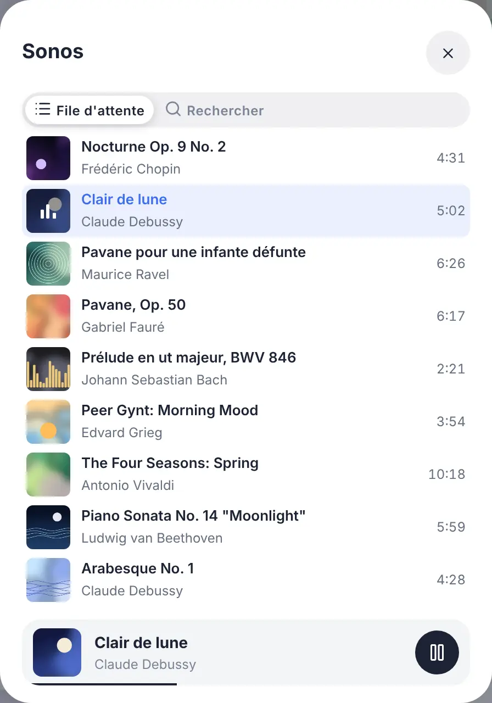
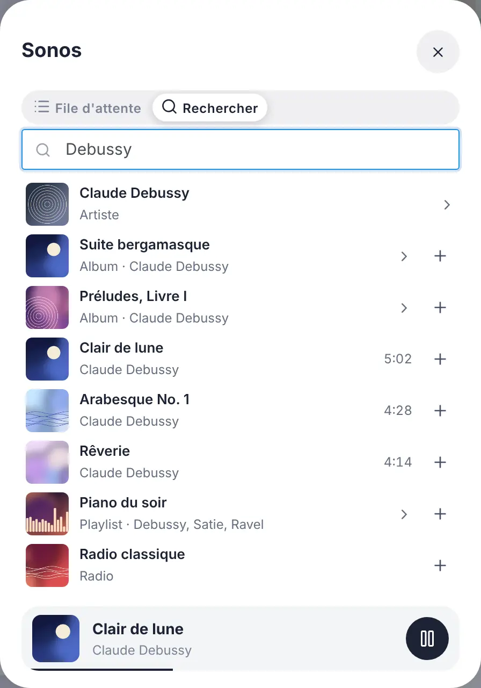
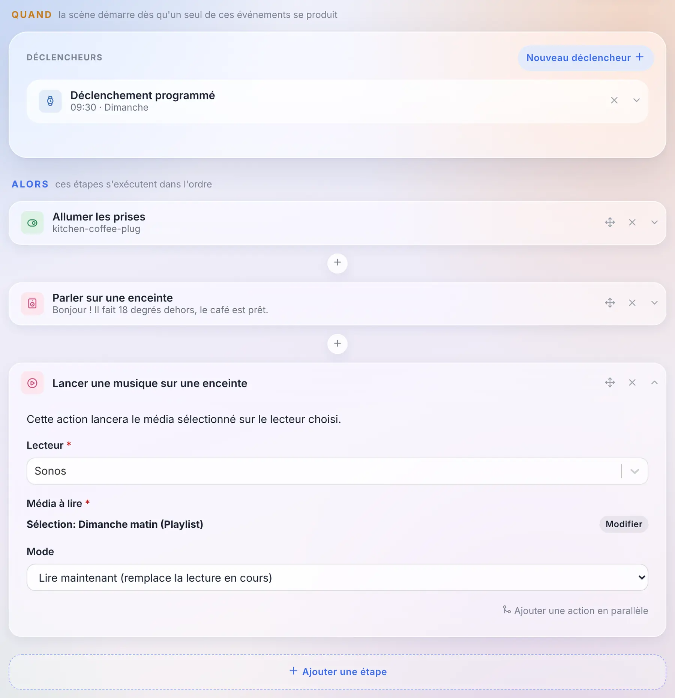
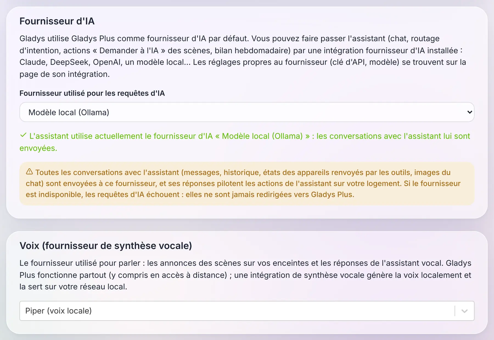
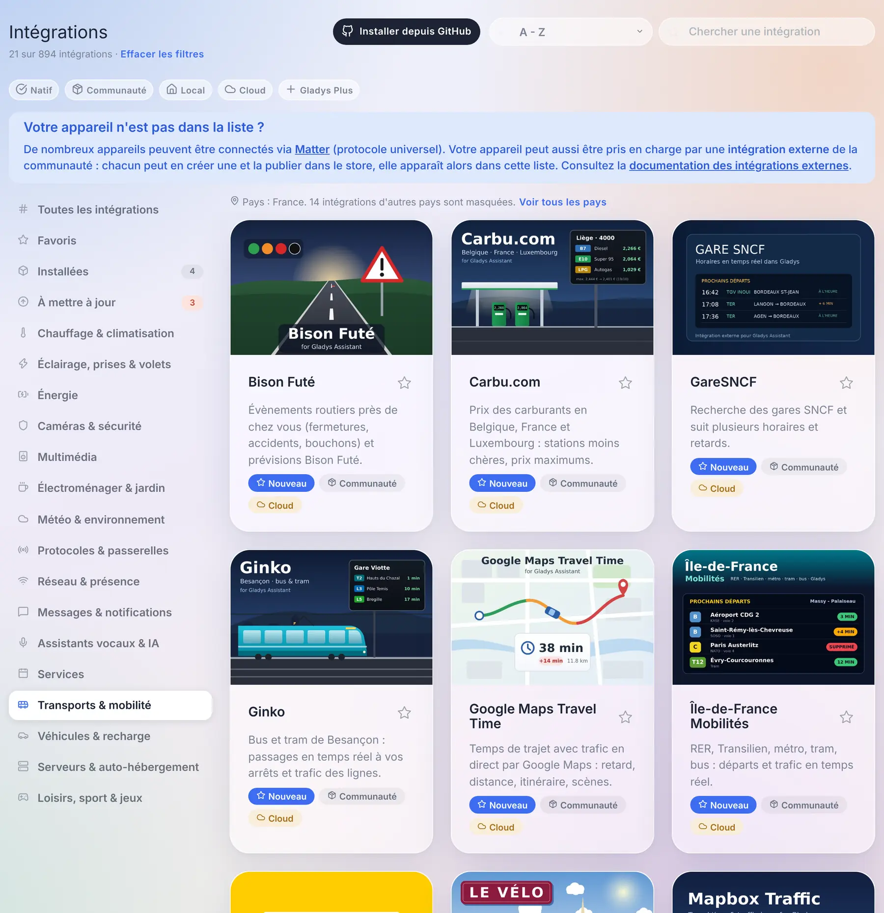
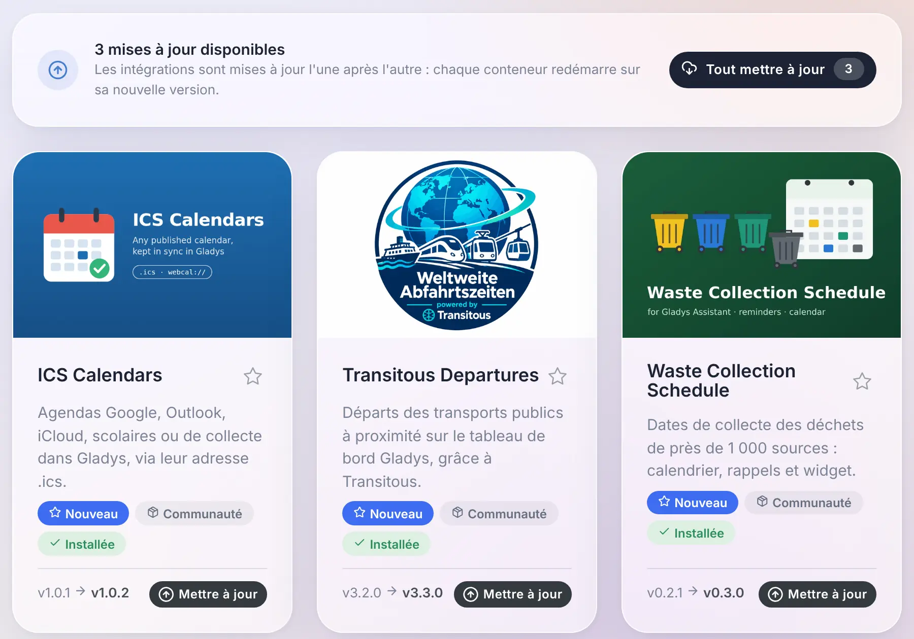

Salut à tous !

Nouvelle version de Gladys aujourd'hui, la 5.3 🎉

Trois choses dans celle-ci. Le widget musique devient **un vrai lecteur** : la pochette, le titre, la progression, la file d'attente, et une recherche pour lancer un album ou une playlist. L'assistant peut maintenant tourner sur **l'IA de votre choix**, y compris un modèle qui tourne chez vous, à la place de Gladys Plus. Et **la voix** aussi : les annonces des scènes peuvent être prononcées par un moteur de synthèse vocale local.

{/* truncate */}

## Un vrai lecteur de musique sur le tableau de bord

Jusqu'ici, le widget musique de Gladys était une télécommande : le nom de l'enceinte, lecture, pause, suivant, et un curseur de volume. Rien ne vous disait ce qui était en train de jouer.

Dans la 5.3, il devient le lecteur que vous connaissez dans les applications Spotify ou Sonos : la **pochette** de l'album, le **titre**, l'**artiste** et l'**album**, une **barre de progression** que vous pouvez faire glisser pour avancer, la lecture aléatoire, la répétition (de tout ou d'un seul morceau), et le volume. Une radio en direct affiche un badge « En direct » à la place de la barre de progression.

Deux boutons au bout de la ligne du volume ouvrent le reste, dans un panneau qui ne change jamais la taille de la carte :

- **la file d'attente**, avec le morceau en cours mis en évidence : un appui saute à n'importe quel morceau ;

- **la recherche et la bibliothèque** : tapez un artiste, un album, une playlist ou une radio, appuyez pour le lancer, ou ajoutez-le à la file d'attente avec le bouton « + ». Un album ou une playlist peut être ouvert, ou joué en entier.

Un détail qui compte : la barre de progression n'est pas rafraîchie chaque seconde par le serveur. Le lecteur ne donne sa position que quand il se passe quelque chose (une pause, un saut, un nouveau morceau), et le tableau de bord calcule le reste. Un lecteur de musique ne coûte rien à votre base de données : aucun de ses états n'est gardé en historique.

### Lancer une playlist depuis une scène

Une nouvelle action **« Lancer une musique sur une enceinte »** permet à une scène de lancer un morceau, un album, une playlist ou une radio. Vous le choisissez avec la même recherche que sur le tableau de bord, et vous choisissez s'il remplace ce qui joue ou s'il rejoint la file d'attente (juste après le morceau en cours, ou à la fin).

Et comme le morceau est maintenant un état de l'appareil comme un autre, « quand le morceau change sur l'enceinte de la cuisine » est simplement le déclencheur d'appareil habituel, sur le titre.

### Quels lecteurs ?

Ce nouveau lecteur est alimenté par les **intégrations externes** : une intégration publie ce qui joue et fournit les pochettes, Gladys les affiche et ne charge jamais une image d'internet dans votre navigateur. Le store a déjà des intégrations pour Sonos, Spotify, Jellyfin, Plex, Volumio, MPD, Lyrion ou Yamaha MusicCast, qui ont maintenant tout ce qu'il faut pour faire vivre ce lecteur : il suffit à leurs auteurs de publier les nouveaux états.

Les intégrations natives Sonos, Google Cast et AirPlay ne changent pas : leur widget garde les mêmes commandes, dans le nouveau style. Et l'intégration native Sonos a déjà son bouton « Migrer » vers l'intégration de la communauté : vos pièces, widgets et scènes suivent l'appareil.

## Choisissez l'IA de votre assistant

Depuis quelques mois, l'assistant de Gladys discute avec vous, pilote votre maison, crée des scènes et analyse vos caméras. Derrière, c'était toujours la même IA : celle de Gladys Plus.

Dans la 5.3, cela devient **un choix**. Une intégration externe du nouveau type **« Fournisseur d'IA »** peut répondre à l'assistant à la place de Gladys Plus : Claude, Mistral, OpenAI, DeepSeek, ou **un modèle qui tourne sur votre propre machine** avec Ollama. Vous le choisissez sur la page Intelligence Artificielle des intégrations, et tout l'assistant suit : la discussion, l'action « Demander à l'IA » des scènes, et le bilan hebdomadaire de la maison.

Pour être clair sur ce qui sort aujourd'hui : la 5.3 apporte les types « Fournisseur d'IA » et « Synthèse vocale », et les fournisseurs eux-mêmes arriveront dans le catalogue au fil de leur publication par la communauté. La capture ci-dessus utilise des intégrations d'exemple. Et l'intégration Ollama déjà présente dans le store, c'est autre chose : elle permet à une scène de poser une question à un modèle local, ce n'est pas un fournisseur d'IA pour l'assistant.

Ce que je trouve intéressant dans le fonctionnement : **tout l'assistant tourne toujours dans votre Gladys**. Les outils, le contexte de votre maison, l'historique de la conversation, les actions sur vos appareils : tout cela reste local. La seule chose qui part chez le fournisseur, c'est une requête standard, celle que toutes les IA du marché comprennent, et sa réponse revient à Gladys, qui la vérifie avant d'agir. Une intégration d'IA est donc un simple adaptateur, capable de brancher n'importe quel fournisseur.

Trois règles auxquelles je tenais :

- **Gladys Plus reste le choix par défaut.** Rien ne change pour vous si vous ne touchez à rien.
- **Pas de repli silencieux.** Si vous avez choisi un modèle local parce que vous voulez que vos conversations restent à la maison, et que ce modèle est en panne, Gladys vous le dit. Elle n'envoie jamais vos messages à Gladys Plus dans votre dos.
- **L'assistant sans Gladys Plus.** Avec votre propre fournisseur, la discussion, les scènes et le bilan hebdomadaire fonctionnent sans abonnement Gladys Plus.

Un avertissement honnête : un fournisseur d'IA voit chaque conversation, et ses réponses déclenchent des actions dans votre maison. C'est le plus haut niveau de confiance que vous puissiez accorder à une intégration, et Gladys le dit clairement quand vous en sélectionnez un.

## Et la voix aussi

Même idée pour la synthèse vocale. Jusqu'ici, quand une scène annonçait « la machine à laver est terminée » sur une enceinte, la voix venait de Gladys Plus.

Une intégration du nouveau type **« Synthèse vocale »** peut maintenant générer cette voix, en local avec un moteur comme Piper, ou avec le service cloud de votre choix. Vous la choisissez sur la même page, et **les annonces des scènes** sur vos enceintes passent par elle. L'audio est généré sur votre réseau et reste en mémoire quelques minutes, le temps que l'enceinte vienne le chercher.

Une limite, pour l'instant : avec une voix locale, les réponses de l'assistant vocal dans le navigateur sont uniquement écrites. Le micro d'un navigateur exige le HTTPS, et un navigateur refuse de jouer, dans une page en HTTPS, un son servi en HTTP sur votre réseau local. Gladys ne bascule jamais sur Gladys Plus dans votre dos : si vous voulez que l'assistant parle dans le navigateur, gardez Gladys Plus comme voix.

## Un catalogue taillé pour un millier d'intégrations

Au lancement de la version 5 fin août, le store comptait environ soixante-dix intégrations de la communauté. Aujourd'hui, il en compte **785**, plus les intégrations natives. La page des intégrations n'était pas pensée pour ça : elle téléchargeait le store complet (22 Mo) toutes les 30 minutes, et trouver quelque chose voulait dire tout faire défiler.

Voici ce qui change :

- **Un catalogue qui charge vite.** Gladys télécharge maintenant un index léger de 1,4 Mo, et ne va chercher le fichier complet d'une intégration, quelques kilo-octets, que quand vous l'ouvrez, l'installez ou la mettez à jour. Pendant le chargement, la page le dit, au lieu d'afficher les intégrations natives comme si c'était tout le catalogue. Les cartes s'affichent page par page, avec un bouton « Afficher plus d'intégrations ».
- **La recherche est le premier filtre.** Elle lit plus que la carte : toutes les langues de la description, les mots-clés déclarés par l'auteur, l'auteur lui-même, et les pays. Les résultats sont classés (les noms qui commencent par ce que vous avez tapé d'abord), et une recherche regarde toujours dans tout le catalogue, quelle que soit la catégorie où vous êtes.
- **Le filtre de pays que personne n'a à régler.** Réseaux de transport, fournisseurs d'électricité, collecte des déchets, cinémas : beaucoup d'intégrations n'ont de sens que dans un pays. Gladys déduit votre pays du fuseau horaire avec lequel elle est déjà configurée, et masque des catégories les intégrations des autres pays. Une ligne indique combien sont masquées, avec un lien « Voir tous les pays », et la recherche les trouve toujours.
- **Quatre nouvelles catégories** : *Transports & mobilité*, *Véhicules & recharge*, *Serveurs & auto-hébergement* et *Loisirs, sport & jeux*. « Services » était devenu un fourre-tout de 160 intégrations.
- **Les petites choses qui comptent** : un badge « Installée » sur les cartes, un tri « Dernière mise à jour », un compteur toujours comparé au catalogue entier (« 21 sur 823 intégrations ») avec un seul lien « Effacer les filtres », et quand vous revenez de la page d'une intégration, vous êtes exactement là où vous étiez dans la liste.

### Mettre à jour vos intégrations depuis le catalogue

Quand une intégration de la communauté a une nouvelle version, sa carte affiche maintenant la version installée, la nouvelle, et un bouton **Mettre à jour**. Plus besoin d'ouvrir l'intégration.

Et quand plusieurs attendent, la vue **À mettre à jour** s'ouvre sur un bouton **Tout mettre à jour**. Les intégrations sont mises à jour l'une après l'autre, pas toutes en même temps, ce qui ménage un Raspberry Pi ou un NAS, et le panneau suit la progression. Si l'une échoue, il la liste avec un lien vers sa page, et les autres continuent.

Merci à [@cicoub13](https://github.com/cicoub13) pour les deux !

## Pour les développeurs d'intégrations

- **Lecteurs de musique** : un lecteur gagne les fonctionnalités « en cours de lecture » (`title`, `artist`, `album`, `artwork`, `duration`, `position`, `shuffle`, `repeat`, `mute`, et un `playback_state` modifiable), et le nouveau champ `music` du manifest déclare ce que l'intégration sait faire à la demande : `browse`, `search`, `queue` et `append`. Les pochettes sont servies par l'intégration derrière une clé, jamais sous forme d'URL. Le contrat est dans [la spec musique](https://github.com/GladysAssistant/Gladys/blob/master/docs/specs/external-integrations/capabilities/music.md).
- **Fournisseurs d'IA** : le nouveau type `ai` reçoit des requêtes de complétion de chat compatibles OpenAI, et répond avec une complétion compatible OpenAI. [La spec des fournisseurs d'IA](https://github.com/GladysAssistant/Gladys/blob/master/docs/specs/external-integrations/capabilities/ai-type.md) explique aussi comment joindre un modèle qui tourne sur l'hôte, et pourquoi sa fenêtre de contexte doit être configurée.
- **Fournisseurs de synthèse vocale** : le nouveau type `tts` reçoit un texte et une langue, et répond avec l'audio. [La spec des fournisseurs de synthèse vocale](https://github.com/GladysAssistant/Gladys/blob/master/docs/specs/external-integrations/capabilities/tts-type.md).
- **Catalogue** : deux nouveaux champs optionnels dans le manifest, `keywords` (des termes utilisés seulement par la recherche : marques, modèles, villes desservies) et `countries` (les codes ISO des pays où l'intégration est utilisable, absent veut dire partout dans le monde), et les quatre nouvelles catégories `transport`, `vehicles`, `servers` et `leisure`.
- **Polling** : un appareil découvert qui publie une `poll_frequency` est maintenant interrogé par Gladys sans avoir à mettre aussi `should_poll`.

Le [SDK v0.16.0](https://github.com/GladysAssistant/integration-sdk-js) gère tout cela : `onAiChat` pour les fournisseurs d'IA, `onTtsSynthesize` pour la synthèse vocale, et `publishNowPlaying`, `artworkKey` et les handlers `onMusic*` pour les lecteurs de musique.

## Correctifs

La 5.2.1 est sortie le lendemain de la 5.2. Voici ce qu'elle et cette version corrigent :

- **Utilisateurs** : vous ne pouvez plus modifier votre propre rôle, et le dernier administrateur d'une instance ne peut plus perdre ce rôle. Jusqu'ici, un administrateur seul pouvait se donner un autre rôle, et plus personne ne pouvait accéder aux paramètres des utilisateurs pour le lui rendre. Une instance déjà dans cette situation rend le rôle d'administrateur à son compte le plus ancien.
- **Appareils** : enregistrer un appareil ne remet plus la valeur actuelle de ses fonctionnalités à celle que la page avait à son ouverture. Merci [@Terdious](https://github.com/Terdious) !
- **Appareils** : créer un appareil pendant que Gladys écrit autre chose dans sa base de données n'échoue plus avec une erreur « database is locked ».
- **Connexion** : un e-mail tapé avec des majuscules ou des espaces est accepté, à la connexion comme à la réinitialisation du mot de passe.
- **Batteries** : désactiver l'alerte de batterie faible dans les paramètres la désactive vraiment, et les messages de batterie faible et d'échec de sauvegarde arrivent à tous les administrateurs, même quand l'envoi à l'un d'eux échoue. Merci [@cicoub13](https://github.com/cicoub13) !
- **Énergie** : les modèles EDF Tarif Bleu, qui portent plus de dix ans d'historique de prix, peuvent de nouveau être sélectionnés : l'historique en dehors de la validité de votre contrat est écarté, sans rien changer aux coûts.
- **Enedis** : les compteurs peuvent être renommés, et un nouveau compteur est nommé d'après son PDL plutôt que « Enedis », ce qui permet de distinguer deux compteurs.
- **Zigbee2MQTT** : le port série du dongle USB est toujours celui monté dans le conteneur, quel que soit son chemin sur l'hôte, ce qui pouvait empêcher Zigbee2MQTT de démarrer.
- **Zigbee2MQTT** : les quatre boutons de l'interrupteur Philips Hue Tap sont reconnus.
- **Tableau de bord** : sélectionner du texte ou faire glisser un curseur dans un panneau ou une fenêtre, puis relâcher la souris en dehors, ne la ferme plus.
- **Appareils** : les listes d'appareils ne transportent plus l'image de chaque caméra (jusqu'à 150 ko chacune) : elles chargent plus vite, et enregistrer une caméra n'échoue plus parce que la requête est trop lourde.
- **Énergie** : un nouveau contrat peut reprendre le nom d'un contrat existant, comme un contrat Tempo renouvelé. Merci [@cicoub13](https://github.com/cicoub13) !
- **Paramètres** : un utilisateur qui n'est pas administrateur accède maintenant aux paramètres depuis le menu, et ne voit que les onglets qu'il peut utiliser. Merci [@cicoub13](https://github.com/cicoub13) !
- **Scènes** : le résumé d'une action sur un volet affiche l'appareil et la valeur choisie, et l'éditeur met en évidence le bouton sélectionné. Merci [@cicoub13](https://github.com/cicoub13) !
- **Widgets** : les boutons des widgets d'intégrations gardent la couleur de leurs icônes dans le thème Horizon. Merci à Stefan Bauer !
- **HomeKit** : les préréglages d'un radiateur restent justes dans l'app Maison, et une requête qui échoue reçoit une réponse au lieu de laisser l'app Maison en attente. Merci [@Dreamthy](https://github.com/Dreamthy) !
- **Sous le capot** : l'interface est maintenant construite avec Vite 8. Merci [@bertrandda](https://github.com/bertrandda) !

Cela fait 32 pull requests depuis la version 5.2.

## Merci aux contributeurs

Merci à [@cicoub13](https://github.com/cicoub13) pour les boutons de mise à jour du catalogue, « Tout mettre à jour » compris, les messages de batterie et de sauvegarde, les paramètres des utilisateurs non administrateurs, les actions sur les volets dans les scènes et les contrats d'énergie qui partagent un nom, à [@Terdious](https://github.com/Terdious) pour la correction de l'enregistrement des appareils, à [@Dreamthy](https://github.com/Dreamthy) pour les radiateurs dans HomeKit, à Stefan Bauer pour les icônes des widgets dans le thème Horizon, à [@bertrandda](https://github.com/bertrandda) pour le passage à Vite 8, et à [@William-De71](https://github.com/William-De71) pour des tests qui restent verts au changement d'heure. Et merci à tous ceux qui ont demandé ces fonctionnalités et remonté des bugs sur le forum !

On se retrouve sur [le forum](https://community.gladysassistant.com/) si vous voulez parler de cette version :)

## Comment mettre à jour ?

Comme toujours, Gladys se met à jour automatiquement sous 24 h si vous utilisez Watchtower, sinon vous pouvez le faire en un clic depuis les paramètres.

Le [CHANGELOG complet de la 5.3.0](https://github.com/GladysAssistant/Gladys/releases/tag/v5.3.0) est sur GitHub.
