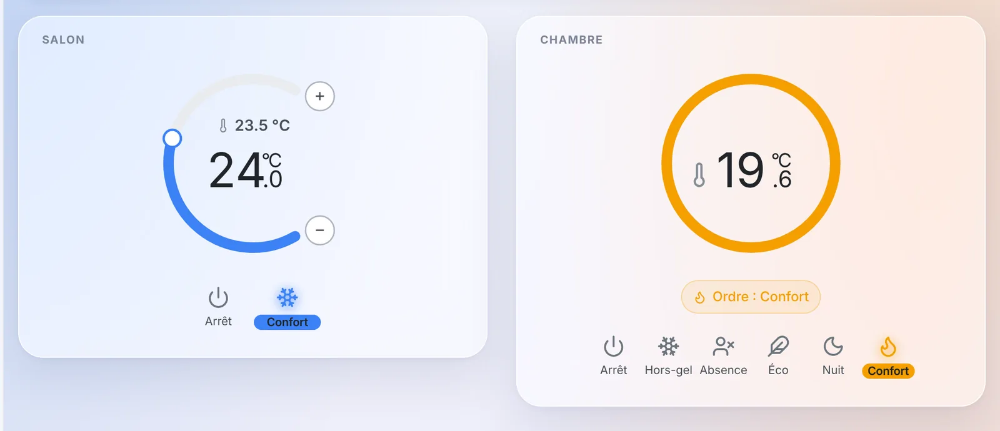
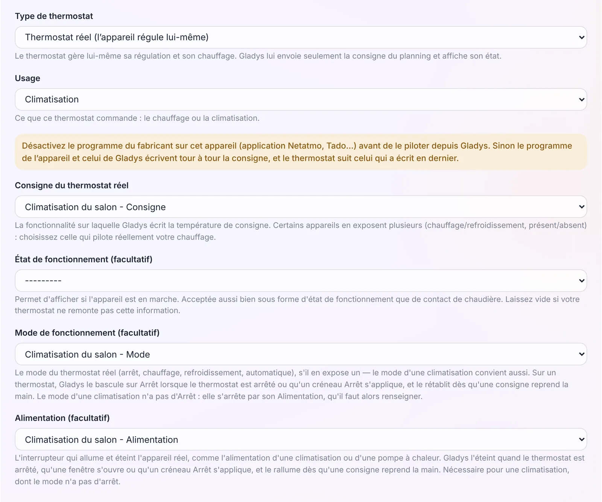
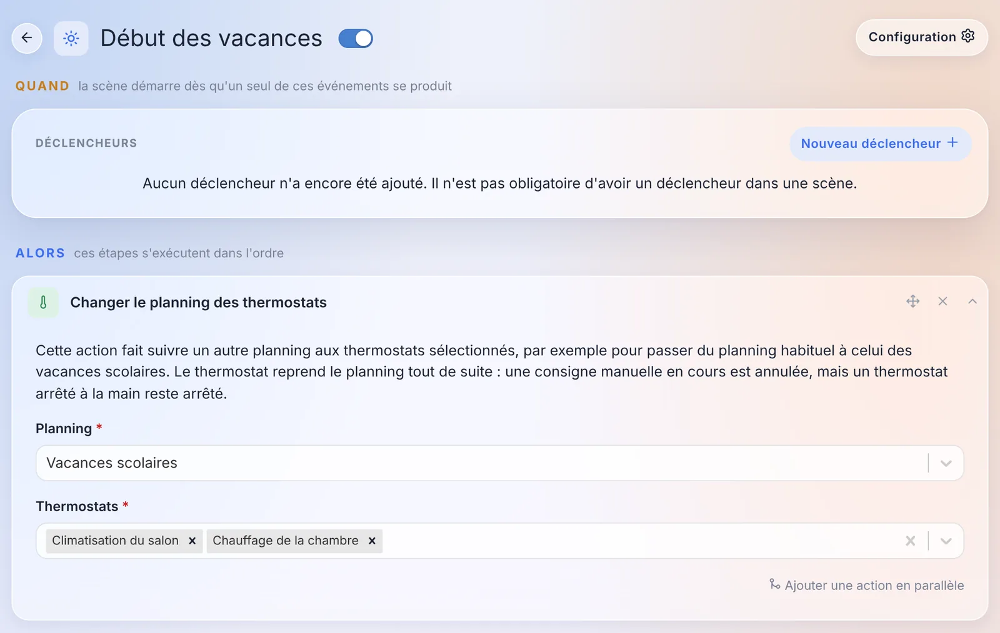
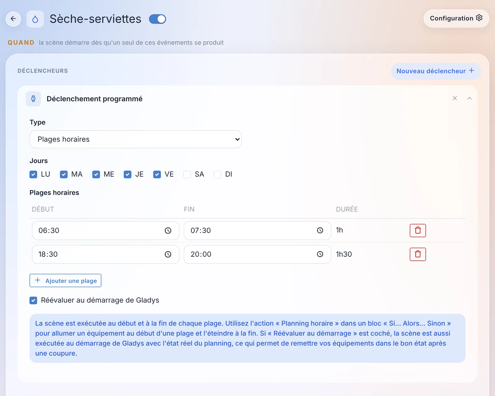

Salut à tous !

Nouvelle version de Gladys aujourd'hui, la 5.3.1 🎉

Ne vous fiez pas au numéro : ce n'est pas qu'une version de correctifs. Le thermostat arrivé dans la 5.2 pilote maintenant **les climatisations** et **les radiateurs à fil pilote**, il attend un peu avant de couper le chauffage quand une fenêtre s'ouvre, et une scène peut basculer toute la maison sur le planning des vacances. Les scènes gagnent un déclencheur **« Plages horaires »**. Et côté Gladys Plus, les utilisateurs se gèrent sur une seule page, la double authentification se récupère sans écrire au support, et les sauvegardes passent à une par jour.

{/* truncate */}

## Le thermostat pilote la climatisation

Dans la 5.2, Gladys est devenue votre thermostat, mais uniquement pour le chauffage. Dans la 5.3.1, une **climatisation** ou une **pompe à chaleur** peut être configurée comme un « Thermostat réel (l'appareil régule lui-même) » : Gladys lui envoie la consigne et le mode, et la climatisation fait le reste.

Une climatisation a une particularité : son mode n'a pas de position « arrêt ». Le formulaire a donc un nouveau champ **« Alimentation (facultatif) »**. Gladys coupe cette alimentation quand le thermostat est arrêté, qu'une fenêtre s'ouvre ou qu'une plage « Arrêt » s'applique, et la rallume quand une consigne reprend la main. Quand vous choisissez la consigne d'une climatisation, son mode et son alimentation sont pré-remplis, et si l'alimentation manque, le formulaire vous prévient.

Quelques détails qui comptent :

- **Des préréglages pensés pour le froid** : Confort 24 °C, Éco 26 °C, Nuit 25 °C, Absence 28 °C et Hors-gel 30 °C, au lieu des valeurs du chauffage.
- **La télécommande est respectée.** Si vous éteignez la climatisation avec sa télécommande, le thermostat s'arrête jusqu'au prochain point du programme, au lieu de la rallumer dans votre dos.
- **Plusieurs capteurs de température** : un bouton « Ajouter un capteur de température » permet d'en mettre plusieurs, et Gladys régule sur la moyenne. Une sonde silencieuse depuis plus d'une heure est écartée de la moyenne tant qu'une autre répond.
- **Plusieurs capteurs d'ouverture** : n'importe quelle fenêtre ouverte coupe le chauffage ou la climatisation.
- **Des listes filtrées par pièce** : dans le formulaire, les listes d'appareils ne proposent que ceux de la pièce du thermostat. Un interrupteur « Afficher les appareils de toutes les pièces » les élargit, pratique pour un salon ouvert sur la cuisine.
- **Un nouvel état « Preset actif du thermostat »** suit chaque point du programme. Une scène peut donc se déclencher quand le programme passe, par exemple, de Confort à Éco.

## Les radiateurs à fil pilote

Si vous avez des radiateurs électriques en France, il y a de bonnes chances qu'ils aient un fil pilote. Un radiateur à fil pilote garde son propre thermostat et obéit à six ordres : arrêt, hors-gel, éco, confort, confort -1 et confort -2.

La 5.3.1 ajoute un type de thermostat **« Radiateur à fil pilote (le radiateur régule lui-même) »**. Vous choisissez le module fil pilote comme actionneur, et le tableau des préréglages gagne une colonne **« Ordre envoyé »** : par défaut, Hors-gel et Absence envoient hors-gel, Éco et Nuit envoient éco, et Confort envoie confort. Confort -1 et confort -2 sont aussi proposés.

Le widget de ce type (à droite sur la capture en haut de l'article) n'a pas de molette : un radiateur à fil pilote ne prend pas de consigne en degrés. Il affiche la température de la pièce, un anneau de la couleur de l'ordre en cours, et « Ordre : Confort », ou « Envoi de l'ordre Confort… » tant que le module ne l'a pas confirmé.

Si vous préférez que Gladys régule elle-même à partir d'un capteur de la pièce, c'est possible aussi : un « Thermostat virtuel (Gladys régule) » accepte maintenant un fil pilote comme actionneur. Gladys envoie confort sous la consigne et hors-gel au-dessus. Dans ce cas, réglez la consigne confort du radiateur assez haut (24 °C par exemple) : il obéit à Gladys, et cette valeur reste un plafond de sécurité si Gladys s'arrête.

Un conseil, que le formulaire vous rappelle : désactivez d'abord le programme propre au module (le planning Heatzy, le programme Tuya…), sinon le module et Gladys vont se renvoyer l'ordre à tour de rôle. Un ordre changé sur le module lui-même, avec son bouton ou l'application du fabricant, est pris comme un changement manuel.

Merci à [@William-De71](https://github.com/William-De71), qui a testé tout ça sur un vrai module Qubino ZMNHJD !

## Une fenêtre ouverte ne coupe plus tout de suite

Jusqu'ici, ouvrir la porte d'entrée pour rentrer et la refermer derrière soi coupait le chauffage dans la seconde. Le formulaire du thermostat a maintenant un champ **« Délai avant coupure »** sous le capteur d'ouverture : **60 secondes par défaut**, jusqu'à une heure, et 0 pour garder la coupure immédiate.

Une fenêtre refermée avant la fin du délai ne coupe rien, et le bandeau « Fenêtre ouverte » du widget n'apparaît qu'une fois le délai écoulé.

Attention, c'est un changement de comportement : les thermostats qui ont déjà un capteur d'ouverture attendent maintenant 60 secondes avant de couper. Si vous voulez garder la coupure immédiate, mettez le délai à 0.

## Le planning des vacances, depuis une scène

Une nouvelle action de scène, **« Changer le planning des thermostats »**, bascule un ou plusieurs thermostats sur un autre planning. L'exemple typique : passer du planning de l'année scolaire à celui des vacances, puis revenir.

Le thermostat suit le nouveau planning tout de suite. Une consigne manuelle en cours est annulée, mais un thermostat arrêté à la main reste arrêté. L'assistant IA connaît aussi cette action quand il crée une scène pour vous.

Deux petites choses en plus dans l'éditeur de planning et le widget :

- **« Toute la journée »** : une case pour couvrir une journée entière, au lieu de taper 00:00 → 23:59 et de laisser une minute non couverte. Au passage, plusieurs bugs qui pouvaient faire perdre une partie d'un planning à l'enregistrement sont corrigés.
- **La jauge s'anime** : quand la consigne change, l'arc, le curseur et le chiffre glissent vers la nouvelle valeur au lieu de sauter d'un coup.

## Des plages horaires dans les scènes

Piloter un appareil selon un planning de la semaine demandait jusqu'ici deux scènes, une pour allumer et une pour éteindre, à garder synchronisées à la main.

Le déclencheur programmé a maintenant un type **« Plages horaires »** : vous cochez des jours, vous ajoutez des plages (un début et une fin), et la scène se lance au début et à la fin de chaque plage. Les plages qui passent minuit sont gérées (affichées « J+1 »).

Pour tout faire dans une seule scène, il y a une nouvelle condition **« Planning horaire »** : « On est dans une plage horaire » ou « On est en dehors des plages horaires ». Dans un bloc « Si… Alors… Sinon », le « Alors » allume l'appareil au début d'une plage, et le « Sinon » l'éteint à la fin.

Et une case **« Réévaluer au démarrage de Gladys »** relance la scène au démarrage avec l'état actuel du planning : après une coupure de courant, vos appareils reviennent dans le bon état.

Merci [@William-De71](https://github.com/William-De71) pour celle-ci aussi !

## Une seule page pour les utilisateurs

Si vous utilisez Gladys Plus, vous gériez vos utilisateurs à trois endroits : Paramètres › Utilisateurs, l'onglet « Utilisateurs Plus » et « Utilisateurs distants » dans les paramètres Gladys Plus. Tout est maintenant réuni dans **Paramètres › Utilisateurs**.

Chaque utilisateur a une section **« Accès à distance · Gladys Plus »** qui dit où il en est : « Invitation envoyée », « En attente de votre autorisation », « Clés modifiées », « Autorisé »… L'interrupteur d'autorisation et les empreintes de clés à comparer sont directement sur sa carte.

Depuis l'application Gladys Plus, un administrateur peut :

- **inviter** un utilisateur depuis sa carte : le compte créé avec l'invitation est rattaché automatiquement à cet utilisateur, l'invité n'a rien à choisir ;
- **rattacher** un compte Gladys Plus existant à un utilisateur, en un clic quand l'e-mail correspond ;
- **réinitialiser la double authentification** d'un utilisateur, en confirmant avec son propre code ;
- **retirer** quelqu'un de Gladys Plus, sans toucher à son utilisateur Gladys ni à ses données.

Et quand un utilisateur n'est pas accepté par l'instance, par exemple après avoir réinitialisé son mot de passe Gladys Plus, il voit maintenant une page qui explique pourquoi et quoi faire, au lieu d'une erreur d'une ligne.

## La double authentification, sans passer par le support

Perdre son téléphone, c'est perdre son application de double authentification. Jusqu'ici, il fallait écrire au support pour qu'on réinitialise votre compte à la main. Il y a maintenant plusieurs chemins pour vous en sortir seul :

- **Changer d'application** : dans Paramètres › Sécurité, sur Gladys Plus, une carte « Votre application 2FA » permet de passer sur un nouveau téléphone. Il faut le code de la nouvelle application et celui de l'actuelle, ou un code de récupération si vous l'avez perdue.
- **De nouveaux codes de récupération depuis votre Gladys** : un administrateur, connecté en local, peut générer de nouveaux codes pour un utilisateur depuis Paramètres › Utilisateurs, en retapant son mot de passe Gladys. Les anciens codes cessent de fonctionner.
- **Une réinitialisation par e-mail** quand aucune Gladys n'est connectée au compte : un lien sur l'écran de connexion envoie un e-mail valable une heure.

Le formulaire de connexion renvoie aussi vers [notre nouveau guide de dépannage de la double authentification](/fr/docs/plus/two-factor-authentication/), qui couvre les causes les plus courantes : l'horloge du téléphone décalée, une ancienne entrée dans l'application, un nouveau téléphone.

## Des sauvegardes Gladys Plus tous les jours

Trois choses n'allaient pas avec les sauvegardes Gladys Plus :

- en cas d'échec, chaque administrateur recevait un message à chaque tentative, soit un message par nuit tant que le problème durait ;
- à l'inverse, certains échecs n'étaient jamais signalés : une Gladys éteinte ou déconnectée à 2 h du matin, ou redémarrée pendant la sauvegarde, ne disait rien ;
- et la règle « plus de 24 h depuis la dernière sauvegarde », combinée à une heure de départ aléatoire, faisait qu'en pratique la plupart des instances étaient sauvegardées un jour sur deux.

Maintenant, chaque instance fait **une sauvegarde par jour**. Une nuit manquée est rattrapée dans la journée et au démarrage de Gladys. Les administrateurs sont prévenus à partir de **deux nuits sans sauvegarde réussie**, puis une fois par semaine si le problème dure, et une dernière fois quand tout refonctionne. Un mois de pannes, c'est six messages au lieu de trente. La page des sauvegardes affiche aussi un bandeau quand elles échouent, avec la date de la dernière sauvegarde réussie et la dernière erreur.

## Zigbee2MQTT : renommer un appareil ne casse plus rien

Renommer un appareil dans l'interface de Zigbee2MQTT cassait le lien avec Gladys : l'appareil réapparaissait comme nouveau dans la découverte, les scènes s'arrêtaient sans prévenir, et l'historique était coupé en deux.

Gladys retient maintenant l'adresse IEEE de chaque appareil, son identifiant matériel qui ne change jamais. Quand un nom ne correspond plus, l'appareil est retrouvé par son adresse : scènes, tableaux de bord et historique continuent de fonctionner. Le nom affiché dans Gladys suit le renommage, sauf si vous l'aviez personnalisé. Rien à faire de votre côté : les appareils existants récupèrent leur adresse au prochain démarrage.

Toujours dans Zigbee2MQTT :

- les appareils dont le nom contient un « / » (comme « salon/lampe ») envoient enfin leurs états à Gladys ;
- les boutons de l'interrupteur Philips Hue Tap Dial (RDM002) déclenchent les scènes. Merci [@cicoub13](https://github.com/cicoub13) !
- les appareils ajoutés avant le suivi de l'énergie peuvent être mis à jour pour recevoir leurs fonctionnalités de consommation et de coût. Merci [@cicoub13](https://github.com/cicoub13) !

## Des intégrations natives remplacées par la communauté

Depuis la version 5, de plus en plus d'intégrations de la communauté font mieux que leur version native. Celles-ci affichent maintenant un badge « Bientôt dépréciée » dans le catalogue, et un bandeau sur leur page qui indique la remplaçante :

| Intégration native | Remplaçante                                                                                                                                       | Bouton « Migrer » |
| ------------------ | ------------------------------------------------------------------------------------------------------------------------------------------------- | ----------------- |
| Tasmota            | [Gladys-Tasmota](https://github.com/gboulvin/Gladys-Tasmota)                                                                                      | oui               |
| Google Cast        | [Gladys-Google-Cast](https://github.com/gboulvin/Gladys-Google-Cast)                                                                              | oui               |
| eWeLink            | [gladys-sonoff-ewelink](https://github.com/William-De71/gladys-sonoff-ewelink)                                                                    | oui               |
| Broadlink          | [gladys-broadlink](https://github.com/prohand/gladys-broadlink)                                                                                   | oui               |
| Xiaomi             | [gladys-xiaomi-home](https://github.com/callemand/gladys-xiaomi-home) ou [gladys-xiaomi-miot](https://github.com/guim31/gladys-xiaomi-miot)       | oui               |
| Node-RED           | [Gladys-Node-RED](https://github.com/gboulvin/Gladys-Node-RED)                                                                                    | –                 |
| CallMeBot          | [gladys-callmebot](https://github.com/GladysAssistant/gladys-callmebot)                                                                           | –                 |
| CalDAV             | [gladys-caldav-sync](https://github.com/bertrandda/gladys-caldav-sync)                                                                            | –                 |
| Nextcloud Talk     | [gladys-nextcloud-talk](https://github.com/bertrandda/gladys-nextcloud-talk)                                                                      | –                 |

Rien ne casse aujourd'hui : les intégrations natives continuent de fonctionner, et les deux versions cohabitent dans le catalogue pendant la transition. Le bouton « Migrer », à côté de « Supprimer » sur les appareils déjà créés, déplace l'historique, les scènes et les tableaux de bord vers l'appareil de la nouvelle intégration. Pour Tasmota par exemple, relais, variateurs, couleurs, mesures d'énergie, température et humidité sont associés automatiquement. Merci [@gboulvin](https://github.com/gboulvin) pour la migration Tasmota !

AirPlay reste supportée pour l'instant : son équivalent de la communauté ne couvre pas encore tout.

## Et aussi

- **Assistant vocal** : avec du bruit autour de vous, la fin de votre phrase n'était parfois jamais détectée, et l'enregistrement continuait jusqu'à 30 secondes. Pendant l'écoute, le bouton devient maintenant **« Envoyer »** : un appui envoie ce que vous avez dit, au lieu de l'effacer. Même chose pour la dictée dans la discussion.
- **Intégrations externes** : la page des appareils affiche un badge de batterie, vert, orange ou rouge, pour les appareils qui publient leur niveau de batterie. Merci [@Terdious](https://github.com/Terdious) !
- **Assistant IA** : « quelle est l'humidité dans la maison ? » ne répond plus « il n'y a pas de capteur d'humidité » parce que le modèle cherchait uniquement les appareils sans pièce.

## Sécurité

- **Changer de mot de passe déconnecte les autres sessions.** Jusqu'ici, un navigateur connecté avec l'ancien mot de passe restait connecté jusqu'à un an. Maintenant, changer votre mot de passe déconnecte toutes vos autres sessions, et une réinitialisation par « mot de passe oublié » les déconnecte toutes. Les clés d'API (MCP, webhooks, Open API) sont conservées, mais les tablettes en mode tablette devront se reconnecter.
- **Une session révoquée le reste après un redémarrage**, et une tablette verrouillée par l'alarme ne retrouve plus un accès complet après une mise à jour.
- **Le nouveau mot de passe n'est plus gardé dans le navigateur** après l'avoir changé depuis votre profil.
- **Le serveur MCP** crée maintenant un serveur par requête : deux requêtes simultanées ne peuvent plus recevoir la réponse de l'autre.
- Et les dépendances avec des failles connues hautes ou critiques ont été mises à jour.

## Correctifs

- **Connexion** : les utilisateurs dont l'e-mail avait été enregistré avant la 5.3 avec un espace ou des majuscules peuvent de nouveau se connecter. Sur une instance où c'était le seul administrateur, plus personne ne pouvait entrer.
- **Mot de passe oublié** : le texte et le lien arrivent dans un seul message. Par e-mail, le lien seul était souvent bloqué par les filtres anti-spam.
- **MQTT** : après la restauration d'une sauvegarde sur une nouvelle machine, le broker MQTT intégré est recréé avec ses identifiants, au lieu de disparaître. Et une mise à jour de Mosquitto ne vide plus la liste de ses utilisateurs.
- **Thermostat** : une dérogation « jusqu'au prochain point » finit à la bonne heure lors d'un changement d'heure, et se cale sur un nouveau point ajouté au planning. Les bandeaux indiquent le jour quand ce n'est pas aujourd'hui (« jusqu'à demain 14:00 »). Sur iPad, la flamme reste au centre de la jauge.
- **Matter** : une ampoule Matter n'apparaît plus sur deux lignes (un interrupteur et une luminosité) dans le widget des appareils, et les actions de scène sur les lumières l'allument bien.
- **CalDAV** : les événements récurrents, comme un anniversaire, ne s'arrêtent plus deux ans après leur import. Merci [@bertrandda](https://github.com/bertrandda) !
- **Plans** : la carte garde votre zoom et votre position au lieu de se recadrer à chaque mise à jour d'une position. Merci [@cicoub13](https://github.com/cicoub13) !
- **Scènes** : le pied de page de l'éditeur tient sur une ligne sur mobile. Merci [@cicoub13](https://github.com/cicoub13) !
- **Quota IA** : le compte à rebours avant la remise à zéro du quota affiche le bon nombre de jours (30 jours affichaient « 0s »). Merci [@huangkongsheng](https://github.com/huangkongsheng) !
- **Fuseaux horaires** : 18 décalages obsolètes corrigés dans la liste des fuseaux horaires, comme Apia (Samoa), à GMT+13:00 et non plus +14:00. Merci [@yu2971512385-ui](https://github.com/yu2971512385-ui) !
- **Lecteur de musique** : les barres de volume et de progression vont jusqu'au bout de leur piste.

Cela fait 45 pull requests depuis la version 5.3.0.

## Merci aux contributeurs

Un énorme merci à [@William-De71](https://github.com/William-De71), à qui l'on doit la plupart des nouveautés du thermostat (climatisation, fil pilote, délai d'ouverture, changement de planning, « Toute la journée », animation de la jauge) et les plages horaires des scènes, plus les correctifs Matter, iPad et du lecteur de musique. Merci aussi à [@cicoub13](https://github.com/cicoub13) pour le Hue Tap Dial, l'énergie des anciens appareils Zigbee2MQTT, les plans et l'éditeur de scènes sur mobile, à [@gboulvin](https://github.com/gboulvin) pour la migration Tasmota et les intégrations Tasmota, Google Cast et Node-RED de la communauté, à [@bertrandda](https://github.com/bertrandda) pour CalDAV et Nextcloud Talk, à [@Terdious](https://github.com/Terdious) pour les badges de batterie, à [@huangkongsheng](https://github.com/huangkongsheng) pour le compte à rebours du quota IA, et à [@yu2971512385-ui](https://github.com/yu2971512385-ui) pour les fuseaux horaires. Et merci à tous ceux qui ont demandé ces fonctionnalités et remonté des bugs sur le forum !

On se retrouve sur [le forum](https://community.gladysassistant.com/) si vous voulez parler de cette version :)

## Comment mettre à jour ?

Comme toujours, Gladys se met à jour automatiquement sous 24 h si vous utilisez Watchtower, sinon vous pouvez le faire en un clic depuis les paramètres.

Le [CHANGELOG complet de la 5.3.1](https://github.com/GladysAssistant/Gladys/releases/tag/v5.3.1) est sur GitHub.
