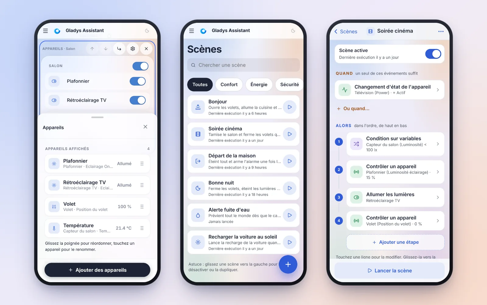
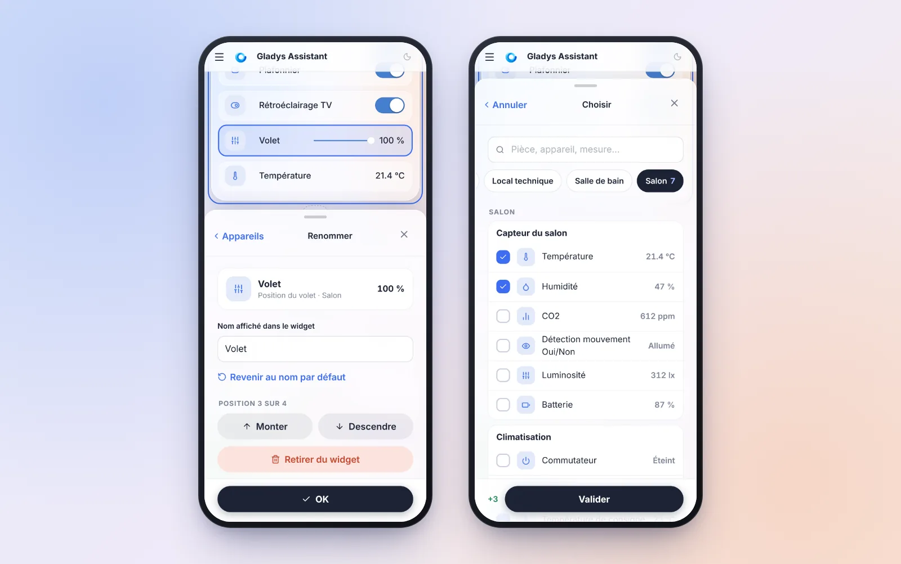
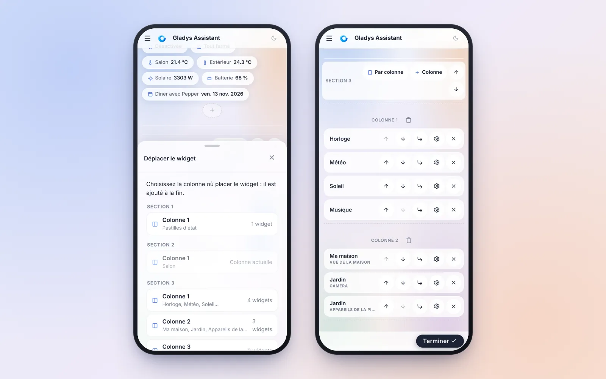
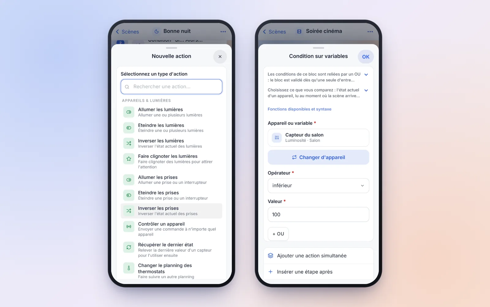
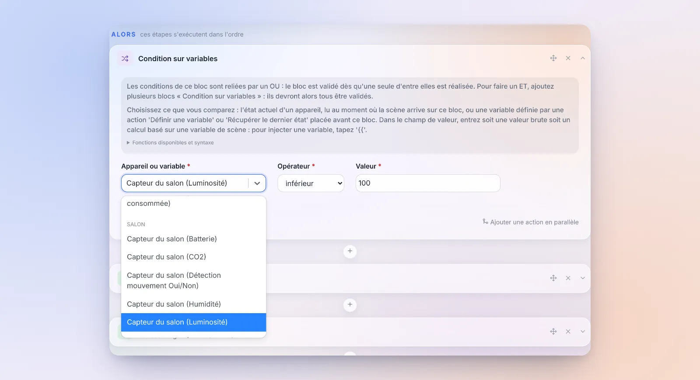
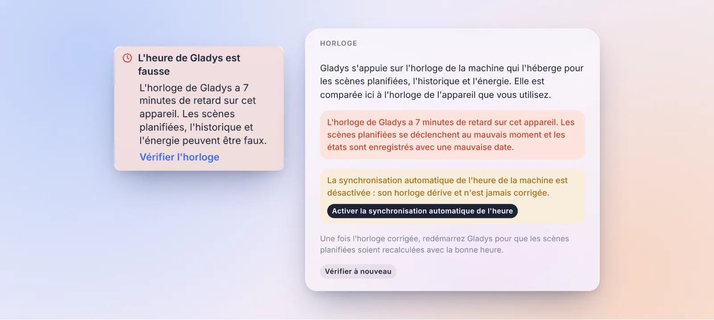
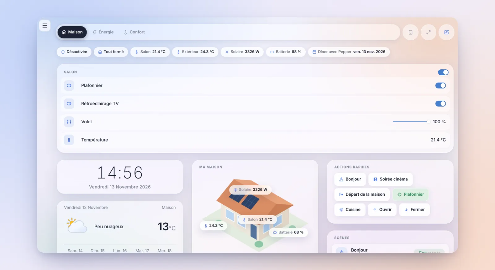

Salut à tous !

Nouvelle version de Gladys aujourd'hui, la 5.3.3 🎉

Encore une fois, ne vous fiez pas au numéro. Cette version est presque entièrement consacrée à un chantier : **Gladys sur le téléphone**. Beaucoup d'entre vous consultent leur tableau de bord sur leur smartphone, mais dès qu'il fallait **modifier** quelque chose, un widget ou une scène, on se retrouvait face à un formulaire d'ordinateur tassé dans un petit écran. Champs qui zooment tout seuls sur iPhone, boutons de 15 pixels, modifications perdues au moindre retour arrière…

On a donc repris l'édition du tableau de bord et celle des scènes en partant du téléphone. Sur ordinateur, rien ne change dans vos habitudes.

{/* truncate */}

## Le tableau de bord s'édite au doigt

### Le widget « Appareils », refait de zéro

C'était le formulaire le plus pénible à utiliser sur téléphone : chaque appareil était un champ texte toujours modifiable (un doigt qui traîne, et le clavier s'ouvrait), seuls 4 appareils tenaient à l'écran, et on les ajoutait un par un depuis une liste de tous les appareils de la maison, sans icône ni valeur.

Il y a maintenant trois vues :

- **La liste** : une ligne par appareil, avec son icône, son nom, sa pièce et sa valeur actuelle. On réordonne en glissant la poignée, avec un aperçu qui suit le doigt et un défilement automatique en bord d'écran.
- **Le détail**, en touchant une ligne : on renomme l'appareil (ou on revient au nom par défaut d'un tap), on le monte, on le descend ou on le retire. La ligne modifiée est **entourée dans l'aperçu du widget**, juste au-dessus.
- **Le sélecteur** : une recherche, des pastilles par pièce, les appareils regroupés par pièce puis par appareil, avec des cases à cocher et leur valeur actuelle. En bas, le résumé des changements (« +3 », « −1 ») : une seule validation ajoute et retire.

Un appareil retiré par erreur ? Une barre « Annuler » apparaît. Et un nom effacé reprend tout de suite le nom par défaut, au lieu de garder l'ancien en silence.

### Le panneau d'édition laisse voir le widget

Le panneau qui monte du bas de l'écran, commun à tous les widgets, a lui aussi été repris :

- il s'ouvre à **mi-hauteur**, pour que le widget modifié reste visible au-dessus ; la poignée l'agrandit en plein écran (un tap ou un glissé), et un glissé vers le bas le ferme ;
- la barre d'actions de l'éditeur s'efface tant qu'il est ouvert, au lieu de lui manger de la place ;
- faire défiler la page ne le ferme plus : il faut un vrai tap à côté ;
- tous les champs font 16 pixels, l'iPhone ne zoome plus, et le panneau remonte au-dessus du clavier.

### Déplacer un widget sans glisser-déposer

Sur téléphone, un widget ne pouvait que monter ou descendre dans sa colonne. Chaque widget a maintenant un bouton **« Déplacer vers… »** qui liste toutes les colonnes de toutes les sections : un tap, et le widget s'y retrouve, mis en évidence.

Pour les gros réaménagements, le bouton **« Réorganiser »** replie chaque widget sur sa seule barre d'outils. Sur le tableau de bord de la démo, la page passe de 8 230 à 3 123 pixels de haut : traverser le tableau de bord ne demande plus qu'un coup de pouce.

Et quelques détails qui changent la vie :

- **Supprimer un widget ne demande plus de confirmation** : un message « Annuler » reste affiché 6 secondes.
- **Plus de modifications perdues** : « Annuler », le bouton retour du téléphone, un lien vers une autre page ou la fermeture de l'onglet demandent maintenant confirmation quand il reste des changements non enregistrés.
- **L'ordre sur téléphone** : sur un téléphone, une section de plusieurs colonnes s'affiche colonne après colonne. Un bouton « Par colonne / Par rangée » dans l'en-tête de la section permet de l'afficher rangée par rangée : pratique pour une rangée de trois lumières.
- La suppression d'un tableau de bord passe dans ses réglages, la barre du bas tient sur une ligne, l'aide de l'éditeur se masque pour de bon, et le choix d'un nouveau widget propose d'abord les six plus utilisés.

## Les scènes, pensées pour le téléphone

Sous 768 pixels de large, les pages des scènes ont maintenant une vraie mise en page de téléphone.

**La liste des scènes** : une recherche, des pastilles par étiquette, une ligne par scène avec sa dernière exécution et un bouton pour la lancer. Glissez une scène vers la gauche pour la désactiver ou la dupliquer. Le bouton **+** demande juste un nom, devine une icône à partir de ce nom, et ouvre l'éditeur directement sur le choix du déclencheur.

**L'éditeur** se lit comme une **timeline numérotée** : « Quand », puis « Alors », avec les blocs « Si… Alors… Sinon… » et leurs branches. Pendant qu'une scène tourne, l'étape en cours d'exécution est mise en évidence.

Chaque déclencheur, chaque étape et chaque condition s'ouvre dans **un panneau qui monte du bas de l'écran**, avec exactement le même formulaire que sur ordinateur, mais habillé pour le doigt : des champs de 48 pixels, des interrupteurs à la place des cases à cocher, les jours de la semaine en sept boutons, les champs d'heure et de date natifs du téléphone. Le choix du type d'action s'ouvre en plein écran, recherche prête à taper. Et pour choisir un appareil, c'est le sélecteur par pièce du tableau de bord qui s'ouvre.

Les gestes sont ceux qu'on attend d'une app :

- un panneau se ferme en le glissant vers le bas, ou avec le bouton « retour » du téléphone ;
- glisser une étape vers la gauche la supprime, avec un bouton « Annuler » ;
- un **appui long** sur une étape permet de la déplacer (le menu « ••• » propose aussi « Réorganiser les étapes », avec des flèches) ;
- la barre du bas affiche « Lancer la scène », ou « ● 2 modifications · Tester · Sauvegarder » quand il y a des changements.

Et sur toutes les tailles d'écran, ordinateur compris :

- **vos modifications ne sont plus jamais perdues en silence** : quitter l'éditeur avec des changements demande confirmation, et un brouillon est gardé dans le navigateur. Si l'iPhone ferme l'app en arrière-plan, ou si un geste de retour vous fait quitter la page, Gladys vous propose de le restaurer en revenant ;
- une erreur d'enregistrement s'affiche là où vous la voyez ;
- les résumés nomment les choses (« Plafonnier (Luminosité éclairage) · 15 % ») au lieu d'afficher des identifiants.

## Une condition peut lire l'état d'un appareil

C'était une des difficultés les plus fréquentes pour une première scène : pour tester l'état d'un appareil dans une « Condition sur variables », il fallait d'abord ajouter une étape « Récupérer le dernier état », puis comparer sa variable.

Ce n'est plus nécessaire : une condition compare maintenant **soit une variable, soit l'état actuel d'un appareil**, lu au moment où la scène arrive sur la condition. Par exemple, « ne tamiser le salon que si la luminosité est inférieure à 100 lx », en une seule étape. Ça marche aussi dans les blocs « Si… Alors… Sinon… » et « Tant que… Répéter… ».

Sur ordinateur, un seul champ « Appareil ou variable » propose les variables des étapes précédentes, puis tous les appareils de la maison regroupés par pièce. Sur téléphone, un bouton « Choisir un appareil » ouvre le sélecteur par pièce, puis l'appareil choisi s'affiche dans le panneau de la condition (le téléphone de droite dans la capture des scènes).

Deux règles à connaître : un appareil qui n'a encore jamais remonté d'état ne valide aucune condition, quel que soit l'opérateur, et un appareil supprimé arrête la scène. Les scènes existantes, qui comparent une variable, ne changent pas. Merci à ceux qui l'avaient demandé [sur le forum](https://community.gladysassistant.com/t/6502) !

Deux autres petites choses dans l'éditeur de scènes :

- **Le « ET » est affiché** entre les blocs de conditions d'un « Si… Alors… Sinon… » ou d'un « Tant que… Répéter… ». Deux blocs empilés ressemblaient à deux alternatives, alors qu'ils doivent être vrais tous les deux.
- **Taper `{{` ouvre la liste des variables** tout de suite, comme l'annonce le texte d'aide. Avant, il fallait taper un troisième caractère.

## Gladys vous prévient quand son horloge est fausse

Quand l'horloge de la machine qui fait tourner Gladys est fausse (synchronisation de l'heure désactivée, pile du mini-PC morte…), tout ce qui dépend de l'heure se dérègle en silence : les scènes programmées se déclenchent à la mauvaise heure, l'historique est enregistré dans le passé ou le futur, l'énergie est comptée sur le mauvais jour. Et rien ne disait pourquoi.

Gladys compare maintenant l'heure du serveur avec celle de l'appareil que vous utilisez (votre téléphone ou votre ordinateur sont presque toujours à l'heure). Au-delà de 20 secondes d'écart, une alerte apparaît dans le menu.

Dans **Paramètres › Système**, une nouvelle carte **« Horloge »** affiche l'écart mesuré et l'état de la synchronisation de l'heure de la machine. Si elle est désactivée, c'est la cause la plus fréquente : un bouton **« Activer la synchronisation automatique de l'heure »** la rallume en un clic. Gladys ne contacte aucun service extérieur pour faire cette vérification.

## Le menu latéral se replie sur ordinateur

Sur ordinateur, une flèche en bas du menu latéral, à côté du bouton du mode sombre, **masque le menu** : la page récupère toute la largeur, pratique pour un grand tableau de bord ou les plans. Un bouton discret le fait revenir, et votre choix est gardé sur cet appareil. Merci pour [la demande sur le forum](https://community.gladysassistant.com/t/mettre-la-barre-laterale-gauche-en-mode-tiroir/10740) !

## Donnez-nous votre avis

On a très peu de retours sur ce qui marche bien ou moins bien dans Gladys. Un lien **« Donner mon avis »** apparaît donc sur la page de chaque intégration et dans le menu du profil. Il ouvre un nouveau sujet sur le forum, pré-rempli avec « Ce qui fonctionne bien » / « Ce qui pourrait être amélioré » et la version de Gladys. Gladys n'envoie rien : vous relisez et publiez le message vous-même.

N'hésitez pas, ça nous aide vraiment à savoir où mettre nos efforts !

## Zigbee2MQTT explique pourquoi il ne démarre pas

On continue [l'audit de Zigbee2MQTT](https://community.gladysassistant.com/t/zigbee2mqtt-un-audit-pour-devenir-plus-simple-que-home-assistant/11498), après la 5.3.2 qui reconnaissait déjà le dongle branché et présélectionnait son port et son modèle :

- **Les erreurs de démarrage sont expliquées**, avec l'action à faire : un dongle qui ne répond pas (souvent un autre modèle que celui choisi, ou un dongle utilisé par un autre logiciel), un coordinateur réseau injoignable, une configuration refusée par Zigbee2MQTT. Avant, Gladys affichait la dernière ligne d'erreur des logs, en anglais, souvent sans rapport.
- **Les SONOFF ZBDongle-E avec un vieux firmware démarrent tout seuls.** Beaucoup sont encore vendus avec un firmware que le driver `ember` refuse. Gladys bascule maintenant d'elle-même sur le driver de compatibilité `ezsp`, et la page de configuration explique comment revenir à `ember` après une mise à jour du firmware.
- Le compteur triphasé **Tuya SPM02V3** remonte toutes ses mesures : la phase C, les tensions de chaque phase et l'énergie produite.

Merci [@cicoub13](https://github.com/cicoub13) pour tout ça !

## Et aussi

- **Thermostat** : pour un radiateur à fil pilote que Gladys régule, l'option « Forcer un autre ordre que hors-gel au repos » permet d'envoyer **Éco** ou **Arrêt** une fois la consigne atteinte, au lieu de hors-gel. Certains sèche-serviettes bloquent leur boost en hors-gel. Et une pompe à chaleur rallumée depuis sa télécommande pendant un créneau « Arrêt » est désormais affichée correctement. Merci [@William-De71](https://github.com/William-De71) !
- **Scènes** : dans les actions « Allumer / Éteindre / Inverser les prises », chaque prise d'une multiprise peut être choisie et pilotée, et plus seulement la première. Merci [@cicoub13](https://github.com/cicoub13) !
- **Matter** : décommissionner un nœud demande maintenant confirmation, liste les appareils Gladys créés à partir de ce nœud et propose de les supprimer aussi. Les erreurs sont affichées au lieu d'être ignorées. Merci [@bertrandda](https://github.com/bertrandda) !
- **Prix de l'électricité** : le widget et les scènes de prix suivent le contrat **actif** du compteur. Après un changement de tarif, ils continuaient d'utiliser l'ancien contrat, expiré.
- **Intégrations externes** : une mise à jour qui demande une version de Gladys plus récente n'est plus proposée comme une mise à jour qui ne fait rien. La carte indique « mettez d'abord Gladys à jour ».
- **Vue de la maison** : jusqu'à 50 épingles par widget (contre 20), et l'éditeur prévient quand la limite est atteinte au lieu d'échouer à l'enregistrement.
- **Résumé hebdomadaire de l'IA** : les nombres sont écrits dans votre langue et arrondis (« 111,34 kWh » au lieu de « 111.34 kWh »).

## Correctifs

- **Calendrier** : un événement sur plusieurs jours commencé avant la période affichée (les vacances de la Toussaint en novembre, par exemple) s'affiche enfin, tout comme un événement qui passe minuit sur son deuxième jour.
- **Scènes** : « Récupérer les évènements d'un calendrier » trouve les événements sur la journée entière le bon jour. « Aujourd'hui » renvoyait ceux du lendemain.
- **Matter** : les ampoules qui n'indiquent pas leurs bornes de luminosité, comme la Nanoleaf Essentials, s'ajoutent sans erreur.
- **MQTT** : les topics personnalisés avec plusieurs « + » fonctionnent, et un topic ne capte plus les messages d'un topic qui commence pareil (`salon` et `salon2`). Merci [@huangkongsheng](https://github.com/huangkongsheng) !
- **Unités** : les conversions kWh/100 km ↔ kWh/100 mi étaient inversées. Merci [@huangkongsheng](https://github.com/huangkongsheng) !
- Les dépendances qui avaient des vulnérabilités connues élevées ou critiques ont été mises à jour.

Ça fait 26 pull requests depuis la version 5.3.2.

## Merci aux contributeurs

Un grand merci à [@cicoub13](https://github.com/cicoub13) pour le gros travail sur Zigbee2MQTT et les multiprises dans les scènes, à [@William-De71](https://github.com/William-De71) pour le thermostat, à [@bertrandda](https://github.com/bertrandda) pour la décommission Matter, et à [@huangkongsheng](https://github.com/huangkongsheng) pour les correctifs MQTT, unités et dates. Et merci à tous ceux qui ont remonté des bugs et des idées sur le forum !

On se retrouve sur [le forum](https://community.gladysassistant.com/) si vous voulez parler de cette version :)

## Comment mettre à jour ?

Comme toujours, Gladys se met à jour automatiquement sous 24 h si vous utilisez Watchtower, sinon vous pouvez le faire en un clic depuis les paramètres.

Le [CHANGELOG complet de la 5.3.3](https://github.com/GladysAssistant/Gladys/releases/tag/v5.3.3) est sur GitHub.
