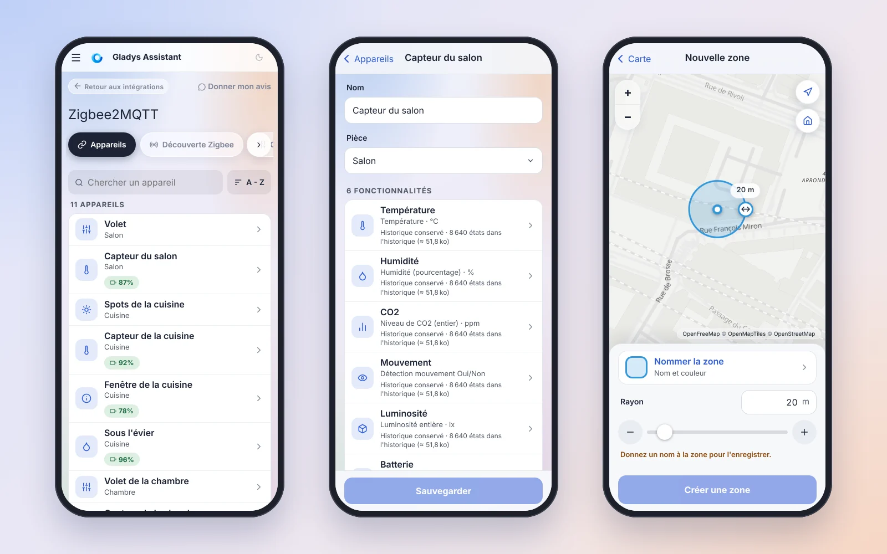
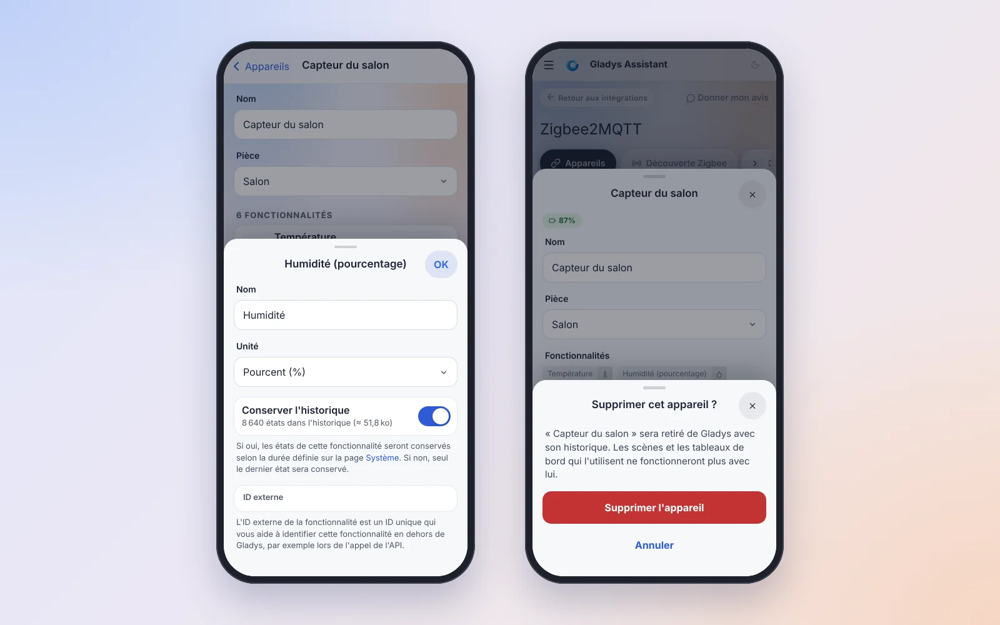
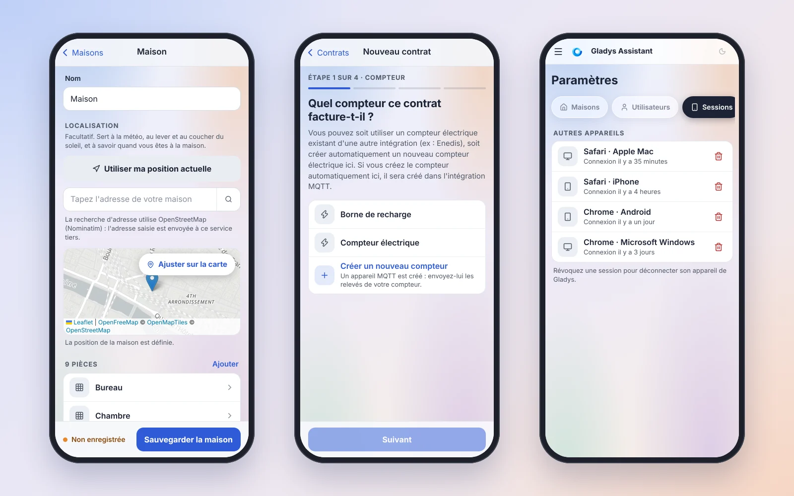
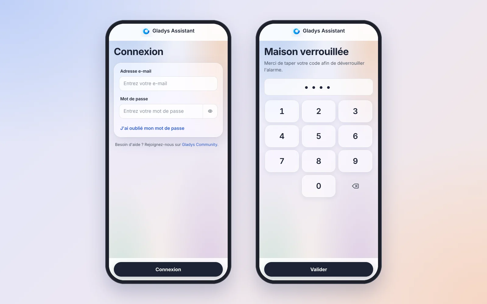
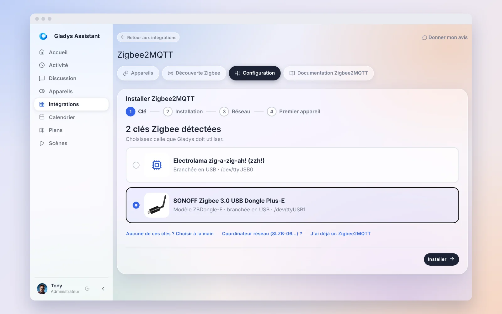
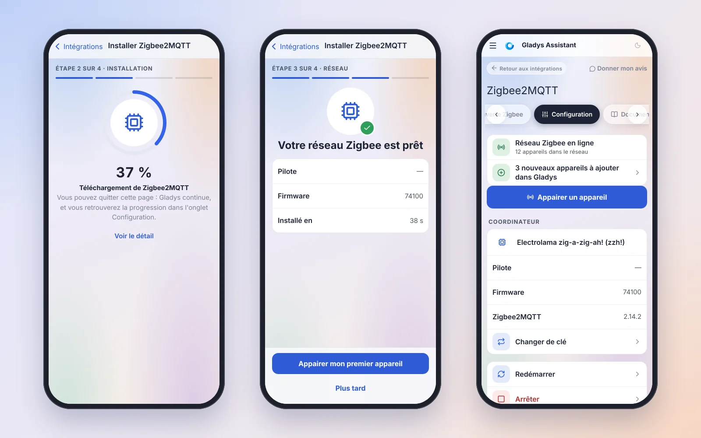
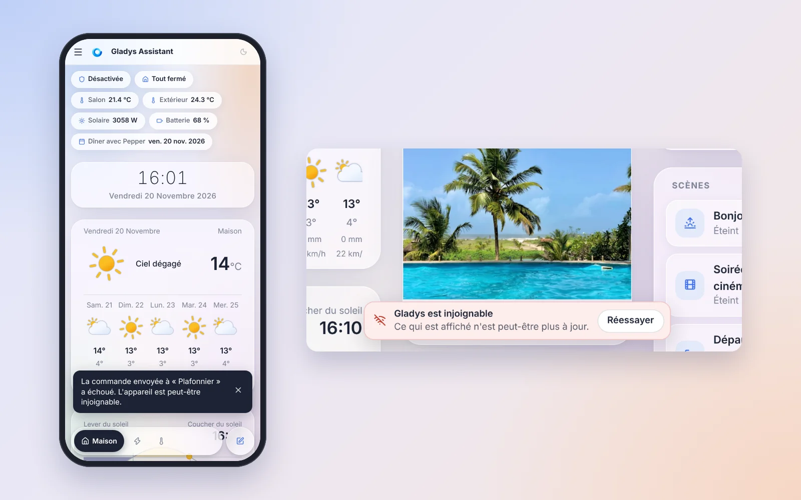
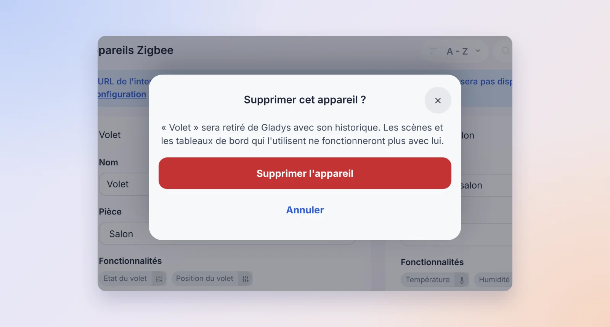
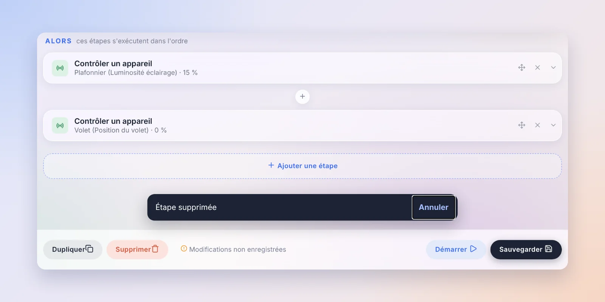

Salut à tous !

Nouvelle version de Gladys aujourd'hui, la 5.3.4 🎉

La semaine dernière, la 5.3.3 refaisait le tableau de bord et les scènes pour le téléphone. Cette version termine le chantier : **le reste de Gladys passe en version téléphone**, de la page de connexion à l'assistant de contrat d'énergie, en passant par toutes les pages des appareils. Sur ordinateur, rien ne change.

Et il y a beaucoup d'autres choses : **Zigbee2MQTT gagne un assistant d'installation et un tableau de bord**, et Gladys **vous prévient maintenant quand quelque chose ne va pas**, au lieu de vous laisser croire que tout a marché.

{/* truncate */}

## Tout Gladys, sur votre téléphone

En dessous de 768 pixels de large (ou sur un téléphone tenu à l'horizontale), les pages suivent les mêmes règles que le tableau de bord et les scènes : des zones à toucher d'au moins 44 pixels, des champs en 16 pixels (l'iPhone ne zoome plus), rien qui défile sur le côté, rien de destructif en un seul tap, et vos modifications ne sont jamais perdues en silence, geste « retour » du téléphone compris.

### Les appareils et leurs intégrations

- **La page d'un appareil** : le nom et la pièce d'abord, puis une ligne par fonctionnalité, qui s'ouvre dans un panneau (nom, unité, conservation de l'historique, ID externe). L'enregistrement est dans la barre du bas, et un message « Enregistré » le confirme.
- **Les onglets « Appareils » et « Découverte »** de Matter, MQTT, Bluetooth, AirPlay, LAN Manager, Enedis, Thermostat, caméras RTSP, Zigbee2MQTT et de toutes les intégrations externes : une ligne par appareil au lieu d'une pile de cartes d'ordinateur. Trois appareils Matter faisaient 2 452 pixels de défilement ! Un tap ouvre l'appareil dans un panneau, avec ce que montrait la carte.
- **Rien ne se supprime en un seul tap** : une confirmation nomme l'appareil et ce qui part avec lui.
- **Fermer un panneau avec des modifications non enregistrées** demande : « Enregistrer et fermer », « Fermer sans enregistrer » ou « Continuer la modification ».
- Dans les onglets **Découverte**, le scan est le bouton principal de la page, et devient « Arrêter le scan » pendant qu'il tourne.
- Pour les **caméras RTSP**, le bouton « Tester » affiche l'image de la caméra directement dans le panneau.

### Maisons, paramètres, énergie et zones

- **Maisons et pièces** : une pièce se renomme dans un panneau, se supprime avec un « Annuler », et s'ajoute avec des suggestions de pièces courantes. « Utiliser ma position actuelle » place la maison, et le code d'alarme se tape sur un pavé numérique.
- **Paramètres** : sessions, services, tâches de fond, sauvegardes, système et clés Open API deviennent des listes de lignes. Révoquer une session, restaurer une sauvegarde, redémarrer ou éteindre demande d'abord une confirmation.
- **Assistant de contrat d'énergie** : quatre étapes (compteur, modèle, paramètres, aperçu), avec les heures creuses choisies comme des plages horaires.
- **Zones de la carte** : la carte prend tout l'écran. Un tap place la zone, on glisse le cercle pour la déplacer, et la poignée sur son bord pour la redimensionner, avec le rayon affiché en direct.
- **Première installation** : les cinq étapes sont en plein écran, avec une barre de progression et un seul bouton en bas.

### Connexion et clavier verrouillé

Les pages de connexion, de mot de passe oublié et de Gladys Plus ont le bon clavier et le remplissage automatique sur chaque champ, un bouton pour afficher le mot de passe, et les erreurs à côté du champ concerné.

Le **clavier verrouillé** d'une tablette murale a de grandes touches à la taille de l'écran, jamais à faire défiler, et une mise en page sur deux colonnes à l'horizontale. Et sur Gladys Plus, configurer la double authentification **depuis le téléphone** propose maintenant d'abord « Ouvrir mon application 2FA » : plus besoin de scanner un QR code avec le téléphone qui l'affiche.

## Zigbee2MQTT : un assistant d'installation et un tableau de bord

L'[audit de Zigbee2MQTT](https://community.gladysassistant.com/t/zigbee2mqtt-un-audit-pour-devenir-plus-simple-que-home-assistant/11498) continue, avec sa plus grosse étape jusqu'ici. Merci [@cicoub13](https://github.com/cicoub13) pour cet énorme travail !

### Un assistant pour la première installation

Quand rien n'est configuré, la page Zigbee2MQTT est maintenant un assistant en quatre étapes :

1. **La clé** : Gladys affiche la clé qu'il a détectée, avec sa photo et son nom. Vous pouvez aussi choisir un modèle à la main dans une liste rangée par marque, utiliser un coordinateur réseau (SLZB-06…), ou vous connecter à un Zigbee2MQTT qui tourne déjà ailleurs.
2. **L'installation**, phase par phase. Un échec est expliqué en clair, avec « Réessayer » ou « Changer de clé ou de modèle ».
3. **Réseau prêt** : le pilote, le firmware et la durée de l'installation.
4. **Premier appareil** : l'association est autorisée pendant 4 minutes, puis direction l'onglet Découverte.

### Une installation plus rapide, en arrière-plan

- **L'installation tourne en arrière-plan** : vous pouvez quitter la page, la progression est toujours là quand vous revenez (et dans Paramètres › Tâches).
- **Les deux images sont téléchargées en parallèle**, et dès que vous choisissez une clé, avant même de cliquer sur « Installer ».
- **Le broker MQTT démarre une seule fois**, prêt dès qu'il répond : fini les attentes fixes et les doubles redémarrages. Sur un Raspberry Pi 4, les images se sont téléchargées en 15 secondes environ et Zigbee2MQTT répondait 15 secondes après son démarrage.
- **L'espace disque libre est vérifié** avant chaque téléchargement : une erreur claire plutôt qu'un disque plein.
- **La mise à jour de l'image Zigbee2MQTT ne coupe plus votre réseau Zigbee** pendant le téléchargement : la nouvelle image est téléchargée d'abord. Sans Internet, la version en place continue de tourner.

### Un tableau de bord pour une installation configurée

L'ancienne page de configuration est remplacée par un tableau de bord : l'état de Zigbee2MQTT avec l'action à faire (appareils à ajouter, un échec expliqué, « Redémarrer »…), le coordinateur, et les boutons « Redémarrer », « Arrêter » et « Réglages avancés ». **« Arrêter » est retenu** : ni un redémarrage de Gladys ni un redémarrage de la machine ne relancent Zigbee2MQTT tant que vous n'avez pas cliqué sur « Démarrer ».

### Et sous le capot

- **La clé est retrouvée où qu'elle soit branchée** : Gladys l'enregistre par son chemin stable (`/dev/serial/by-id/…`), et non plus par `/dev/ttyUSB0`, qui peut changer au prochain redémarrage. Les installations existantes basculent toutes seules.
- **Débranchée puis rebranchée, la clé relance Zigbee2MQTT toute seule**, en une dizaine de secondes, sans redémarrer Gladys. Une configuration avec une clé qui n'est pas branchée est refusée avant que quoi que ce soit ne soit enregistré.
- **Un nouvel appareil affiche ses valeurs tout de suite** quand vous l'ajoutez à Gladys, au lieu de rester vide jusqu'à son prochain envoi. Les appareils sur secteur sont interrogés pour leurs valeurs actuelles. Merci à ceux qui l'ont [signalé sur le forum](https://community.gladysassistant.com/t/transfert-zigbee2mqtt-ha-vers-gladys/11582) !
- **Les nouvelles installations génèrent leurs propres clés réseau**, comme un Zigbee2MQTT installé seul, et un fichier de configuration perdu ou corrompu est restauré depuis la sauvegarde que garde Gladys. Si vous déplacez un coordinateur vers une nouvelle installation de Gladys, restaurez votre sauvegarde Gladys Plus **avant** de configurer Zigbee2MQTT pour garder votre réseau.

## Gladys vous prévient quand quelque chose ne va pas

Jusqu'ici, quand Gladys redémarrait, se mettait à jour ou n'était plus sur le réseau, l'application avait l'air vivante, mais ne l'était pas : les valeurs ne bougeaient plus, les interrupteurs semblaient marcher, et rien ne le disait.

- **Une commande qui échoue est annoncée** : si la lumière n'a pas pu être pilotée (appareil injoignable, intégration non configurée…), un message le dit et l'interrupteur revient à l'état réel. Seule la page qui a envoyé la commande affiche le message : la tablette murale reste silencieuse quand la commande de votre téléphone échoue.
- **« Gladys est injoignable »** : après 4 secondes sans connexion, un bandeau s'affiche sur toutes les pages, avec un bouton « Réessayer ». Un tableau de bord se recharge tout seul quand Gladys revient.
- **La connexion temps réel se reconnecte jusqu'au retour de Gladys**. Avant, elle n'était retentée qu'une fois : après une mise à jour ou une coupure Wi-Fi, une tablette murale pouvait rester figée en silence jusqu'à ce que quelqu'un la recharge.
- **La page de connexion distingue les erreurs** : identifiants faux, Gladys injoignable, trop de tentatives ou erreur du serveur. Avant, tout était « Adresse e-mail ou mot de passe invalide », même un serveur arrêté.
- **Gladys Plus** : le chargement infini sur iPhone, après un passage de l'application en arrière-plan, est corrigé ([forum](https://community.gladysassistant.com/t/lag-multitache-ios/11587)).

## Moins de suppressions par erreur

Sur ordinateur, un bouton rouge « Supprimer » était posé à côté de « Sauvegarder » sur chaque carte d'appareil : un clic de travers, et l'appareil partait avec son historique.

- **Supprimer un appareil demande maintenant confirmation, dans 22 intégrations**, avec la même confirmation que sur téléphone.

- **Dans l'éditeur de scènes sur ordinateur, une étape supprimée peut être restaurée** avec un message « Annuler », comme sur téléphone.

- **Se déconnecter de Gladys Plus demande confirmation**, et prévient que la clé de sauvegarde est supprimée aussi. Révoquer une session demande confirmation.
- **Un appareil avec un long historique se supprime tout seul** : au-delà de 5 000 états, Gladys les purgeait en arrière-plan et vous demandait de revenir cliquer une deuxième fois sur « Supprimer ». Une seule tâche de fond purge maintenant l'historique, puis supprime l'appareil.

## Tablettes murales : le mode tablette depuis une URL

Pour configurer une tablette murale (ou dix), une URL suffit maintenant : `/dashboard/<tableau-de-bord>?tablet_mode_house=<maison>&fullscreen=force` ouvre le bon tableau de bord, en mode tablette et en plein écran, sans passer par le menu. Le menu « Mode tablette » affiche l'URL prête à l'emploi pour la maison choisie, avec un bouton pour la copier. Pratique quand un navigateur kiosque a été réinitialisé. Merci [@vincentBesseau](https://github.com/vincentBesseau) ([forum](https://community.gladysassistant.com/t/deployer-le-mode-tablette-plein-ecran-via-une-url-tablet-mode-house/11354)) !

## Et aussi

- **Discussion avec l'IA** : les messages envoyés par vos scènes font maintenant partie de la conversation. Si une scène demande « Faut-il éteindre le sèche-linge ? », répondre « Oui » est compris comme une réponse à cette question ([forum](https://community.gladysassistant.com/t/contexte-de-longlet-discussion/11622)).
- **Calendrier** : quand vous n'avez aucun calendrier, la page explique comment en connecter un, avec des liens vers les intégrations de calendrier installées ou vers le catalogue.
- **Nuki** : l'intégration native est dépréciée au profit de l'intégration communautaire [Gladys-Nuki](https://github.com/gboulvin/Gladys-Nuki). Un bouton « Migrer » déplace vos appareils. L'intégration native continue de tourner pour l'instant.
- **Thermostat** : le cadran reste dans la plage du thermostat (un Tado X via Matter affichait un cadran de -100 à 200 °C !), et une consigne manuelle sur un thermostat virtuel est ramenée dans sa plage. Un widget dont le thermostat a été supprimé le dit, et les noms des préréglages restent dans leur colonne dans toutes les langues. Merci [@William-De71](https://github.com/William-De71) !
- **Widget de consommation d'énergie** : les séries portent le nom de leur appareil (« Prise du salon ») au lieu d'un long nom de fonctionnalité suivi de « (1) », « (2) », et l'éditeur affiche des noms lisibles.
- **Climatisation** : le balayage horizontal s'appelle maintenant « Balayage », comme le vertical, et non plus « Balancement ». Merci [@smuteau](https://github.com/smuteau) !
- **Gladys Plus** : la carte d'invitation rappelle de vérifier le dossier Spam, et quelqu'un qui a perdu à la fois son mot de passe et son application de double authentification ne tourne plus en rond dans la récupération.

## Correctifs

- **Gladys pouvait se figer pendant des minutes, voire des heures**, après l'enregistrement d'un appareil pendant que des intégrations publiaient des états. Merci [@smuteau](https://github.com/smuteau) pour le diagnostic et la correction ([forum](https://community.gladysassistant.com/t/nouveau-probleme-de-freeze-de-gladys/11625)) !
- **Matter** : une commande vers un appareil hors ligne n'attend plus indéfiniment (elle échoue au bout de 15 secondes), et le **bouton Arrêter d'une scène** termine maintenant une exécution bloquée dans une action ([forum](https://community.gladysassistant.com/t/scene-inarretable/11614)). « Mettre à jour » dans la page Matter garde le nom, la pièce et les réglages d'énergie de l'appareil, et n'est plus proposé pour chaque appareil qui mesure l'énergie.
- **Intégrations externes** : « Mettre à jour » dans l'onglet Découverte garde le nom que vous avez donné à l'appareil. Merci [@smuteau](https://github.com/smuteau) !
- **MQTT** : le déclencheur « Recevoir un message MQTT » fonctionne avec les jokers `+` et `#`, et les appareils Home Assistant dont la valeur « éteint » est `0` ou `false` (un radar de présence qui restait « détecté ») remontent correctement leur état. Merci [@zagg](https://github.com/zagg) !
- **Caméras** : le direct démarre pour les caméras dont l'image redimensionnée avait une hauteur impaire (un sous-flux en 896×512, par exemple).
- La correction automatique est vraiment désactivée sur les champs e-mail, mot de passe et code du téléphone.

Ça fait 38 pull requests depuis la version 5.3.3.

## Merci aux contributeurs

Un grand merci à [@cicoub13](https://github.com/cicoub13) pour l'assistant, le tableau de bord et l'installation de Zigbee2MQTT, à [@William-De71](https://github.com/William-De71) pour le thermostat, à [@smuteau](https://github.com/smuteau) pour la correction du blocage et les intégrations externes, à [@zagg](https://github.com/zagg) pour MQTT, et à [@vincentBesseau](https://github.com/vincentBesseau) pour le mode tablette depuis une URL. Et merci à tous ceux qui ont remonté des bugs et des idées sur le forum !

On se retrouve sur [le forum](https://community.gladysassistant.com/) si vous voulez parler de cette version :)

## Comment mettre à jour ?

Comme toujours, Gladys se met à jour automatiquement sous 24 h si vous utilisez Watchtower, sinon vous pouvez le faire en un clic depuis les paramètres.

Le [CHANGELOG complet de la 5.3.4](https://github.com/GladysAssistant/Gladys/releases/tag/v5.3.4) est sur GitHub.
