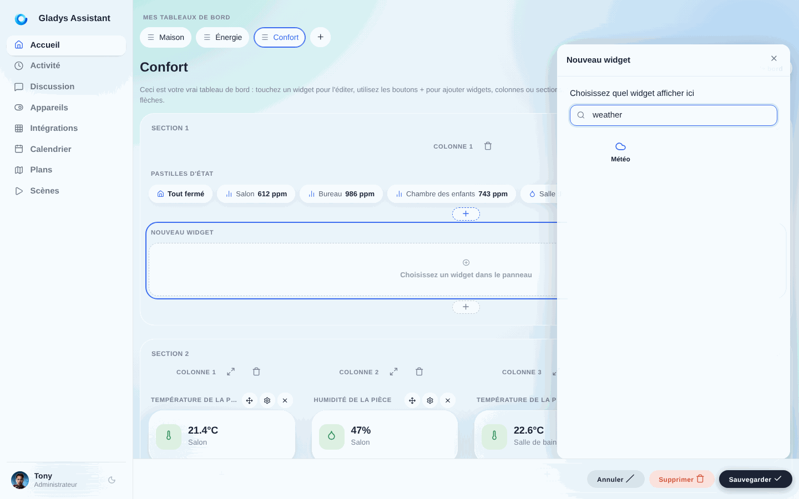
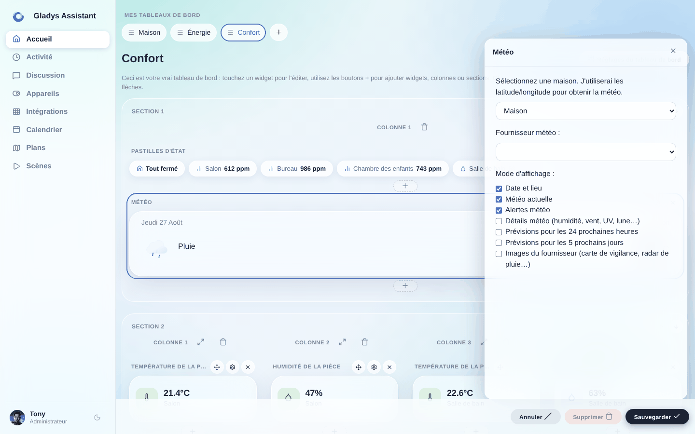

Vous pouvez afficher la météo liée à votre localisation sur le tableau de bord.

## Pré-requis

- Vous devez au préalable avoir installé et configuré une intégration météo depuis le [catalogue des intégrations](/fr/docs/integrations/), comme [OpenWeather](/fr/docs/integrations/external/openweather/), Météo France ou Open-Meteo.
- Vous devez avoir configuré votre maison dans les paramètres, et avoir placé votre maison sur la carte, afin que le fournisseur météo connaisse la latitude et la longitude de votre maison.

## Configuration

Rendez-vous sur le tableau de bord, puis cliquez sur "Éditer".

Ajoutez un widget "Météo" :

Ensuite, sélectionnez votre maison et les options d'affichage :

Cliquez sur "Sauvegarder".

Vous devriez voir la météo !

