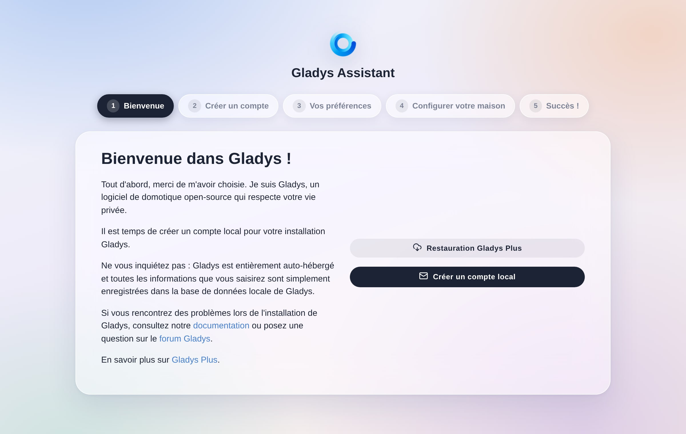

import {
  Roadmap,
  HowItWorks,
  InstallOptions,
  InstallOption,
  IntegrationChips,
  IntegrationsCount,
  Highlights,
} from "@site/src/components/docs/GettingStarted";
import GladysScreenshot from "@site/src/components/horizon/GladysScreenshot";

**Gladys Assistant est un logiciel de domotique gratuit et open-source.** Il réunit tous vos appareils dans une seule application, vous permet de les piloter depuis votre téléphone et d'automatiser votre maison, tout en fonctionnant **chez vous**, et non dans le cloud de quelqu'un d'autre.

De zéro à votre première automatisation, voici tout le parcours :

<Roadmap
  label="Les étapes de ce guide"
  steps={[
    { href: "#install", title: "Installer Gladys", time: "~30 min" },
    { href: "#create-account", title: "Créer votre compte", time: "2 min" },
    { href: "#connect-devices", title: "Connecter vos appareils", time: "5 min par marque" },
    { href: "#automate", title: "Automatiser votre maison", time: "5 min" },
  ]}
/>

<GladysScreenshot lang="fr" caption="Le tableau de bord de Gladys : vos appareils, vos pièces, vos caméras et votre énergie, sur ordinateur comme sur téléphone." />

## Comment fonctionne Gladys {/* #how-it-works */}

<HowItWorks
  nodes={[
    { title: "Vos appareils", text: "Lumières, capteurs, prises, chauffage, caméras… de toutes les marques." },
    { title: "Gladys, chez vous", text: "Sur un petit ordinateur toujours allumé, comme votre box Internet." },
    { title: "Votre téléphone et votre ordinateur", text: "Pour tout piloter, depuis votre canapé ou de n'importe où." },
  ]}
>

Gladys est **auto-hébergé** : au lieu de vous abonner à un cloud, vous l'installez une fois pour toutes sur un petit ordinateur chez vous. C'est pour cela qu'il y a une étape d'installation, et c'est ce qui rend Gladys **privé** (vos données ne quittent jamais votre maison) et **fiable** (votre maison continue de fonctionner même quand Internet est coupé).

</HowItWorks>

## Étape 1 : installer Gladys {/* #install */}

Choisissez la machine sur laquelle Gladys va tourner. **Vous hésitez ? Prenez le mini-PC** : c'est ce qu'utilisent la plupart des utilisateurs, et ce que j'utilise chez moi.

<InstallOptions>
<InstallOption
  featured
  icon="cpu"
  badge="Recommandé"
  title="Sur un mini-PC, avec Gladys Assistant OS"
  facts={[["clock", "30 minutes environ"], ["check", "Aucune ligne de commande"], ["refresh-cw", "Mises à jour automatiques"]]}
  cta="Installer Gladys sur un mini-PC"
  to="/fr/docs/installation/mini-pc/"
>

Notre installeur officiel fait tout le travail : vous l'écrivez sur une clé USB, vous démarrez le mini-PC dessus, vous répondez à quelques questions, et Gladys s'installe toute seule. Ensuite, elle se met à jour automatiquement.

- **Un mini-PC neuf** : petit, silencieux et économe. Je recommande le [Beelink Mini S13](https://amzn.to/4hRtIE3), voir aussi notre [guide d'achat des mini-PC](/fr/mini-pc-home-automation/).
- **Un mini-PC reconditionné** : souvent nettement moins cher sur Leboncoin, eBay ou chez les revendeurs spécialisés. Vérifiez qu'il a au moins 8 Go de RAM et un SSD.
- **Un ordinateur que vous avez déjà** : un vieux PC avec un processeur Intel ou AMD, un SSD d'au moins 16 Go et un port Ethernet peut devenir votre box Gladys (son disque sera effacé).

</InstallOption>

<InstallOption
  icon="package"
  title="Sur un Raspberry Pi"
  facts={[["clock", "30 minutes à 1 heure"], ["check", "Aucune ligne de commande"]]}
  cta="Installer sur un Raspberry Pi"
  to="/fr/docs/installation/raspberry-pi/"
>

Vous avez déjà un Raspberry Pi 3, 4 ou 5 ? Flashez notre image officielle 64 bits avec Raspberry Pi Imager : idéal pour découvrir Gladys. Pour une utilisation au quotidien sur le long terme, un mini-PC reste préférable.

</InstallOption>

<InstallOption
  icon="server"
  title="Sur un serveur ou un NAS que vous avez déjà"
  facts={[["clock", "10 minutes environ"], ["terminal", "Pour les habitués de Docker"]]}
>

Gladys s'installe à côté de vos autres services, sans nouvelle machine à acheter :

- [Docker sur Debian, Ubuntu ou tout Linux](/fr/docs/installation/docker/)
- [Proxmox VE](/fr/docs/installation/proxmox/)
- [NAS Synology](/fr/docs/installation/synology/)
- [NAS Unraid](/fr/docs/installation/unraid/)
- [Freebox Delta](/fr/docs/installation/freebox-delta/)

</InstallOption>

<InstallOption
  icon="home"
  title="Clé en main : le kit de démarrage"
  facts={[["check", "Gladys pré-installé"], ["user", "Formation incluse"]]}
  cta="Découvrir le kit de démarrage"
  to="/fr/starter-kit/"
>

Vous ne voulez pas vous occuper de l'installation ? Le kit de démarrage est un mini-PC avec Gladys déjà installé, prêt à brancher, livré avec une formation et 6 mois de Gladys Plus. Une option premium, en aucun cas obligatoire.

</InstallOption>
</InstallOptions>

## Étape 2 : créer votre compte {/* #create-account */}

Une fois Gladys démarré, ouvrez-le dans votre navigateur, depuis un ordinateur ou un téléphone connecté au même réseau :

- avec Gladys Assistant OS ou l'image Raspberry Pi : **[http://gladysassistant.local](http://gladysassistant.local)**,
- sinon : l'adresse IP de la machine, par exemple `http://192.168.1.42`.

Un court assistant vous guide : créez le compte administrateur, choisissez vos préférences (langue, unités), puis nommez votre maison et ses pièces. C'est l'affaire de deux minutes, et tout ce que vous saisissez reste dans la base de données locale de Gladys.

Vous venez d'une installation précédente ? Le bouton **Restauration Gladys Plus** de cet écran récupère toute votre configuration.

## Étape 3 : connecter vos appareils {/* #connect-devices */}

Dans Gladys, ouvrez **Intégrations** et choisissez la marque de vos appareils. Gladys fonctionne avec plus de <IntegrationsCount lang="fr" /> intégrations, les plus populaires intégrées d'office, les autres installables en un clic :

<IntegrationChips lang="fr" allLabel="Les {count}+ intégrations" />

Chaque intégration a sa page dans cette documentation, avec les étapes à suivre.

:::tip[Vous partez de zéro ? Choisissez le Zigbee]
Si vous achetez des appareils, je vous recommande le **Zigbee** : un dongle Zigbee USB (une trentaine d'euros) branché sur votre box Gladys et l'[intégration Zigbee2MQTT](/fr/docs/integrations/zigbee2mqtt/) vous donnent accès à des milliers de capteurs, prises, ampoules et télécommandes abordables, de toutes les marques, sans passerelle propriétaire ni cloud. Ma sélection de modèles fiables est sur la page [matériel recommandé](/fr/docs/installation/recommended-hardware/).
:::

Exemple : équiper un salon pour 120 € environ

Commencez par une pièce, voyez ce qui vous plaît, puis étendez pièce par pièce.

| Appareil                                       | Prix   | Lien                                                                                                                                                                   |
| ---------------------------------------------- | ------ | ---------------------------------------------------------------------------------------------------------------------------------------------------------------------- |
| Capteur température/humidité Zigbee avec écran | 10,91€ | [Domadoo](https://www.domadoo.fr/fr/peripheriques/6614-sonoff-capteur-de-temperature-et-d-humidite-zigbee-30-avec-ecran.html?domid=17)                                 |
| Module volet roulant Zigbee                    | 39,92€ | [Domadoo](https://www.domadoo.fr/fr/peripheriques/5245-sunricher-module-volet-roulant-zigbee-30.html?domid=17)                                                         |
| Prise connectée pour télé avec consommation    | 16,99€ | [Domadoo](https://www.domadoo.fr/fr/peripheriques/6165-nous-prise-intelligente-zigbee-30-mesure-de-consommation-5907772033517.html?domid=17)                           |
| Ampoule IKEA TRÅDFRI E27 couleur (plafonnier)  | 17,99€ | [IKEA](https://www.ikea.com/fr/fr/p/tradfri-ampoule-led-e27-806-lumen-connecte-sans-fil-a-variateur-dintensite-spectre-couleur-et-blanc-globe-70439158/)               |
| Télécommande IKEA STYRBAR (luminosité/couleur) | 9,99€  | [IKEA](https://www.ikea.com/fr/fr/p/styrbar-telecommande-connecte-blanc-30488363/)                                                                                     |
| Détecteur mouvement Zigbee Aqara P1            | 24,99€ | [Domadoo](https://www.domadoo.fr/fr/peripheriques/6138-aqara-detecteur-de-mouvement-et-luminosite-zigbee-30-aqara-motion-sensor-p1-ms-s02-6970504215979.html?domid=17) |

## Étape 4 : automatiser votre maison {/* #automate */}

C'est là que Gladys prend tout son sens. Vos appareils apparaissent sur le **tableau de bord**, que vous pouvez [personnaliser](/fr/docs/dashboard/intro/) et partager avec votre famille. Ensuite, les **scènes** font fonctionner votre maison toute seule : un déclencheur (une heure, un capteur, quelqu'un qui rentre…), quelques conditions, et des actions.

<GladysScreenshot lang="fr" shot="scene" alt="Une scène dans Gladys Assistant" />

Quelques idées pour une première scène :

<Highlights
  items={[
    { icon: "zap", title: "Éclairer le couloir la nuit", text: "Quand un mouvement est détecté après le coucher du soleil, allumer la lumière pendant 2 minutes." },
    { icon: "home", title: "Partir l'esprit tranquille", text: "Quand la maison est vide, tout éteindre et armer l'alarme." },
    { icon: "thermometer", title: "Chauffer seulement quand il faut", text: "Baisser le chauffage la nuit et quand personne n'est là." },
    { icon: "message-square", title: "Être prévenu tout de suite", text: "Recevoir un message en cas de fuite d'eau ou si une porte s'ouvre pendant vos vacances." },
  ]}
/>

👉 [Créer votre première scène](/fr/docs/scenes/intro/)

Pour utiliser Gladys comme une application, [installez-le sur votre téléphone](/fr/docs/installation/phone/). Pour le piloter quand vous n'êtes pas chez vous, [Gladys Plus](/fr/plus/), notre service optionnel, vous donne un accès à distance chiffré de bout en bout, sans aucune configuration réseau.

## Questions fréquentes {/* #faq */}

Gladys est-il vraiment gratuit ?

Oui. Gladys est open-source (licence Apache 2.0) et gratuit, sans limite d'appareils ni de fonctionnalités. [Gladys Plus](/fr/plus/) est un service payant et optionnel en complément (accès à distance, sauvegardes quotidiennes, Google Home et Alexa, IA) ; il finance le développement du projet.

Faut-il savoir coder ou utiliser un terminal ?

Non. Avec Gladys Assistant OS ou l'image Raspberry Pi, vous installez Gladys sans taper une seule commande, et tout le reste se fait depuis l'interface de Gladys.

Gladys fonctionne-t-il sans Internet ?

Oui. Gladys fonctionne en local : vos appareils, votre tableau de bord et vos scènes continuent de fonctionner sans Internet. La connexion n'est nécessaire que pour installer Gladys, récupérer les mises à jour, et pour les intégrations de services cloud.

J'utilise déjà un autre logiciel de domotique, puis-je changer ?

Oui, et Gladys peut même tourner à côté le temps de migrer vos appareils. La plupart des appareils Zigbee, Matter, Philips Hue ou Shelly s'appairent directement avec Gladys. Voyez comment Gladys se compare à [Jeedom](/fr/jeedom-alternative/) ou à [Home Assistant](/fr/home-assistant-alternative/).

## Besoin d'aide ?

Bloqué à une étape ? Posez votre question sur [le forum](https://community.gladysassistant.com/) : la communauté et moi y répondons tous les jours.
