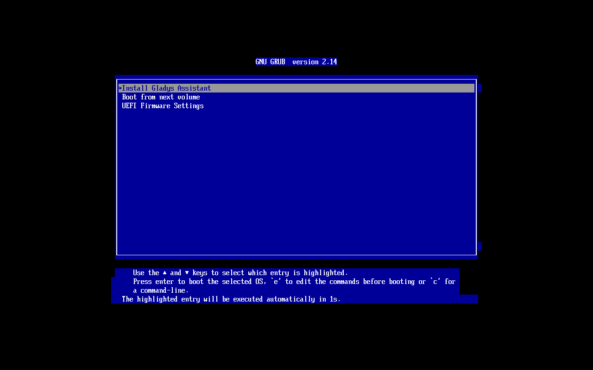
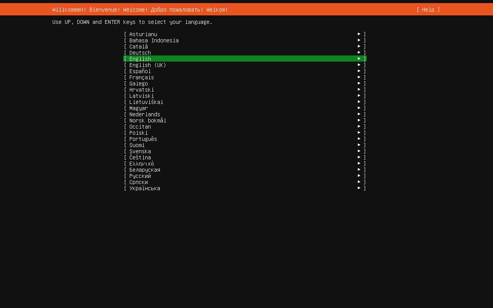
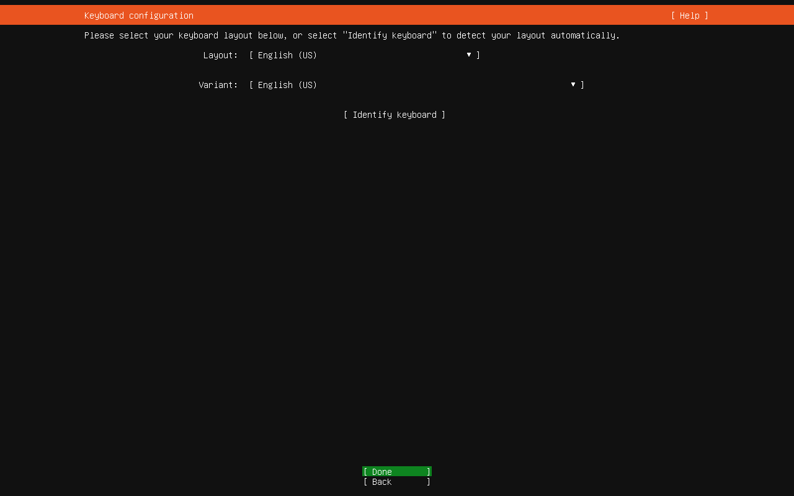
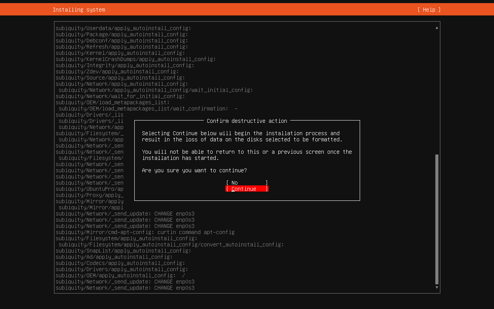
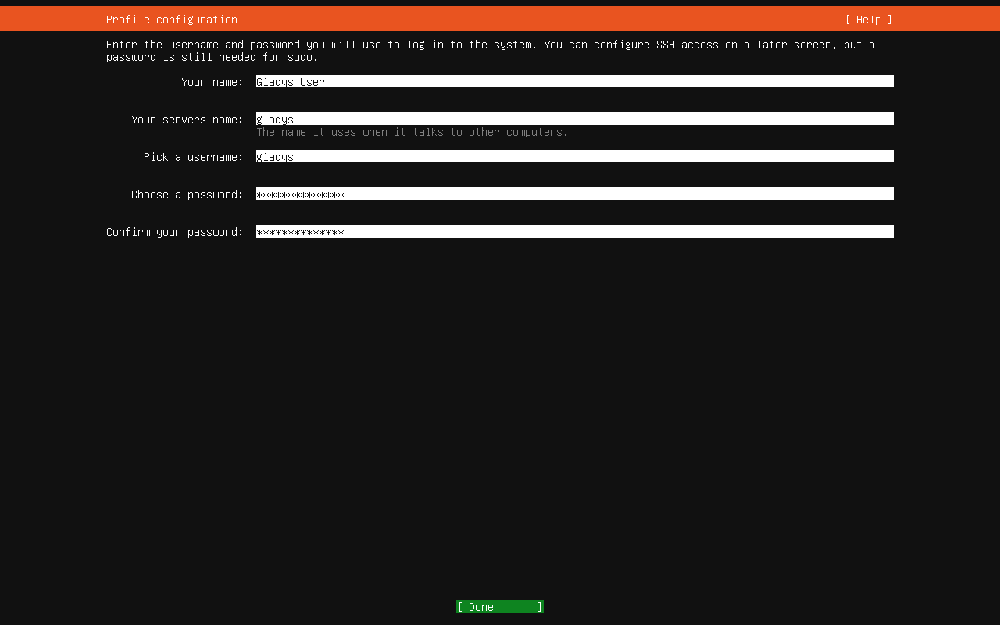
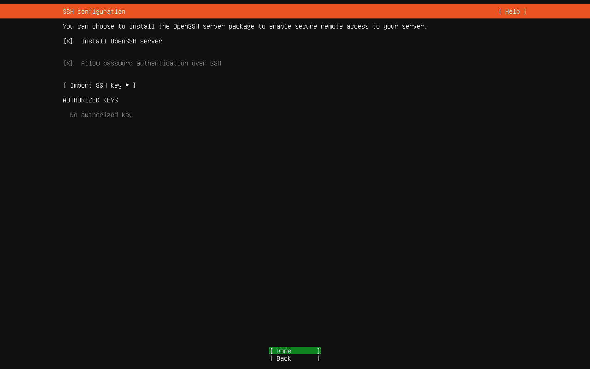
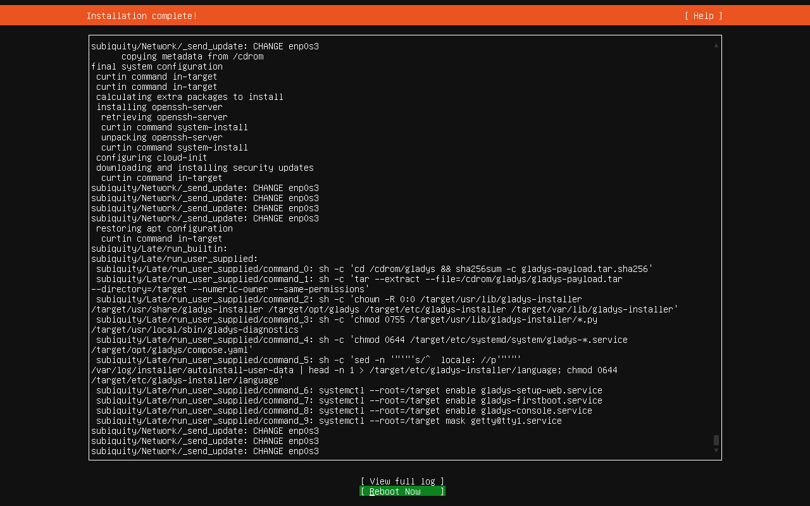
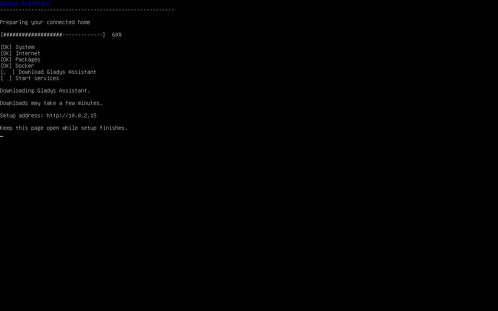
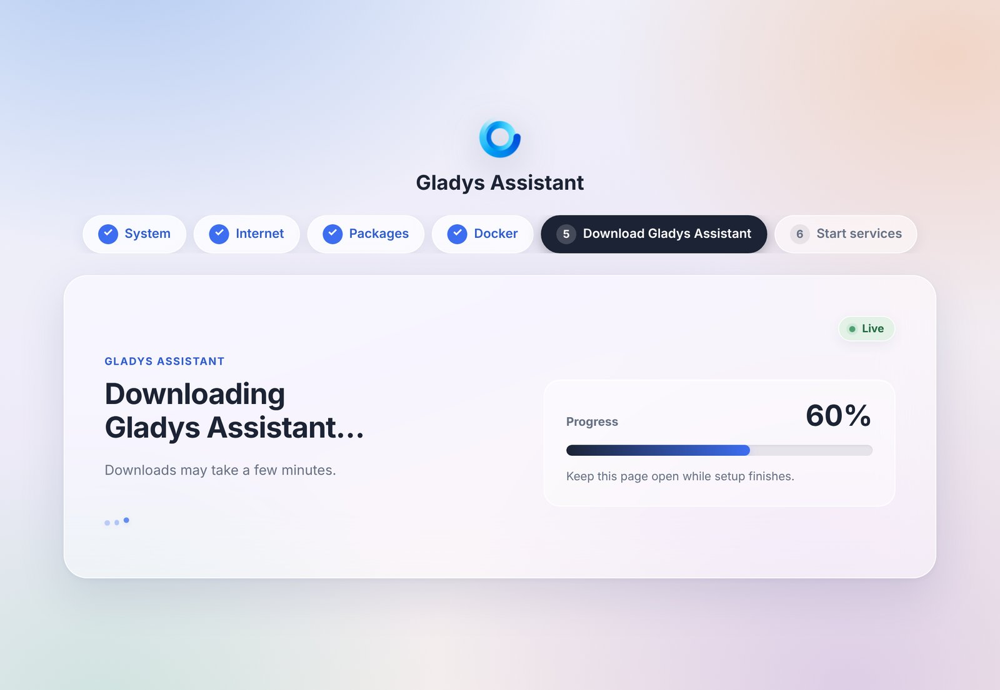

import JsonLd from '@site/src/components/seo/JsonLd';

**Gladys Assistant OS** est notre installeur officiel pour mini-PC. Il transforme n'importe quel mini-PC en box domotique dédiée à Gladys Assistant : vous l'écrivez sur une clé USB, vous démarrez le mini-PC dessus, vous répondez à quelques questions, et Gladys s'installe toute seule.

Pas de ligne de commande, pas de Docker à installer à la main : Gladys Assistant OS s'occupe de tout, puis maintient Gladys à jour automatiquement.

:::tip[Quel mini-PC acheter ?]
Modèles, caractéristiques, consommation et budget : [Quel mini-PC pour la domotique](/fr/mini-pc-home-automation/). Le Beelink Mini S13 est une très bonne option pour débuter avec Gladys, vous pouvez le trouver sur [Amazon](https://amzn.to/4hRtIE3).

Si vous préférez ne pas vous occuper de l'installation, le [kit de démarrage](/fr/starter-kit/) est une box domotique avec Gladys Assistant déjà installé.
:::

## Ce que Gladys Assistant OS fait pour vous

Sous le capot, Gladys Assistant OS est un **Ubuntu Server 26.04 LTS** standard, préparé pour Gladys :

- il installe Ubuntu Server sur le disque interne du mini-PC,
- au premier démarrage, il installe Docker, télécharge la dernière version de Gladys et la lance,
- il **met à jour Gladys automatiquement** dès qu'une nouvelle version sort,
- il installe automatiquement les **mises à jour de sécurité d'Ubuntu**,
- il détecte votre fuseau horaire,
- et Gladys est accessible à l'adresse **`http://gladysassistant.local`** depuis n'importe quel appareil de votre réseau.

Gladys Assistant OS est open source : son code est sur [GitHub](https://github.com/GladysAssistant/ubuntu-server-gladys).

## Ce qu'il vous faut

- Un **mini-PC** (ou un PC) avec un **processeur Intel ou AMD** (x86-64) qui démarre en mode **UEFI**, ce qui est le cas de quasiment tous les ordinateurs des dix dernières années. Prévoyez au moins **8 Go de RAM**.
- Un **SSD interne** (NVMe, SATA ou eMMC) d'au moins 16 Go dans le mini-PC.
- Un **câble Ethernet** branché sur votre box Internet ou votre routeur. L'installeur ne gère pas le Wi-Fi.
- Une **clé USB de 4 Go ou plus**.
- Un **écran et un clavier**, uniquement pendant l'installation. Ensuite, le mini-PC fonctionne tout seul, sans écran.
- Un ordinateur pour télécharger l'image et l'écrire sur la clé USB.

:::warning[Le disque interne du mini-PC sera effacé]
Gladys Assistant OS efface le disque sur lequel il s'installe. Rien n'est effacé avant que vous ne le confirmiez dans l'installeur, mais sauvegardez d'abord tout ce que vous voulez garder. La clé USB sera elle aussi effacée.
:::

:::info[Sur un Raspberry Pi ?]
Gladys Assistant OS est conçu pour les ordinateurs Intel et AMD. Sur un Raspberry Pi, utilisez plutôt notre [image officielle pour Raspberry Pi](/fr/docs/installation/raspberry-pi/).
:::

## Étape 1 : télécharger Gladys Assistant OS

Téléchargez l'image de Gladys Assistant OS (un fichier `.iso` d'environ 2 Go) :

<p>
  <a class="button button--primary button--lg" href="https://download.gladysassistant.com/gladys-assistant-installer-amd64.iso">Télécharger Gladys Assistant OS</a>
</p>

Ce lien vous donne toujours la dernière version. Les notes de version sont sur [GitHub](https://github.com/GladysAssistant/ubuntu-server-gladys/releases).

<details>
<summary>Facultatif : vérifier que le téléchargement est intact</summary>

Téléchargez le [fichier de contrôle](https://download.gladysassistant.com/gladys-assistant-installer-amd64.iso.sha256) et placez-le dans le même dossier que l'image. Puis, depuis ce dossier :

Sous Linux :

```bash
sha256sum -c gladys-assistant-installer-amd64.iso.sha256
```

Sous macOS :

```bash
shasum -a 256 -c gladys-assistant-installer-amd64.iso.sha256
```

Les deux commandes doivent répondre `OK`.

Sous Windows, dans PowerShell :

```powershell
Get-FileHash .\gladys-assistant-installer-amd64.iso -Algorithm SHA256
```

L'empreinte affichée doit être identique à celle du fichier `.sha256` (ouvrez-le avec le Bloc-notes).

</details>

## Étape 2 : écrire l'image sur une clé USB

L'image doit être **écrite** sur la clé USB avec un outil dédié : copier le fichier `.iso` sur la clé ne fonctionne pas.

1. Téléchargez et installez [balenaEtcher](https://etcher.balena.io/), disponible sur Windows, macOS et Linux.
2. Branchez la clé USB sur votre ordinateur.
3. Dans balenaEtcher, cliquez sur **Flash from file** et sélectionnez `gladys-assistant-installer-amd64.iso`.
4. Cliquez sur **Select target** et choisissez votre clé USB. Vérifiez bien qu'il s'agit de la bonne clé : elle sera effacée.
5. Cliquez sur **Flash!** et attendez la fin de l'écriture et de la vérification.

## Étape 3 : démarrer le mini-PC sur la clé USB

1. Branchez le mini-PC à votre box avec le **câble Ethernet**, puis branchez l'écran, le clavier et la clé USB.
2. Allumez le mini-PC et appuyez aussitôt plusieurs fois sur la touche du **menu de démarrage** : **F7** sur les Beelink, **F10** sur les Intel NUC, et en général **F12**, **F11** ou **Échap** sur les autres marques.
3. Dans le menu de démarrage, choisissez votre clé USB (son nom commence souvent par `UEFI:`).

Le menu de Gladys Assistant OS s'affiche, avec **Install Gladys Assistant** en surbrillance. Il démarre tout seul au bout de 3 secondes.



:::tip[Le mini-PC ne démarre pas sur la clé USB ?]
Ouvrez les réglages du BIOS (en général avec **Suppr** ou **F2** au démarrage), vérifiez que l'ordinateur démarre en mode **UEFI** (et non « Legacy » ou « CSM »), et placez la clé USB en premier dans l'ordre de démarrage. S'il refuse toujours de démarrer, désactivez le **Secure Boot** dans ces mêmes réglages.
:::

## Étape 4 : répondre aux questions de l'installeur {/* #installer-questions */}

L'installeur ne pose que quelques questions. Déplacez-vous avec les **flèches** et **Tab**, cochez ou décochez une option avec **Espace**, et validez avec **Entrée**.

1. **Langue** : l'anglais est présélectionné. Choisissez **Français** : les écrans suivants, puis la page d'installation de Gladys, seront en français.

   
2. **Clavier** : la disposition de votre langue est proposée (AZERTY français si vous avez choisi le français). Vérifiez-la bien, vous allez taper votre mot de passe juste après.

   
3. **Disque** :
   - si le mini-PC a **un seul disque interne** (les disques de moins de 16 Go ne comptent pas), il n'y a rien à choisir : Gladys Assistant OS s'installe dessus automatiquement, en utilisant tout le disque ;
   - s'il a **plusieurs disques**, l'installeur vous demande lequel utiliser : gardez l'option qui utilise le disque entier (*Use an entire disk*), sélectionnez le disque, laissez l'option LVM telle quelle, puis validez l'écran de résumé (*Done*).

   Dans les deux cas, l'installeur vous demande ensuite de confirmer dans une fenêtre (*Confirm destructive action*), qui peut n'apparaître qu'un peu plus tard, après l'écran du compte. **Non** (*No*) est sélectionné par défaut : descendez sur **Continuer** (*Continue*) avec les flèches et appuyez sur **Entrée** pour effacer le disque et lancer l'installation. Rien n'est effacé avant cette étape.

   

4. **Votre compte** : saisissez votre nom, un nom d'utilisateur et un mot de passe. C'est le seul compte de la machine (il n'y a pas de mot de passe par défaut) : notez-le en lieu sûr, il vous servira pour la maintenance. L'installeur demande aussi un nom de serveur, mais la machine s'appelle toujours `gladys` : vous pouvez taper n'importe quoi.

   
5. **SSH** : l'option **Installer le serveur OpenSSH** (*Install OpenSSH server*) est cochée par défaut. Gardez-la pour pouvoir vous connecter plus tard au mini-PC à distance depuis votre ordinateur. Vous pouvez la décocher si vous n'en voulez pas.

   

L'installation se déroule ensuite toute seule pendant quelques minutes.

## Étape 5 : laisser Gladys s'installer

Quand l'écran indique que l'installation est terminée (*Installation complete!*), sélectionnez **Redémarrer maintenant** (*Reboot Now*) avec les flèches, appuyez sur **Entrée**, puis **retirez la clé USB** (si un message vous demande de retirer le support d'installation, retirez-la, puis appuyez sur **Entrée**).



Lors de ce premier démarrage, Gladys Assistant OS installe Docker, télécharge Gladys et la lance. Vous pouvez suivre la progression :

- sur l'écran du mini-PC,
- ou depuis votre ordinateur ou votre téléphone, à l'**adresse de configuration** affichée à l'écran (par exemple `http://192.168.1.42`).





Le téléchargement de Gladys est l'étape la plus longue, sa durée dépend de votre connexion Internet. Laissez le mini-PC branché au câble Ethernet jusqu'au bout.

:::note[Pas d'inquiétude]
Si le mini-PC n'a pas accès à Internet, son écran affiche **Connexion Internet requise** et l'installation attend : elle reprend toute seule dès que la connexion revient. En cas de coupure de courant, rallumez simplement le mini-PC : l'installation reprend là où elle s'était arrêtée.
:::

## Étape 6 : ouvrir Gladys

Quand l'écran affiche **Gladys Assistant est prêt**, ouvrez **`http://gladysassistant.local`** dans votre navigateur, depuis un ordinateur ou un téléphone connecté au même réseau. Si vous aviez laissé la page de configuration ouverte, elle bascule toute seule sur Gladys (rafraîchissez-la si besoin).

Si `gladysassistant.local` ne s'ouvre pas, utilisez plutôt l'adresse affichée juste en dessous sur l'écran du mini-PC (par exemple `http://192.168.1.42`). Certains réseaux, par exemple certains téléphones Android, les réseaux invités ou les box avec l'isolation des clients activée, ne gèrent pas ces noms locaux.

Il ne vous reste plus qu'à créer votre compte et à configurer votre maison : voir [Configuration de votre maison connectée](/fr/docs/#configuration-de-votre-maison-connectée). Vous pouvez débrancher l'écran et le clavier, le mini-PC n'en a plus besoin.

:::tip
Donnez une adresse IP fixe au mini-PC avec une réservation DHCP dans les réglages de votre box : son adresse ne changera plus jamais.
:::

## Les mises à jour

- **Gladys se met à jour toute seule.** [Watchtower](https://github.com/nicholas-fedor/watchtower) est installé à côté de Gladys et installe chaque nouvelle version automatiquement. Vous n'avez rien à faire.
- **Les mises à jour de sécurité d'Ubuntu s'installent automatiquement.** Le mini-PC ne redémarre en revanche jamais tout seul : certaines mises à jour (du noyau Linux, par exemple) ne s'appliquent qu'après un redémarrage. Redémarrez le mini-PC de temps en temps, par exemple avec `sudo reboot` en SSH. Gladys redémarre toute seule.
- Inutile de réinstaller quand une nouvelle version de Gladys Assistant OS sort : les nouvelles versions ne concernent que les nouvelles installations.

## Pour aller plus loin

Gladys Assistant OS est un Ubuntu Server standard : vous gardez la main sur votre machine. Quelques informations utiles si vous êtes à l'aise avec un terminal :

- **Se connecter à distance** (si vous avez gardé OpenSSH) : `ssh votre-utilisateur@gladysassistant.local`, ou avec l'adresse IP du mini-PC.
- **Les données de Gladys** sont stockées dans `/var/lib/gladysassistant`.
- **Gladys et Watchtower** sont lancés avec Docker Compose, depuis `/opt/gladys/compose.yaml`. Votre compte peut utiliser `docker` sans `sudo` (reconnectez-vous une fois après l'installation s'il vous demande `sudo`).
- **Bluetooth** : pour utiliser des capteurs Bluetooth ou appairer des appareils Matter en Bluetooth, installez BlueZ sur le mini-PC : `sudo apt install -y bluez`.
- **Diagnostic** : `sudo gladys-diagnostics` affiche l'état de la machine. Sa sortie ne contient ni mot de passe ni secret : vous pouvez la partager sur [le forum](https://community.gladysassistant.com/) si vous avez besoin d'aide.
- **Fuseau horaire** : il est détecté automatiquement. Pour le changer, par exemple pour `Europe/Paris` :

```bash
sudo timedatectl set-timezone Europe/Paris
```

```bash
echo GLADYS_TZ=Europe/Paris | sudo tee /opt/gladys/.env
```

```bash
docker compose -f /opt/gladys/compose.yaml up -d gladys
```

## En cas de problème

**L'écran affiche « Connexion Internet requise »** : le mini-PC n'a pas accès à Internet. Vérifiez le câble Ethernet et votre box : l'installation reprend toute seule, sans redémarrage, dès que la connexion fonctionne.

**`gladysassistant.local` ne s'ouvre pas** : votre réseau ne gère pas les noms locaux. Utilisez l'adresse affichée sur l'écran du mini-PC.

**L'écran reste noir après le redémarrage** (*Reboot Now*) : l'installation est déjà terminée. Retirez la clé USB et redémarrez le mini-PC avec son bouton d'alimentation.

**Le navigateur affiche toujours la page de configuration** : Gladys n'est pas encore prête. Attendez **Gladys Assistant est prêt** à l'écran, puis rafraîchissez la page.

**L'écran affiche « La configuration ne peut pas continuer »** : connectez-vous sur le mini-PC (appuyez sur **Ctrl+Alt+F2** pour obtenir une invite de connexion, ou passez par SSH) et lancez `sudo gladys-diagnostics`. Demandez ensuite de l'aide sur [le forum](https://community.gladysassistant.com/) avec sa sortie.

Pour consulter les logs de Gladys elle-même, voir [comment télécharger les logs de Gladys](/fr/docs/installation/logs/).

## Vous préférez installer à la main ?

Gladys Assistant OS dédie tout le mini-PC à Gladys. Si vous préférez installer vous-même Ubuntu Server ou Debian, ou faire tourner Gladys sur une machine qui fait déjà autre chose (un NAS, un serveur, une machine virtuelle), suivez le [guide d'installation avec Docker](/fr/docs/installation/docker/).

## Questions fréquentes

### Qu'est-ce que Gladys Assistant OS ?

Gladys Assistant OS est l'installeur officiel de Gladys Assistant pour mini-PC. Il installe Ubuntu Server 26.04 LTS, Docker et Gladys, puis maintient Gladys à jour automatiquement. Vous l'écrivez sur une clé USB, vous démarrez le mini-PC dessus et vous répondez à quelques questions : aucune ligne de commande n'est nécessaire.

### Quel mini-PC conseillez-vous pour Gladys ?

Nous utilisons et recommandons le Beelink Mini S13. Il est puissant, silencieux, économe en énergie et fait tourner Gladys de manière fiable sur le long terme. Gladys Assistant OS est conçu pour n'importe quel mini-PC avec un processeur Intel ou AMD qui démarre en mode UEFI : prévoyez au moins 8 Go de RAM et un SSD.

### Pourquoi un mini-PC plutôt qu'un Raspberry Pi ?

Un mini-PC offre plus de puissance, plus de RAM et un stockage plus rapide et plus fiable qu'un Raspberry Pi, généralement pour un prix total similaire une fois le boîtier, l'alimentation et le SSD ajoutés. C'est l'installation que nous recommandons pour faire tourner Gladys sereinement sur le long terme.

### Puis-je installer Gladys Assistant OS en Wi-Fi ?

Non, l'installeur a besoin d'un câble Ethernet avec un accès à Internet. Une connexion filaire est aussi plus fiable pour une box domotique allumée toute la journée.

### Gladys Assistant OS va-t-il effacer mon mini-PC ?

Oui. Gladys Assistant OS efface le disque interne sur lequel il s'installe, après vous avoir demandé de confirmer. Sauvegardez tout ce que vous voulez garder avant l'installation.

### Puis-je encore utiliser le mini-PC pour autre chose ?

Oui. Gladys Assistant OS est un Ubuntu Server standard : vous pouvez vous y connecter en SSH et faire tourner d'autres containers Docker à côté de Gladys. Les mises à jour automatiques ne concernent que Gladys et Watchtower : vos autres containers ne sont jamais mis à jour, sauf si vous leur ajoutez le label de Watchtower.

<JsonLd
  data={{
    "@context": "https://schema.org",
    "@type": "FAQPage",
    mainEntity: [
      {
        "@type": "Question",
        name: "Qu'est-ce que Gladys Assistant OS ?",
        acceptedAnswer: {
          "@type": "Answer",
          text: "Gladys Assistant OS est l'installeur officiel de Gladys Assistant pour mini-PC. Il installe Ubuntu Server 26.04 LTS, Docker et Gladys, puis maintient Gladys à jour automatiquement. Vous l'écrivez sur une clé USB, vous démarrez le mini-PC dessus et vous répondez à quelques questions : aucune ligne de commande n'est nécessaire.",
        },
      },
      {
        "@type": "Question",
        name: "Quel mini-PC conseillez-vous pour Gladys ?",
        acceptedAnswer: {
          "@type": "Answer",
          text: "Nous utilisons et recommandons le Beelink Mini S13. Il est puissant, silencieux, économe en énergie et fait tourner Gladys de manière fiable sur le long terme. Gladys Assistant OS est conçu pour n'importe quel mini-PC avec un processeur Intel ou AMD qui démarre en mode UEFI : prévoyez au moins 8 Go de RAM et un SSD.",
        },
      },
      {
        "@type": "Question",
        name: "Pourquoi un mini-PC plutôt qu'un Raspberry Pi ?",
        acceptedAnswer: {
          "@type": "Answer",
          text: "Un mini-PC offre plus de puissance, plus de RAM et un stockage plus rapide et plus fiable qu'un Raspberry Pi, généralement pour un prix total similaire une fois le boîtier, l'alimentation et le SSD ajoutés. C'est l'installation que nous recommandons pour faire tourner Gladys sereinement sur le long terme.",
        },
      },
      {
        "@type": "Question",
        name: "Puis-je installer Gladys Assistant OS en Wi-Fi ?",
        acceptedAnswer: {
          "@type": "Answer",
          text: "Non, l'installeur a besoin d'un câble Ethernet avec un accès à Internet. Une connexion filaire est aussi plus fiable pour une box domotique allumée toute la journée.",
        },
      },
      {
        "@type": "Question",
        name: "Gladys Assistant OS va-t-il effacer mon mini-PC ?",
        acceptedAnswer: {
          "@type": "Answer",
          text: "Oui. Gladys Assistant OS efface le disque interne sur lequel il s'installe, après vous avoir demandé de confirmer. Sauvegardez tout ce que vous voulez garder avant l'installation.",
        },
      },
      {
        "@type": "Question",
        name: "Puis-je encore utiliser le mini-PC pour autre chose ?",
        acceptedAnswer: {
          "@type": "Answer",
          text: "Oui. Gladys Assistant OS est un Ubuntu Server standard : vous pouvez vous y connecter en SSH et faire tourner d'autres containers Docker à côté de Gladys. Les mises à jour automatiques ne concernent que Gladys et Watchtower : vos autres containers ne sont jamais mis à jour, sauf si vous leur ajoutez le label de Watchtower.",
        },
      },
    ],
  }}
/>
