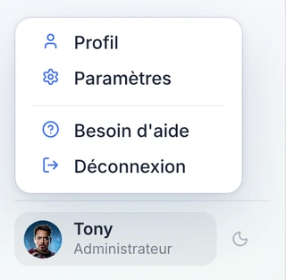
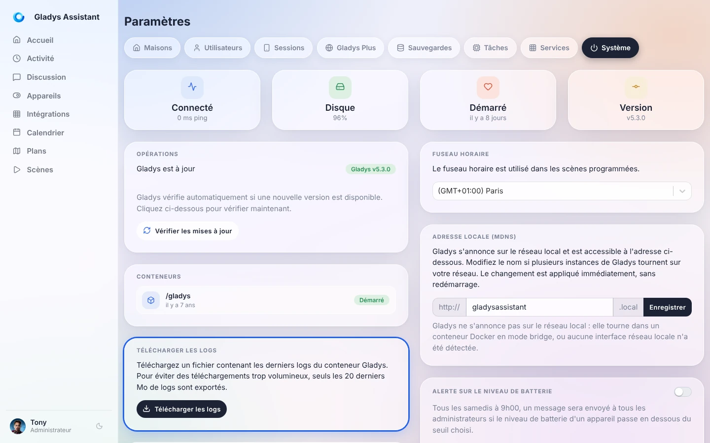
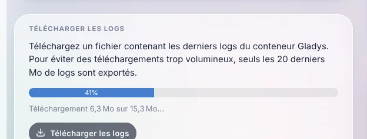

Quand quelque chose ne fonctionne pas comme prévu (une intégration qui ne démarre pas, un appareil qui ne répond plus, une scène qui ne se lance pas), la première chose à regarder, ce sont les **logs de Gladys**. C'est aussi ce qu'on vous demandera sur [le forum](https://community.gladysassistant.com/) pour vous aider.

Pas besoin de ligne de commande : Gladys vous permet de télécharger ses logs **en un clic**, directement depuis l'interface.

## Télécharger les logs depuis l'interface

Ouvrez Gladys dans votre navigateur, cliquez sur votre nom en bas à gauche du menu, puis sur **Paramètres**.



Ouvrez l'onglet **Système**, puis dans la carte **Télécharger les logs**, cliquez sur **Télécharger les logs**.



Gladys rassemble les logs et les télécharge par morceaux : une barre de progression indique où en est le téléchargement.



Une fois terminé, votre navigateur enregistre un fichier texte nommé par exemple `gladys-logs-2026-10-26-101203.log`. Vous pouvez l'ouvrir avec n'importe quel éditeur de texte.

Bon à savoir :

- Seuls les **20 derniers Mo** de logs sont exportés, pour garder un fichier léger. C'est largement suffisant pour couvrir les dernières heures ou les derniers jours d'activité.
- Vous devez être connecté avec un compte **administrateur**.
- Cela fonctionne aussi **à distance via [Gladys Plus](/fr/docs/plus/intro)** : pas besoin d'être chez vous pour récupérer les logs.
- Ce bouton est disponible depuis Gladys Assistant v4.77. Si vous ne le voyez pas, [mettez à jour Gladys](/fr/docs/installation/faq).

## Partager les logs sur le forum

Pour obtenir de l'aide, [créez un sujet sur le forum](https://community.gladysassistant.com/) en expliquant votre problème, et joignez le fichier de logs (ou collez les lignes utiles dans un bloc de code).

Avant de publier, jetez un œil au fichier : les logs peuvent contenir le nom de vos appareils, des adresses IP locales ou les URL de vos services. Retirez ce que vous ne voulez pas partager publiquement.

## Lire les logs en ligne de commande

Si l'interface de Gladys ne s'ouvre pas du tout, vous pouvez quand même lire les logs depuis la machine qui fait tourner Gladys. Connectez-vous-y (en SSH par exemple) et lancez :

```bash
sudo docker logs gladys --tail=1000
```

Cette commande affiche les 1000 dernières lignes. Pour suivre les logs en direct pendant que vous reproduisez le problème, ajoutez `-f` :

```bash
sudo docker logs gladys --tail=100 -f
```

Appuyez sur `Ctrl+C` pour arrêter.

## Questions fréquentes

### Où sont stockés les logs de Gladys ?

Gladys tourne dans un conteneur Docker et écrit ses logs sur la sortie standard de ce conteneur : c'est Docker qui les stocke sur la machine hôte. C'est pour cela qu'on les lit depuis l'interface ou avec `docker logs`, et non dans un fichier du dossier `/var/lib/gladysassistant`.

### Le téléchargement échoue avec « Impossible de télécharger les logs »

Gladys lit ses logs via Docker. Vérifiez que Gladys tourne bien dans Docker et que le socket Docker est partagé avec le conteneur (l'option `-v /var/run/docker.sock:/var/run/docker.sock` de la [commande d'installation](/fr/docs/installation/docker)). Si le problème persiste, lisez les logs [en ligne de commande](#lire-les-logs-en-ligne-de-commande).

### Comment voir les logs d'une intégration communautaire ?

Chaque intégration externe tourne dans son propre conteneur et a ses propres logs : ouvrez l'intégration dans Gladys et allez dans son onglet **Journaux**.
