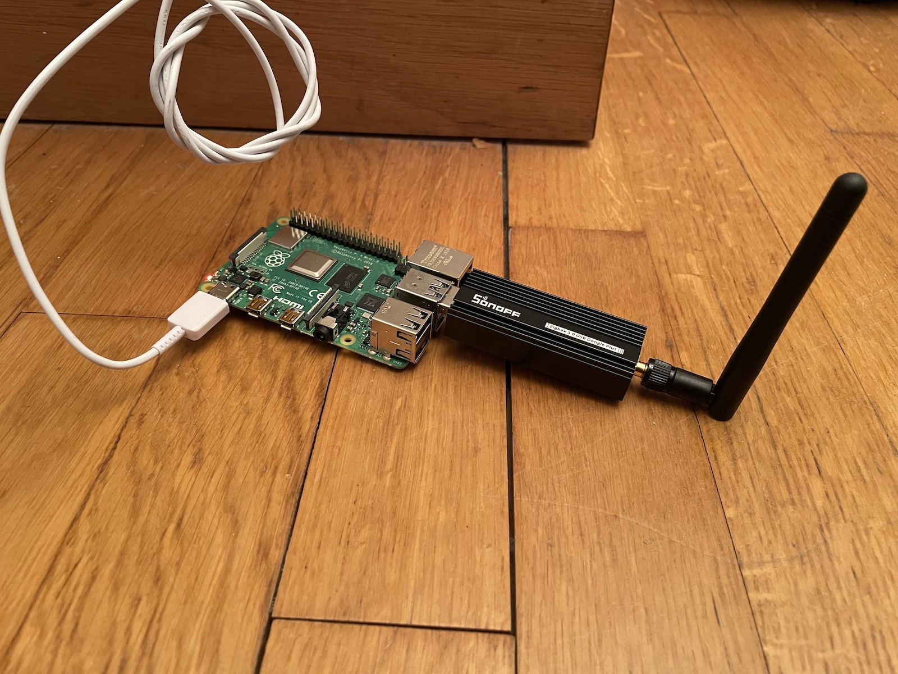
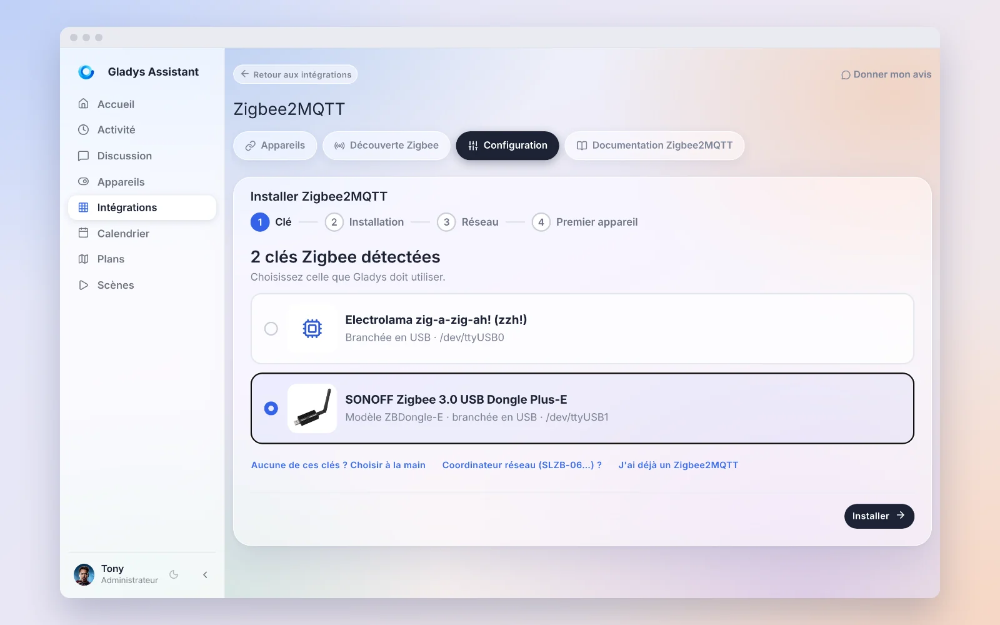
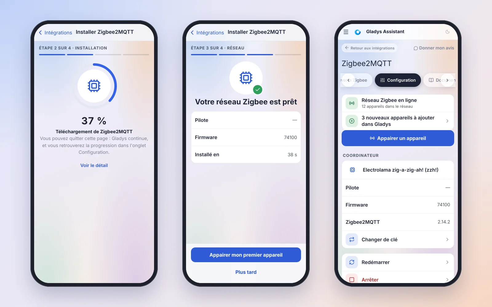
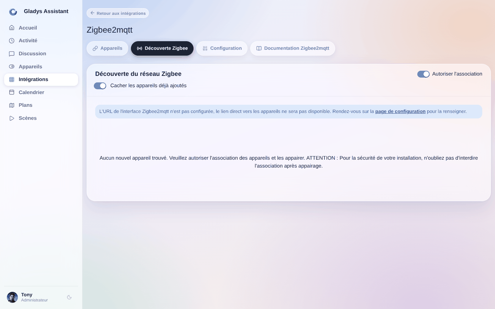
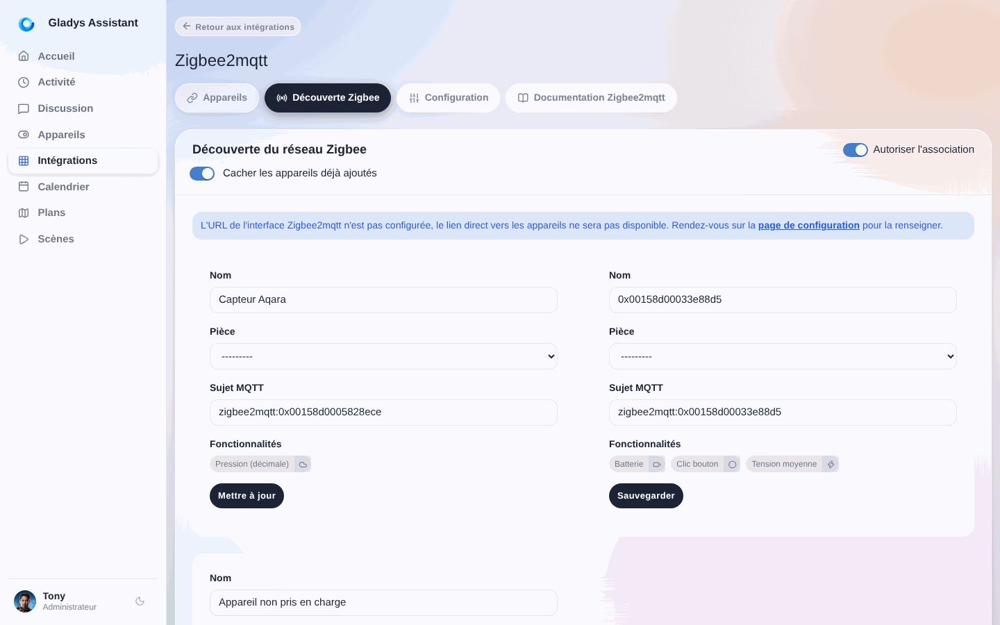
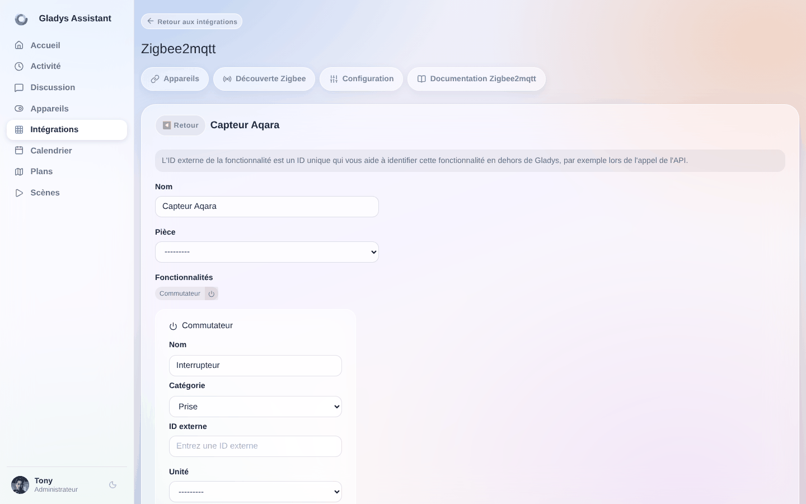

import JsonLd from '@site/src/components/seo/JsonLd';

Dans ce tutoriel, nous allons vous expliquer comment intégrer vos appareils Zigbee dans Gladys via un coordinateur Zigbee : une clé USB Zigbee, ou un coordinateur réseau.

:::tip[Vous venez de Home Assistant ?]
Gladys installe et gère Zigbee2MQTT et son broker MQTT pour vous : voir [Zigbee2MQTT sans Home Assistant](/fr/zigbee2mqtt-without-home-assistant/). Vos appareils tournent déjà sur le module Zigbee2MQTT ? [Migrez-les depuis Home Assistant](/fr/docs/installation/migrate-from-home-assistant) sans les ré-appairer. Vous hésitez encore sur la clé ? Lisez le [guide d'achat des clés Zigbee](/fr/best-zigbee-dongle/).
:::

Vous pourrez ainsi connecter tout type d'appareils Zigbee en direct, et vous affranchir des bridges Zigbee souvent fournis par les constructeurs (Bridge Philips Hue, Hub Xiaomi).

Nous utilisons pour cela l'excellent projet open-source [Zigbee2Mqtt](https://www.zigbee2mqtt.io/).

Si vous préférez en vidéo, j'ai filmé ce tutoriel sur Youtube pour vous montrer comment faire concrètement :

<div class="youtubeVideoContainerInBlog">
<iframe src="https://www.youtube.com/embed/ALW3uDB9P0s" frameborder="0" allow="accelerometer; autoplay; clipboard-write; encrypted-media; gyroscope; picture-in-picture" allowfullscreen></iframe>
</div>

## Le matériel nécessaire

Pour commencer, vous aurez besoin d'un coordinateur Zigbee : un dongle USB branché sur la machine qui fait tourner Gladys, ou un coordinateur réseau (voir [Utiliser un coordinateur réseau](#utiliser-un-coordinateur-réseau) plus bas). Si Zigbee2MQTT tourne déjà ailleurs, Gladys peut aussi [s'y connecter](#connect-to-an-existing-zigbee2mqtt).



Nous avons testé par exemple le Sonoff Zigbee 3.0 USB Dongle Plus, qui fonctionne très bien avec Gladys et Zigbee2mqtt. Dans mon cas je l'ai acheté [chez Domadoo](https://www.domadoo.fr/fr/interface-domotique/5976-sonoff-cle-usb-zigbee-30-antenne-externe-20dbm-compatible-zha-zigbee2mqtt.html?domid=17), mais il est aussi trouvable sur [Amazon](https://amzn.to/3FpIlcZ).

Le gros avantage de ce dongle est qu'il est déjà flashé, par conséquent il est prêt à l'emploi, il n'y a rien à faire.

Vous pouvez consulter la liste des adapteurs Zigbee supportés [ici](https://www.zigbee2mqtt.io/guide/adapters/#recommended).

Vous pouvez consulter la liste des appareils Zigbee compatibles [ici](https://www.zigbee2mqtt.io/supported-devices/).

:::warning
Si vous faites tourner Gladys sur un Raspberry Pi avec un disque externe, votre Raspberry Pi risque d'avoir des problèmes d'alimentation pour alimenter en même temps le disque externe et la clé USB Zigbee.

Nous recommandons d'utiliser un hub USB alimenté de manière externe.

Si Zigbee2Mqtt ne démarre pas chez vous, je vous recommande de lire la FAQ sur le site de Zigbee2mqtt : [Zigbee2MQTT fails to start](https://www.zigbee2mqtt.io/guide/installation/20_zigbee2mqtt-fails-to-start.html)
:::

## Installez Zigbee2MQTT avec l'assistant {/* #install-zigbee2mqtt-with-the-setup-wizard */}

Depuis Gladys 5.3.4, un assistant en quatre étapes vous guide pour la première installation. Gladys installe pour vous deux conteneurs, un broker MQTT et Zigbee2MQTT : rien à taper dans un terminal. Pour cela, Gladys doit tourner dans Docker avec le réseau `host`, ce qui est le cas de toute installation standard.

Branchez votre clé Zigbee sur la machine qui fait tourner Gladys (votre Raspberry Pi, votre mini-PC, votre NAS).

Dans Gladys, rendez-vous dans `Intégrations / Zigbee2Mqtt`, puis ouvrez l'onglet `Configuration`.



### Étape 1 : la clé

Gladys reconnaît les clés les plus courantes (SONOFF ZBDongle-P et ZBDongle-E, Home Assistant Connect ZBT-1 et ZBT-2, ConBee II et III, SMLIGHT SLZB-06M et SLZB-07…). Ce que l'assistant affiche dépend de ce qui est branché :

- **Clé Zigbee détectée** : Gladys affiche votre clé, avec sa photo et son nom. Vous n'avez rien à choisir.
- **2 clés Zigbee détectées** (ou plus) : choisissez celle que Gladys doit utiliser.
- **Gladys n'a pas reconnu votre clé** : choisissez son modèle dans la liste, regroupée par marque. La recherche trouve un modèle par son nom ou son code (`dongle-e`, `sonoff p`, `conbee`, `skyconnect`…). Le modèle est écrit sur la clé ou sur sa boîte : c'est lui qui détermine le pilote qu'utilise Zigbee2MQTT pour dialoguer avec elle.
- **Branchez votre clé Zigbee** : aucune clé n'est encore branchée. Gladys la détecte dès que vous la branchez, sans recharger la page.

En dessous, des liens mènent aux autres choix (sur téléphone, ils sont regroupés sous **Autre clé ou autre installation**) :

- **Pas la bonne clé ? Choisir à la main** (ou **Ma clé est branchée mais n'apparaît pas**) : choisissez le port et le modèle à la main. Les ports série de la machine elle-même et des cartes HAT/GPIO (comme la RaspBee) sont masqués : cliquez sur **Afficher les autres ports série (carte HAT/GPIO, ports de la machine)** pour les voir.
- **Coordinateur réseau (SLZB-06…) ?** : voir [Utiliser un coordinateur réseau](#utiliser-un-coordinateur-réseau).
- **J'ai déjà un Zigbee2MQTT** : voir [Se connecter à un Zigbee2MQTT existant](#connect-to-an-existing-zigbee2mqtt).

Cliquez ensuite sur **Installer**. Gladys vérifie que la clé est bien branchée avant de sauvegarder quoi que ce soit. Il commence même à télécharger Zigbee2MQTT dès qu'une clé est sélectionnée, avant que vous ne cliquiez : l'installation n'en est que plus rapide.

:::tip
Branchez la clé au bout d'une rallonge USB, loin des ports USB 3 et de la box Wi-Fi : le signal Zigbee n'en sera que meilleur.
:::

:::info[Dongle EmberZNet avec un firmware ancien]
Beaucoup de dongles basés sur [EmberZNet](https://www.zigbee2mqtt.io/guide/adapters/emberznet.html) (comme le Sonoff Zigbee 3.0 ZBDongle-E) sont encore vendus avec un firmware antérieur à la version 7.4, que le pilote `ember` de Zigbee2MQTT refuse. Depuis Gladys 5.3.3, vous n'avez rien à faire : Gladys le détecte, bascule votre dongle sur son modèle `(legacy ezsp)` et réinstalle Zigbee2MQTT avec le pilote de compatibilité `ezsp`. L'installation affiche **Firmware ancien : bascule sur ezsp…**, puis le pilote apparaît comme `ezsp (compatibilité)` une fois le réseau prêt, et sur le tableau de bord.

Le pilote `ezsp` est en fin de vie : nous vous recommandons donc quand même de [mettre à jour le firmware de votre dongle](https://www.zigbee2mqtt.io/guide/adapters/emberznet.html#firmware-flashing). Avec le bouton **Changer** du tableau de bord, choisissez ensuite le modèle sans `(legacy ezsp)` (ou le type `ember` pour un coordinateur réseau) pour revenir au pilote `ember`.
:::

### Étape 2 : l'installation

Gladys affiche la progression, phase par phase : téléchargement de Zigbee2MQTT et du broker MQTT (les deux en même temps, et seulement s'ils ne sont pas déjà sur la machine), démarrage du broker, démarrage de Zigbee2MQTT, puis connexion à la clé. Sur un Raspberry Pi 4, les images se sont téléchargées en 15 secondes environ lors de nos tests, et Zigbee2MQTT a répondu 15 secondes après son démarrage.

Vous pouvez quitter la page : l'installation continue en arrière-plan. Vous retrouverez sa progression dans l'onglet `Configuration`, et dans **Paramètres > Tâches**.

Avant chaque téléchargement, Gladys vérifie l'espace disque libre, en gardant 500 Mo pour le reste de Gladys : s'il n'y en a pas assez, il vous le dit au lieu de remplir le disque.

Si l'installation échoue, Gladys explique pourquoi par un titre court et un message, avec les **Détails techniques** en dessous. Cliquez sur **Réessayer**, ou sur **Changer de clé ou de modèle**. La [section de dépannage](#résoudre-les-erreurs-zigbee2mqtt-les-plus-fréquentes) détaille chaque message.

Si vous fermez la page ou redémarrez Gladys avant la fin d'une première installation, l'assistant se rouvre là où vous l'aviez laissé, tant que Zigbee2MQTT n'a pas répondu une première fois.

### Étape 3 : le réseau est prêt

**Votre réseau Zigbee est prêt** : Gladys affiche le pilote, le firmware du coordinateur et la durée de l'installation. Cliquez sur **Appairer mon premier appareil**, ou sur **Plus tard**.

### Étape 4 : le premier appareil

Cliquez sur **Autoriser l'association** : Gladys autorise les nouveaux appareils à rejoindre le réseau pendant 4 minutes. Approchez l'appareil à moins de 2 mètres de la clé et mettez-le en mode appairage : souvent un appui long (5 s) sur son bouton ; pour une ampoule, allumez-la et éteignez-la 5 à 6 fois de suite. Cliquez ensuite sur **Aller à Découverte** pour l'ajouter à Gladys (voir [Ajoutez des appareils](#add-devices)).

:::note[Gladys ne peut pas installer Zigbee2MQTT sur cette machine ?]
Si Gladys ne tourne pas dans Docker, ou si son conteneur n'a pas été démarré avec le réseau `host`, l'assistant vous le dit et renvoie vers la [commande d'installation de Gladys](/fr/docs/installation/docker/). Vous pouvez quand même connecter Gladys à un [Zigbee2MQTT qui tourne ailleurs](#connect-to-an-existing-zigbee2mqtt).
:::

## Utiliser un coordinateur réseau

Depuis Gladys 5, le coordinateur n'a pas besoin d'être branché sur la machine qui fait tourner Gladys. Un coordinateur réseau (SMLIGHT SLZB-06/SLZB-07, ZigStar…) se connecte en Ethernet ou en Wi-Fi : vous pouvez le placer au centre de la maison, loin de votre serveur et des interférences. Gladys installe et gère toujours Zigbee2MQTT pour vous.

À l'étape 1 de l'assistant, cliquez sur **Coordinateur réseau (SLZB-06…) ?**, puis :

1. Entrez l'**Adresse du coordinateur**, indiquée dans son interface web, avec son port TCP : par exemple `tcp://192.168.1.20:6638` (le préfixe `tcp://` est facultatif). Donnez au coordinateur une adresse IP fixe sur votre box.
2. Choisissez le **Type de coordinateur** : **Puce Silicon Labs** (SLZB-06M, SLZB-07…, pilote `ember`), **Puce Texas Instruments** (SLZB-06, SLZB-06P7…, pilote `zstack`) ou **dresden elektronik** (pilote `deconz`). Dans le doute, la documentation de votre coordinateur l'indique.
3. Cliquez sur **Installer**, puis suivez les étapes 2 à 4 comme avec une clé USB.

## Se connecter à un Zigbee2MQTT existant {/* #connect-to-an-existing-zigbee2mqtt */}

Zigbee2MQTT tourne déjà ailleurs (Home Assistant, une autre machine…) ? Gladys peut se connecter à son broker MQTT, sans rien installer. À l'étape 1 de l'assistant, cliquez sur **J'ai déjà un Zigbee2MQTT**, puis entrez :

- l'**Adresse du broker MQTT**, par exemple `mqtt://192.168.1.30:1883` ;
- l'**Utilisateur** et le **Mot de passe** du broker ;
- l'**Adresse de l'interface Zigbee2MQTT** (facultative), pour les liens vers son interface web.

Cliquez ensuite sur **Se connecter**. Le réseau est prêt une fois que Zigbee2MQTT répond sur le broker, pas dès que Gladys est connecté au broker. S'il ne répond pas, vérifiez que Zigbee2MQTT tourne et que son topic de base (`mqtt.base_topic`) est `zigbee2mqtt`. Gladys a besoin de Zigbee2MQTT 1.21 ou plus récent.

Sur le tableau de bord, **Déconnecter** ne fait que déconnecter Gladys : votre Zigbee2MQTT continue de tourner. Réinitialiser l'intégration ne fait qu'oublier la connexion : votre Zigbee2MQTT, sa configuration et ses appareils ne sont pas touchés.

Votre Zigbee2MQTT tourne sur Home Assistant, et vous voulez que Gladys le gère à la place ? Voir [Migrer depuis Home Assistant](/fr/docs/installation/migrate-from-home-assistant#option-b-move-zigbee2mqtt-into-gladys) : vous déplacez son dossier et votre clé, sans ré-appairer vos appareils.

## Le tableau de bord Zigbee2MQTT {/* #the-zigbee2mqtt-dashboard */}

Une fois Zigbee2MQTT installé, l'onglet `Configuration` affiche un tableau de bord. Une installation configurée avant Gladys 5.3.4 y arrive directement : sa configuration, ses conteneurs et son réseau Zigbee sont conservés.



### L'état de Zigbee2MQTT

En haut, Gladys affiche où en est Zigbee2MQTT, et l'action à faire :

- **Réseau Zigbee en ligne**, avec le nombre d'appareils du réseau. Quand des appareils ont rejoint le réseau mais ne sont pas encore dans Gladys, un lien mène à l'onglet `Découverte Zigbee` (**1 nouvel appareil à ajouter dans Gladys**). **Appairer un appareil** autorise les nouveaux appareils à rejoindre le réseau pendant 4 minutes.
- **Zigbee2MQTT démarre…** : Gladys attend sa réponse. Il n'affiche Zigbee2MQTT en ligne qu'une fois qu'il a réellement démarré et répondu à Gladys.
- Une installation, une mise à jour ou un changement de coordinateur, avec sa progression.
- **Zigbee2MQTT ne démarre pas** : Gladys lit les journaux de Zigbee2MQTT et explique pourquoi, avec quoi faire. Cliquez sur **Redémarrer** une fois le problème corrigé, ou sur **Changer de clé ou de modèle**. Reportez-vous à [Résoudre les erreurs Zigbee2MQTT les plus fréquentes](#résoudre-les-erreurs-zigbee2mqtt-les-plus-fréquentes).
- **Clé Zigbee débranchée** : voir [Clé débranchée ou branchée sur un autre port](#dongle-unplugged-or-moved-to-another-port).
- **Zigbee2MQTT ne répond pas** : Gladys n'obtient pas de réponse ; il plante peut-être au démarrage. Reportez-vous à la même section de dépannage.
- **Gladys n'est pas connecté au broker MQTT** : Gladys ne reçoit plus les messages de Zigbee2MQTT.
- **Zigbee2MQTT est arrêté** : depuis quand, avec un bouton **Démarrer**.
- **Le service Zigbee2MQTT n'est pas démarré** : il a été arrêté dans **Paramètres > Services**. Démarrez-le là.

Tant que Zigbee2MQTT ne répond pas, les onglets `Appareils` et `Découverte Zigbee` affichent un bandeau qui le signale, et l'association d'appareils est désactivée. Le bandeau disparaît de lui-même dès que Zigbee2MQTT est prêt.

### Le coordinateur et les actions

En dessous, le tableau de bord affiche votre coordinateur : sa photo, son nom, son pilote, son firmware et la version de Zigbee2MQTT. Son bouton **Changer** ouvre l'étape 1 de l'assistant pour choisir une autre clé, la clé actuelle étant signalée. Si la nouvelle clé utilise un autre pilote (une puce Texas Instruments au lieu d'une puce Silicon Labs, par exemple), Gladys vous prévient : Zigbee2MQTT ne peut pas y reprendre votre réseau, et vous devrez appairer de nouveau vos appareils.

Les boutons :

- **Redémarrer** redémarre Zigbee2MQTT : vos appareils ne répondent pas pendant les quelques secondes que cela prend.
- **Arrêter** arrête Zigbee2MQTT, et Gladys s'en souvient : ni un redémarrage de Gladys, ni un redémarrage de la machine ne le relancent tant que vous n'avez pas cliqué sur **Démarrer**. Pratique pour flasher la clé, par exemple.
- **Interface Zigbee2MQTT** ouvre l'interface web de Zigbee2MQTT. Depuis Gladys 5.3.4, elle est activée sur toutes les installations : une installation existante l'obtient au prochain démarrage de Gladys, qui redémarre alors Zigbee2MQTT une fois.

### Réglages avancés

Les **Réglages avancés** regroupent :

- le **Port** de l'interface Zigbee2MQTT (le changer redémarre Zigbee2MQTT ; ses données sont conservées) ;
- la connexion au broker MQTT, pour un [Zigbee2MQTT existant](#connect-to-an-existing-zigbee2mqtt) ;
- l'état de chaque **composant** : Gladys ↔ broker MQTT, broker MQTT et Zigbee2MQTT ;
- la **Connexion pour outils externes** : des identifiants en lecture seule pour connecter des outils comme Node-RED au broker MQTT géré par Gladys, avec un bouton pour les copier. Si l'outil tourne sur une autre machine, remplacez `localhost` dans l'URL par l'adresse IP de votre machine Gladys ;
- **Réinitialiser l'intégration** : supprime les conteneurs, la configuration et le réseau Zigbee. Vous devrez appairer de nouveau tous vos appareils : gardez-le pour repartir de zéro.

Si vous quittez cet écran avec des modifications non sauvegardées, Gladys vous demande d'abord confirmation.

### Les mises à jour de Zigbee2MQTT

Quand Gladys met à jour Zigbee2MQTT, il télécharge d'abord la nouvelle image pendant que votre réseau Zigbee continue de fonctionner, puis remplace le conteneur. Sans Internet, ou sans assez d'espace disque, la version actuelle continue de tourner : le tableau de bord indique qu'une mise à jour de Zigbee2MQTT attend, et Gladys réessaie à son prochain démarrage. Les anciennes images qu'aucun conteneur n'utilise sont supprimées, pour ne pas remplir le disque.

## Clé débranchée ou branchée sur un autre port {/* #dongle-unplugged-or-moved-to-another-port */}

Depuis Gladys 5.3.4, Gladys enregistre votre clé par son chemin stable (`/dev/serial/by-id/…`), et non par le nom de son port (`/dev/ttyUSB0`), qui peut changer au prochain redémarrage ou quand un autre appareil USB est branché. Branchée sur un autre port USB, la clé est retrouvée. Au démarrage de Gladys, une installation existante dont Gladys reconnaît la clé passe d'elle-même au chemin stable, sans rien appairer de nouveau.

Si vous débranchez la clé, le tableau de bord affiche **Clé Zigbee débranchée**. Rebranchez-la, sur n'importe quel port : Zigbee2MQTT redémarre tout seul en une dizaine de secondes, sans redémarrer Gladys. Un Zigbee2MQTT que vous avez arrêté vous-même (depuis le tableau de bord, ou avec Docker) reste arrêté : cliquez sur **Démarrer** sur le tableau de bord.

## Conservez votre réseau Zigbee {/* #keep-your-zigbee-network */}

Votre réseau Zigbee est défini par sa clé réseau, son PAN ID et son PAN ID étendu, enregistrés sur le coordinateur et dans la configuration de Zigbee2MQTT.

- Depuis Gladys 5.3.4, une nouvelle installation laisse Zigbee2MQTT générer ces réglages, comme un Zigbee2MQTT installé seul.
- Gladys sauvegarde la configuration de Zigbee2MQTT dans sa base de données chaque nuit. Si le fichier de configuration (`configuration.yaml`) est perdu, vide ou corrompu (par une coupure de courant, par exemple), Gladys le restaure depuis cette sauvegarde à son prochain démarrage : le réseau garde ses réglages et ses appareils. Un fichier qui n'est pas du YAML valide est mis de côté sous le nom `configuration.yaml.invalid-<date>`. Sans sauvegarde, Gladys affiche l'erreur et laisse le fichier en place pour que vous le corrigiez ; redémarrez ensuite Gladys.
- Pour garder votre réseau quand vous déplacez votre coordinateur vers une nouvelle installation de Gladys, restaurez votre sauvegarde Gladys Plus **avant** de configurer Zigbee2MQTT : voir le [guide pour changer de machine](/fr/docs/installation/migrate).
- **Réinitialiser l'intégration**, ou une nouvelle clé qui utilise un autre pilote, forme un nouveau réseau : vos appareils doivent être appairés de nouveau.

## Autorisez l'association d'appareils

Pour permettre aux appareils de rejoindre votre réseau Zigbee, ouvrez l'onglet `Découverte Zigbee`, puis cliquez sur le bouton **Autoriser l'association**. Gladys n'affiche l'association comme ouverte qu'une fois que Zigbee2MQTT l'a confirmée.



Depuis Gladys 5.3.4, l'association se referme d'elle-même au bout de 4 minutes environ : vous n'avez plus besoin de revenir l'interdire. Cliquez sur **Arrêter l'association** pour la fermer plus tôt.

## Ajoutez des appareils {/* #add-devices */}

Pour que votre périphérique rejoigne le réseau, reportez-vous à la notice de celui-ci. Dans la majorité des cas, un appui long sur le bouton physique permet cette opération.

Les appareils déjà associés à votre réseau Zigbee apparaîtront automatiquement avec la liste des fonctionnalités détectées. Vous pouvez les renommer, les associer à une pièce grâce à la liste déroulante, puis cliquer sur **Ajouter à Gladys**. **Cacher les appareils déjà ajoutés** n'affiche que les nouveaux.



Depuis Gladys 5.3.4, un appareil affiche ses valeurs dès qu'il est ajouté : Gladys garde les valeurs envoyées par Zigbee2MQTT depuis que Gladys s'y est connecté, et demande leurs valeurs actuelles aux appareils sur secteur (prises, ampoules…). Un capteur sur pile qui n'a rien envoyé depuis affiche ses valeurs à son prochain envoi : à l'ouverture pour un détecteur d'ouverture, au bout d'une heure environ pour un capteur de température.

## Modifiez les appareils

Si nécessaire, vous pouvez vous rendre dans l'onglet `Appareils` pour modifier/compléter la configuration de vos appareils.

Cliquez sur le bouton **Editer** d'un appareil. Vous pourrez alors éditer son nom, la pièce à laquelle il appartient et le nom de chaque fonctionnalité. Sur téléphone, chaque appareil est une ligne qui ouvre un panneau avec les mêmes réglages. La suppression d'un appareil demande d'abord une confirmation.



## Utilisation

Vous pouvez maintenant utiliser ces appareils Zigbee depuis le [Tableau de bord](../dashboard/devices.md) ou depuis les [Scènes](../scenes/intro.md) de manière automatique. Selon les fonctionnalités de chaque appareil, vous aurez accès à des mesures, des états ou des actions.

## Résoudre les erreurs Zigbee2MQTT les plus fréquentes

La grande majorité des problèmes Zigbee2MQTT vient de trois causes : le mauvais port USB, le mauvais type de coordinateur, ou des interférences en 2,4 GHz. Voici les erreurs que vous rencontrerez le plus souvent, et ce qu'elles signifient vraiment. Depuis Gladys 5.3.3, Gladys vous indique aussi la cause et quoi faire. Depuis Gladys 5.3.4, il affiche un titre court, un message et les détails techniques, à l'étape 2 de l'assistant ou sur le tableau de bord de l'onglet `Configuration` : les titres en gras ci-dessous sont ceux qu'il affiche. Pour lire les journaux complets de Zigbee2MQTT, lancez `sudo docker logs gladys-z2m-zigbee2mqtt` sur la machine qui fait tourner Gladys.

### Error while starting zigbee-herdsman

Zigbee2MQTT n'a pas réussi à dialoguer avec votre clé. Quand le pilote abandonne, Gladys affiche **Le coordinateur Zigbee ne répond pas**. Dans les journaux, le pilote écrit `Failed to connect to the adapter` (Texas Instruments, `zstack`), `Failed to start EZSP layer with status=HOST_FATAL_ERROR` (Silicon Labs, `ember`), `Failure to connect` (`ezsp`) ou `failed to start adapter connection to firmware` (ConBee, `deconz`). Vérifiez, dans cet ordre :

1. La **clé** affichée sur le tableau de bord est bien celle qui est branchée. Depuis Gladys 5.3.4, une clé changée de port est retrouvée ; si vous utilisez une autre clé, choisissez-la avec le bouton **Changer**.
2. Le **modèle de clé** correspond bien à votre matériel : c'est lui qui détermine le pilote utilisé par Zigbee2MQTT. Une clé Silicon Labs configurée comme une Texas Instruments (ou l'inverse) échoue ici. Pour le corriger, cliquez sur **Changer de clé ou de modèle**.
3. Aucun autre logiciel n'utilise le coordinateur (Home Assistant, un autre Zigbee2MQTT…) : un seul peut prendre la main dessus.
4. La clé est suffisamment alimentée. Débranchez-la, rebranchez-la via un **hub USB alimenté** ou une courte rallonge USB, et redémarrez l'intégration. Avec un coordinateur réseau, redémarrez-le.

### Failed to connect to the adapter (SRSP - SYS - ping after 6000ms)

Cette erreur est propre aux coordinateurs Texas Instruments (CC2652 / ZBDongle-P) : la clé est bien là, mais elle ne répond pas. Gladys l'affiche sous la forme **Le coordinateur Zigbee ne répond pas**. C'est presque toujours un mauvais port, un mauvais type de coordinateur dans les paramètres, ou une clé qu'il faut débrancher et rebrancher physiquement. Si cela persiste, reflasher le firmware du coordinateur règle les derniers cas.

### Zigbee2MQTT n'arrive pas à joindre votre coordinateur réseau (ECONNREFUSED, ETIMEDOUT, ENOTFOUND)

Avec un [coordinateur réseau](#utiliser-un-coordinateur-réseau), Gladys affiche **Coordinateur réseau injoignable** quand le pilote n'arrive pas à s'y connecter : les journaux indiquent `connect ECONNREFUSED`, `connect ETIMEDOUT`, `connect EHOSTUNREACH` ou `getaddrinfo ENOTFOUND`. Vérifiez que :

1. Le coordinateur est allumé et connecté à votre réseau : son interface web s'ouvre dans votre navigateur.
2. Son adresse et son port TCP sont les bons, par exemple `tcp://192.168.1.20:6638`. Pour les corriger, cliquez sur **Changer** sur le tableau de bord.
3. Son adresse IP n'a pas changé : donnez-lui une adresse IP fixe sur votre box.

### Refusing to start because configuration is not valid

Zigbee2MQTT refuse son fichier de configuration (`configuration.yaml`) et attend sans s'arrêter. Gladys affiche **Configuration de Zigbee2MQTT refusée**, suivi des réglages refusés. Gladys écrit ce fichier pour vous : cela arrive surtout après une modification à la main. Corrigez les réglages indiqués dans `configuration.yaml`, dans le dossier de données de Zigbee2MQTT. Sur une installation standard, c'est `/var/lib/gladysassistant/zigbee2mqtt/z2m`. Si vous avez monté un autre dossier de l'hôte au lancement de Gladys, cette commande affiche le bon :

```bash
sudo docker inspect -f '{{range .Mounts}}{{if eq .Destination "/app/data"}}{{.Source}}{{end}}{{end}}' gladys-z2m-zigbee2mqtt
```

Cliquez ensuite sur **Redémarrer** sur le tableau de bord. Si vous n'avez jamais modifié ce fichier, signalez-le sur le [forum de Gladys](https://community.gladysassistant.com/) avec les réglages refusés.

### Adapter EZSP protocol version (8) is not supported by host

Votre clé EmberZNet (Silicon Labs), typiquement une **Sonoff ZBDongle-E**, utilise un firmware antérieur à la version 7.4, que le pilote `ember` de Zigbee2MQTT refuse. Depuis Gladys 5.3.3, vous n'avez en général rien à faire : Gladys détecte cette erreur, bascule votre clé sur son modèle `(legacy ezsp)` (ou un coordinateur réseau sur le type d'adaptateur `ezsp`), et réinstalle Zigbee2MQTT. Le pilote apparaît alors comme `ezsp (compatibilité)` une fois le réseau prêt, et sur le tableau de bord.

Gladys affiche encore une erreur (**Firmware de la clé trop ancien**) dans deux cas :

- Votre modèle n'a pas de variante `(legacy ezsp)` : [mettez à jour le firmware de la clé](https://www.zigbee2mqtt.io/guide/adapters/emberznet.html#firmware-flashing).
- Le firmware est **plus récent** que ce que Zigbee2MQTT prend en charge : le pilote `ezsp` le refuserait aussi, Gladys affiche donc l'erreur brute. Flashez une version de firmware prise en charge par Zigbee2MQTT.

Le pilote `ezsp` est en fin de vie. Pour revenir à `ember`, mettez à jour le firmware de la clé, puis, avec le bouton **Changer** du tableau de bord, choisissez le modèle sans `(legacy ezsp)` (ou le type `ember` pour un coordinateur réseau).

### Clé Zigbee introuvable

Gladys affiche **Clé Zigbee introuvable** quand la clé choisie n'est pas branchée : il refuse de l'enregistrer, et une installation s'arrête dessus. Branchez la clé, puis cliquez sur **Réessayer**, ou choisissez-la de nouveau. Si elle n'apparaît toujours pas, vérifiez que la machine la voit avec `ls /dev/serial/by-id/`. Si Gladys tourne dans une machine virtuelle, la clé doit lui être transmise (voir le [guide Proxmox](/fr/docs/installation/proxmox)).

### Zigbee2MQTT ne répond pas

Zigbee2MQTT a démarré, mais n'a pas répondu à Gladys dans les 2 minutes, sans dire pourquoi dans ses journaux. Vérifiez que le modèle sélectionné est bien celui de votre coordinateur, débranchez et rebranchez votre clé (ou redémarrez votre coordinateur réseau), puis cliquez sur **Réessayer**. Si cela recommence, lisez les journaux avec `sudo docker logs gladys-z2m-zigbee2mqtt`.

### Espace disque insuffisant

Gladys vérifie l'espace disque libre avant de télécharger Zigbee2MQTT, et garde 500 Mo pour le reste de Gladys. Il supprime d'abord les anciennes images de Zigbee2MQTT qu'aucun conteneur n'utilise. Si cela ne suffit pas, il affiche **Espace disque insuffisant** : libérez de la place (voir [Le disque de ma machine se remplit](/fr/docs/installation/troubleshooting#le-disque-de-ma-machine-se-remplit)), puis cliquez sur **Réessayer**.

### MQTT failed to connect, exiting (connection refused: not authorized)

Zigbee2MQTT a démarré, mais le broker MQTT a refusé ses identifiants. Gladys affiche **Connexion MQTT refusée** ou **Identifiants MQTT refusés**. Dans Gladys, les deux conteneurs sont gérés pour vous : vous n'avez donc quasiment jamais besoin de toucher à un fichier de configuration. Si vous utilisez aussi l'intégration MQTT avec votre propre broker, vérifiez que vous n'y avez pas branché Zigbee2MQTT avec un autre identifiant ou mot de passe. Sinon, supprimez le conteneur du broker avec `sudo docker rm -f gladys-z2m-mqtt`, puis cliquez sur **Redémarrer** sur le tableau de bord : Gladys recrée le broker, avec les identifiants qu'il a enregistrés.

### MAC channel access failure

Là, le problème est radio, pas logiciel : le coordinateur n'arrive pas à obtenir un créneau libre sur les ondes. Les causes et correctifs habituels :

- La clé est branchée directement sur la machine, à côté de ports USB 3.0, d'un SSD ou du Raspberry Pi lui-même. Éloignez-la avec une **rallonge USB d'environ un mètre** : c'est de loin le correctif le plus efficace.
- Votre Wi-Fi et votre réseau Zigbee se chevauchent sur la bande 2,4 GHz. Déplacez le canal Wi-Fi, ou le canal Zigbee, pour qu'ils ne se superposent pas.
- L'appareil est trop loin du coordinateur. Ajoutez un appareil Zigbee sur secteur (une prise, une ampoule) entre les deux : ils font office de routeurs et étendent le maillage.

Si votre problème n'est pas listé ici, la [documentation de Zigbee2MQTT](https://www.zigbee2mqtt.io/guide/installation/20_zigbee2mqtt-fails-to-start.html) détaille les échecs au démarrage, et le [forum Gladys](https://community.gladysassistant.com/) est un bon endroit pour chercher votre message exact.

## Questions fréquentes

### Comment ajouter un appareil dans Zigbee2MQTT avec Gladys ?

Une fois Zigbee2MQTT installé, ouvrez l'onglet `Découverte Zigbee` et cliquez sur `Autoriser l'association`, puis mettez votre appareil en mode appairage (en général un appui long sur son bouton). L'appareil apparaît automatiquement dans la liste avec ses fonctionnalités détectées : vous pouvez le renommer, l'associer à une pièce et l'ajouter à Gladys. Depuis Gladys 5.3.4, l'association se referme d'elle-même au bout de 4 minutes environ, et l'appareil affiche ses valeurs dès qu'il est ajouté.

### Quelle clé USB Zigbee utiliser avec un Raspberry Pi ou un NAS ?

N'importe quel adaptateur de la [liste des coordinateurs pris en charge par Zigbee2MQTT](https://www.zigbee2mqtt.io/guide/adapters/) fonctionne. Une clé abordable que nous avons testée avec Gladys est la Sonoff Zigbee 3.0 USB Dongle Plus. Notre [guide d'achat des clés Zigbee](/fr/best-zigbee-dongle/) compare les modèles les plus courants.

### Zigbee2MQTT avec Gladys fonctionne-t-il sans le cloud ?

Oui. Zigbee2MQTT tourne en local sur votre propre matériel et dialogue avec vos appareils via la clé USB : votre réseau Zigbee continue donc de fonctionner sans connexion internet et sans compte cloud de fabricant.

### Pourquoi Zigbee2MQTT ne démarre-t-il pas ?

Presque toujours parce que Zigbee2MQTT n'arrive pas à joindre le coordinateur : mauvais port USB sélectionné, modèle de clé qui ne correspond pas au matériel, clé mal alimentée, ou firmware trop ancien (l'erreur `EZSP protocol version is not supported` sur les Sonoff ZBDongle-E, que Gladys règle seul depuis la version 5.3.3, en basculant sur le pilote `ezsp`). Depuis cette version, Gladys vous indique aussi la cause et quoi faire, sur le tableau de bord de l'onglet `Configuration`. Vérifiez d'abord la clé et son modèle, puis débranchez et rebranchez la clé via un hub alimenté ou une rallonge USB.

### Que se passe-t-il si je débranche ma clé Zigbee ?

Zigbee2MQTT s'arrête, et le tableau de bord de l'intégration indique que la clé est débranchée. Depuis Gladys 5.3.4, il suffit de la rebrancher, sur n'importe quel port USB : Zigbee2MQTT redémarre tout seul en une dizaine de secondes, sans redémarrer Gladys. Si vous avez arrêté Zigbee2MQTT vous-même, il reste arrêté : cliquez sur **Démarrer** sur le tableau de bord.

### Pourquoi mes appareils Zigbee se déconnectent-ils ?

Les interférences sur la bande 2,4 GHz sont la cause principale, et elles apparaissent sous la forme d'erreurs `MAC channel access failure` dans les journaux. Éloignez la clé de la machine avec une rallonge USB d'un mètre, tenez-la à l'écart des ports USB 3.0 et des SSD, vérifiez que vos canaux Wi-Fi et Zigbee ne se chevauchent pas, et ajoutez des appareils Zigbee sur secteur, qui font office de routeurs et étendent le maillage.

<JsonLd
  data={{
    "@context": "https://schema.org",
    "@type": "FAQPage",
    mainEntity: [
      {
        "@type": "Question",
        name: "Comment ajouter un appareil dans Zigbee2MQTT avec Gladys ?",
        acceptedAnswer: {
          "@type": "Answer",
          text: "Une fois Zigbee2MQTT installé, ouvrez l'onglet Découverte Zigbee et cliquez sur Autoriser l'association, puis mettez votre appareil en mode appairage (en général un appui long sur son bouton). L'appareil apparaît automatiquement dans la liste avec ses fonctionnalités détectées : vous pouvez le renommer, l'associer à une pièce et l'ajouter à Gladys. Depuis Gladys 5.3.4, l'association se referme d'elle-même au bout de 4 minutes environ, et l'appareil affiche ses valeurs dès qu'il est ajouté.",
        },
      },
      {
        "@type": "Question",
        name: "Quelle clé USB Zigbee utiliser avec un Raspberry Pi ou un NAS ?",
        acceptedAnswer: {
          "@type": "Answer",
          text: "N'importe quel adaptateur de la liste des coordinateurs pris en charge par Zigbee2MQTT fonctionne. Une clé abordable que nous avons testée avec Gladys est la Sonoff Zigbee 3.0 USB Dongle Plus. Branchez-la sur la machine qui fait tourner Gladys, et si vous démarrez sur un disque USB, utilisez un hub alimenté pour que la clé reçoive assez de courant.",
        },
      },
      {
        "@type": "Question",
        name: "Zigbee2MQTT avec Gladys fonctionne-t-il sans le cloud ?",
        acceptedAnswer: {
          "@type": "Answer",
          text: "Oui. Zigbee2MQTT tourne en local sur votre propre matériel et dialogue avec vos appareils via la clé USB : votre réseau Zigbee continue donc de fonctionner sans connexion internet et sans compte cloud de fabricant.",
        },
      },
      {
        "@type": "Question",
        name: "Pourquoi Zigbee2MQTT ne démarre-t-il pas ?",
        acceptedAnswer: {
          "@type": "Answer",
          text: "Presque toujours parce que Zigbee2MQTT n'arrive pas à joindre le coordinateur : mauvais port USB sélectionné, modèle de clé qui ne correspond pas au matériel, clé mal alimentée, ou firmware trop ancien (l'erreur EZSP protocol version is not supported sur les Sonoff ZBDongle-E, que Gladys règle seul depuis la version 5.3.3, en basculant sur le pilote ezsp). Depuis cette version, Gladys vous indique aussi la cause et quoi faire, sur le tableau de bord de l'onglet Configuration. Vérifiez d'abord la clé et son modèle, puis débranchez et rebranchez la clé via un hub alimenté ou une rallonge USB.",
        },
      },
      {
        "@type": "Question",
        name: "Que se passe-t-il si je débranche ma clé Zigbee ?",
        acceptedAnswer: {
          "@type": "Answer",
          text: "Zigbee2MQTT s'arrête, et le tableau de bord de l'intégration indique que la clé est débranchée. Depuis Gladys 5.3.4, il suffit de la rebrancher, sur n'importe quel port USB : Zigbee2MQTT redémarre tout seul en une dizaine de secondes, sans redémarrer Gladys. Si vous avez arrêté Zigbee2MQTT vous-même, il reste arrêté : cliquez sur Démarrer sur le tableau de bord.",
        },
      },
      {
        "@type": "Question",
        name: "Pourquoi mes appareils Zigbee se déconnectent-ils ?",
        acceptedAnswer: {
          "@type": "Answer",
          text: "Les interférences sur la bande 2,4 GHz sont la cause principale, et elles apparaissent sous la forme d'erreurs MAC channel access failure dans les journaux. Éloignez la clé de la machine avec une rallonge USB d'un mètre, tenez-la à l'écart des ports USB 3.0 et des SSD, vérifiez que vos canaux Wi-Fi et Zigbee ne se chevauchent pas, et ajoutez des appareils Zigbee sur secteur, qui font office de routeurs et étendent le maillage.",
        },
      },
    ],
  }}
/>
